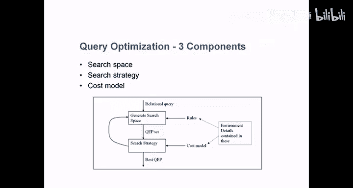
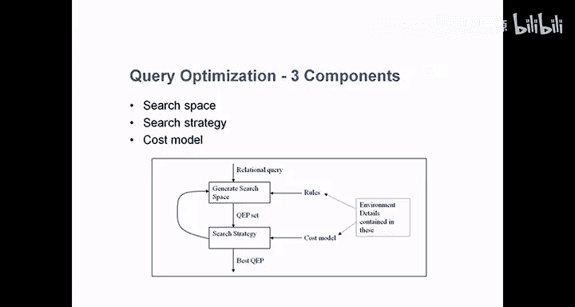
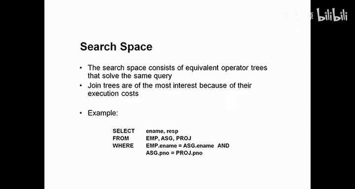
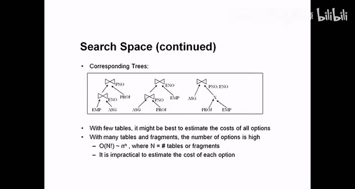
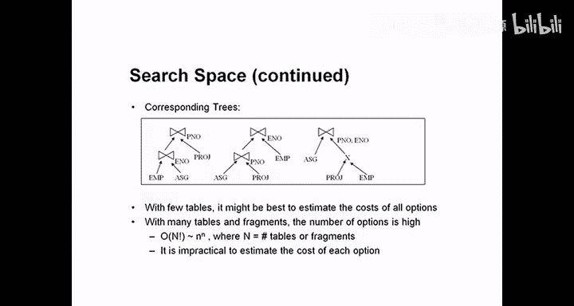
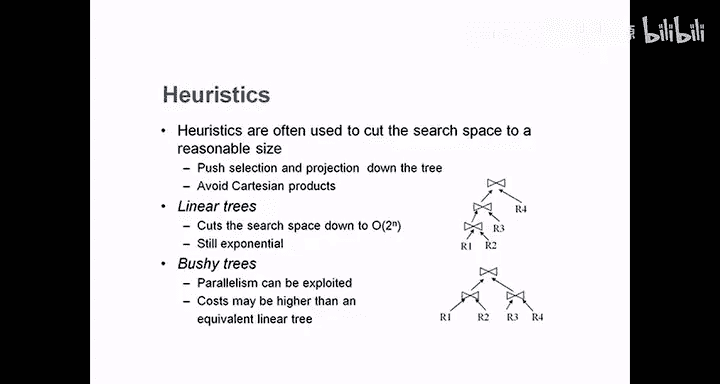

# 课程24：大规模数据库系统 - 查询优化步骤 🧩


在本节课中，我们将学习查询优化的核心步骤。我们将了解数据库系统如何从一个SQL查询出发，通过一系列系统化的过程，最终找到最高效的执行计划。

---

## 概述

查询优化是数据库管理系统的核心组件，其目标是为给定的SQL查询找到成本最低的执行方案。这个过程主要包含三个关键步骤：**生成搜索空间**、**应用成本模型**和**执行搜索策略**。接下来，我们将逐一详细探讨这些步骤。

---

## 查询优化的三个核心过程

给定一个关系型查询，我们通过以下三个过程来寻找最优的查询执行计划（Query Execution Plan, QEP）。

1.  **生成搜索空间**：此过程旨在找出所有可能用于执行该查询的潜在计划。正如我们在上一模块所见，我们可以为同一个查询创建多种语义等价但执行成本不同的关系代数树（即操作符树）。生成搜索空间就是系统地产生这些不同的计划。在实际中，由于计划数量可能极其庞大，我们通常应用一些规则来生成一部分有潜力的初始计划，从而得到一个候选的QEP集合。

2.  **应用成本模型**：接下来，我们对上一步得到的QEP集合中的每一个计划应用成本模型进行估算。成本模型会评估每个计划的执行代价（如CPU、I/O、网络通信开销）。估算结果将揭示哪些计划成本高昂，哪些计划成本相对合理。

3.  **执行搜索策略**：基于成本估算的结果，我们会**剪枝**掉那些成本高昂、没有潜力的计划。而那些表现出合理成本的计划，则会被送回“生成搜索空间”过程进行进一步的精炼。在这个反馈循环中，系统会对这些有潜力的计划应用更多优化规则，从而衍生出新的、可能更优的QEP集合。然后，再次应用成本模型和剪枝策略。如此循环迭代，最终基于成本估算选出最佳的查询执行计划。





---

## 深入搜索空间生成

上一节我们介绍了查询优化的整体流程，本节中我们来看看如何具体生成搜索空间。上一模块我们讨论了如何将关系查询转换为关系代数表达式，进而生成操作符树。对于一个查询，实际上可以生成许多不同的操作符树。

在本模块，我们将重点关注操作符树中的**连接（Join）**操作，因为连接通常是查询中最耗时、最昂贵的部分。在集中式数据库中，连接操作代价很高；在分布式数据库中，由于涉及不同处理器间的数据传输，其代价更为显著。

以下是一个示例查询，它从三个表中选择员工姓名和职责：

```sql
SELECT Employee.Name, Assignment.Responsibility
FROM Employee, Assignment, Project
WHERE Employee.EmpID = Assignment.EmpID
  AND Assignment.ProjID = Project.ProjID;
```



对于这个三表连接查询，我们可以构想出不同的连接计划。以下是三种可能的连接树：

1.  首先连接 `Employee` 和 `Assignment` 表（基于 `EmpID`），然后将结果与 `Project` 表连接（基于 `ProjID`）。
2.  首先连接 `Assignment` 和 `Project` 表（基于 `ProjID`），然后将结果与 `Employee` 表连接（基于 `EmpID`）。
3.  先计算 `Employee` 和 `Project` 表的笛卡尔积，然后将结果与 `Assignment` 表连接（同时基于 `EmpID` 和 `ProjID`）。

当涉及的表或片段（在分布式数据库中，每个片段被视为一个表）数量（设为 **n**）很大时，可能的连接顺序组合数量会变得极其庞大。

**连接计划的数量级约为 O(n!)**，这大致相当于 **O(nⁿ)**。为每一个可能的计划估算成本是不切实际的，因此我们必须借助**启发式规则**来将搜索空间缩小到合理范围。

---



## 应用启发式规则



正如上一模块所讨论的，一些常见的启发式规则包括：将选择（Selection）和投影（Projection）操作尽可能下推到树的最底层，以及避免不必要的笛卡尔积。然而，即使应用了这些规则，我们仍然需要评估不同的连接顺序。


在评估连接时，主要有两类启发式方法，对应两种连接树形态：

*   **线性树（Linear Trees）**
*   **丛生树（Bushy Trees）**

请看右侧示意图。顶部的**线性树**是指，每个连接操作的结果只与另一个**单一**的表进行下一次连接，从而形成一条线性的链。例如，先连接 R1 和 R2，其结果再与 R3 连接，以此类推。虽然搜索空间仍然是指数级的，但线性树将可能性减少到了 **O(2ⁿ)** 左右。

右下方的**丛生树**则允许更灵活的结构，可以在同一层连接两个中间结果，然后再将它们的产物在更高层进行连接。这种结构有利于**并行执行**，但其可能的计划数量级仍然是 **O(n!)** 或 **O(nⁿ)**，并且其成本有时可能高于等效的线性树计划。

为了高效处理这两种情况，我们将探索不同的优化器系统：

*   对于**线性树**，我们将研究 **INGRES 系统**采用的启发式方法。
*   对于**丛生树**，我们将探讨 **System R** 优化器所使用的技术。

我们将在后续的课程单元中对它们进行详细讲解。

---

## 总结



本节课中，我们一起学习了查询优化的核心步骤。我们了解到，优化器通过“生成搜索空间-成本估算-搜索剪枝”的循环迭代，从海量的潜在执行计划中筛选出最优解。面对连接顺序组合爆炸的问题（**O(n!)**），我们引入了启发式规则，并区分了**线性树**和**丛生树**两种优化路径，为后续深入理解具体优化算法奠定了基础。