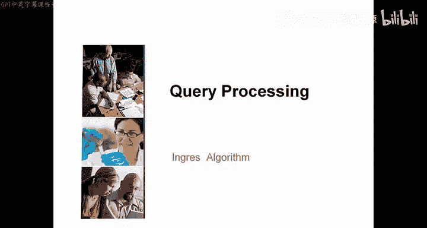
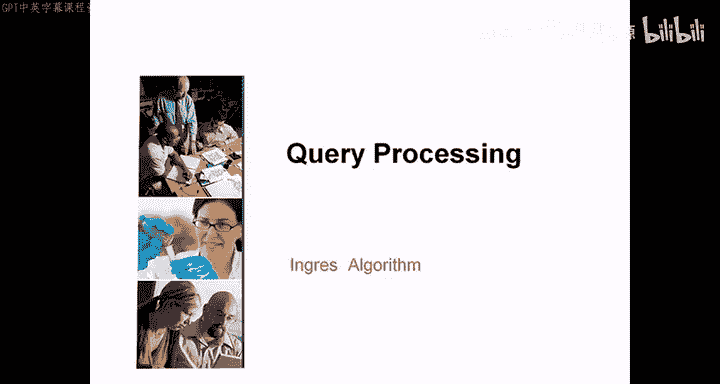
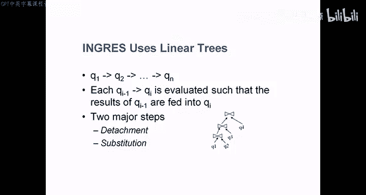
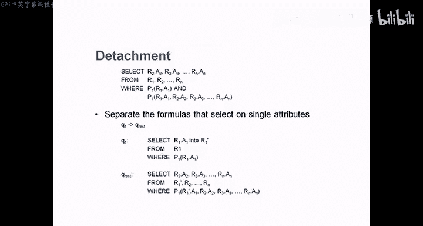
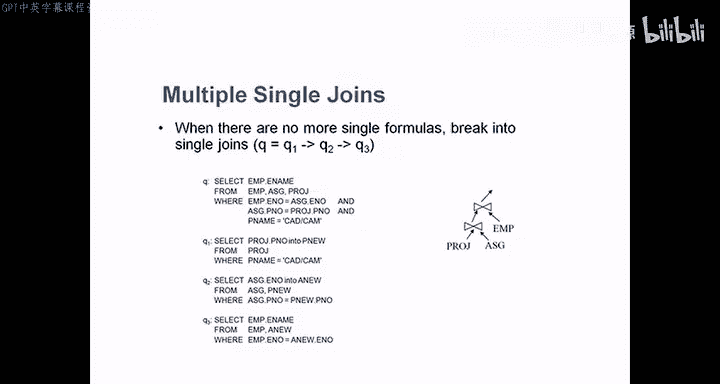
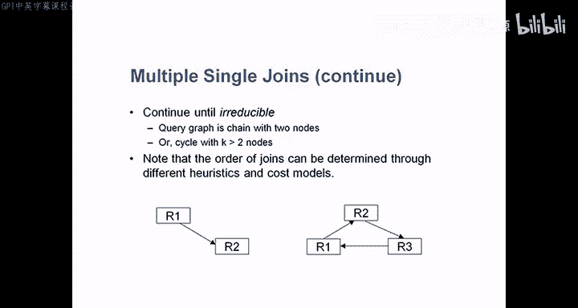
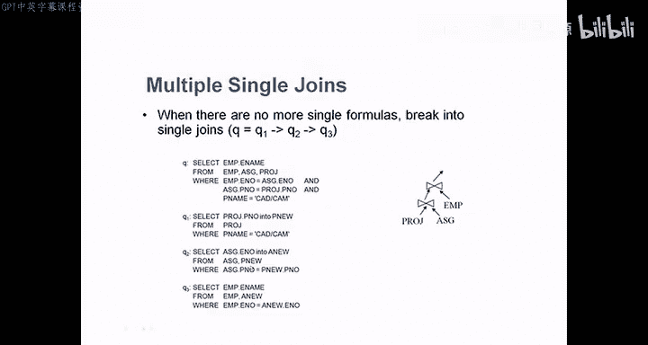
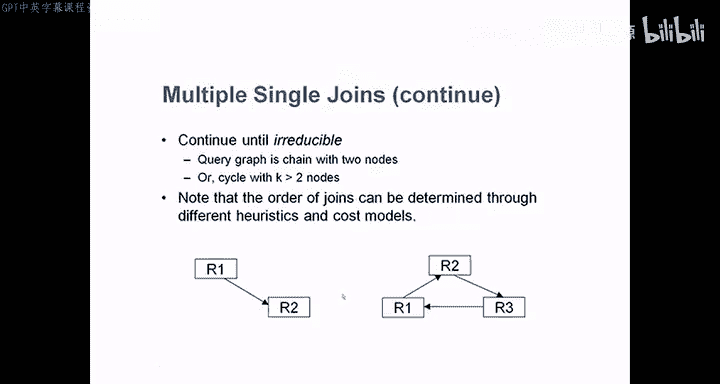
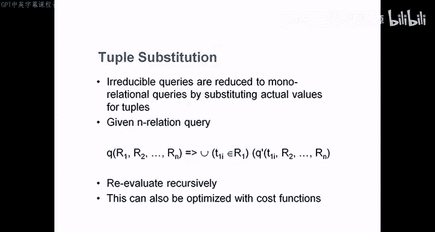
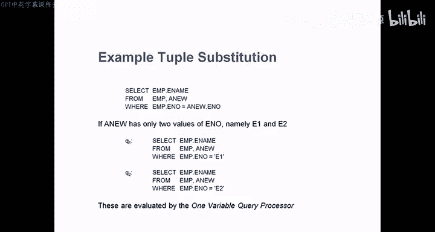

# 课程 26：INGRES 算法 🧩

在本节课中，我们将要学习查询处理中的一个重要算法——INGRES算法。该算法通过“分离”和“替换”两个核心步骤，将复杂的多表连接查询分解为一系列更简单的单表或双表查询，从而高效地处理大规模数据库查询。

---

## 分离与替换

INGRES 算法使用线性树结构来处理查询。观察右侧的图表，你会发现我们首先将两个由查询1和查询2产生的表连接起来，然后将结果与查询3产生的新表进行连接，依此类推。这意味着，当你拆解一个查询时，本质上是在将查询1的结果传递给查询2，再将结果传递给查询3，直到最后一个查询。每个查询步骤的评估都依赖于前一个查询的结果。

INGRES 算法主要包含两个步骤：一是**分离**，二是**替换**。

---

## 分离步骤

以下是评估分离步骤的方法。假设我们有一个查询，需要从一系列关系（表）中选择大量属性和关系，并且存在多个谓词（条件）。其中，谓词1应用于表R1，其余谓词应用于其他表。

第一步是从其余查询中分离出一个查询。具体来说，我们将分离出Q1，它本质上是选择某些属性，并通过将谓词1应用于R1中的某个属性来从R1创建一个临时表。这样就得到了查询1的连接结果。接着，我们将这个结果输入到其余查询中。其余查询是所有其他关系及其关联谓词的连接。

为了让概念更具体，我们来看一个例子。我们将从一个初始查询开始，这个查询需要从三个不同的表中选择员工姓名，并在这些表之间进行连接：从员工表到任务表，再从任务表到项目表，并且对项目名称有一个约束条件。

---

## 分离示例

INGRES 算法将基于项目表分离出第一个查询。它会应用约束条件：从项目表中选择项目编号到一个新表 `P_new` 中，条件是项目名称等于“CADCm”。这就是我们的第一个查询。

然后，我们取这个结果并将其输入到 `P_new` 中，再将 `P_new` 输入到第二个查询。第二个查询从任务表中选择员工编号，并在 `P_new` 和任务表之间进行连接，连接条件是项目编号。这将创建一个临时结果 `A_new`。

接着，`A_new` 被输入到第三个查询，该查询在 `A_new` 和员工表之间进行连接，最终找出该查询产生的所有员工姓名。

这个查询的模型显示在右侧：我们取项目表，生成一个临时表 `P_new`，将其输入到与任务表的连接中，创建出 `A_new`，最后将 `A_new` 输入到与员工表的连接中。

---

## 替换步骤

我们持续进行分离，直到查询变得不可约简，然后应用替换。查询不可约简意味着我们现在需要连接两个或更多的表。

回顾上一张幻灯片，第一个查询代表了一次分离，我们可以从单个项目表创建一个查询。将其结果输入到中间结果 `P_new` 后，之后的每个查询都变成了需要连接两个表的查询。我们将通过替换来处理这些需要连接的表。

在某些情况下，R1 将与 R2 连接。这是查询不可约简且必须应用替换的典型情况。还存在更复杂的查询，其中 R1、R2、R3 之间存在非常复杂的连接模式，甚至可能回连到 R1。这种情况虽不常见，但在通过替换简化查询时仍需考虑。

那么，当面对不可约简的查询，需要连接两个或更多表时，替换如何工作呢？

---

## 元组替换原理

假设我们有一个包含 n 行的表，每一行都可以从该表中抽象出来。给定一个查询和关系，我们实际上可以取出第一行（或第一个关系），并对其中的每个元组（即行），将其替换到查询的其余部分。

具体来说，我们取 `T1_i`（R1 中的每一行），并稍微修改查询。我们不再是在 R1 和其余关系之间进行连接查询，而是在 R1 中的一个特定元组和其余关系之间进行连接，并且递归地重新评估这个过程。

---

## 替换示例

我们来看一个具体的例子，假设我们需要连接员工表和 `A_new` 表。

这里存在一个连接。我们将查看 `A_new` 表，并从中取出员工编号 `E_num`。在一个非常简化的案例中，我们假设其中只有两个元组：一个员工编号是 E1，另一个是 E2。

接着，我们检查员工表，取出所有元组，并为每个元组创建独立的查询。我们不再是将员工表的 `E_num` 与 `A_new` 的 `E_num` 连接（`A_new` 只有 E1 和 E2 两个值），而是将 `A_new` 表中的 E1 值代入查询。这样我们就得到了一个查询：选择员工编号为 E1 的员工姓名。

然后，我们取 `A_new` 中的下一个元组（E2），再次将其代入查询，选择员工编号为 E2 的员工姓名。我们通过将每个单独的元组代入查询来评估结果。

这就是**元组替换**，这些查询由一个单变量查询处理器进行评估。

---

## 算法总结

因此，INGRES 算法基本上执行一个两步过程：
1.  **分离**：评估单表上的查询。
2.  **替换**：将结果输入到其他查询段中。这些查询段通常涉及两个表的连接（一个表是前一个连接的结果）。对于这种情况，我们将应用元组替换，即取出一行并将其值代入查询，使得查询不再仅仅是两个不同表之间的连接，而是变成了对第二个表的非常简单的查询。

本节课中，我们一起学习了 INGRES 算法的核心思想。它通过“分离”将复杂查询拆解，再通过“替换”（特别是元组替换）处理不可约简的连接，从而将复杂的多表连接转化为一系列高效的单表或简单查询，是大规模数据库系统中一种重要的查询优化策略。