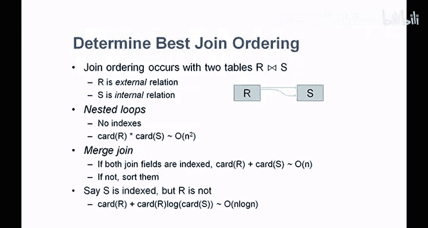
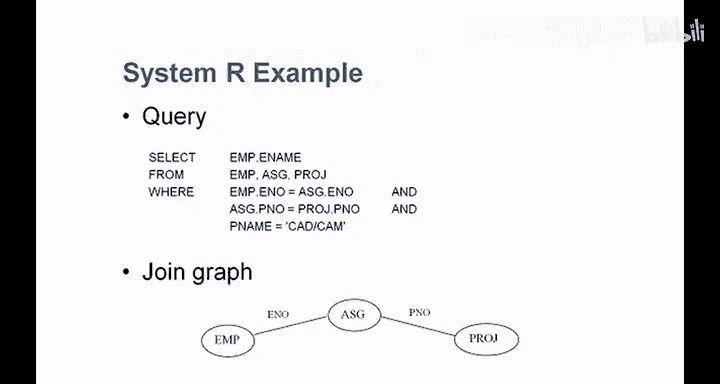
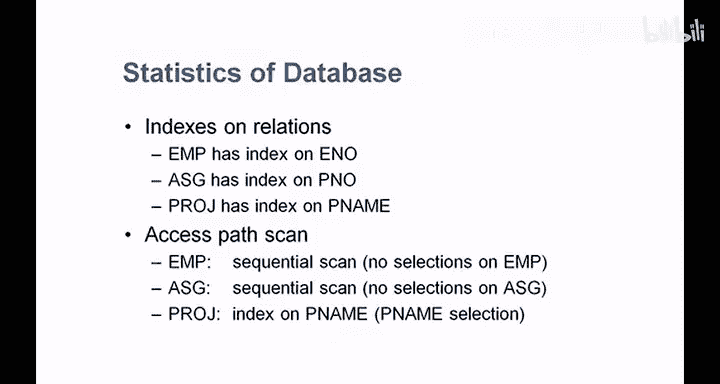
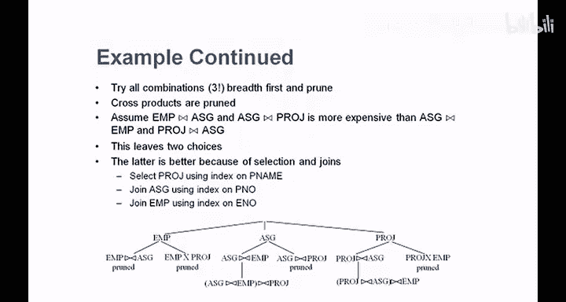

# 课程名称：大规模数据库系统 - P27：System R 查询优化算法 🧠

## 概述

在本节课中，我们将学习 System R 查询优化算法。该算法用于在多表连接查询中，高效地寻找成本最低的执行计划。我们将通过一个具体的例子，理解算法如何通过逐步构建和剪枝执行计划树来工作。

---

## 连接操作的成本分析

上一节我们介绍了查询优化的重要性，本节中我们来看看如何估算不同连接策略的成本。连接操作的效率很大程度上取决于表的访问方式和是否有索引可用。

假设我们需要连接两个表 **R** 和 **S**。在连接表示法 `R ⨝ S` 中，**R** 被视为外表，**S** 被视为内表。

以下是几种常见的连接策略及其成本估算：

*   **嵌套循环连接（无索引）**：这是效率最低的方法。对于外表 **R** 的每一行，都需要完整扫描内表 **S** 来寻找匹配行。
    *   **成本公式**：`Cost = |R| * |S|` （即 O(n²) 操作）

*   **归并连接**：这是最理想的情况，要求两个表在连接列上都是有序的。
    *   **成本公式**：`Cost = |R| + |S|` （即 O(n) 操作）
    *   如果表无序，则需要先排序，成本会增加。

*   **索引嵌套循环连接**：这是最常见的高效场景。假设内表 **S** 在连接列上有索引，而外表 **R** 没有。
    *   对于 **R** 的每一行，我们使用 **S** 的索引（深度为 log|S|）来快速定位匹配行。
    *   **成本公式**：`Cost = |R| + |R| * log|S|` （即 O(n log n) 操作）

---

## 示例查询与统计信息

现在，让我们通过一个具体的查询来应用 System R 算法。考虑以下查询：从三个表（`Employee`， `Assignment`， `Project`）中，找出项目名为 “CAD/CAM” 的员工姓名。

其连接图如下：
`Employee ⨝_{E#} Assignment ⨝_{P#} Project`， 并且带有条件 `Project.Pname = ‘CAD/CAM’`。

假设我们拥有以下数据库统计信息和索引情况：
*   `Employee` 表在 `E#` （员工号）列上有索引。
*   `Assignment` 表在 `P#` （项目号）列上有索引。
*   `Project` 表在 `Pname` （项目名）列上有索引。

---

## System R 算法步骤详解

基于以上信息，System R 算法通过动态规划来构建和选择最优计划。其核心思想是自底向上地构建所有可能的连接树，并利用启发式规则尽早剪枝掉低效的计划。

以下是算法执行过程的关键步骤：

1.  **初始化单表访问计划**：算法首先为查询中涉及的每个基表生成一个初始的、单表的执行计划片段。此时，我们无法进行剪枝。

2.  **逐步扩展与连接**：算法迭代地将已生成的计划（或基表）与另一个未连接的表进行连接，生成新的、更大的计划。

3.  **应用剪枝启发式规则**：在扩展过程中，算法会应用规则来淘汰明显低效的计划，大幅减少搜索空间。主要规则有：
    *   **避免笛卡尔积**：立即剪枝掉那些不基于连接条件、而是产生笛卡尔积的计划，因为其成本是 O(n²)。
    *   **利用索引优化连接方向**：优先保留那些能让**内表**在连接列上使用索引的连接顺序。因为 `外表 ⨝_{有索引列} 内表` 的成本通常是 O(n log n)，而反向连接可能成本更高。

---

## 算法推演过程

让我们跟随算法的步骤，看看它是如何为我们的示例查询找到最优计划的。

首先，算法从三个基表计划开始：`[Emp]`， `[Asgn]`， `[Proj]`。

**第一轮扩展**：尝试将每个基表与另一个表连接。
*   从 `[Emp]` 开始扩展：
    *   连接 `Emp ⨝ Asgn`（`Emp` 为外表）：由于内表 `Asgn` 在 `E#` 上无索引，这是一个低效的 O(n²) 连接，**被剪枝**。
    *   连接 `Emp ⨝ Proj`：两者无直接连接条件，是笛卡尔积，**被剪枝**。
    *   **结果**：从 `[Emp]` 出发没有产生有希望的计划。

*   从 `[Asgn]` 开始扩展：
    *   连接 `Asgn ⨝ Emp`（`Emp` 为内表）：内表 `Emp` 在连接列 `E#` 上有索引，这是一个高效的 O(n log n) 连接，**保留**。
    *   连接 `Asgn ⨝ Proj`（`Proj` 为内表）：内表 `Proj` 在连接列 `P#` 上无索引，是低效连接，**被剪枝**。

*   从 `[Proj]` 开始扩展：
    *   连接 `Proj ⨝ Asgn`（`Asgn` 为内表）：内表 `Asgn` 在连接列 `P#` 上有索引，是高效连接，**保留**。
    *   连接 `Proj ⨝ Emp`：是笛卡尔积，**被剪枝**。

**第二轮扩展**：对上一轮保留的计划进行最后连接。
*   计划 A: `(Asgn ⨝ Emp) ⨝ Proj`
    *   现在需要将中间结果与 `Proj` 连接，连接列是 `P#`。此时 `Proj` 作为内表，但在 `P#` 上无索引，因此这个最终连接成本很高，**被剪枝**。
*   计划 B: `(Proj ⨝ Asgn) ⨝ Emp`
    *   将中间结果与 `Emp` 连接，连接列是 `E#`。内表 `Emp` 在 `E#` 上有索引，这是一个高效的 O(n log n) 连接。

**最终选择**：经过层层剪枝，算法确定最优执行计划是 **`(Proj ⨝ Asgn) ⨝ Emp`**。即先利用 `Asgn` 表上的 `P#` 索引连接 `Proj` 和 `Asgn`，然后再利用 `Emp` 表上的 `E#` 索引将结果与 `Emp` 表连接。

---

## 总结

本节课中我们一起学习了 System R 查询优化算法。该算法通过**动态规划**系统地构建所有可能的连接顺序，并运用**避免笛卡尔积**和**优先使用内表索引**两大启发式规则进行**剪枝**，从而在庞大的搜索空间（n! 种可能）中高效地找到近似最优的查询执行计划。我们通过一个三表连接的实例，一步步演示了算法如何初始化、扩展和剪枝计划，最终选出成本最低的 `(Proj ⨝ Asgn) ⨝ Emp` 计划。理解这个算法对于掌握数据库查询优化的核心思想至关重要。