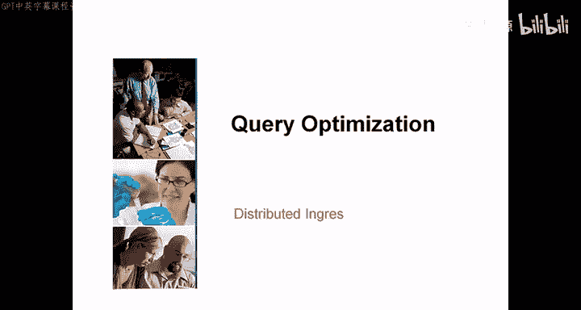
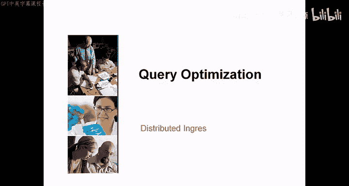
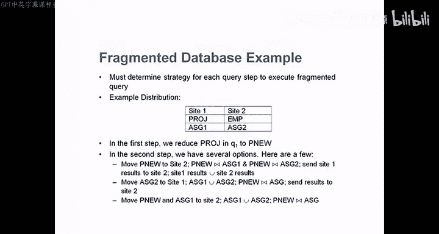
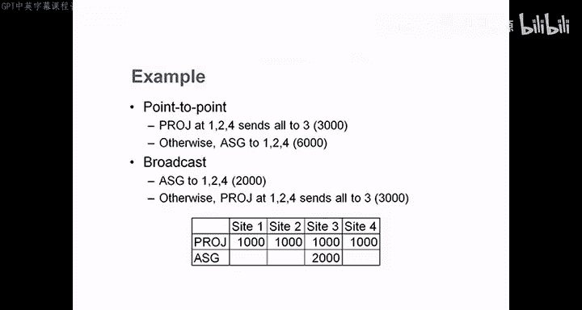

# 课程名称：大规模数据库系统 - 第28讲：分布式INGRES 🗄️

## 概述

在本节课中，我们将要学习分布式INGRES数据库系统中的查询优化。我们将重点探讨在数据被分片存储的分布式环境下，如何为查询的每一步选择执行策略，并理解网络架构对策略选择的关键影响。

---

## 分布式查询优化简介

上一节我们介绍了分布式数据库的基本概念。本节中我们来看看在分布式INGRES系统中，面对一个分片数据库时，如何为查询制定执行策略。

考虑一个分布式数据库的例子。我们需要为每个查询步骤确定执行策略，以处理一个涉及分片的查询。

以下是一个分布示例：
*   在站点1，存储着项目表（`project`）和分配表（`assignment`）的一个分片。
*   在站点2，存储着员工表（`employee`）和分配表（`assignment`）的第二个分片。

回忆我们进行“分离与替换”的过程。第一步，我们将项目表化简为分离查询Q1，并将其结果发送到一个名为`Pnew`的临时表中。

---

## 第二步的策略选择

在第二步，我们面临多个选择。特别是在分布式数据库中，这说明了选项远比传统的集中式数据库复杂。

以下是第二步的一些可选策略（实际上可能更多）：

*   **选项一**：将 `Pnew` 移动到站点2。这样，站点1和站点2都有一份 `Pnew` 的副本。然后，在站点1执行 `Pnew` 与 `assignment1` 分片的连接操作，在站点2执行 `Pnew` 与 `assignment2` 分片的连接操作。最后，将站点1的连接结果发送到站点2，并与站点2的连接结果进行合并。
*   **选项二**：将 `assignment2` 分片移回站点1。在站点1合并 `assignment1` 和 `assignment2` 分片，然后执行 `Pnew` 与合并后分配表的连接操作，再将最终结果发送到站点2。
*   **选项三**：将 `Pnew` 和 `assignment1` 分片都移动到站点2。在站点2合并两个分配表分片，然后执行 `Pnew` 与完整分配表的连接操作。

请注意，在上述每个选项中，都需要在不同站点间移动各种分片和表。由于在分布式数据库系统中，通信时间是一项非常重要的成本，我们希望在可能的情况下尽量减少它。

---

## 网络架构对成本的影响

上一节我们看到了策略的多样性。本节中我们来看看网络架构如何影响不同策略的成本估算。

假设我们有一个包含四个站点的系统。项目表（`project`）被分片存储在全部四个站点上，而分配表（`assignment`）仅作为一个完整的表存在于站点3。

这涉及到我们早期模块中讨论过的不同网络架构：
*   **点对点架构**：每个站点通过独立的通信路径与其他站点相连。
*   **广播架构**：所有站点相互连接，数据可以一次性发送给所有站点。

回到点对点架构的例子。每次我们需要将数据从一个站点发送到另一个或多个站点时，都必须单独发送到每个目标站点。因此我们面临一个选择：是将项目表的分片发送到分配表所在的站点3，还是将分配表发送到每个存在项目表分片的站点。

在点对点架构下：
*   将不在站点3的所有项目表分片（即站点1、2、4的分片）发送到站点3的成本，大约是发送单个元组成本的3000倍（因为有3000行需要传输）。
*   或者，将分配表发送到其他三个站点。由于是点对点架构，我们需要分别向每个站点发送2000行，总成本将是 `2000 * 3 = 6000` 倍的单行发送成本。

因此，在点对点架构中，策略似乎是**将项目表分片发送到分配表所在的站点3**，并在那里执行连接操作。

然而，在广播架构下，选择则不同：
*   将分配表广播到所有其他站点。由于是广播，我们只需一次性发出2000个元组，它们会到达所有目标站点，因此传输成本仅为2000。
*   将项目表所有分片发送到站点3的成本仍然是3000。

所以，在广播架构中，最佳策略是**将分配表广播到每个存在项目表分片的站点**。

由此可见，网络架构对于决定在站点间移动表和分片的最佳策略至关重要，而这直接影响了查询的最终成本估算。

---

## 总结

本节课中我们一起学习了分布式INGRES系统的查询优化。我们了解到，在分片数据库上执行查询时，需要为每一步选择策略，这涉及到在不同站点间移动数据。我们通过示例分析了多种可能的策略选项。更重要的是，我们认识到**网络架构（点对点 vs 广播）** 是影响策略选择和数据移动成本估算的关键因素，不同的架构会导致完全不同的最优执行计划。这凸显了分布式查询优化相比集中式系统的复杂性。