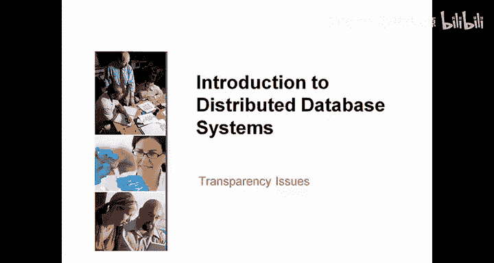
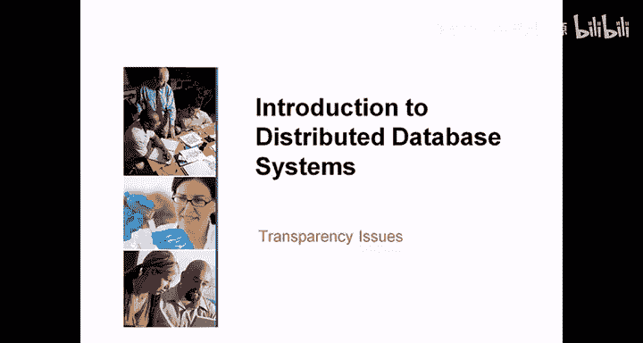
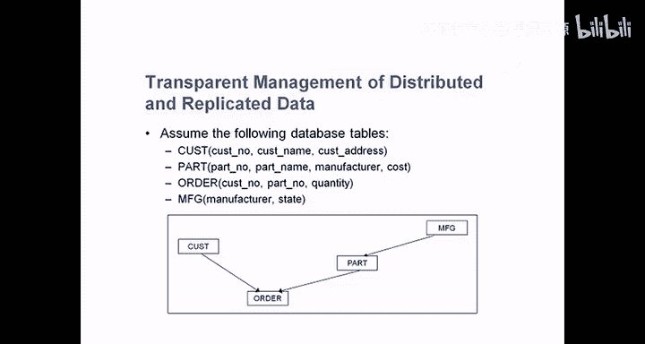
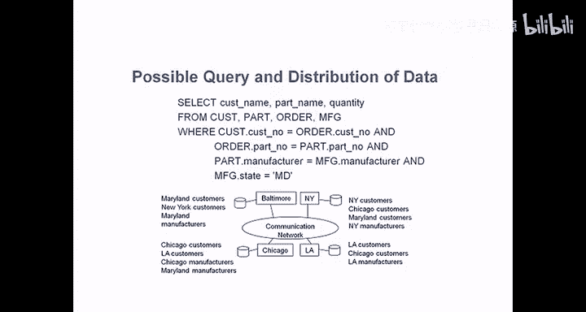
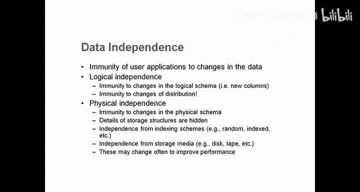
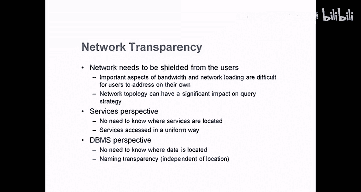
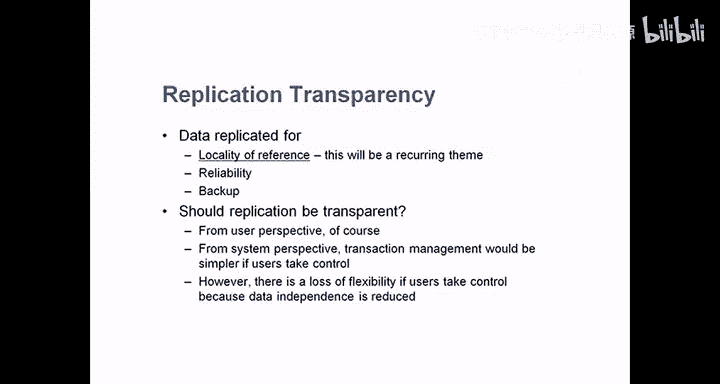
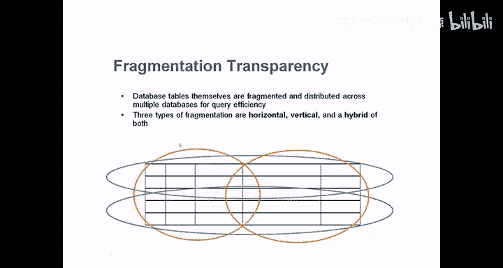

# 大规模数据库系统课程 - P2：透明性问题 🧩

在本节课中，我们将要学习分布式数据库系统的核心特性之一：透明性。透明性意味着用户无需了解数据在系统中的具体分布、存储和访问细节，就能像使用单一数据库一样进行操作。我们将详细探讨透明性的多个方面，包括数据分布、复制、独立性、网络、服务、复制和分片透明性。

上一节我们介绍了分布式数据库系统的基本概念，本节中我们来看看透明性如何让用户更轻松地使用这些系统。

## 透明管理分布式与复制数据

假设我们有一个数据库定义，它包含四个表。这个定义将在整个课程中使用。





以下是数据库中的表结构：

*   **客户表 (Customer Table)**: 包含客户编号、客户姓名和客户地址。
*   **零件表 (Part Table)**: 包含零件编号、零件名称、制造商和成本。
*   **订单表 (Order Table)**: 包含客户编号、零件编号和数量。
*   **制造商表 (Manufacturer Table)**: 包含制造商和所在州。

在关系图中，客户与订单表之间存在一对多关系，一个客户可以下多个订单。同样，一个制造商可以生产多种零件，而一个零件可以出现在多个订单中。实际上，客户和零件的组合在订单表中构成了唯一的订单条目。

有多种方式可以在分布式数据库系统中分布这些表的信息。我们在上一单元讨论过这一点。在本例中，我们有四个不同的节点：巴尔的摩节点、纽约节点、芝加哥节点和洛杉矶节点。表的各个部分被地理分布在全国各地的不同处理器上，共同构成了这个数据库的信息。图中仅展示了客户和制造商表在这些位置上的分布，但实际上，订单表和零件表同样会被分布。



当用户在分布式数据库系统上执行查询时，系统会提供一定程度的透明性。用户无需理解所有这些数据部分具体存放在哪里。

因此，用户可以执行一个单一查询。例如，一个查询可能要求从四个不同的表中获取客户姓名、零件名称和数量，并在这些表之间进行连接操作，同时附加一个关于制造商所在州的约束条件。

```sql
SELECT Customer.Name, Part.Name, Order.Quantity
FROM Customer, Part, Order, Manufacturer
WHERE Customer.CustomerNo = Order.CustomerNo
  AND Part.PartNo = Order.PartNo
  AND Part.Manufacturer = Manufacturer.Manufacturer
  AND Manufacturer.State = 'Maryland';
```

如果用户必须了解并知道数据库所有不同部分的位置，并且必须理解如何将它们整合在一起来满足查询，那么编写这样的查询将非常困难。分布式数据库系统提供的透明性使得用户在构建查询时，无需了解数据库各部分的地理位置。



用户也无需担心数据在大型分布式数据库系统中的复制问题。这是分布式数据库系统提供的一个重要透明性方面。

## 数据独立性

分布式数据库系统提供的另一个透明性部分是数据独立性。这意味着用户应用程序无需理解数据的变更。

*   **逻辑独立性**: 如果逻辑模式发生变更，例如增加了新列，或者数据分布方式发生了变化，用户无需知晓。用户只需按照原有方式构建查询，分布式数据库系统会自动将查询重定向到数据库中新的或已变更的部分，而用户无需了解数据库系统的任何变更。
*   **物理独立性**: 它同样对数据库的物理部分提供透明性。如果模式的物理部分、存储结构的细节等发生变更，用户也无需了解。所有这些变更都由分布式数据库系统管理。

此外，索引方案（如随机索引方案等）也是独立的。用户无需理解具体的方案是什么，他们只需要知道有可用的索引，分布式数据库管理系统会处理其余工作。

更进一步，用户无需理解存储介质，也无需理解如何提升查询性能。分布式数据库管理系统会理解底层拓扑结构、不同表的位置、不同表的结构，并基于数据的分布情况，知道如何构建最优查询。

## 网络透明性

如果用户在没有分布式数据库系统管理表访问的情况下自行处理表，他们将必须理解网络配置。优化查询的制定和执行需要了解网络的哪些部分负载较重，哪些部分负载较轻，从而引导查询和通信通过负载较轻的网络部分。要求用户管理这些是非常困难的。



分布式数据库管理系统可以掌握网络负载信息，并利用这些信息来制定针对分布在整个数据库拓扑中的数据库的最优查询。

## 服务与命名透明性

用户无需知道服务位于何处。服务以统一的方式被访问。用户无需知道数据的具体位置，也无需知道数据在单个数据库系统上存储时使用的特定名称。他们只需要使用整个分布式数据库系统所知晓的数据通用名称。

## 复制透明性

数据复制是为了实现访问的局部性，这将是贯穿本课程的一个反复出现的主题。访问局部性基于这样一个事实：位于某一地理位置的用户会希望他们的数据离他们很近，即使其他站点也需要这些数据。访问局部性使得分布式数据库系统能够将数据放置在最需要它们的用户附近。对于地理上分布的用户，系统将复制信息和数据，以便用户能够快速访问这些数据。数据复制也出于可靠性和备份的原因，我们将在学期后期讨论这一点。



那么，复制是否应该对用户透明？当然，从用户的角度来看，没有人愿意管理那种关于数据库拓扑的深层知识。从系统角度来看，如果由用户控制，事务管理会更简单吗？答案是，如果不是由单一的分布式数据库管理系统管理，事务管理几乎是不可能的。我们将在课程后期详细讨论这一点。

## 分片透明性

为了获得访问局部性的好处，通常明智的做法是将表分片，并将这些片段移动到数据库系统的不同部分。如图所示，橙色圆圈代表垂直分片，蓝色圆圈代表水平分片。水平分片数据和垂直分片数据都有其好处，我们将在后面详细讨论。

但最终目的，是为查询数据库的用户提供最佳的访问局部性。



---

**本节课总结**



本节课中，我们一起学习了分布式数据库系统的核心透明性特性。我们探讨了用户如何无需关心数据的物理分布、复制、网络细节和存储结构，就能执行查询。这些透明性包括：**分布式与复制数据的管理**、**逻辑与物理数据独立性**、**网络与负载的透明性**、**服务与命名的统一访问**、**数据复制的隐藏**以及**表分片的细节抽象**。正是这些特性使得分布式数据库对用户而言如同一个单一、集成的系统，极大地简化了复杂环境下的数据操作。