# 课程名称：大规模数据库系统 - P32：ACID属性详解 🧱

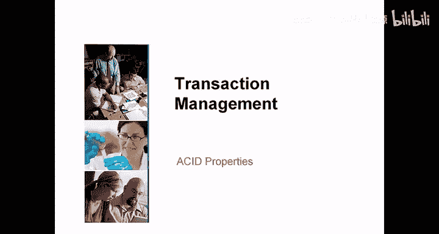

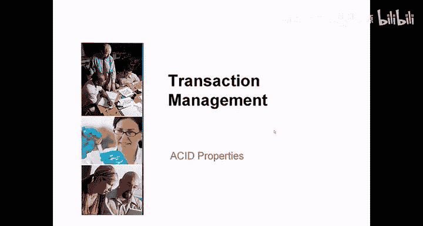

在本节课中，我们将学习数据库事务管理的核心基石——ACID属性。我们将逐一拆解原子性、一致性、隔离性和持久性的含义，并通过具体例子理解它们为何对保障数据正确性至关重要。

## 概述 📋

ACID是事务处理系统的四个关键属性，它们共同确保了数据库在并发操作和系统故障情况下的可靠性与数据完整性。理解这些属性是掌握后续并发控制和恢复机制的基础。

## 原子性 ⚛️

原子性是指事务作为一个不可分割的操作单元。事务中的所有操作要么全部成功完成，要么全部不执行，不存在部分完成的状态。

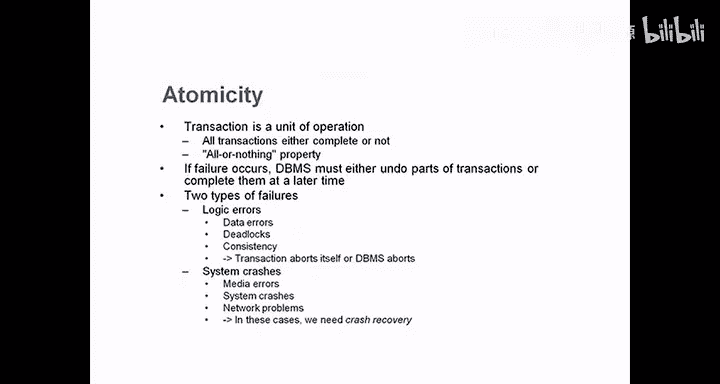

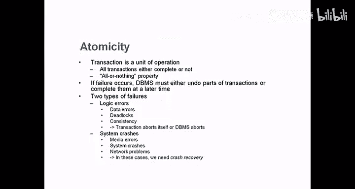

因为当人们将一组操作定义为一个事务时，他们希望这些操作作为一个整体生效。我们稍后会举例说明。

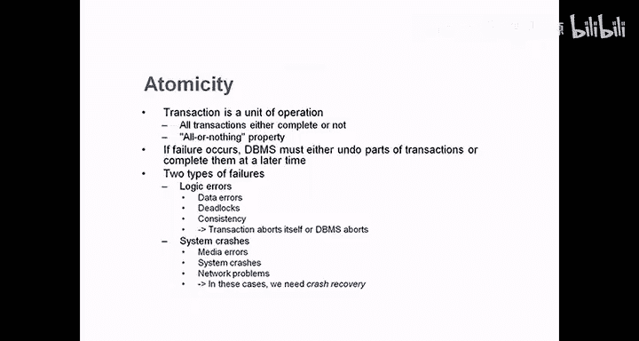

如果发生故障，数据库管理系统必须撤销事务中已执行的部分，或者在以后某个时间完成剩余操作。

例如，在更新工资或银行账户时，如果有一系列操作需要同时执行，我们必须一次性完成所有操作。如果中途失败，就必须撤销已更改的部分，或者暂停事务，待数据库恢复运行后在某个时间点完成剩余操作。

本质上，被称为事务的一组操作必须一次性全部发生。如果失败，它们将同时全部失败。

故障分为两类：逻辑错误（如数据错误、死锁或一致性问题）和系统崩溃（如介质错误、系统崩溃、网络问题）。对于逻辑错误，事务通常会自行中止或由数据库管理系统中止。对于系统崩溃，我们需要崩溃恢复机制，这将在后续单元讨论。

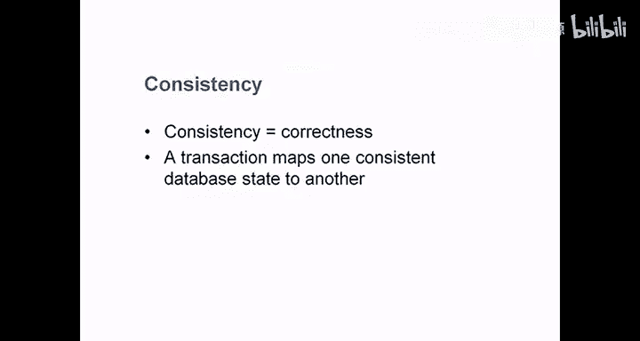

无论在何种情况下，即使有人拔掉电源、磁盘崩溃或在事务中途出现除零错误，我们都必须确保到目前为止所做的所有更改要么从数据库中移除，要么在以后某个时间完成剩余操作。

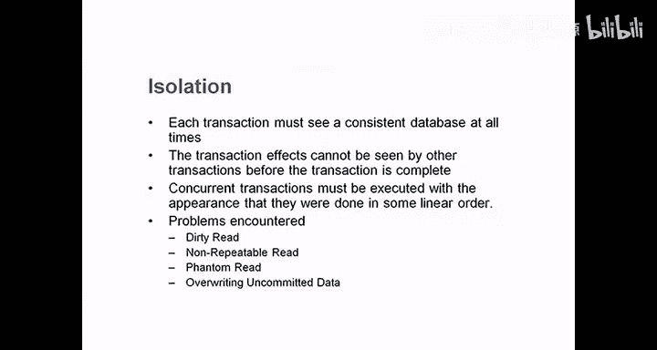

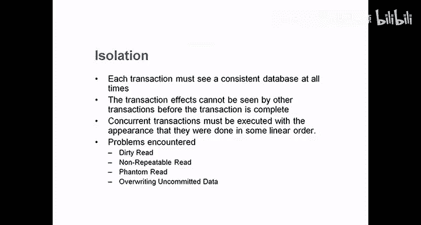

## 一致性 ✅

一致性属性意味着正确性。一个事务，即一组操作，必须将数据库从一个一致状态映射到另一个一致状态。

我们之前定义过一致性检查。如果有人通过一个操作进行更改并使数据库变得不一致，那么在该操作或事务结束时，我们必须回滚所有操作，并声明数据库未处于一致状态。因此，这些操作都不能通过。

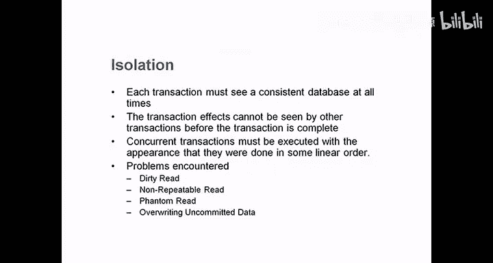

在事务执行过程中，可能会出现不一致的情况，但在事务开始和结束时，数据库必须处于某个一致状态。

例如，如果我们坚持所有项目必须至少有一人参与，我们可能会暂时移除一个人，然后向该项目添加另一个人。在此期间，数据库是不一致的，但在开始时，项目上有人，在结束时，项目上也有一个人。因此，根据“项目必须有人”这一约束，我们知道数据库在事务前后都是一致的。

## 隔离性 🚧

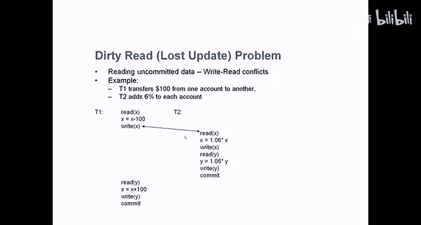

隔离性可能是最难理解的属性，它构成了即将讨论的并发控制的重要内容。每个事务在任何时候都必须看到一个一致的数据库。

每个数据库用户都知道同时有其他用户在使用数据库，但当他们操作数据库时，他们希望在自己的事务执行过程中始终看到一个一致的、不受其他用户影响的数据库副本。他们不希望在执行事务时看到其他用户操作的效果。

实际上，数据库需要通过允许多个人同时操作数据来高效运行。但必须有限制，我们将讨论这些限制，因为用户不希望看到自己操作写入的数据被另一个事务操作覆盖。

因此，用户需要看到一致性，并需要感觉到在事务期间，他们是唯一影响他们需要影响的数据库数据的人。所以数据库需要执行并发事务，就好像这些事务以某种线性顺序执行一样。

遇到的问题可以通过脏读、不可重复读、幻读和覆盖未提交数据等问题来说明。

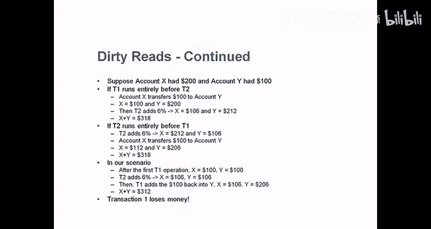

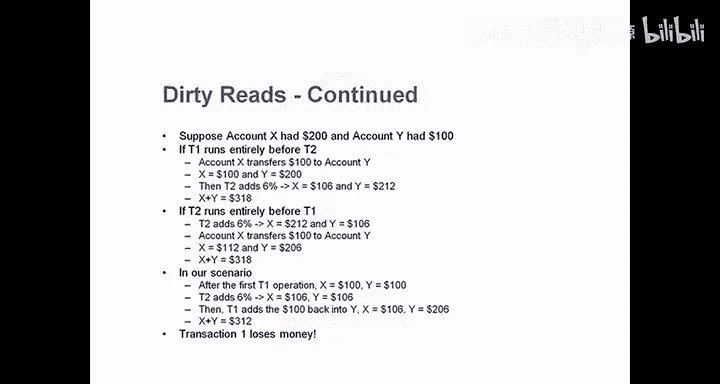

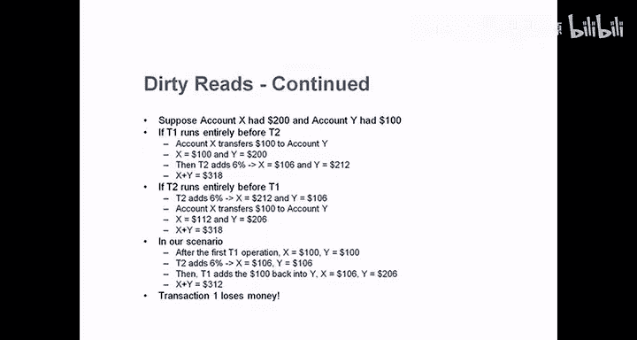

以下是脏读问题的一个例子，有时也称为丢失更新问题。假设有两个事务：T1从其一个账户向另一个账户转账100美元，这是一个非常简单的操作。T2为每个账户增加6%的利息。

想象一下，如果数据库调度程序以下列方式调度这些事务：事务T1从某个账户读取一个值，从中减去100美元，然后将该值写回该账户。假设我从支票账户中取出100美元。与此同时，银行有一个在后台为每个账户计算利息的操作。现在调度程序调度以下操作：银行的交易现在读取X的值，为其增加6%，然后写出X的值；它读取Y（可能是储蓄账户），为其增加6%的利息，写出该值，并提交该操作。同时，事务T1的剩余部分开始操作，事务T1读取储蓄账户中的金额，现在加上之前从支票账户取出的100美元，并将该值写入数据库。

这里的问题在于，注意箭头表示T1的写操作与T2的读操作之间存在冲突。假设账户X有200美元，账户Y有100美元。如果T1完全在T2之前运行，那么账户X向账户Y转账100美元。现在X将有100美元，Y将有200美元。当T2来为X和Y增加6%时，X将有106美元，Y将有212美元，X加Y的总值为318美元，这完全没问题。如果T2完全在T1之前运行，效果也是一样的：T2为X增加6%，使X的值增加到212美元；Y也增加6%，变为106美元；然后当T1运行时，账户X向账户Y转账100美元，现在X有112美元，Y有206美元，X和Y的总和为318美元，完全没问题。无论先运行事务1还是事务2，它们对数据库的影响是相同的。

然而，在我们的场景中，T2打断了T1的操作。在T1的第一个操作之后，T1从其支票账户中取出了100美元。现在支票账户有100美元，储蓄账户有100美元。T2过来为每个账户增加6%。现在每个账户有106美元。然后T1将100美元加回储蓄账户。所以最终支票账户是106美元，储蓄账户是206美元，总和是312美元，少了6美元。原因在于存在脏读，最终事务1会损失金钱。

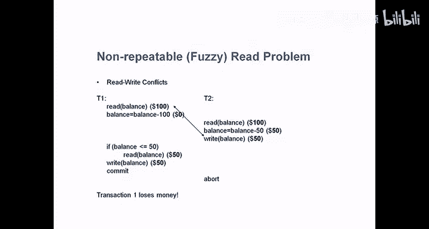

下一类冲突是不可重复读或模糊读问题。这由两个不同的事务说明。事务1将从其账户读取余额并减去100美元，即取出100美元。但事务1在其操作的更深处，如果余额小于50，它将再次读取余额。它看到自己没有对数据库做任何更改，尝试再次读取那100美元，并将其写回数据库。它以为自己会写回100美元。然而，T2过来读取余额，取出50美元，并将余额50美元写出。当事务操作以下列方式交错时：T1读取100美元；与此同时，T2认为那里仍有100美元，取出50美元；然后T1现在读取它认为是100美元的余额，但T2刚刚将其改为50美元，并将余额50美元写出并提交其值。注意，T2中止了其事务，所以它实际上并不想取出那50美元。因此，如果T2从未发生，运行事务T1后，余额值应该是100美元。不幸的是，由于存在不可重复读或模糊读问题，该账户只剩下50美元，事务1损失了金钱。

幻读问题属于读写冲突。问题是，T1正在读取一个值，而T2将要向该值写入数据。但T1仍然认为自己拥有读取到的值，即使T2在T1“眼皮底下”更改了该值。T1正在读取存款列表并打印它。出于某种原因，它再次读取然后写出。然而，T2进来并写入了一笔新存款，并提交了该值。所以事务最初读取和打印的内容，与它在T2写入新存款后最终写出的内容将会不同。事务1将不会拥有存款单上指示的内容，因为会有一笔新存款被插入，即使存款列表没有捕获到那笔新存款。这是由于幻读的读写冲突造成的。

最后是覆盖未提交数据问题。假设一家公司规定，所有相同类别的员工必须拥有相同的工资。如果不看事务2，事务1将X的工资设置为4000美元，将其工资写出为4000美元，并将Y的工资设置为4000美元，然后提交。T2将X和Y的工资写出为5000美元，将X的工资设置为5000美元并写出。两个事务各自都是一致的，它们遵守数据库的一致性规则。然而，由于这些操作之间存在写-写冲突，并且它们相互交错执行，最终结果是Y的工资为4000美元，X的工资为5000美元，这将使数据库处于不一致状态。在下一个模块讨论并发控制时，我们将更详细地了解如何解决这些问题。

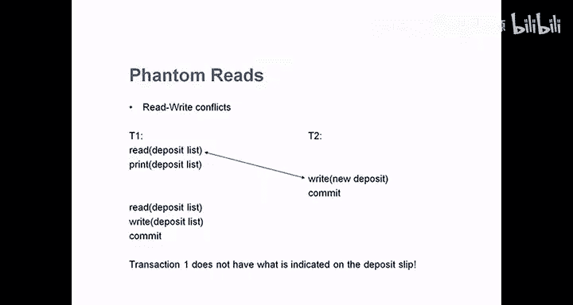

## 持久性 💾

ACID属性的最后一个属性是持久性。一旦事务提交，它就是永久性的。该事务将在所有后续故障中幸存。

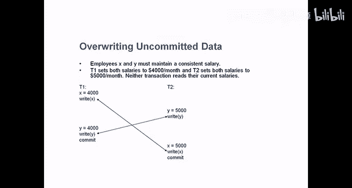

这意味着当你向数据库写出一个值时，你可能不会立即将其写入数据库，而是可能将其写入操作系统或数据库系统的缓存，以便稍后将缓存中的值写入数据库。你期望该数据在未来某个时间点出现在磁盘上。

想象一下，数据库告诉你该事务已提交并已写出，但实际上它所做的只是将其写入缓存。但你期望它出现在磁盘上。在缓存崩溃且数据从未写入磁盘的情况下，持久性确保下次我访问磁盘上的数据库时，该数据会神奇地出现在磁盘上。我们稍后将讨论数据库如何实现这种持久性。

## 总结 🎯

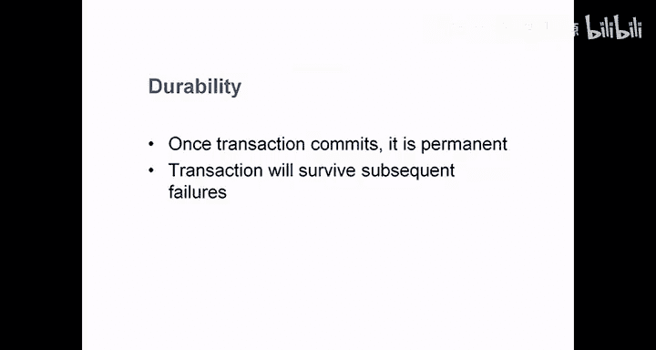

本节课我们一起学习了构成事务管理基石的ACID属性。原子性确保了事务的“全有或全无”；一致性保证了数据的正确性；隔离性使并发事务互不干扰；持久性则承诺已提交的数据永不丢失。这些属性共同为并发控制和恢复机制提供了理论基础，其中一致性和隔离性是并发控制的核心，而原子性和持久性则由恢复机制来保障。理解这些概念是进一步学习复杂数据库系统操作的关键。