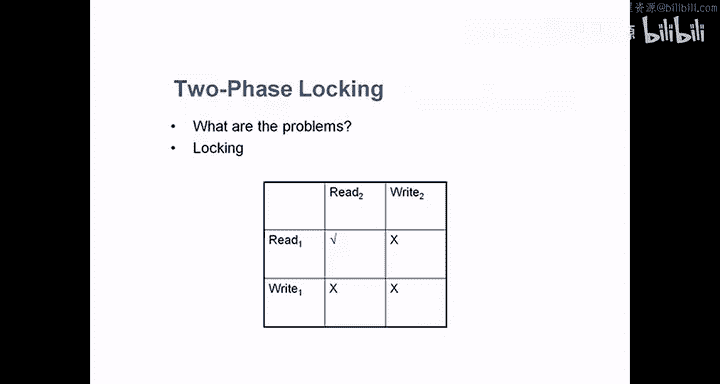
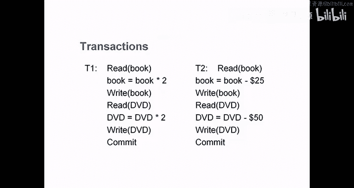
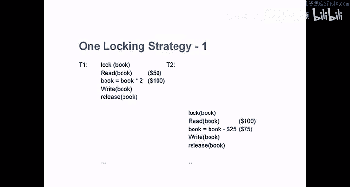
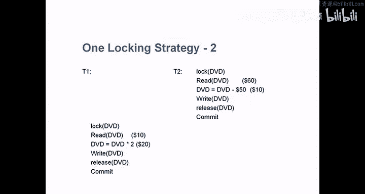
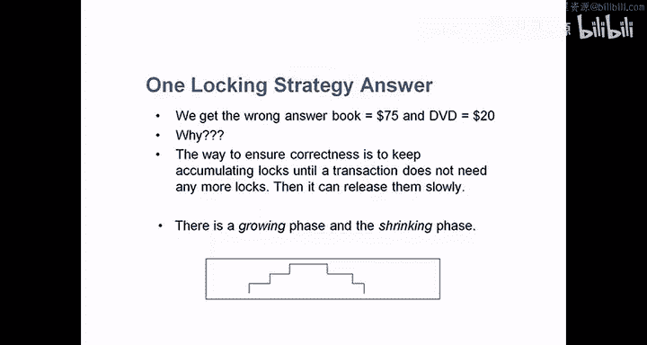
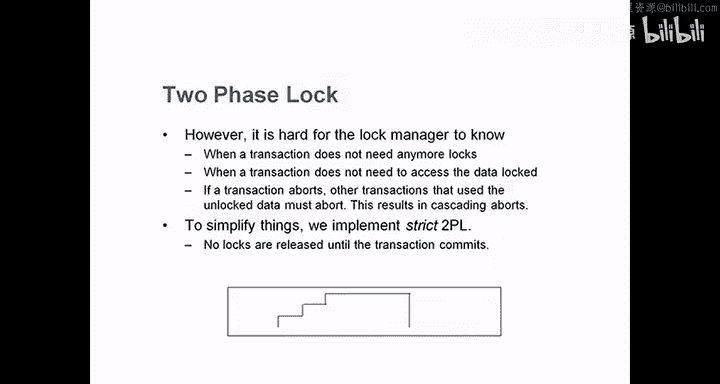

# 课程 4：两阶段锁协议 🔒

在本节课中，我们将要学习并发控制中的一个核心协议：两阶段锁协议。我们将探讨其基本概念、工作原理、潜在问题以及一个更严格的变体。

---

## 概述

并发控制旨在确保多个事务同时访问数据库时，数据的一致性和正确性。两阶段锁协议是实现事务隔离性的一种常用方法。本节将详细介绍该协议的两个阶段，并通过一个示例说明为何需要它。

---

## 锁的兼容性矩阵

首先，我们需要理解不同事务对同一数据项加锁时的兼容性规则。以下是读锁和写锁的兼容性矩阵。

| 当前持有的锁 | 请求读锁 | 请求写锁 |
| :--- | :--- | :--- |
| **读锁** | ✅ 允许 | ❌ 不允许 |
| **写锁** | ❌ 不允许 | ❌ 不允许 |

只要多个事务只想对某个值加读锁以确保该值不被更改，这是完全可以的。只要没有人更改值，不同的读锁是兼容的。

但是，一旦有人想对某个数据项加写锁，而该数据项已被其他事务加了读锁（或写锁），则必须等待该事务释放其锁。例如，如果事务1持有写锁，那么其他事务的读锁和写锁请求都不被允许，直到事务1释放其写锁。

---

## 一个示例场景

为了理解锁协议的必要性，我们来看一个例子。假设亚马逊要将其所有礼品卡账户（包括图书和DVD礼品卡）的价值翻倍。同时，一位顾客在一次交易中使用了他礼品卡中的25美元和50美元。

初始状态是：图书礼品卡有50美元，DVD礼品卡有60美元。

以下是两种可能的正确执行顺序及其结果：

**顺序 1：亚马逊先执行，顾客后执行**
1.  亚马逊将礼品卡价值翻倍：图书卡变为100美元，DVD卡变为120美元。
2.  顾客消费：图书卡减去25美元变为75美元，DVD卡减去50美元变为70美元。
3.  **最终结果**：图书卡 = 75美元， DVD卡 = 70美元。

**顺序 2：顾客先执行，亚马逊后执行**
1.  顾客消费：图书卡减去25美元变为25美元，DVD卡减去50美元变为10美元。
2.  亚马逊将礼品卡价值翻倍：图书卡变为50美元，DVD卡变为20美元。
3.  **最终结果**：图书卡 = 50美元， DVD卡 = 20美元。

以上两种结果都是正确的，因为事务看起来是隔离执行的。任何其他结果都是不一致或不正确的。

---

## 无锁控制下的问题

现在，假设数据库管理系统交错执行这两个事务，但没有正确的锁控制。事务操作如下：

*   **事务1 (亚马逊)**：读图书卡值 -> 翻倍 -> 写回；读DVD卡值 -> 翻倍 -> 写回。
*   **事务2 (顾客)**：读图书卡值 -> 减25 -> 写回；读DVD卡值 -> 减50 -> 写回。

如果执行顺序如下：
1.  事务1锁定并更新图书卡（50 -> 100），然后**释放锁**。
2.  事务2锁定图书卡（100 -> 75），然后锁定并更新DVD卡（60 -> 10），提交。
3.  事务1锁定并更新DVD卡（10 -> 20），提交。

我们得到了一个**错误的结果**：图书卡 = 75美元， DVD卡 = 20美元。这个结果既不是(75, 70)，也不是(50, 20)。

**问题根源**：事务1在完成所有操作之前就释放了锁（例如图书卡的锁），导致事务2能够介入并基于事务1的中间修改进行进一步操作，破坏了事务的原子性和隔离性。

---

## 两阶段锁协议

为了解决上述问题，我们引入两阶段锁协议。该协议要求每个事务必须分两个阶段处理锁：

1.  **增长阶段**：事务可以获取锁，但不能释放任何锁。
2.  **缩减阶段**：事务可以释放锁，但不能获取任何新锁。

协议的核心思想是：事务必须**在开始释放任何锁之前，获取其所需的所有锁**。这确保了在事务修改数据期间，没有其他事务能干扰这些数据。

---

## 两阶段锁的问题：级联中止

然而，基本的2PL也存在问题。在缩减阶段释放锁后，其他事务可能读取或修改这些已释放但尚未提交的数据。

如果最初修改数据的事务随后中止并回滚，那么所有依赖于这些已回滚数据的事务也必须中止并回滚。这种现象称为**级联中止**，会严重影响系统效率。

---

## 严格两阶段锁协议

为了消除级联中止的问题，我们使用**严格两阶段锁协议**。它对基本2PL增加了一个关键限制：

**事务持有的所有锁，都必须等到事务提交或中止后才统一释放。**

这意味着事务在整个执行期间都持有锁，没有单独的“缩减阶段”。这彻底防止了其他事务读取未提交的数据，从而避免了级联中止。

在严格2PL下，事务的锁持有情况如下图所示：锁数量只增不减，直到提交点时一次性全部释放。

---

## 总结

本节课我们一起学习了并发控制中的两阶段锁协议。

*   我们首先通过一个示例看到了无锁控制下事务交错执行可能导致数据不一致。
*   然后，我们介绍了**两阶段锁协议**，它通过将锁操作分为**增长**和**缩减**两个阶段来保证可串行化。
*   接着，我们指出了基本2PL可能引发**级联中止**的问题。
*   最后，我们引入了**严格两阶段锁协议**，它要求事务在提交前持有所有锁，从而有效避免了级联中止，是实践中更常用的方法。

理解并正确应用锁协议，是构建可靠、一致的大型数据库系统的基石。