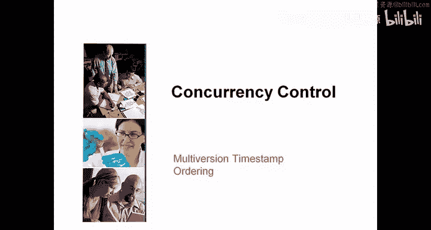
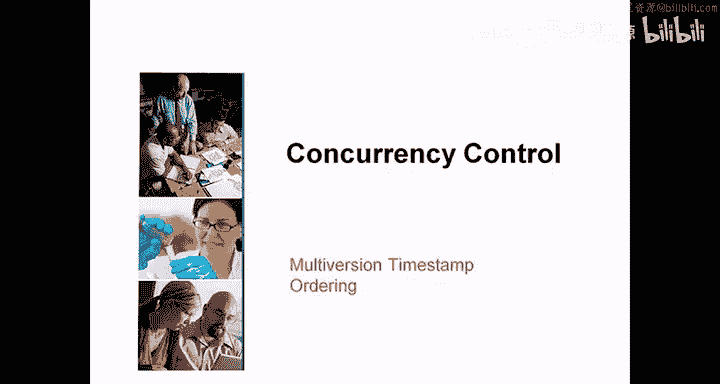
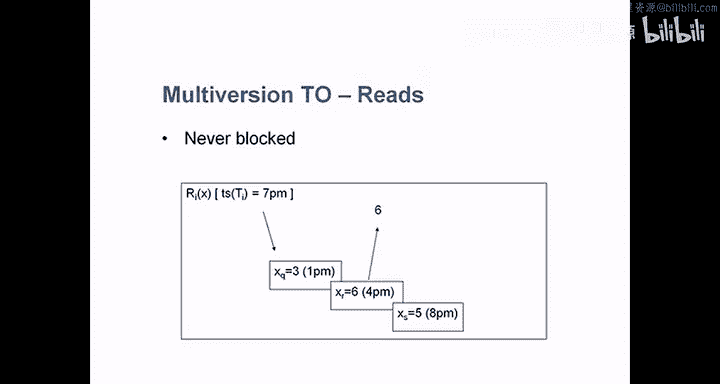
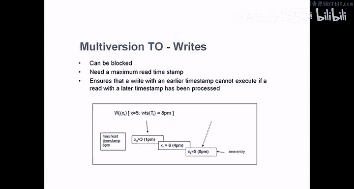
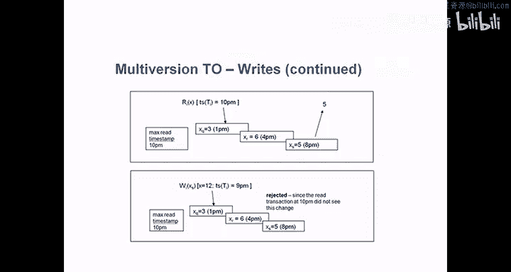

# 课程 37：多版本时间戳排序算法 🕒

在本节课中，我们将要学习并发控制中的一个重要算法——多版本时间戳排序算法。这是一种非常巧妙的算法，旨在优化传统时间戳排序算法中的读操作阻塞问题。

---

上一节我们介绍了传统时间戳排序算法，它存在读操作和写操作被阻塞的情况。本节中我们来看看多版本时间戳排序算法如何解决读阻塞的问题。

在传统时间戳排序算法中，当一个较晚的事务写入新值时，较早事务的读操作可能会被阻塞。然而，在多版本时间戳排序算法中，我们为每个数据资源的所有历史值及其写入时间戳都保留了记录。

因此，读操作永远不会被阻塞。以下是其工作原理：

假设我想读取数据项 `X` 的值，而我的事务时间戳是晚上7点。在数据库中，`X` 在不同时间有多个版本：
*   `X` 在下午1点的值是 `3`。
*   `X` 在下午4点的值是 `6`。
*   `X` 在晚上8点的值是 `5`。

当我的事务（时间戳为晚上7点）想要读取 `X` 时，我不必担心有更新的事务（例如晚上8点的事务）在我之后写入了新值。我只需查找在当前事务时间戳（晚上7点）之前，最后一次写入 `X` 的时间戳所对应的值。在这个例子中，晚上7点之前最后一次写入发生在下午4点，因此我会读取到值 `6`。这样，读操作就不会被阻塞。

---

然而，虽然读操作得到了优化，但写操作在某些情况下仍然可能被阻塞。接下来我们看看写操作是如何被阻塞的。

在这个算法中，我们需要维护一个称为 **最大读时间戳** 的概念。以下是一个例子：

假设 `X` 的版本历史如下：
*   `X` 在下午1点的值是 `3`。
*   `X` 在下午4点的值是 `6`。

现在，一个时间戳为晚上8点的事务想要写入 `X = 5`。每个 `X` 的版本都有自己的写时间戳，我们添加新版本 `X = 5`，其写时间戳为晚上8点。

同时，我们记录一个 **最大读时间戳**。假设在晚上6点，有某个事务读取了 `X` 的值（当时读取的是下午4点的版本 `6`），那么此时 `X` 的最大读时间戳就是晚上6点。

---

如果一个时间戳为晚上10点的事务来读取 `X`，这没有问题。它会读取晚上10点之前最新的版本，即晚上8点写入的版本 `5`。并且，由于这次读取发生在晚上10点，我们会将 `X` 的**最大读时间戳**更新为晚上10点。

现在，问题出现了。假设另一个时间戳为晚上9点的事务（比晚上10点早）现在想要写入 `X` 的一个新值。不幸的是，此时 `X` 的**最大读时间戳**已经是晚上10点（由更晚的事务设置）。

由于这个写事务的时间戳（晚上9点）小于当前的**最大读时间戳**（晚上10点），该写操作会被拒绝。原因在于，我们知道已经有一个更晚的事务（晚上10点）读取了 `X` 的值。如果允许这个时间戳为晚上9点的写操作生效并插入到历史记录中，那么晚上10点的事务读取到的值将不是在其时间戳下应该看到的“正确”历史状态（因为它会看到晚上9点写入的值，而非晚上8点的值），这违反了事务的序列化顺序。因此，我们必须拒绝这个时间戳为晚上9点的写操作。

---

## 总结

本节课中我们一起学习了多版本时间戳排序算法。我们来总结一下它的核心特点：

*   **优点**：该算法通过维护数据的多个历史版本，**完全消除了读操作被阻塞的可能性**，从而提高了系统的并发读性能。
*   **缺点**：
    1.  **写操作仍可能被阻塞或拒绝**：当试图写入的事务时间戳早于该数据的**最大读时间戳**时，写操作会被拒绝。
    2.  **空间开销**：算法在时间效率上的提升，是以**空间消耗**为代价的。系统需要为每个数据项存储多个历史版本。

**核心概念公式/描述**：
*   **读操作**：`read(X, TS(T))` -> 返回满足 `write_timestamp(X_version) ≤ TS(T)` 的最大 `write_timestamp` 对应的 `X_version` 值。
*   **写操作检查**：`write(X, TS(T))` 被允许的条件是 `TS(T) ≥ max_read_timestamp(X)`，否则拒绝。