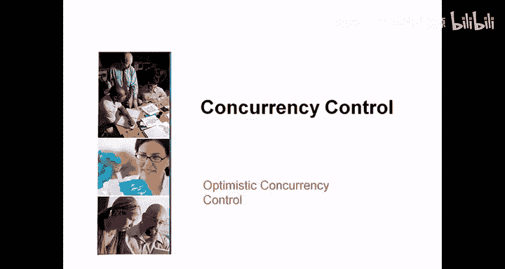
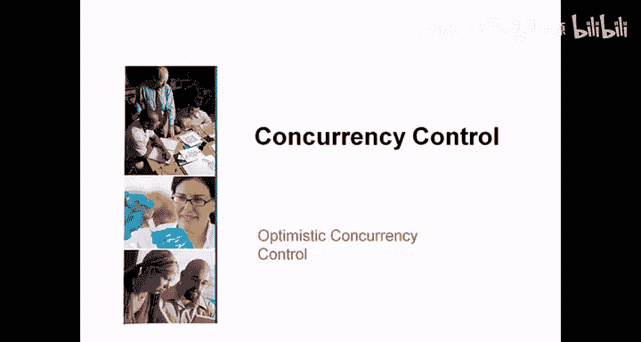
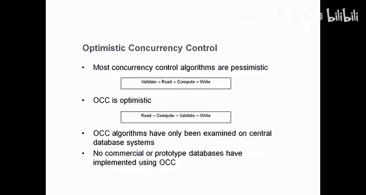
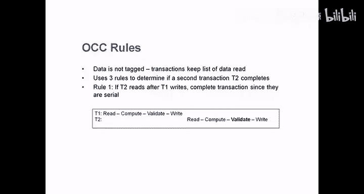
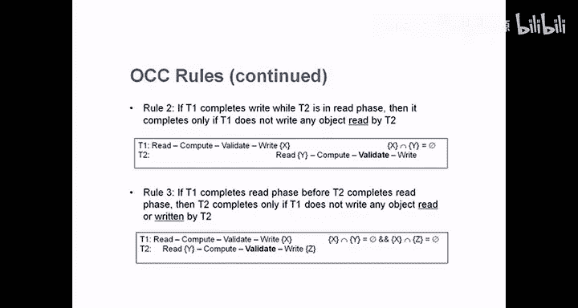
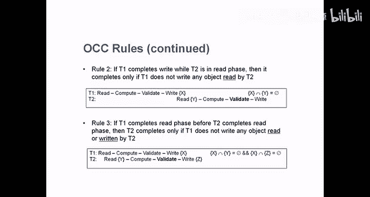
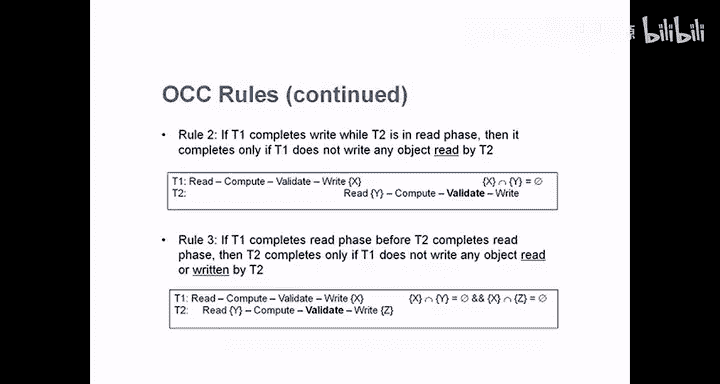

# 课程38：乐观并发控制 🚀



在本节课中，我们将学习乐观并发控制（Optimistic Concurrency Control, OCC）的基本概念和工作原理。这是一种与常见的悲观并发控制不同的方法，它假设事务冲突很少发生，并采用“先执行，后验证”的策略来管理并发操作。

---

## 概述



大多数并发控制算法是悲观的。这意味着它们在事务读取、计算或写入数据之前，会先验证操作是否安全。乐观并发控制则采取不同的思路：它假设冲突很少发生，因此允许事务先读取和计算数据，只在最终写入前进行验证，以确认是否存在冲突。

---

## 乐观并发控制的核心思想

乐观并发控制仅在写入操作前进行验证。与悲观方法不同，OCC算法主要在集中式数据库系统中进行研究。实际上，目前尚无商业或原型数据库系统完全采用OCC实现。但其设计理念对理解并发控制仍有重要价值。



在OCC中，数据本身不附加任何标记。相反，每个事务会维护两个列表：一个记录已读取的数据，另一个记录将要写入的数据。OCC通过三条简单规则来判断一个较晚开始的事务T2能否成功提交。请记住，事务的执行在时间上是可以重叠的，但最终效果必须看起来像是T2在T1完全完成后才进行修改，从而避免相互干扰。

---

## OCC的三条验证规则

以下是决定事务T2能否通过验证、成功完成的三条核心规则。

### 规则一：T2在T1写入后读取

如果事务T2的所有读取操作都发生在事务T1完成写入之后，则不会产生任何问题。因为T2理应读取到T1所写入的最新值。在这种情况下，验证步骤会顺利通过。



**公式表示**：
```
如果 Read(T2) 的时间 > Write(T1) 的时间，则验证通过。
```

### 规则二：T2在T1写入期间读取





这种情况稍复杂。如图所示，T1先进行读取、计算和验证，然后开始写入一组变量（记为集合X）。在T1写入期间，T2开始并完成了其读取、计算和验证阶段。

T2能否通过验证，取决于T1写入的资源（集合X）与T2读取的资源（集合Y）是否有重叠。

*   如果 `X ∩ Y = ∅`（即两个集合没有交集），则T2验证通过，可以完成。
*   如果 `X ∩ Y ≠ ∅`（即存在重叠的资源），则T2验证失败。

### 规则三：T1与T2的执行高度重叠

这是重叠最显著的情况。我们假设T1完成了读取、计算、验证，并正在写入集合X。T2在T1刚完成读取后不久也开始执行，并完成了自身的读取、计算、验证，准备写入集合Z。

此时，T2读取的资源集合为Y，欲写入的资源集合为Z。T1写入的资源集合为X。验证规则如下：

如果T1写入的资源（X）与T2读取的资源（Y）**或** T2欲写入的资源（Z）有任何重叠，则必须中止T2。

**公式表示**：
```
如果 (X ∩ Y) ≠ ∅ 或 (X ∩ Z) ≠ ∅，则中止 T2。
否则，T2验证通过。
```

---

## 总结



本节课我们一起学习了乐观并发控制（OCC）。OCC是一种基于“冲突稀少”假设的并发控制方法，其核心是让事务先不受阻碍地执行读取和计算阶段，仅在最终写入前进行一次验证。我们详细介绍了其三条核心验证规则，这些规则确保了无论事务在时间上如何重叠，较晚事务的冲突操作总是在逻辑上晚于较早事务的操作执行。尽管OCC未被主流数据库系统广泛采用，但它为理解事务验证和并发控制机制提供了一个独特而有益的视角。