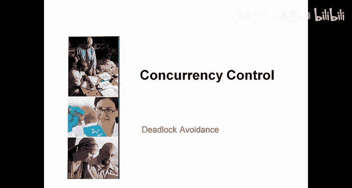
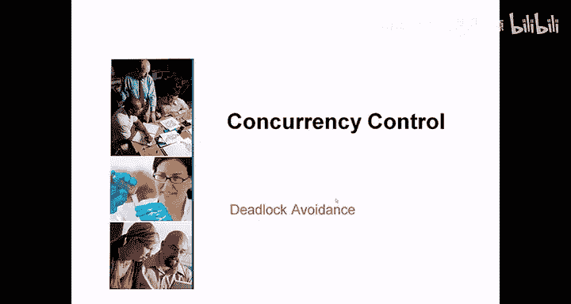
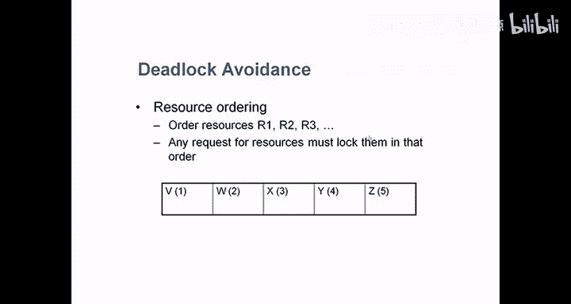
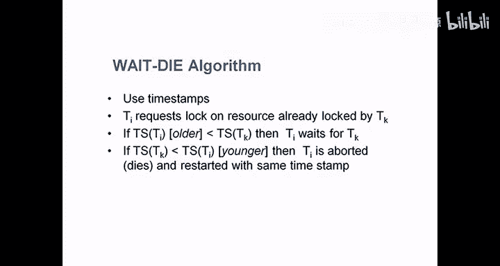
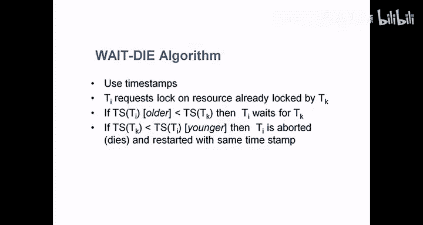
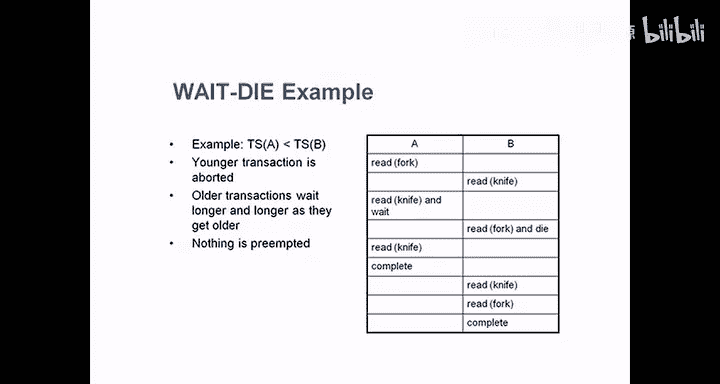
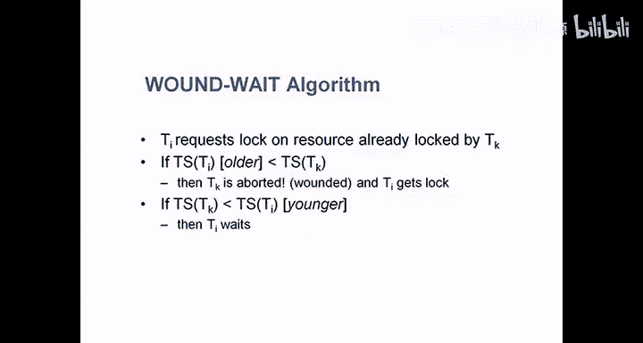
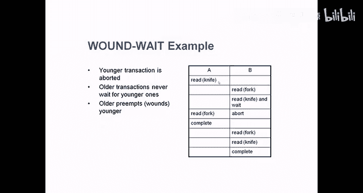
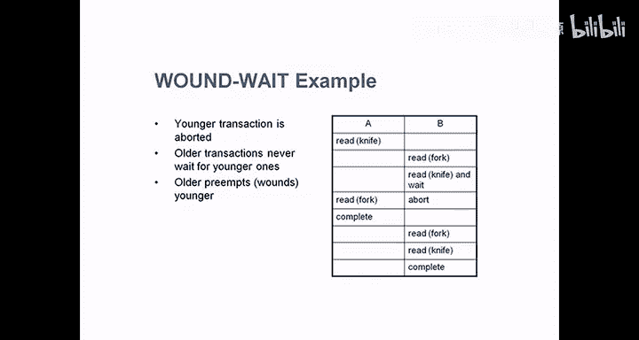
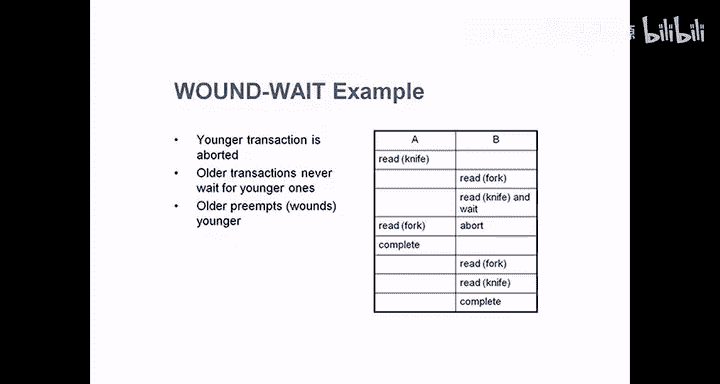

# 课程10：死锁规避 🚫

在本节课中，我们将学习并发控制中的死锁规避策略。死锁是多个事务因相互等待对方释放资源而无法继续执行的状态。为了避免这种情况，数据库系统采用了多种算法。我们将探讨资源排序法、等死算法和伤等算法这三种主要策略，并理解它们如何通过不同的机制来预防死锁的发生。

---

## 资源排序法

上一节我们介绍了死锁的基本概念，本节中我们来看看第一种规避策略：资源排序法。

这种方案的核心思想是为系统中的所有资源规定一个全局的、固定的顺序。当事务需要锁定多个资源时，必须严格按照这个顺序（例如，从编号最小的资源到编号最大的资源）来申请锁。

以下是该方法的运作原理：
*   系统为所有资源（例如数据项 V, W, X, Y, Z）分配一个唯一的编号。
*   任何事务（如 `Trans1` 或 `Trans2`）在申请锁时，都必须从它所需资源中编号最小的那个开始，依次申请到编号最大的。
*   由于所有事务都遵循相同的加锁顺序，因此永远不会出现事务A持有资源R1并等待资源R2，而事务B持有资源R2并等待资源R1的循环等待情况，从而避免了死锁。

这种方法在大型数据库系统中可能不太实用，因为需要管理和维护大量资源的全局顺序。

---

## 等死算法

了解了基于静态顺序的方法后，我们来看一种基于动态时间戳的策略：等死算法。

该算法为每个事务分配一个唯一的时间戳。当一个事务 `Ti` 请求一个已被另一个事务 `Tk` 锁定的资源时，系统会比较两者的时间戳（即“年龄”），并根据比较结果采取不同行动。

以下是具体的决策规则：
*   **如果 `Ti` 比 `Tk` 更老（即 `Ti` 的时间戳更小）**：`Ti` 会**等待** `Tk` 完成并释放锁。
*   **如果 `Ti` 比 `Tk` 更年轻（即 `Ti` 的时间戳更大）**：`Ti` 会**中止（死亡）** 自身，稍后以**相同的时间戳**重新启动。

**举例说明**：
1.  事务A（较老）读取了“刀”。
2.  事务B（较年轻）读取了“叉”。
3.  事务A尝试读取“叉”，发现已被B锁定。由于A更老，它选择**等待**B。
4.  事务B尝试读取“刀”，发现已被A锁定。由于B更年轻，它根据规则**中止**自身，释放“叉”的锁。
5.  事务A获得“叉”的锁，完成操作后释放所有锁。
6.  事务B重启，此时可以顺利获得“刀”和“叉”的锁并完成操作。

等死算法的一个潜在问题是，较老的事务可能需要等待很长时间，甚至可能“饿死”。

---

## 伤等算法

为了解决等死算法中老事务可能长时间等待的问题，我们引入另一种基于时间戳的算法：伤等算法。

当一个事务 `Ti` 请求一个已被事务 `Tk` 锁定的资源时，算法同样比较两者的时间戳，但行为规则不同。

以下是该算法的决策逻辑：
*   **如果 `Ti` 比 `Tk` 更老**：`Ti` 会**中止（伤害）** 较年轻的事务 `Tk`，迫使 `Tk` 释放锁，然后 `Ti` 获得锁并继续。
*   **如果 `Ti` 比 `Tk` 更年轻**：`Ti` 会**等待** `Tk` 完成。

**举例说明**：
1.  事务A（较老）读取了“刀”。
2.  事务B（较年轻）读取了“叉”。
3.  事务B尝试读取“刀”，发现已被A锁定。由于B更年轻，它选择**等待**。
4.  事务A尝试读取“叉”，发现已被B锁定。由于A更老，它会**中止**事务B。
5.  事务A获得“叉”的锁，完成操作后释放所有锁。
6.  事务B重启后，可以顺利获得“刀”和“叉”的锁并完成操作。

在这种策略下，老事务永远不会等待年轻事务，从而保证了老事务能够优先完成。

---

## 总结

本节课中我们一起学习了三种主要的死锁规避策略。
*   **资源排序法**通过强制所有事务遵循统一的加锁顺序来预防循环等待。
*   **等死算法**利用时间戳，让年轻的事务在冲突时牺牲自己，以避免死锁。
*   **伤等算法**同样利用时间戳，但让老事务在冲突时中止年轻的事务，以优先保证老事务的执行。

每种策略都有其适用场景和权衡，数据库系统设计者会根据具体需求选择合适的机制来管理并发并避免死锁。