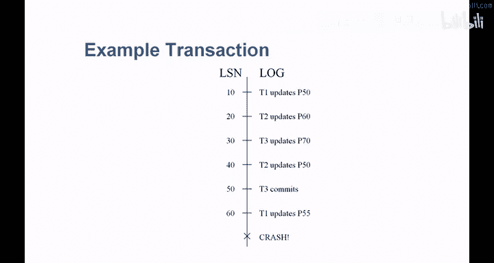
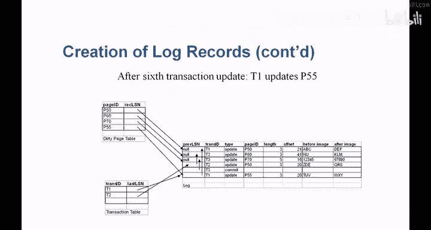
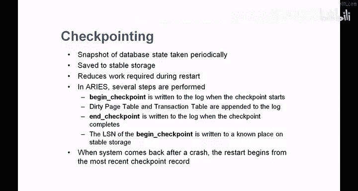
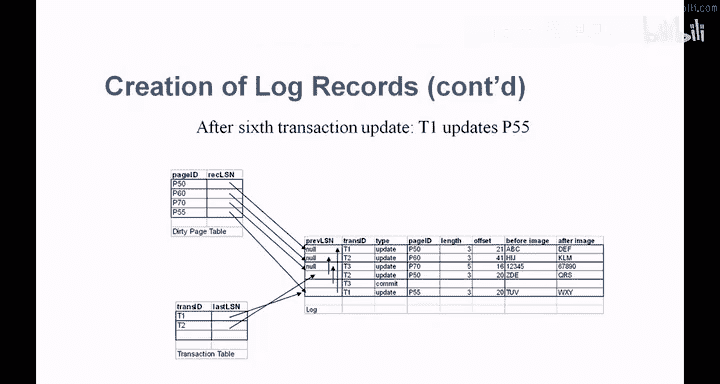
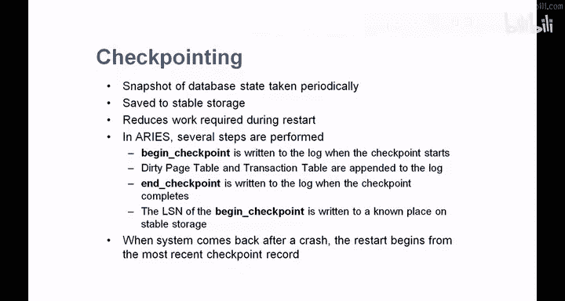

# 课程名称：大规模数据库系统 - 第12课：事务案例 📊

## 概述

在本节课中，我们将通过一个具体的事务操作序列示例，学习数据库系统如何利用日志（Log）、脏页表（Dirty Page Table）和事务表（Transaction Table）来追踪数据变化，并理解系统崩溃后如何利用这些信息进行恢复。我们将一步步解析每个操作对这三个核心数据结构的影响。

---

## 事务操作序列示例

假设我们有一个按时间顺序发生的事务操作序列。左侧是日志序列号（Log Sequence Number, LSN），它按顺序单调递增分配。右侧代表不同事务在一段时间内的操作。

以下是操作序列：
*   LSN 10: 事务 T1 更新内存数据库的第 50 页。
*   LSN 20: 事务 T2 更新第 60 页。
*   LSN 30: 事务 T3 更新第 70 页。
*   LSN 40: 事务 T2 再次更新第 50 页。
*   LSN 50: 事务 T3 提交。
*   LSN 60: 事务 T1 更新第 55 页。
*   随后，系统发生崩溃。

接下来，我们将详细分析每个步骤后，日志、脏页表和事务表的状态变化。

---

## 第一步：T1 更新页 50 (LSN 10)

当第一个事务 T1 更新第 50 页时，系统需要记录这次操作。

**日志表** 中新增一条记录。由于这是事务 T1 的第一次操作，其“前一个LSN”字段为空。记录内容如下：
*   **LSN**: 10
*   **PrevLSN**: `NULL`
*   **TID**: T1
*   **Type**: `UPDATE`
*   **PageID**: 50
*   **修改描述**: 例如，在偏移量 21 处修改了 3 个字符，将 “ABC” 改为 “DEF”。

**脏页表** 用于追踪哪些页被未提交的事务修改过。由于第 50 页首次变“脏”，我们在表中添加一条记录：
*   **PageID**: 50
*   **RecLSN**: 10 (指向使该页变脏的第一条日志记录)

**事务表** 用于追踪所有活跃（未提交）事务的最新日志位置。我们为 T1 添加一条记录：
*   **TID**: T1
*   **LastLSN**: 10 (指向该事务最新的日志记录)

---

## 第二步：T2 更新页 60 (LSN 20)

现在，事务 T2 更新第 60 页。

在 **日志表** 中为 T2 创建第一条记录：
*   **LSN**: 20
*   **PrevLSN**: `NULL` (T2 的第一个操作)
*   **TID**: T2
*   **Type**: `UPDATE`
*   **PageID**: 60
*   **修改描述**: 例如，在偏移量 41 处将 “HIJ” 改为 “KLM”。

在 **脏页表** 中，第 60 页首次变脏，添加记录：
*   **PageID**: 60
*   **RecLSN**: 20

在 **事务表** 中，添加事务 T2 的记录：
*   **TID**: T2
*   **LastLSN**: 20

---

## 第三步：T3 更新页 70 (LSN 30)

事务 T3 开始并更新第 70 页。

**日志表** 新增 T3 的记录：
*   **LSN**: 30
*   **PrevLSN**: `NULL`
*   **TID**: T3
*   **Type**: `UPDATE`
*   **PageID**: 70
*   **修改描述**: 例如，在偏移量 16 处将 “12345” 改为 “67890”。

**脏页表** 新增第 70 页的记录：
*   **PageID**: 70
*   **RecLSN**: 30

**事务表** 新增 T3 的记录：
*   **TID**: T3
*   **LastLSN**: 30

---

## 第四步：T2 更新页 50 (LSN 40)

事务 T2 再次执行操作，这次更新第 50 页。

在 **日志表** 中为 T2 新增一条记录。此时，T2 已有一条记录（LSN 20）。我们需要从 **事务表** 中查找 T2 的 `LastLSN`（当前是 20），并将其作为新记录的 `PrevLSN`，以维护事务内的操作链。
*   **LSN**: 40
*   **PrevLSN**: 20 (来自事务表中 T2 的 LastLSN)
*   **TID**: T2
*   **Type**: `UPDATE`
*   **PageID**: 50
*   **修改描述**: 例如，在偏移量 20 处将 “ZDE” 改为 “QRS”。

**脏页表** 无需更新。因为第 50 页已经在 LSN 10 时被标记为脏页，`RecLSN` 仍然指向最早的修改记录 10。

**事务表** 需要更新 T2 的 `LastLSN` 指针，指向其最新的操作：
*   **TID**: T2
*   **LastLSN**: 40 (更新为新的 LSN)

---

## 第五步：T3 提交 (LSN 50)

事务 T3 成功提交。

在 **日志表** 中记录提交操作：
*   **LSN**: 50
*   **PrevLSN**: 30 (T3 上一条操作的 LSN)
*   **TID**: T3
*   **Type**: `COMMIT`

**脏页表** 不变。提交操作不产生新的脏页。

**事务表** 需要移除已提交的事务 T3。因此，T3 的记录被删除。

---

## 第六步：T1 更新页 55 (LSN 60) 与系统崩溃

事务 T1 更新第 55 页，随后系统崩溃。

**日志表** 记录 T1 的新操作。从事务表查得 T1 的 `LastLSN` 为 10，将其作为 `PrevLSN`：
*   **LSN**: 60
*   **PrevLSN**: 10
*   **TID**: T1
*   **Type**: `UPDATE`
*   **PageID**: 55
*   **修改描述**: 例如，在偏移量 20 处将 “TUV” 改为 “WXY”。

**脏页表** 新增第 55 页的记录，因为这是它第一次被修改：
*   **PageID**: 55
*   **RecLSN**: 60

**事务表** 更新 T1 的 `LastLSN`：
*   **TID**: T1
*   **LastLSN**: 60

此时系统崩溃。内存中的脏页表和事务表丢失，只有持久化存储中的 **日志** 得以保存。

---

## 崩溃恢复的目标与挑战

系统重启后，恢复机制开始工作。目标是利用日志重建崩溃前的状态，但确保 **未提交事务（T1, T2）的所有修改都不会生效**。已提交事务（T3）的修改必须生效。

面临的挑战是，日志可能非常庞大，从头开始扫描重建脏页表和事务表效率低下。

---

## 检查点（Checkpoint）机制

为了解决上述挑战，数据库系统定期执行 **检查点** 操作。

检查点的过程如下：
1.  向日志写入一条 `BEGIN_CHECKPOINT` 记录。
2.  将当前内存中的 **脏页表** 和 **事务表** 的快照写入稳定存储（通常是追加到日志中）。
3.  向日志写入一条 `END_CHECKPOINT` 记录。

这样，当系统崩溃后恢复时，可以从最近一个检查点开始读取日志，快速重建崩溃时刻的脏页表和事务表，而无需扫描全部历史日志，大大提高了恢复效率。

---

## 总结

本节课中，我们一起学习了一个完整的事务操作案例。我们看到了：
1.  每个数据修改操作如何被记录到 **日志** 中。
2.  **脏页表** 如何追踪每个数据页的第一次未提交修改。
3.  **事务表** 如何链式追踪每个未提交事务的所有操作。
4.  系统崩溃后，持久化的日志是恢复的唯一依据。
5.  **检查点** 机制如何优化恢复过程，避免从日志开头进行全量扫描。

在接下来的课程中，我们将深入探讨如何利用重建后的脏页表和事务表，具体执行 **重做（Redo）** 和 **撤销（Undo）** 阶段，从而将数据库恢复到一致的正确状态。