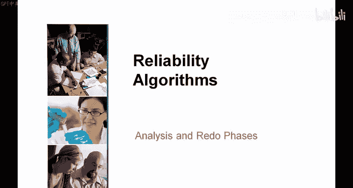
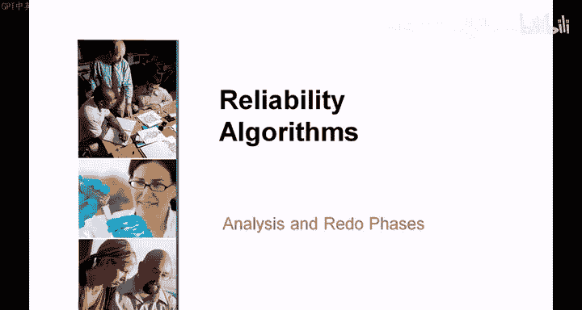
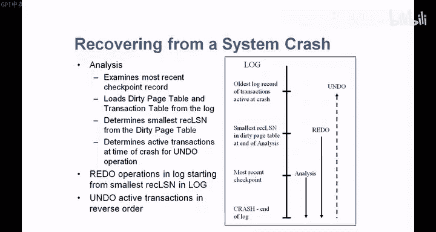
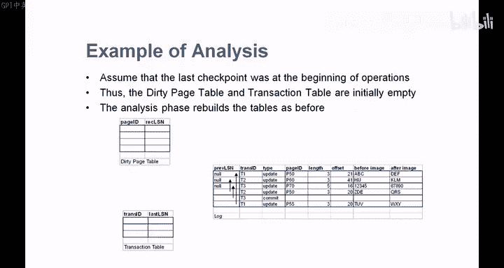
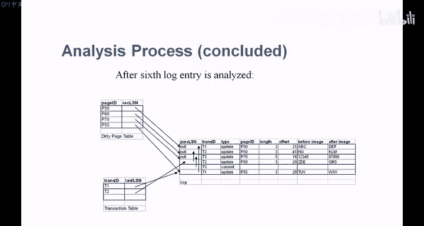
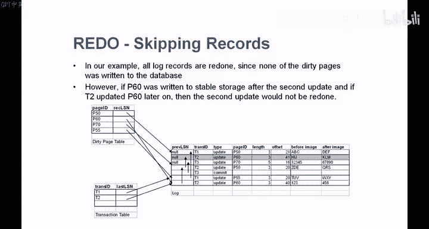

# 课程13：大规模数据库系统 - 分析与重做阶段 📊

在本节课中，我们将学习数据库系统崩溃恢复过程中的前两个关键阶段：**分析阶段**与**重做阶段**。我们将了解系统如何通过日志文件重建崩溃前的状态，并重新执行必要的操作以确保数据一致性。

---

## 概述

当数据库系统从崩溃中恢复时，会执行一个包含三个阶段的算法。本节课将重点讲解前两个阶段：**分析阶段**和**重做阶段**。分析阶段负责确定需要重做和撤销哪些操作，而重做阶段则负责重新执行这些操作，将数据库恢复到崩溃前的状态。

---

## 分析阶段 🔍

上一节我们介绍了恢复过程的整体框架，本节中我们来看看第一个阶段——分析阶段的具体工作。

分析阶段是恢复过程的第一步。它的核心目标是：通过检查日志，重建崩溃发生时**脏页表**和**事务表**的状态。这两个表记录了哪些数据页被修改过（脏页）以及哪些事务正在进行中。

分析阶段的具体步骤如下：

1.  **定位并读取最近的检查点记录**。检查点记录了某个时刻数据库的完整状态，包括当时的脏页表和事务表。
2.  **基于该检查点记录，在内存中重建脏页表和事务表**。
3.  **从检查点开始，向前扫描日志文件**，直到日志末尾（即崩溃点）。
4.  在扫描过程中，动态更新这两个表：
    *   如果遇到一个使新页面变“脏”的日志记录，就将该页面及其对应的**日志序列号**加入脏页表。
    *   如果遇到一个新事务开始的记录，就将该事务加入事务表。
    *   如果遇到一个事务提交的记录，就将该从事务表中移除。

通过这个过程，在分析阶段结束时，内存中的脏页表和事务表就与系统崩溃瞬间的状态完全一致。这为后续的重做和撤销阶段提供了准确的依据。

以下是分析阶段的一个简化示例。我们假设最近的检查点发生在所有操作之前，并且初始的脏页表和事务表为空。

我们有一条在崩溃前生成的日志，分析过程将逐条处理这些记录：

*   **第一条日志记录被分析**：事务T1更新了页面P50。因此，在脏页表中添加P50及其LSN，在事务表中添加T1并指向此日志记录。
*   **第二条日志记录被分析**：事务T2更新了页面P60。因此，在脏页表中添加P60及其LSN，在事务表中添加T2并指向此日志记录。
*   **第三条日志记录被分析**：事务T3更新了页面P70。因此，在脏页表中添加P70及其LSN，在事务表中添加T3并指向此日志记录。
*   **第四条日志记录被分析**：事务T2进行了另一次更新。因此，更新事务表中T2的指针，使其指向这条新的日志记录。脏页表无变化。
*   **第五条日志记录被分析**：事务T3提交。因此，从事务表中移除T3。
*   **第六条日志记录被分析**：事务T1更新了页面P55。因此，更新事务表中T1的指针，并在脏页表中添加P55及其LSN。

至此，分析阶段结束。我们得到了与崩溃时刻完全一致的脏页表和事务表，可以进入下一个阶段。

---

## 重做阶段 🔄

在分析阶段，我们成功重建了系统崩溃时的状态信息。现在，我们进入恢复的第二个阶段——重做阶段。

重做阶段的目标是：**重新执行所有必要的修改**，确保所有已提交和未提交事务对数据库的更新都反映在磁盘上。它从脏页表中**最早的日志序列号**开始，顺序重做日志中的所有操作。

重做阶段的具体规则如下：

*   **起点**：从脏页表中所有LSN的**最小值**对应的日志记录开始。
*   **操作**：对于每一条可重做的日志记录（通常是更新记录），无论其对应的事务是否已提交，都重新执行一次该操作。例如，一条日志记录是 `UPDATE Page 50, offset 21: ‘ABC’ -> ‘DEF’`，那么重做阶段就会再次将页面50的偏移量21处的内容改为‘DEF’。
*   **优化**：为了提高效率，重做操作有一个重要的**避免重复写入**的规则。在应用一条日志记录前，系统会检查目标页面的当前LSN。如果该页面的当前LSN **大于或等于** 要重做的日志记录的LSN，则说明这个修改可能已经被写入磁盘（例如，由检查点或缓冲区管理器提前写回），此时就**跳过**这条重做记录。这可以用以下逻辑判断：
    `if (page.current_lsn >= log_record.lsn) { skip_redo(); }`

通过重做阶段，数据库被推进到了崩溃前那一刻所有已完成操作所应达到的状态。即使某些已提交事务的修改在崩溃前未能写回磁盘，现在也被重新执行并持久化了。

---

## 总结

本节课中我们一起学习了ARIES恢复算法中的前两个阶段。

*   **分析阶段**：通过从最近检查点开始扫描日志，精确重建了崩溃瞬间的**脏页表**和**事务表**，明确了哪些操作需要重做，哪些事务需要撤销。
*   **重做阶段**：从最早的脏页操作开始，**重新执行**日志中的所有更新操作（遵循LSN检查以避免冗余），确保所有数据修改都持久化到磁盘上，将数据库恢复到崩溃前的物理状态。

完成重做阶段后，数据库包含了所有已提交和未提交事务的修改。下一个阶段——**撤销阶段**，将负责回滚那些未提交的事务，以维护数据库的原子性和逻辑一致性。我们将在下一课中进行讲解。