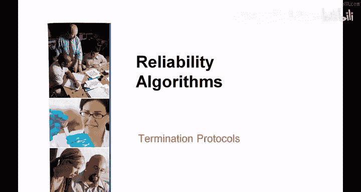
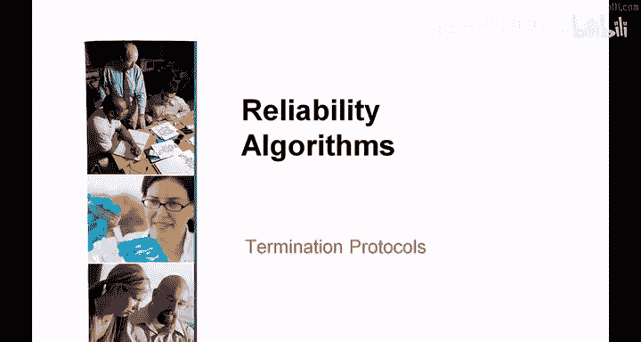
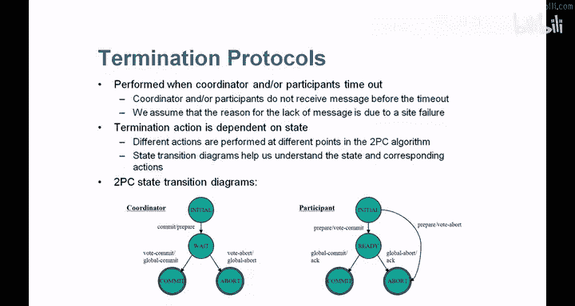
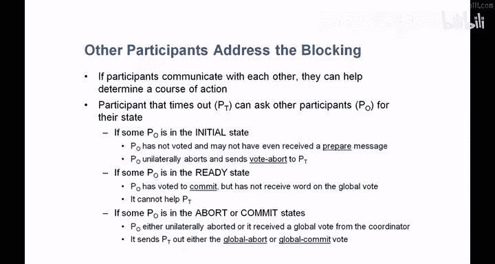
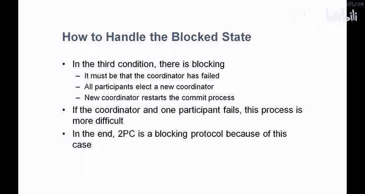
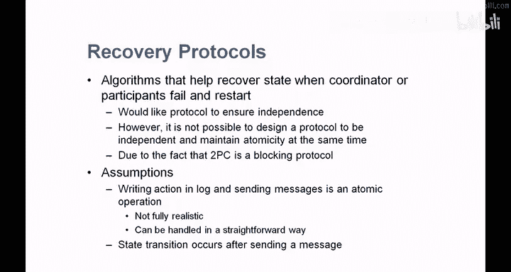
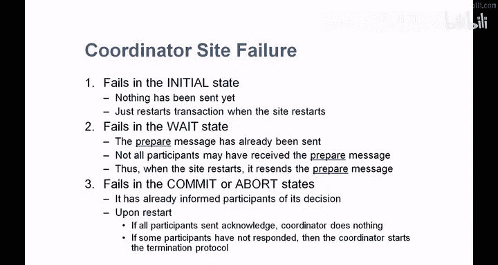

# 课程15：终止协议 🛑

在本节课中，我们将学习两阶段提交协议中的终止协议。当协调者或参与者发生超时或故障时，系统需要特定的流程来恢复并决定事务的最终状态，以确保数据的一致性。我们将详细探讨各种情况下的处理逻辑。

---

## 协调者与参与者的状态转换图

上一节我们介绍了两阶段提交的基本流程，本节中我们来看看协调者和参与者的状态转换图，这是理解终止协议的基础。

协调者的状态转换如下：
*   **初始状态**：协调者向所有参与者发送 `PREPARE` 消息。
*   **等待状态**：协调者等待所有参与者的投票。
*   **提交状态**：如果所有参与者都投票“提交”，协调者发送 `GLOBAL-COMMIT` 消息。
*   **中止状态**：如果任一参与者投票“中止”，协调者发送 `GLOBAL-ABORT` 消息。

参与者的状态转换如下：
*   **初始状态**：参与者等待 `PREPARE` 消息。
*   **就绪状态**：如果参与者可以提交，它投票“提交”并进入此状态，等待协调者的最终决定。
*   **提交状态**：收到 `GLOBAL-COMMIT` 消息后提交事务。
*   **中止状态**：在初始状态投票“中止”，或收到 `GLOBAL-ABORT` 消息后中止事务。

---

## 协调者超时处理

了解了基本状态后，我们来看看当协调者发生超时时应如何处理。协调者超时可能发生在等待状态，也可能发生在提交或中止状态。

以下是协调者超时的处理逻辑：

*   **在等待状态下超时**：协调者尚未收到所有参与者的投票。由于无法单方面提交（需要全体一致），协调者可以单方面决定中止。它会向所有参与者发送 `GLOBAL-ABORT` 消息。
*   **在提交或中止状态下超时**：协调者已发出最终指令（`GLOBAL-COMMIT` 或 `GLOBAL-ABORT`），但不确定所有参与者是否已执行完毕。它会**重复发送**最终指令，直到收到所有参与者的确认。

---

## 参与者超时处理

现在，我们转向参与者的超时情况。参与者的超时可能发生在初始状态或就绪状态，处理方式有所不同。

以下是参与者超时的处理逻辑：

*   **在初始状态下超时**：参与者一直在等待 `PREPARE` 消息但未收到，推测协调者可能已故障。参与者可以**单方面中止**事务，并向协调者发送“中止”投票。
*   **在就绪状态下超时**：参与者已投票“提交”，但未收到协调者的最终决定。此时，参与者**不能单方面做出决定**，否则可能破坏原子性。它必须询问其他参与者以决定下一步行动。

---

## 参与者查询协议

当参与者在就绪状态下超时且联系不上协调者时，它可以通过查询其他参与者来收集信息并做出决定。这个过程称为参与者查询协议。

以下是参与者根据查询结果采取的行动：

1.  **如果任何参与者处于“初始”或“中止”状态**：这意味着至少有一个参与者会投票或已经决定中止。因此，查询者可以安全地**中止**事务。
2.  **如果任何参与者处于“提交”状态**：这意味着协调者已发出 `GLOBAL-COMMIT` 指令。因此，查询者可以安全地**提交**事务。
3.  **如果所有被查询的参与者都处于“就绪”状态**：这是一个**阻塞**情况。所有参与者都投票同意提交，但都不知道最终决定。此时，参与者们需要选举一个新的协调者，由新协调者重新发起提交协议。
4.  **如果协调者与一个参与者同时故障**：且所有存活参与者均处于“就绪”状态，则协议将**永久阻塞**，因为无法确定故障参与者的投票和协调者的决定。这是两阶段提交协议的一个严重缺点。

---

## 故障恢复协议

最后，我们探讨当协调者或参与者的站点发生故障并重启后，应如何恢复。恢复行动取决于故障发生时实体所处的状态。

**协调者站点故障恢复：**

*   **在初始状态故障**：重启后无事可做，可重新开始事务。
*   **在等待状态故障**：重启后重新向所有参与者发送 `PREPARE` 消息，并等待投票。
*   **在提交/中止状态故障**：重启后，向未确认的参与者**重复发送**最终的 `GLOBAL-COMMIT` 或 `GLOBAL-ABORT` 消息。

**参与者站点故障恢复：**

*   **在初始状态故障**：重启后，参与者应**单方面中止**事务。
*   **在就绪状态故障**：重启后，参与者发现自己处于“就绪”状态但无协调者消息。此时，应**启动参与者查询协议**（如上节所述）来决定提交或中止。
*   **在提交/中止状态故障**：事务已经完成，无需特殊操作。

---

## 总结

本节课中我们一起学习了两阶段提交协议中的终止协议。我们分析了协调者和参与者在各种超时及站点故障场景下的处理逻辑，包括状态转换、单方面中止决策、参与者查询协议以及故障恢复步骤。关键点在于，两阶段提交协议在协调者与一个参与者同时故障且其他参与者均处于“就绪”状态时，可能导致系统阻塞，这揭示了该协议的一个主要缺陷。在接下来的课程中，我们将介绍三阶段提交协议，它被设计用来解决这种阻塞问题。