# 课程名称：大规模数据库系统 - P6：数据库架构分类 🗂️

## 概述

在本节课中，我们将学习分布式数据库系统的架构分类。我们将探讨三个独立的衡量维度：自治性、分布性和异构性，并了解如何通过这些维度来定义和设计不同的分布式数据库系统。

---

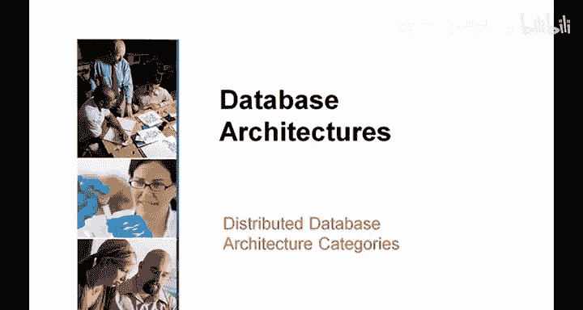

## 自治性的不同定义

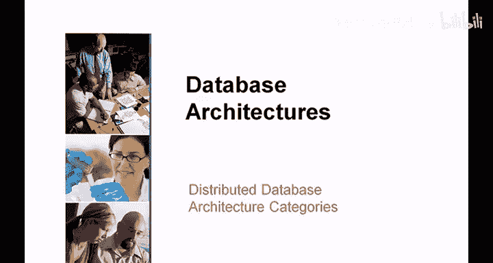

上一节我们介绍了分布式数据库系统的三个衡量维度。本节中，我们来看看第一个维度——自治性。自治性指的是数据库系统在参与全局分布式系统时，其本地操作不受影响的程度。

以下是几种不同的自治性定义：

*   **Gligor 和 Luck 的定义**：本地操作不受参与全局多数据库系统的影响。这意味着连接到分布式数据库的任何数据库都可以独立运行，无需了解全局模式。全局系统的查询处理和优化也不受全局查询访问的影响。
*   **Garcia-Molina 的定义**：他们从不同方面衡量自治性。
    *   **设计自治性**：数据库是否必须使用共同的数据库模型和事务管理方案。
    *   **通信自治性**：数据库是否能自主决定向分布式系统提供哪些数据。
    *   **执行自治性**：数据库是否能按自己的方式执行查询，而不是由分布式系统强制规定执行方式。

我们的教材作者 Özsu 和 Valduriez 则从集成程度的角度定义了三种自治性类别：

1.  **紧密集成**：呈现单一数据库映像。
2.  **半自治**：数据库自行决定共享、交换和修改哪些数据。
3.  **完全隔离**：数据库是独立的，参与分布式系统但不关心其他数据库的数据表示。

从紧密集成到完全隔离，构成了自治性的一个连续谱系。完全隔离意味着完全自治。这是分布式数据库系统的一个关键设计特性，设计者可以选择谱系上的任意一点。

---

## 分布性：从集中到对等

理解了自治性后，我们转向第二个维度——分布性。它描述了数据库功能在物理或逻辑上的分散程度。

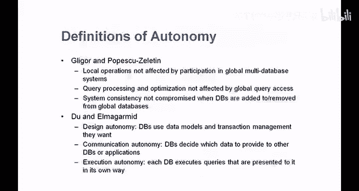

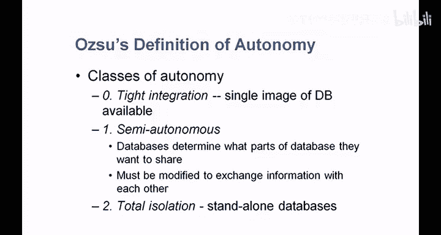

以下是分布性的主要类别：

*   **非分布式**：所有功能集中在一处。
*   **客户端-服务器架构**：数据库功能分布在客户端和服务器之间。
*   **对等架构**：完全分布式的系统，每个节点平等协作。

分布性维度与自治性维度是正交的。在设计分布式数据库时，你可以独立选择这两个维度的属性，并以任意方式组合它们。

---

## 异构性：同质与异质的系统

最后，我们探讨第三个维度——异构性。它衡量被集成的各个数据库系统之间的差异程度。

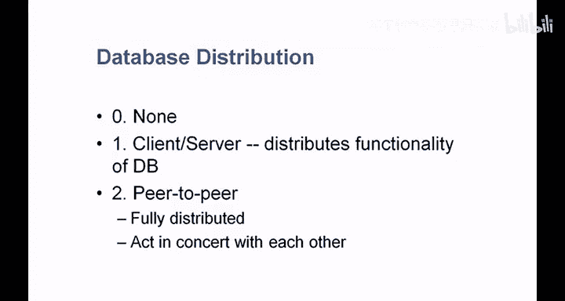

异构性可能体现在以下几个方面：

*   不同的硬件平台。
*   不同的数据模型。
*   不同的查询语言。
*   不同的事务模型。

系统间的差异越大，异构性就越高。在设计架构时，你需要评估并决定系统需要处理多大程度的异构性。

---

## 架构组合示例

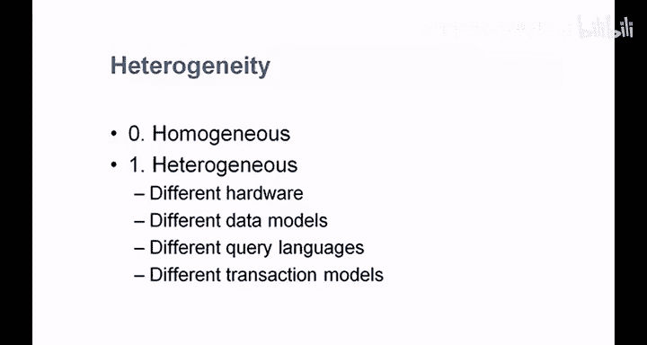

现在，我们将三个维度结合起来看。你可以选择这三个维度的不同组合来定义你的分布式数据库系统。

例如：

1.  **组合一**：`自治性=0`（紧密集成），`分布性=2`（对等），`异构性=1`（同质平台）。这定义了一个紧密集成、完全分布但在同质平台上的系统。
2.  **组合二**：`自治性=1`（半自治），`分布性=0`（非分布），`异构性=1`（异构访问）。这类似于一个位于单一机器上但能处理异构数据源的联邦数据库系统。
3.  **组合三**：`自治性=2`（完全自治），`分布性=1`（分布），`异构性=1`（异构）。这描述了一个由散布在不同机器上、完全自治且彼此异构的数据库组成的系统。

你可以通过选择自治性、分布性和异构性的级别，来构建任何形式的分布式数据库架构。

---

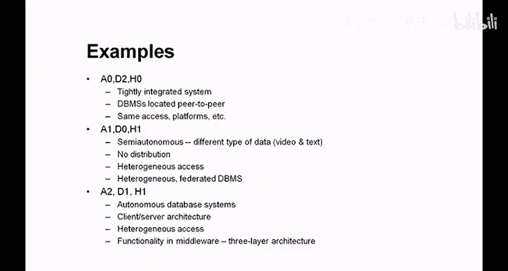

## 客户端-服务器架构详解

客户端-服务器架构是分布性维度中的一种常见模式。让我们更详细地了解它。

在分布性为 `D1` 的客户端-服务器模型中，通常有几种配置：

*   **多客户端对单服务器**：多个客户端访问一个中央数据库服务器。
*   **多客户端对多服务器**：这又衍生出两种子模式：
    *   **客户端管理集成**：每个客户端应用程序自己负责协调访问多个服务器。这增加了客户端的复杂性，因为每个应用都需要了解如何集成不同服务器的数据。
    *   **服务器管理集成**：客户端只访问一个“中间”服务器，由该服务器负责将请求分发和管理到其他后端服务器。这实现了“瘦客户端”，将数据集成的工作负担放在了服务器端。

从用户视角看，客户端-服务器架构的典型分层如下：

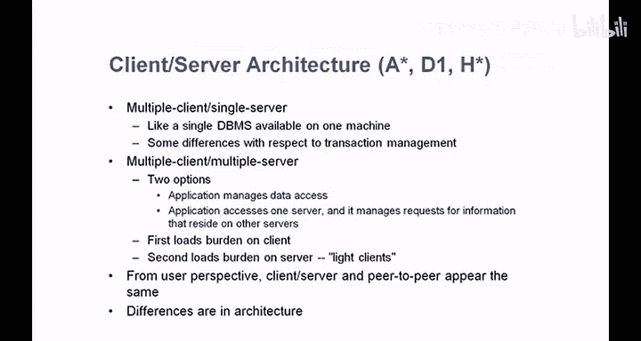

```
[应用程序/用户界面] -> [客户端DBMS] -> [通信软件]
                                      ↓
[服务器通信层] -> [查询处理器] -> [语义数据控制器/查询优化器/事务管理器等]
```

所有数据库核心功能（如查询优化、事务管理、恢复）都集中在服务器端。

---

## 对等架构详解

接下来，我们看看完全分布式的对等架构。

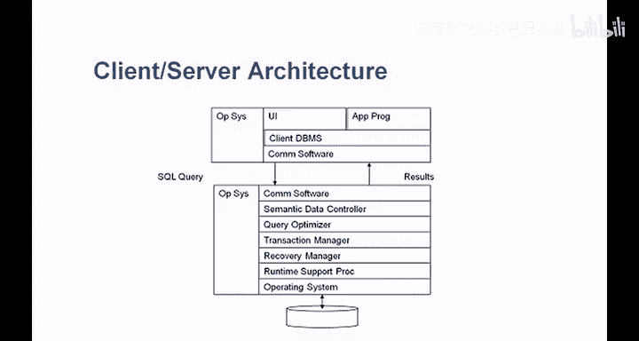

对等架构通常意味着较低的自治性（`A0`），因为所有节点都需要意识到彼此是更大系统的一部分，并协同工作。但它提供了数据位置上的独立性。

对等架构的关键特点是具有一个**全局概念模式**。其架构层次如下：

```
[外部模式1]  [外部模式2] ... [外部模式N]
                ↓ (映射)
          [全局概念模式]
                ↓ (映射)
    [本地概念模式1]  [本地概念模式2] ...
          ↓                ↓
    [本地内部模式1]  [本地内部模式2] ...
```

在对等架构中，一个核心的**分布式数据库管理系统层**负责处理整个查询。其工作流程是：

1.  用户通过用户界面处理器提交查询。
2.  分布式DBMS层（包含语义数据控制器）接收查询。
3.  该层利用**外部模式**、**全局概念模式**和**全局数据字典**来理解查询。
4.  随后进行全局查询优化，并决定如何将查询分解。
5.  将子查询分发给各个本地数据库服务器。
6.  本地服务器使用自己的**本地模式**处理子查询。
7.  结果返回给分布式DBMS层进行整合，最终返回给用户。

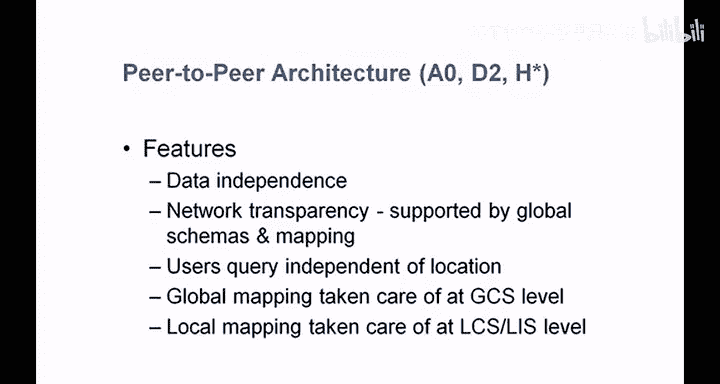

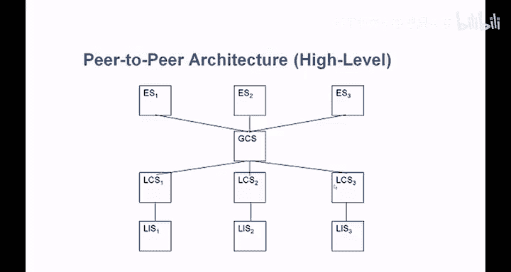

这种架构将许多集成与优化工作提升到了中间的分布式管理层，而本地服务器专注于执行。

---

## 总结

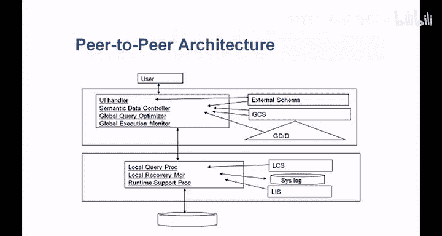

本节课中，我们一起学习了分布式数据库系统的架构分类方法。我们掌握了三个核心的衡量维度：**自治性**（从紧密集成到完全隔离）、**分布性**（从集中式、客户端-服务器到对等式）以及**异构性**（系统间的差异程度）。通过选择这三个维度的不同级别，可以组合出多种多样的分布式数据库架构。我们还深入分析了常见的**客户端-服务器架构**和**对等架构**在结构和工作流程上的特点与区别。理解这些分类是设计和选用合适分布式数据库解决方案的基础。