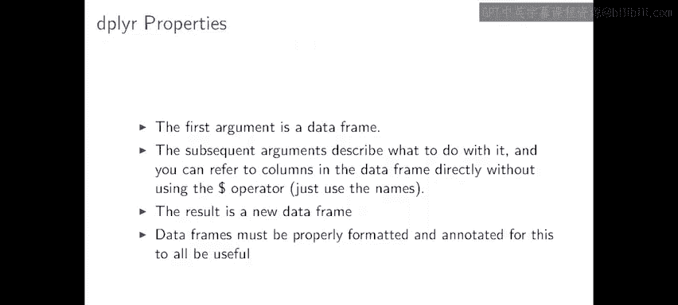

# 数据科学课程3：获取和清理数据 🧹 | P19：使用dplyr管理数据框


在本节课中，我们将学习R语言中的`dplyr`包。这个包是专门为处理数据框而设计的。我们将介绍该包的基础知识，讲解几个核心“动词”：`arrange`、`filter`、`select`、`mutate`和`rename`。我们会展示如何使用这些函数来高效、便捷地操作和管理数据框中的数据。

## 数据框与dplyr的设计理念

`dplyr`包的核心是处理数据框。数据框是统计学和R语言中关键的数据结构。`dplyr`包遵循“整洁数据”的基本假设：在一个数据框中，**每一行代表一个观测**，**每一列代表一个变量、度量或特征**。

`dplyr`包支持多种后端实现来处理数据框，例如`data.table`包或关系数据库系统。在本课程中，我们将使用R默认的实现方式。

`dplyr`包由Hadley Wickham在RStudio开发。它可以看作是`plyr`包的一个优化和精简版本。虽然它在概念上并未提供全新的功能，但它极大地简化了R中许多现有功能的操作，并且运行速度更快，这得益于其许多关键操作是用底层的C++代码编写的。

## dplyr的核心“动词”

`dplyr`提供了一系列用于数据操作的“动词”，它们构成了数据操作的语法。以下是几个基本动词：
*   `select`：返回数据框列的子集。
*   `filter`：提取数据框行的子集。
*   `arrange`：重新排序数据框的行。
*   `rename`：重命名变量（列）。
*   `mutate`：转换或向数据框添加新变量。
*   `summarize`：生成数据框的汇总统计量。

在本演示中，我们将逐一介绍这些“动词”。

## 函数格式与通用规则

所有`dplyr`函数都遵循相似的格式。**第一个参数总是一个数据框**，随后的参数则描述要对该数据框执行什么操作。

例如，在`select`函数中，你通过列名来引用不同的列；在`filter`函数中，你可能会创建一个逻辑测试来筛选行。这些内容就作为函数的第二个（及后续）参数。

这些函数的结果**总是一个新的数据框**。每个函数都接收一个数据框作为参数，并返回一个数据框。因此，你需要确保你的数据框格式正确且注释完整，例如因子水平已标注、变量名齐全，这样才能让这些函数充分发挥作用。

---

上一节我们介绍了`dplyr`包的基本理念和函数通用规则，本节中我们来看看第一个核心动词：`select`。

### 使用 `select` 选择列

`select`函数用于从数据框中选择特定的列（变量）。它允许你通过列名快速提取所需的数据子集。

以下是`select`函数的一些常见用法：

*   `select(data_frame, col1, col2, ...)`：直接按名称选择多个列。
*   `select(data_frame, starts_with("prefix"))`：选择所有以特定字符串开头的列。
*   `select(data_frame, ends_with("suffix"))`：选择所有以特定字符串结尾的列。
*   `select(data_frame, contains("text"))`：选择所有包含特定文本的列。
*   `select(data_frame, matches("regex"))`：使用正则表达式匹配列名。

---

学会了如何选择列之后，我们来看看如何筛选行。这是`filter`函数的功能。

### 使用 `filter` 筛选行

`filter`函数用于根据逻辑条件提取数据框中满足条件的行（观测）。它类似于SQL中的`WHERE`子句。

以下是`filter`函数的基本用法示例，假设我们有一个名为`df`的数据框，其中包含`height`和`gender`列：

*   `filter(df, height > 180)`：筛选出身高大于180的行。
*   `filter(df, gender == "Male")`：筛选出性别为“Male”的行。
*   `filter(df, height > 180 & gender == "Male")`：筛选出身高大于180**且**性别为“Male”的行（与运算）。
*   `filter(df, height > 180 | gender == "Male")`：筛选出身高大于180**或**性别为“Male”的行（或运算）。

---

筛选出我们感兴趣的行之后，有时我们需要对它们进行排序。`arrange`函数可以帮我们做到这一点。

### 使用 `arrange` 排列行

`arrange`函数用于根据一列或多列的值对数据框的行进行重新排序。默认是按升序排列。

以下是`arrange`函数的用法：

*   `arrange(df, column_name)`：根据`column_name`列的值升序排列。
*   `arrange(df, desc(column_name))`：根据`column_name`列的值降序排列（使用`desc()`函数）。
*   `arrange(df, col1, desc(col2))`：先按`col1`升序排列，然后在`col1`相同的情况下按`col2`降序排列。

---

数据框的列名有时可能不够直观或需要统一格式。`rename`函数可以轻松地解决这个问题。

### 使用 `rename` 重命名列

`rename`函数用于更改数据框中一个或多个列的名称。它的语法非常直观：`新名字 = 旧名字`。

其基本格式为：
```r
rename(data_frame, new_name1 = old_name1, new_name2 = old_name2)
```

例如，`rename(df, patient_id = ID, blood_pressure = BP)` 会将`df`中的`ID`列重命名为`patient_id`，将`BP`列重命名为`blood_pressure`。

---

有时，现有的列不足以满足我们的分析需求，我们需要基于现有列创建新的衍生列。这正是`mutate`函数的用武之地。

### 使用 `mutate` 添加/转换列

`mutate`函数用于向数据框中添加新列，或转换现有列。新列通常是基于现有列的计算结果。

其基本格式为：
```r
mutate(data_frame, new_column = expression_based_on_old_columns)
```

例如：
*   `mutate(df, bmi = weight / (height/100)^2)`：计算BMI指数并添加为新列`bmi`。
*   `mutate(df, height_cm = height * 2.54)`：将身高从英寸转换为厘米（假设原`height`列为英寸）。
*   你可以在一行`mutate`调用中创建多个新列。

---

## 总结

本节课中我们一起学习了R语言`dplyr`包的基础知识，这是数据清理和操作中一个极其强大的工具。我们介绍了它的设计理念，即围绕数据框进行操作，并遵循整洁数据的原则。

我们重点讲解了五个核心“动词”：
1.  **`select`**：用于选择数据框中的特定列。
2.  **`filter`**：用于根据条件筛选数据框中的特定行。
3.  **`arrange`**：用于对数据框的行进行排序。
4.  **`rename`**：用于更改列的名称。
5.  **`mutate`**：用于创建新的列或转换现有列。

所有这些函数都遵循一致的语法：第一个参数是数据框，操作结果返回一个新的数据框。掌握这些基础函数，能让你以更高效、更可读的方式管理和转换数据，为后续的数据分析打下坚实基础。



