# 课程3：获取和清理数据 - P21：合并数据 📊


在本节课中，我们将要学习如何在R语言中合并多个数据集。这是数据清理和整合过程中的一个关键步骤，类似于在数据库（如MySQL）中连接多张表。我们将通过一个实际的同行评审实验数据集来演示两种主要的合并方法：基础的`merge`函数和`plyr`包中的`join`函数。


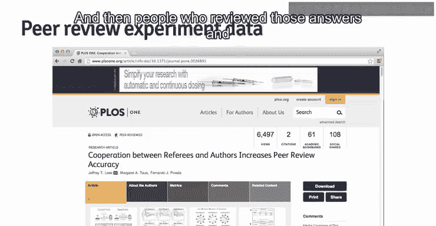

## 概述

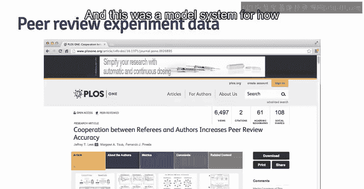

有时，你会在R中加载多个数据集，并希望将它们合并在一起进行分析。通常，合并操作是基于一个共同的标识符（ID）来匹配不同数据集中的记录。本节课将详细介绍如何执行这种操作。

## 合并数据的基础：`merge`函数

上一节我们介绍了合并数据的基本概念。本节中，我们来看看如何使用R内置的`merge`函数。

我们使用的数据来自一个同行评审实验。该实验收集了人们提交的SAT类问题答案，以及其他评审者判断这些答案对错的数据。这模拟了科学研究中同行评审系统的工作方式。

我们可以从Dropbox下载两个文件：`reviews.csv`（包含所有评审记录）和`solutions.csv`（包含所有被解答的问题）。将它们读入R后，我们得到两个数据框。

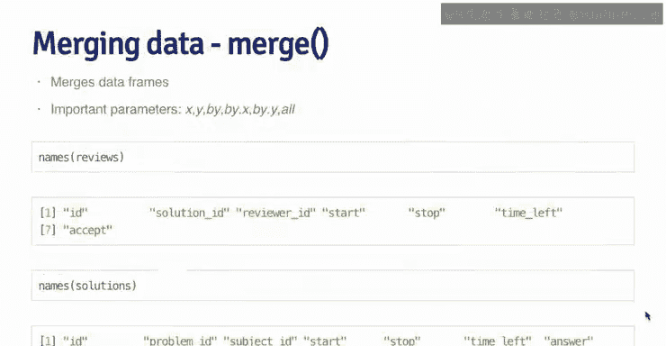

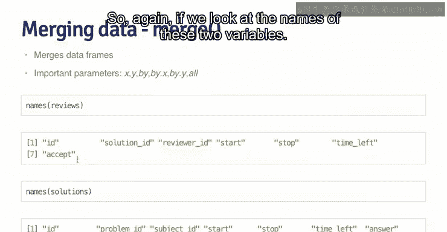

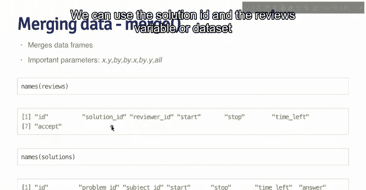

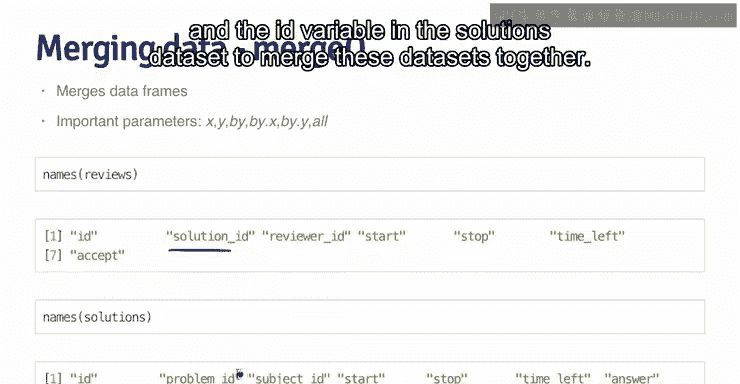

以下是查看数据框变量名的代码：
```r
names(reviews)
names(solutions)
```
在`reviews`数据框中，有一个变量叫`solution_id`。这个ID对应于`solutions`数据集中的`id`变量。`solutions`数据中还有`problem_id`和`subject_id`，它们会与其他数据集匹配，但本示例不涉及。

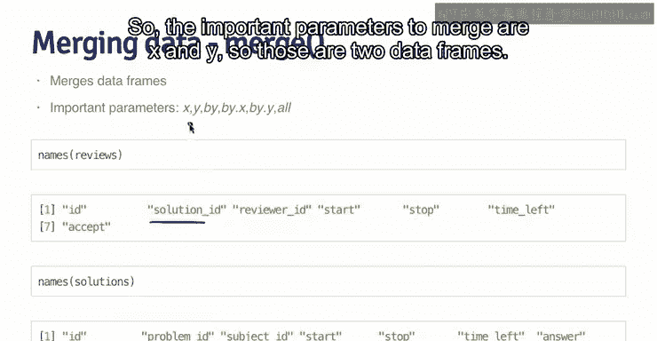


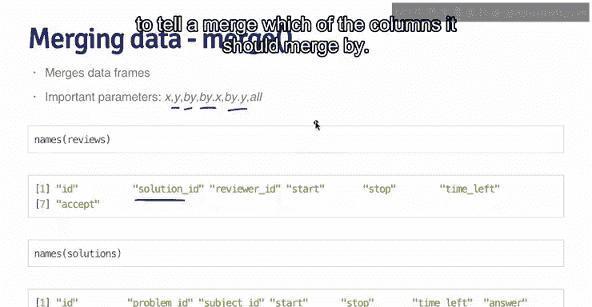

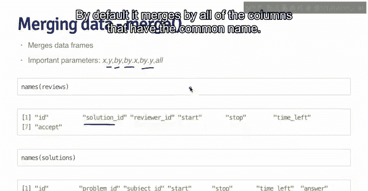

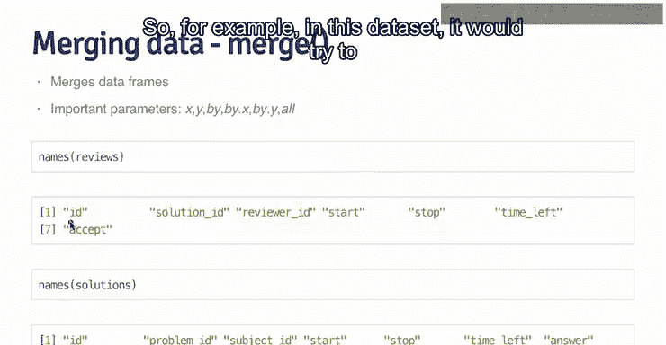

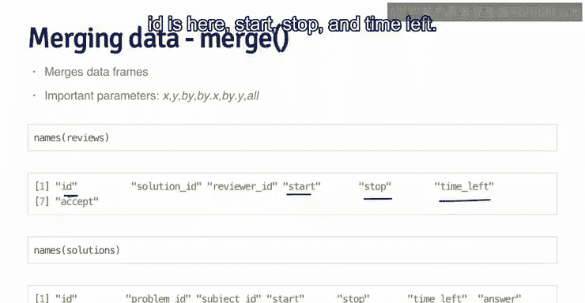

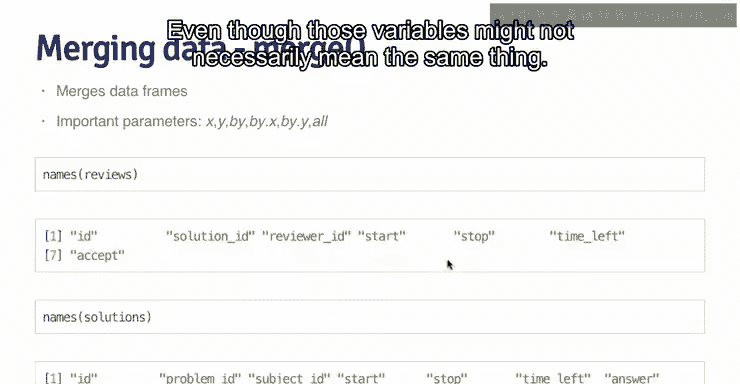

我们首先想使用`merge`命令将这两个数据集合并。`merge`函数的重要参数是`x`和`y`，即两个待合并的数据框。你可以使用`by`、`by.x`或`by.y`参数来指定依据哪一列进行合并。默认情况下，它会尝试合并所有具有共同名称的列。

例如，在本数据中，如果不指定，它会尝试依据`id`、`start`、`stop`、`time_left`等变量合并，因为这些变量名在两个数据框中都出现了。然而，这些变量（除了`id`）在两个数据集中的含义可能并不相同，这会导致错误的合并。

因此，我们需要明确告诉`merge`应该依据哪些变量进行合并。我们将依据`reviews`数据框中的`solution_id`和`solutions`数据框中的`id`进行合并。

以下是执行合并的代码：
```r
mergedData <- merge(reviews, solutions, by.x = "solution_id", by.y = "id", all = TRUE)
```
参数`all = TRUE`意味着，如果一个值出现在一个数据集中但不在另一个中，它仍会包含该行，并为缺失值填充`NA`。

现在，我们可以查看这个新合并数据集的前几行。可以看到，`solution_id`现在取代了`id`的位置，并且数据按此变量排序。而原来的`id`变量（来自`reviews`数据框）被保留了下来。这样，我们就基于共同的ID将两个数据集连接在一起，可以将其作为一个整体进行分析。

默认合并所有共同列名的行为是：如果你对`solutions`和`reviews`数据框的变量名取交集，会得到四个变量。如果不指定合并依据，`merge`会尝试依据所有这四个变量合并。结果就是，`id`变量有时能在两个数据集间匹配上，但`start`和`stop`时间不一定能匹配，最终会生成一个更大的数据框，为`reviews`的每一行和`solutions`的每一行创建组合，这通常不是我们想要的结果。

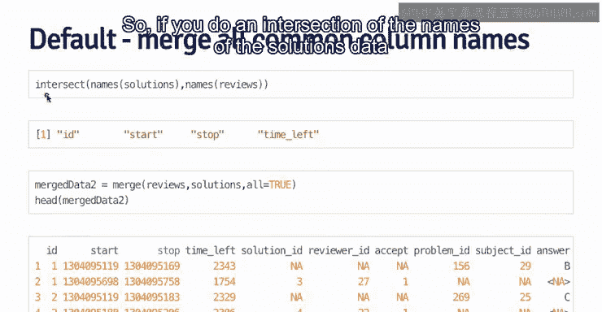

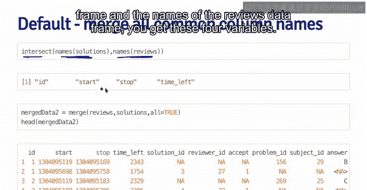

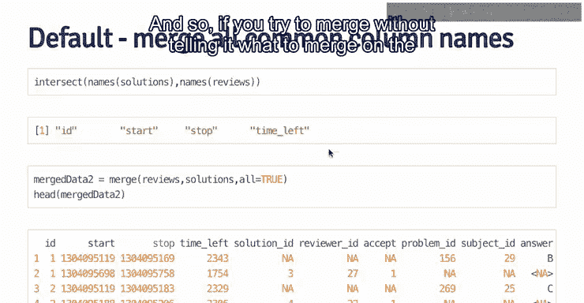

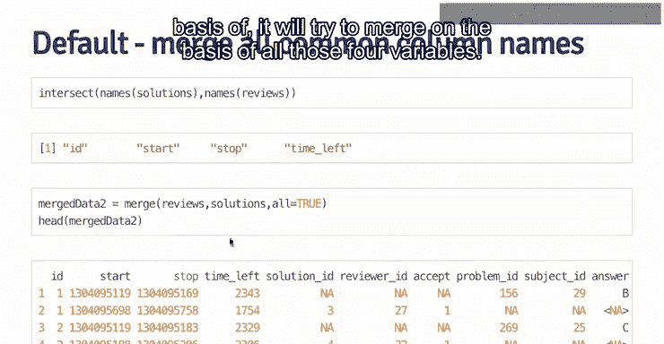

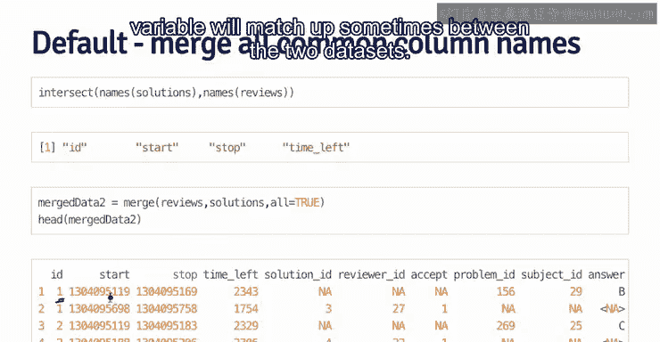

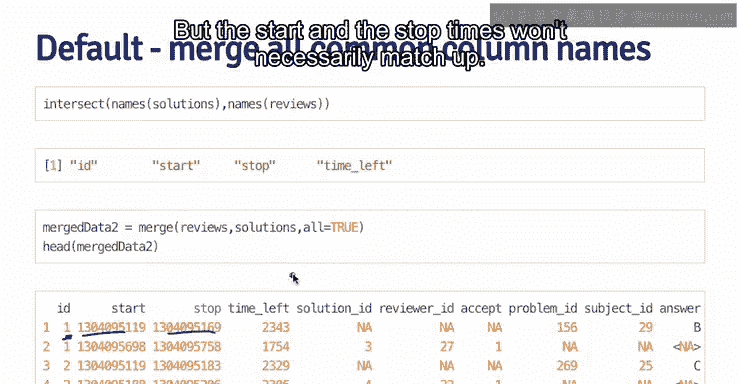

## 使用`plyr`包进行连接

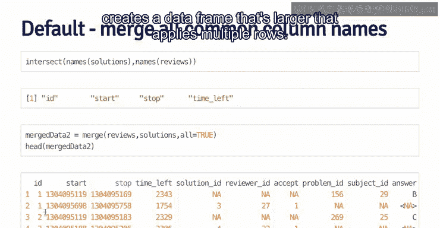

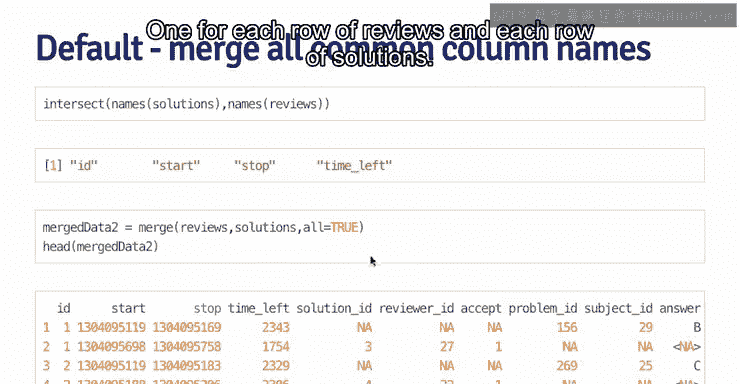

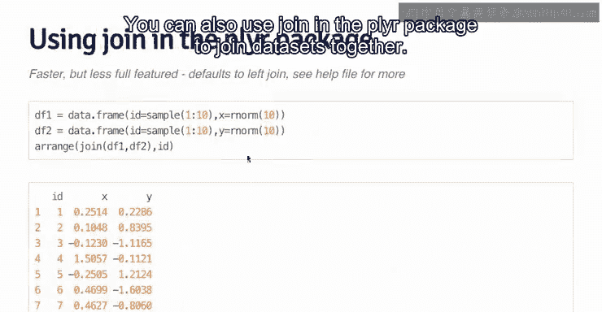

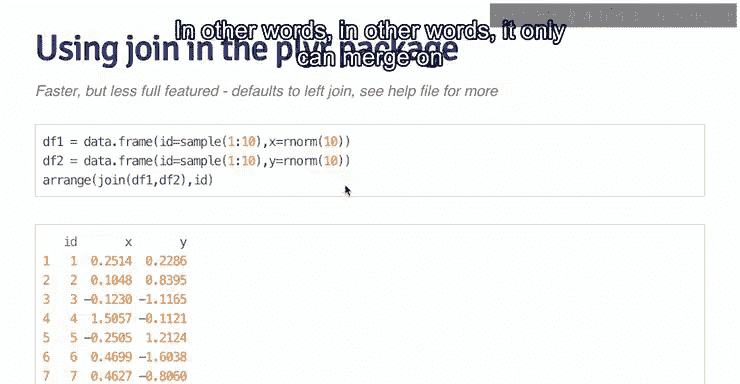

除了`merge`，你还可以使用`plyr`包中的`join`函数来连接数据集。它比`merge`速度更快，但功能稍少。具体来说，`join`只能基于两个数据集间**完全相同的列名**进行合并。

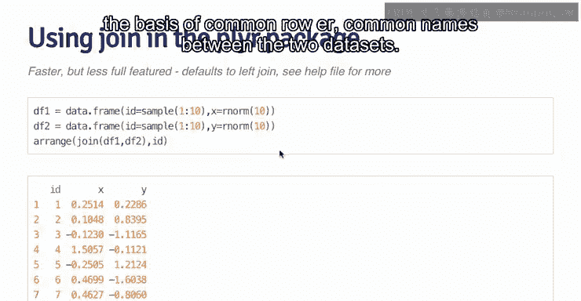

因此，我们不能用它来合并刚才讨论的两个数据集，因为我们需要依据`reviews$solution_id`和`solutions$id`进行合并，而`join`只能依据名为`id`的列合并，尽管它速度更快。

以下是一个使用`join`的示例。我创建了两个虚构的数据框，它们有一个共同的标识符`ID`，但顺序被打乱了。

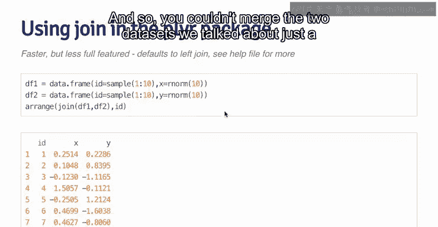

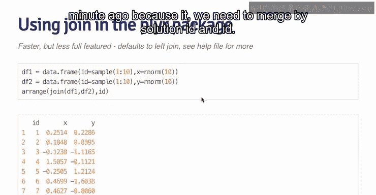

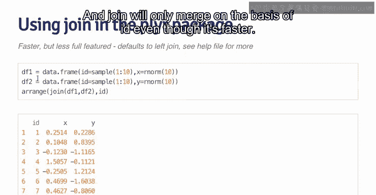

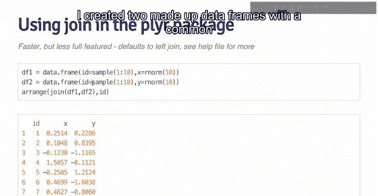

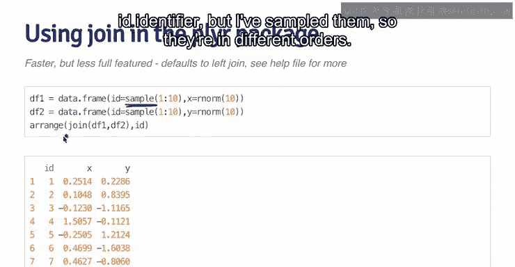

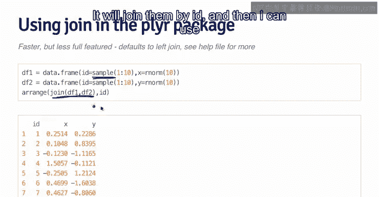

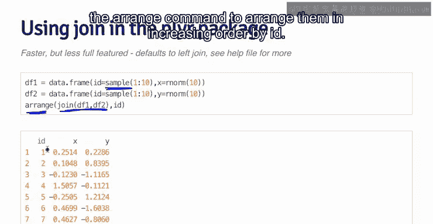

以下是创建示例数据和执行连接的代码：
```r
df1 <- data.frame(ID = sample(1:10), x = rnorm(10))
df2 <- data.frame(ID = sample(1:10), y = rnorm(10))
joinedData <- join(df1, df2, by = "ID")
arrangedData <- arrange(joinedData, ID)
```
我可以使用`join`将两个数据集连接起来，它会依据`ID`列进行连接。然后，我可以使用`arrange`命令按`ID`递增的顺序排列数据。你可以尝试使用这些命令，看看如何将数据集连接在一起。

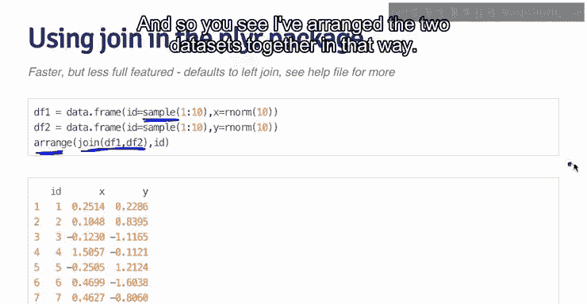

## 合并多个数据集

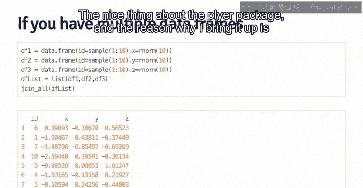

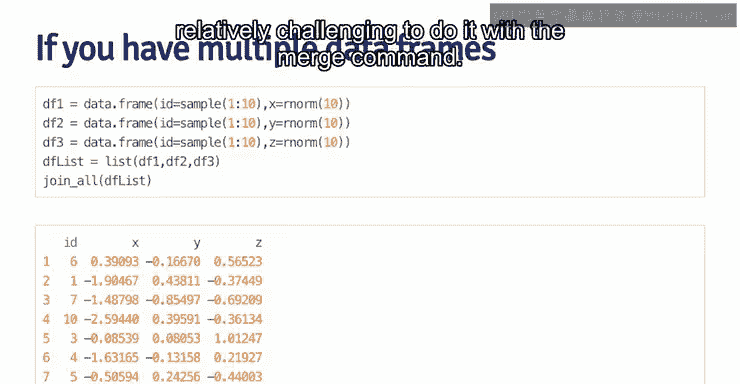

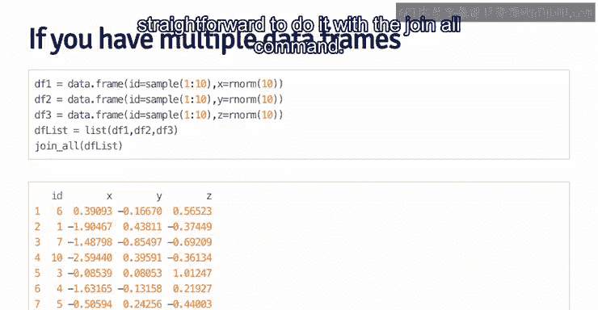

`plyr`包的一个优点是，如果你有多个数据框，使用`merge`命令进行合并相对复杂，但如果它们有一个共同的ID，使用`join_all`命令就非常直接。

以下是合并多个数据集的示例代码：
```r
df1 <- data.frame(ID = 1:5, A = letters[1:5])
df2 <- data.frame(ID = 1:5, B = letters[6:10])
df3 <- data.frame(ID = 1:5, C = letters[11:15])
dfList <- list(df1, df2, df3)
allJoinedData <- join_all(dfList)
```
我创建了三个数据框，并把它们放在一个列表中，形成一个包含三个数据框的列表。然后，我使用`join_all`命令，它会基于共同的变量（本例中是`ID`）合并所有不同的数据。这是一种快速合并多个数据集的便捷方法。


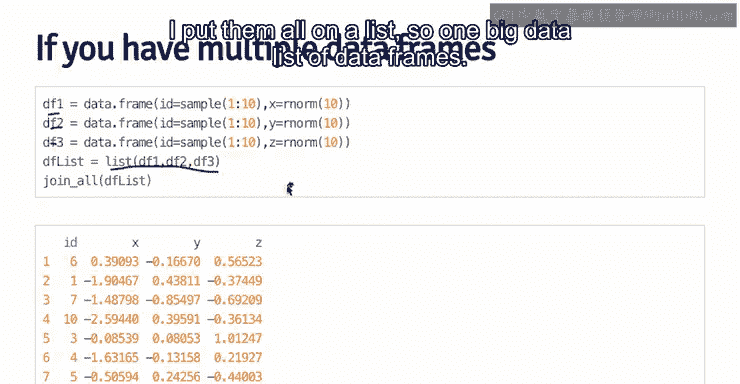


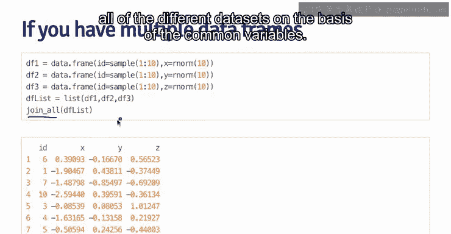

## 总结

本节课中，我们一起学习了在R中合并数据集的两种主要方法。
1.  使用基础的`merge`函数，它可以灵活地指定合并依据的列，并处理各种合并类型（如全连接）。
2.  使用`plyr`包中的`join`和`join_all`函数，它们在处理具有共同列名的多个数据集时更快捷，但灵活性稍低。

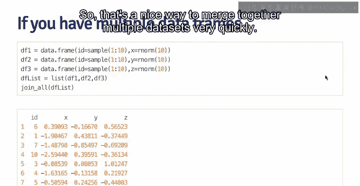


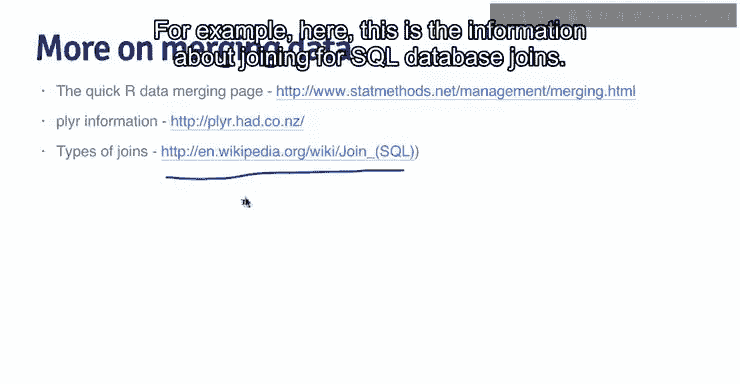

R的数据合并帮助页面（`?merge`）和`plyr`包的帮助页面都非常有用。在你开始密集进行数据合并前，值得注意你正在执行哪种类型的连接（例如左连接、右连接）。了解更多相关信息的最佳方式是阅读数据库（如SQL）中关于连接（JOIN）的文档。