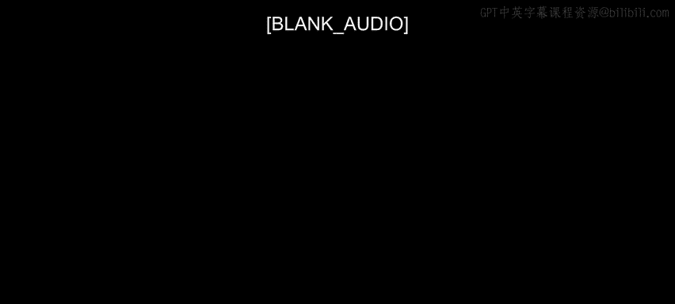
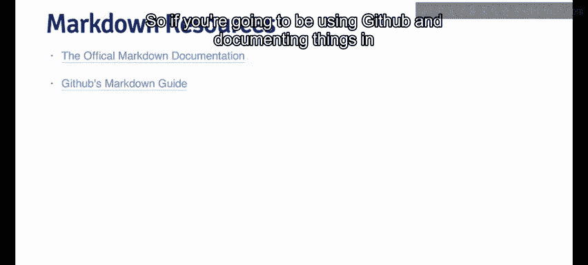

# 课程5：《可重复研究》｜第11课：Markdown基础入门 📝

在本节课中，我们将学习Markdown语言的基础知识。Markdown是一种轻量级标记语言，旨在让用户专注于内容创作，而无需处理复杂格式。我们将介绍其核心语法和基本用法。

---

## 什么是Markdown？

Markdown是一种面向网络写作者的文本到HTML转换工具。它允许你使用易于阅读和编写的纯文本格式进行写作，然后将其转换为结构上有效的XHTML。其设计理念是让创作者专注于内容本身。

## Markdown基础语法

上一节我们介绍了Markdown的基本概念，本节中我们来看看它的核心语法。Markdown的语法设计得非常简洁直观。

### 文本格式

以下是基本的文本格式化方法：

*   使用单个星号包裹文本可以使其变为*斜体*，例如：`*斜体文本*`。
*   使用两个星号包裹文本可以使其变为**粗体**，例如：`**粗体文本**`。

### 标题

你可以创建不同层级的标题，类似于HTML中的`<h1>`到`<h6>`标签。

*   使用一个井号表示一级标题：`# 一级标题`
*   使用两个井号表示二级标题：`## 二级标题`
*   使用三个井号表示三级标题：`### 三级标题`

### 列表

创建列表是Markdown的常用功能。以下是两种主要列表的创建方式：

*   **无序列表**：在每行开头使用连字符（`-`）、星号（`*`）或加号（`+`）即可创建无序列表。符号的选择并不重要，只需在列表中保持一致。
*   **有序列表**：在每行开头直接使用数字加句点（例如 `1.`， `2.`）即可创建有序列表。一个有用的技巧是，你无需按顺序编号，Markdown处理器会自动为你排序。例如，即使你写成 `1.`， `4.`， `2.`，最终输出也会是正确顺序的列表。

### 链接

在文档中插入链接非常重要。Markdown提供了两种插入链接的方式：

1.  **内联链接**：将链接文本放在方括号`[]`中，紧接着将URL放在圆括号`()`里。格式为：`[链接文本](URL)`。例如：`[约翰霍普金斯大学](https://www.jhu.edu)`。
2.  **引用式链接**：为了使行文更整洁，尤其是当URL很长时，可以使用引用式链接。首先，用方括号`[]`定义链接文本和引用标识，格式为：`[链接文本][引用标识]`。然后，在文档的其他地方（通常是底部）定义该标识对应的真实URL，格式为：`[引用标识]: URL`。这种方式将冗长的URL移到了文档末尾，保持了编辑时正文的清晰易读。

### 换行

在Markdown中创建新行有一个需要注意的细节：在行末添加**两个空格**，然后按回车键，才会产生一个真正的换行。如果只是简单地按回车键，文本会连接在一起。这是Markdown初学者常会遇到的一个小问题。

---

## 学习资源与总结

本节课我们一起学习了Markdown的基础语法，包括文本格式化、标题、列表、链接和换行的创建方法。

Markdown的官方文档简短易读，你可以在几分钟内掌握它。此外，GitHub在其平台上使用了一种增强版的Markdown（GitHub Flavored Markdown），如果你计划在GitHub上撰写文档，查阅其指南会很有帮助。

总而言之，Markdown以其简洁的语法，让你能够专注于内容创作，并轻松地将文档转换为格式良好的网页，是可重复研究和工作流中非常实用的工具。