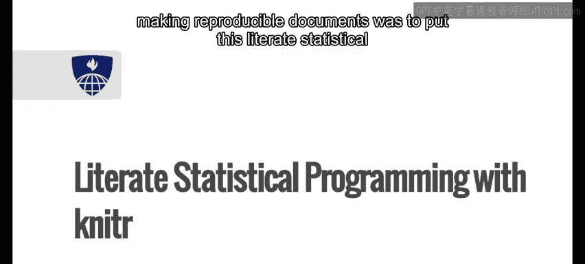
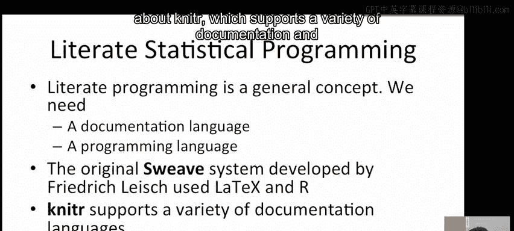
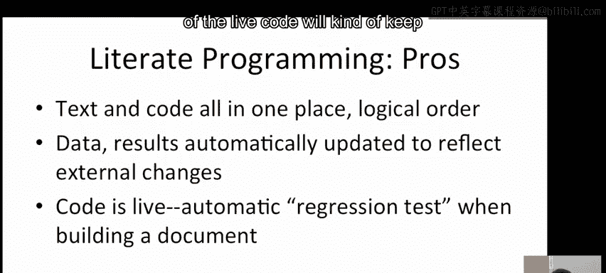
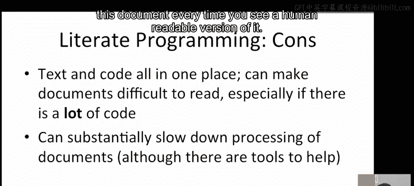

# 课程5：《可重复研究》｜第14讲：knitr 第1部分 📘

## 概述

在本节课中，我们将学习**文学化统计编程**的基本概念，这是实现可重复研究的关键工具之一。我们将探讨如何将数据、代码和分析文本整合到单一文档中，以便他人能够轻松理解和复现你的分析过程。

---

## 文学化统计编程简介

在之前的课程中，我们讨论了可重复研究的基本理念。现在，我们将介绍一种具体工具，帮助你让他人能够复现你的分析。这种方法的核心是**文学化统计编程**。

文学化统计编程的基本思想是，作者通常需要花费大量精力将数据和结果发布到网络上。然而，即使所有材料都已公开，数据、代码和文档往往是分离的。这可能导致混淆，例如不清楚哪段代码对应哪个数据集，或者执行代码的正确顺序是什么。

为了解决这个问题，我们可以将数据、代码和分析文本整合到同一个文档中。这样，他人可以按照正确的顺序执行代码，并在适当的时间读取数据。最终，我们得到一个集成了数据分析、代码和文字描述的单一文档，所有内容都紧密相连。

文学化编程的原始概念由斯坦福大学的计算机科学家 Don Knuth 提出。他最初设计该系统是为了在编写常规计算机程序的同时，记录代码文档。这一理念同样适用于文学化统计编程，即在同一文档中记录分析过程并包含分析代码。

文学化编程文档可以看作是由文本和代码块组成的流。其中，**展示代码**负责格式化表格和图形，**文章文本**则解释分析过程。这类文档可以通过两种方式处理：**编织**成人类可读的文档，或**拆解**成机器可读的代码文件。

---

## 文学化编程的构成要素

文学化编程作为一个通用概念，需要一种**文档语言**和一种**编程语言**。例如，早期由 Fritz Leisch 开发的 Sweave 系统使用 LaTeX 作为文档语言，R 作为编程语言。

在本课程中，我们将重点介绍 **knitr** 工具，它支持多种文档和编程语言。

---

## 如何实现可重复研究

实现可重复研究的基本前提是**决定去做**。你可以在分析过程的任何阶段做出这个决定，但通常最容易在开始时进行。如果在分析结束时才决定，可能会非常困难甚至无法实现。

以下是实现可重复研究的一些关键步骤：

*   **使用版本控制系统**：例如 Git 或 SVN。这有助于跟踪分析过程中的所有更改。
*   **使用可编码的统计软件**：选择那些操作可以通过代码记录的软件。这通常排除了图形用户界面，除非这些界面能生成或记录操作代码。像 R 这样的系统要求显式编程，因此只要保存代码，就能完整记录对数据的所有操作。
*   **避免保存中间输出**：这里的“输出”主要指临时数据转换对象。例如，如果你对原始数据进行了预处理并得到了一个干净的数据集，与其保存这个干净的数据集，不如保留原始数据以及预处理代码。这样不仅能重现最终结果，还能清晰展示从原始数据到最终数据的完整过程。
*   **避免使用专有数据格式**：专有格式的数据布局不公开，可能使没有特定软件的人无法读取数据。使用非专有格式（即使是压缩的文本格式）能大大提高研究的可复现性。

---

## 文学化编程的优缺点

文学化编程是实现可重复研究的工具之一，但它并非唯一选择。以下是它的一些优缺点。

### 优点

*   **整合内容**：它迫使你将分析的所有文本和代码整合到一个地方，并按逻辑顺序组织。
*   **自动更新**：数据和结果会自动更新以反映外部变化。当你重新处理文档时，所有内容都会自动更新，避免了数字过时或内容不匹配的问题。
*   **回归测试**：由于最终文档需要通过运行代码来生成（即编织过程），这本身就像一种回归测试。如果分析中引入了错误导致代码无法运行，你会立即发现问题。

### 缺点

*   **文档编辑复杂**：当分析代码量很大或非常复杂时，人类可读的文本会与大量代码混合在一起，这可能使编辑文档变得困难，因为你需要在整个文档中搜索文本部分。
*   **处理速度可能较慢**：如果分析非常复杂，每次想要查看文档的人类可读版本时都需要重新处理整个文档，这可能会显著减慢文档的构建过程。

---

## 总结

本节课我们一起学习了**文学化统计编程**的概念及其在实现可重复研究中的重要性。我们了解到，通过将数据、代码和文本整合到单一文档中，可以极大地提高分析的可复现性和透明度。我们还探讨了实现可重复研究的一般原则，并分析了文学化编程工具（如 knitr）的优缺点。在接下来的课程中，我们将深入探讨 knitr 的具体使用方法。