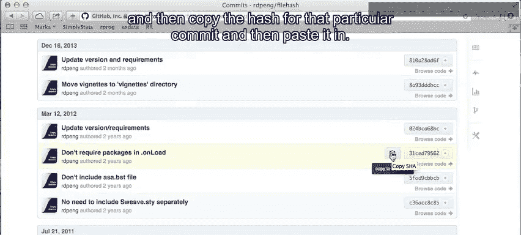
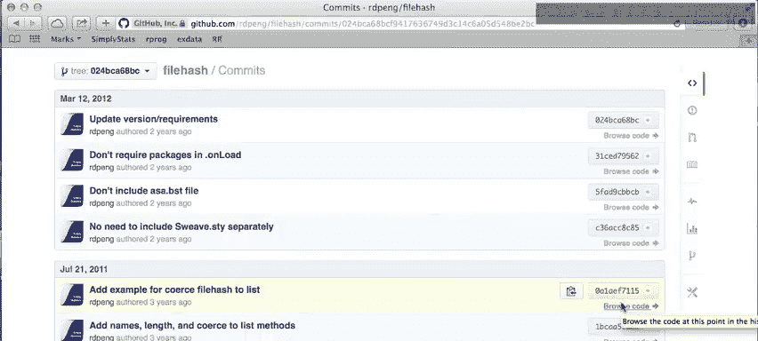

# 课程5：《可重复研究》｜P18：课程项目1介绍 📋

在本节课中，我们将学习如何完成并提交课程的第一个项目。项目要求你完成一项数据分析，并使用R Markdown和knitr撰写报告。提交过程涉及将你的工作上传至GitHub，并提交特定的提交哈希值以供评估。

---

## 项目要求概述

要成功提交本次作业，你需要完成两件事。首先，你需要进行一项相对简单的数据分析。其次，你需要使用R Markdown和knitr撰写一份报告。

为了提交作业，你需要：
1.  将你的项目文件检入一个GitHub仓库。
2.  将该仓库推送到GitHub。
3.  提交你的GitHub仓库链接。
4.  提交一个特定的Sha1哈希值，该值标识了你用于提交的仓库状态。

这样，评估者就能知道你仓库中哪个版本的文件是用于本次作业的正式提交。在Git仓库中，文件会不断变化，通过不同的提交记录变更。因此，需要明确哪个提交对应你的正式作业。

---

## 如何获取并提交GitHub仓库信息

上一节我们介绍了项目的基本要求，本节中我们来看看如何具体操作，获取并提交所需的GitHub仓库链接和哈希值。

### 获取仓库URL

首先，你需要找到你的GitHub仓库的URL。当你访问自己的GitHub仓库页面时，URL会显示在浏览器的地址栏顶部。例如，一个仓库的URL可能类似于：
`https://github.com/yourusername/your-repo-name`
这就是你需要提交的仓库链接。

### 获取提交的Sha1哈希值

其次，你需要找到代表你提交状态的特定提交的Sha1哈希值。

以下是获取该哈希值的步骤：

1.  在你的GitHub仓库页面，找到“commits”（提交）链接或数量统计。
2.  点击进入提交历史列表。最新的提交会显示在最顶部。
3.  在每条提交记录的右侧，你会看到一个缩写版的Sha1哈希值。
4.  将鼠标悬停在该哈希值上，会出现一个复制到剪贴板的图标。点击它即可复制完整的哈希值。

如果你想提交的不是最新版本，而是更早的某个提交，只需在提交历史列表中向下滚动，找到对应的提交记录，然后复制其哈希值即可。

---

## 如何评估他人的提交

在同伴互评环节，你需要评估他人提交的作业。为此，你需要访问他们提供的GitHub仓库URL，并定位到他们指定的提交快照。

以下是查看他人特定提交的步骤：

1.  访问对方提供的GitHub仓库URL。这会显示仓库的最新状态。
2.  点击“commits”进入提交历史列表。
3.  在列表中，找到与对方提供的Sha1哈希值相匹配的提交记录。
4.  点击该提交记录旁边的“browse code”（浏览代码）按钮。

点击“browse code”后，你将看到该仓库在**那个特定提交时刻**的完整快照。这就像回到了项目在那一刻的状态。你可以查看当时所有文件的内容。

例如，如果你想查看2012年3月12日的仓库状态，只需找到该日期的提交，然后点击“browse code”即可。

---

## 总结

本节课中我们一起学习了课程项目1的提交流程。你需要完成数据分析并撰写报告，然后将工作推送到GitHub仓库。提交时，需提供仓库的URL和标识特定提交状态的Sha1哈希值。在评估他人作业时，你也需要利用这些信息在GitHub上定位到对应的项目快照。这个过程确保了评估基于明确、可复现的代码版本。