# 约翰霍普金斯大学数据科学课程5：《可重复研究》｜第25课：基于证据的数据分析（第2部分）🔍

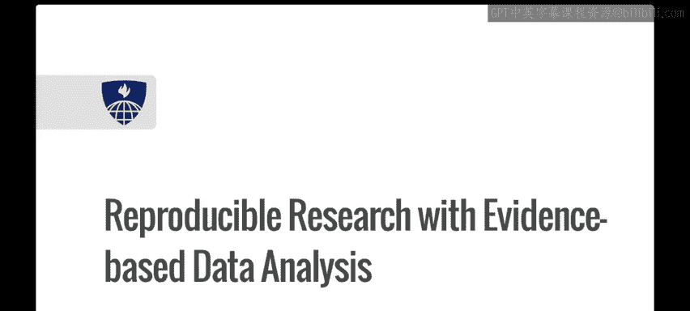

在本节课中，我们将探讨可重复研究的基本框架，分析其解决的问题与存在的局限性，并理解其在科学传播中的定位。

## 研究过程的传统框架

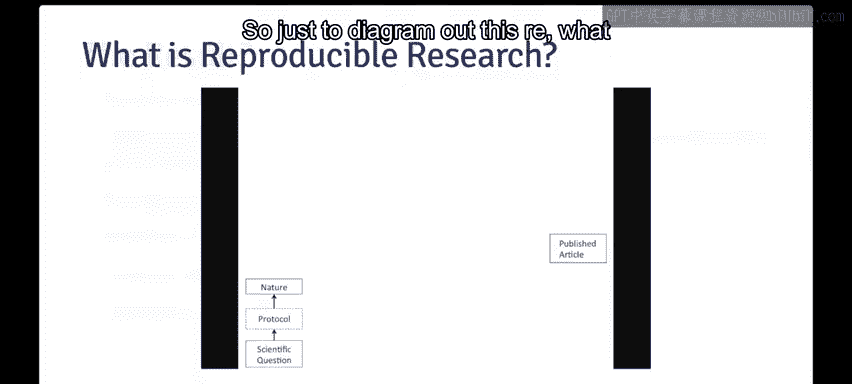

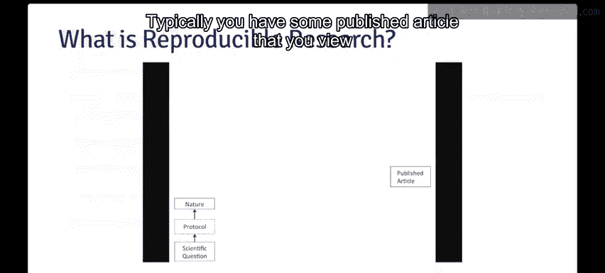

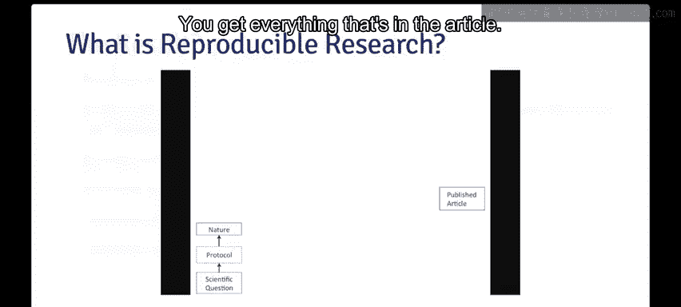

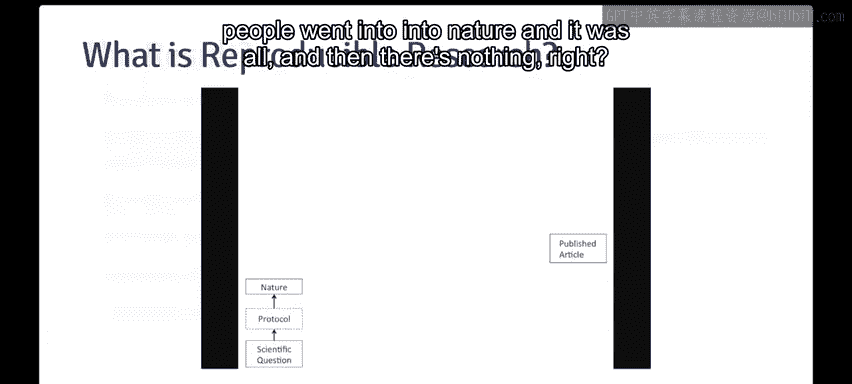

上一节我们讨论了可重复研究的重要性，本节中我们来看看一个典型的研究过程是如何被呈现和接收的。

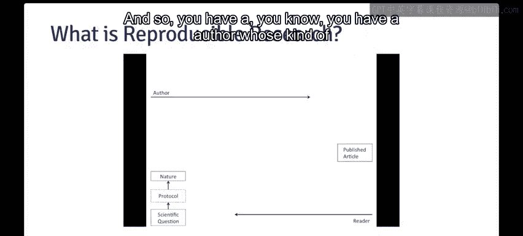

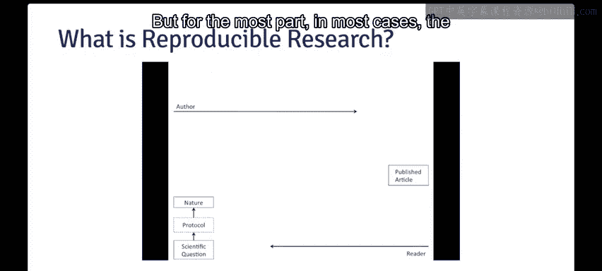

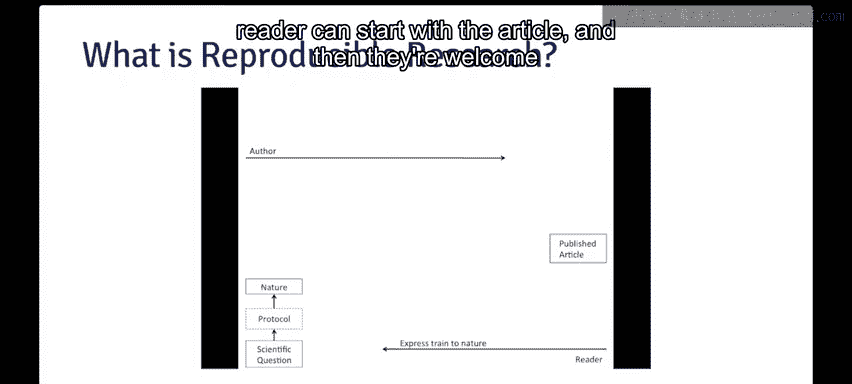

通常，读者在期刊上看到的是一篇已发表的文章。这是读者能获得的全部信息。读者可以了解到研究者提出的科学问题，以及他们最终得出的结论。然而，这个过程是单向且不透明的：作者从原始问题出发，经过一系列步骤得出了文章中的结论；而读者只能从文章这个终点开始，尝试反向理解作者的路径。

在绝大多数情况下，读者除了阅读文章并表示赞叹，或者亲自去重复整个研究之外，没有其他办法能深入了解研究过程。

## 可重复研究的核心理念

那么，可重复研究试图解决什么问题呢？它的基本理念是“在中间地带相遇”。

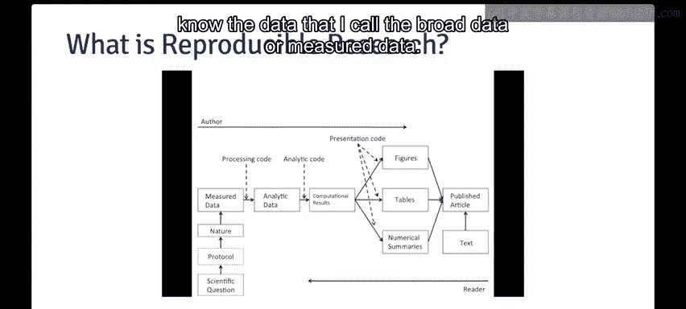

实际上，在一篇发表的文章背后，存在大量未被公开的中间过程。这包括：
*   **原始数据与测量数据**
*   对数据进行的**具体分析**
*   执行分析所用的**全部代码**
*   分析产生的**结果、图表和表格**

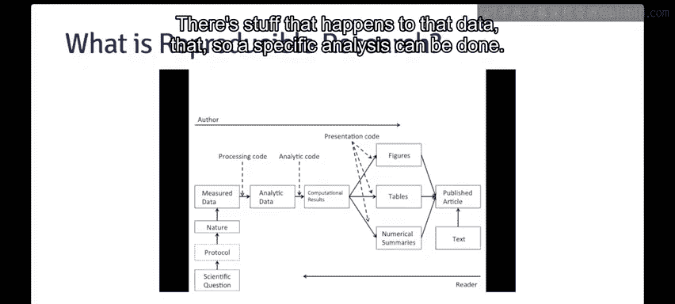

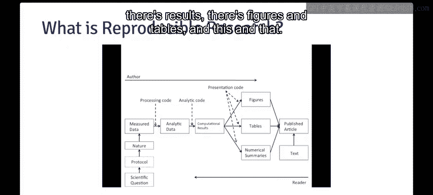

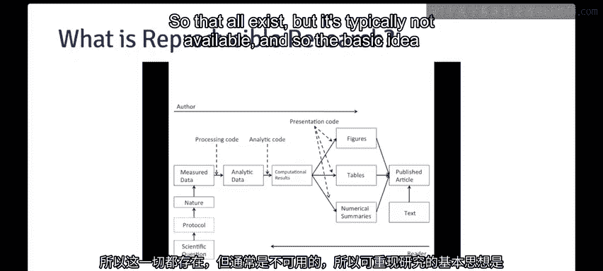

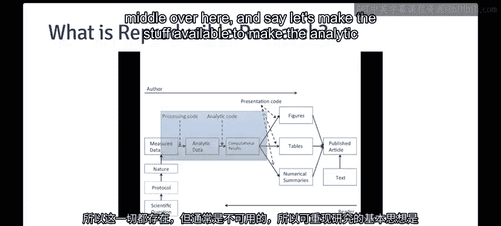

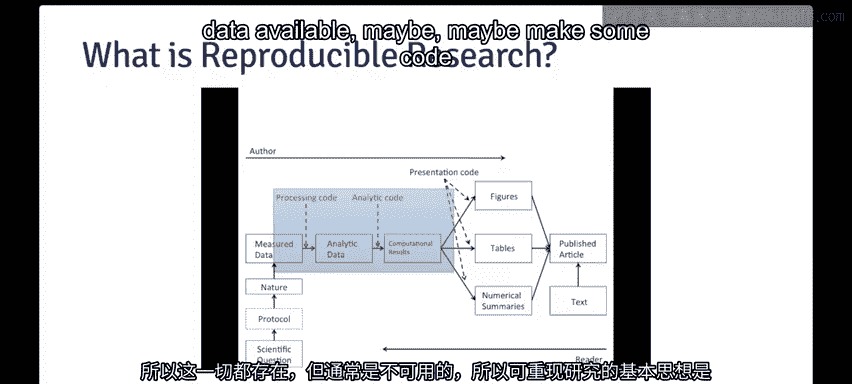

可重复研究倡导将这些中间材料公开。例如，公开分析所用的数据集、相关的处理代码以及重要的预处理步骤。这是一种折衷方案，它虽不能替代完整的重复研究，但极大地增强了研究的透明度。

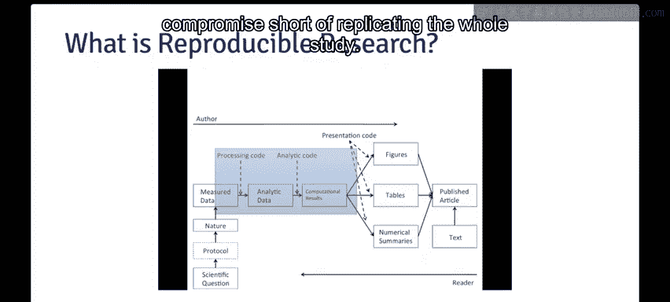

## 可重复性解决的问题与局限

接下来，我们具体分析可重复性带来的益处及其固有的局限。

可重复研究主要带来以下好处：
1.  **透明度**：我们能更清楚地知道研究者实际做了什么。
2.  **数据可用性**：分析所使用的数据变得可获取。
3.  **方法传播**：如果涉及新方法，这些方法得以传播。
4.  **知识转移**：我们确切知道了他们“实际做了什么”，而不仅仅是他们“意图做什么”。

然而，可重复性**并不解决**一个根本性问题：**我们能否信任这个分析？** 因为一个分析可以是完全可重复的，但同时也是错误的。例如，研究者可能使用了错误的方法或不当处理了数据。文献中存在许多这样的例子。

因此，可重复性虽然至关重要，但它并不能为分析的正确性提供保证。

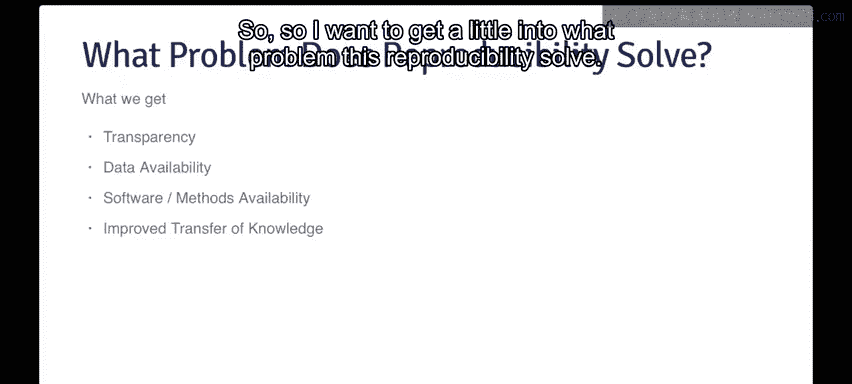

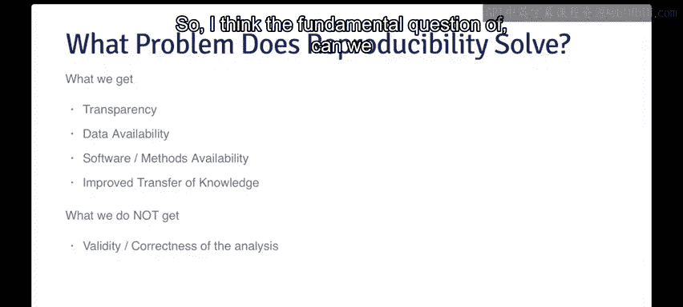

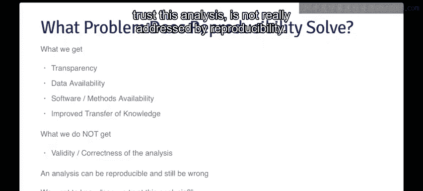

## 对可重复性前提的反思

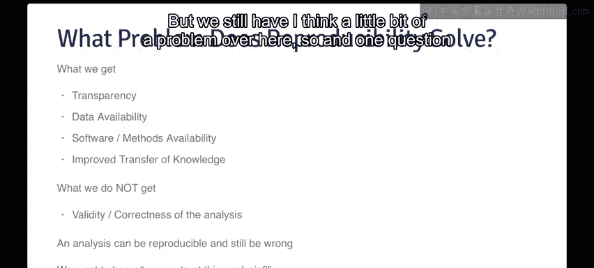

最后，让我们思考一下可重复研究范式所依赖的一些前提假设。

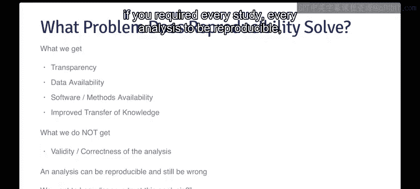

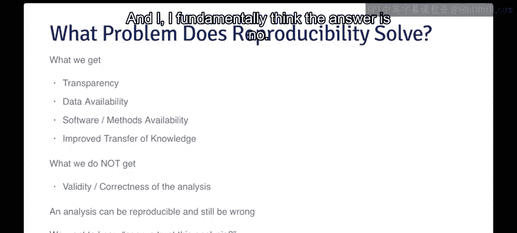

可重复研究的前提是，当所有数据和代码都免费公开后，同行可以互相检查，验证彼此的分析，从长远看，整个科学体系能够实现自我纠正。

但这个范式存在一些问题：
*   **“长远”可能太久**：对于许多亟待解决的问题，自我纠正的周期可能过长。
*   **侧重于下游环节**：可重复性主要解决的是科学传播中**发表后**的环节。
*   **理想化的假设**：它假设所有人都遵守相同的规则，并追求相同的科学目标。这显然与事实不符。

---

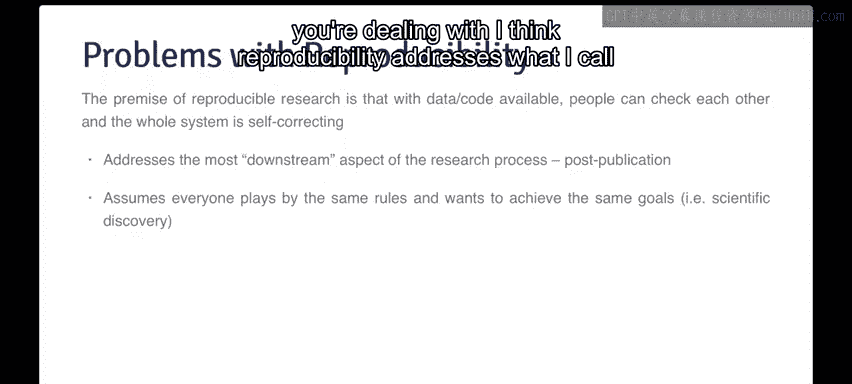

**本节课总结**

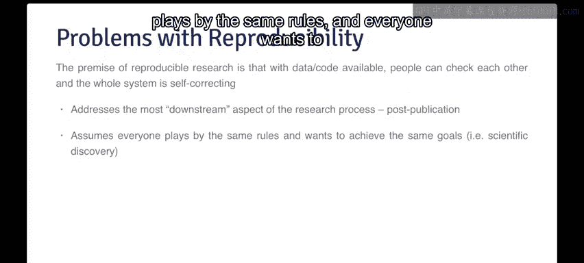

本节课我们一起学习了可重复研究的核心框架。我们了解到，传统研究发表模式存在不透明的问题，而可重复研究通过公开数据、代码等中间材料，在透明性、数据可用性和知识传播方面做出了重要改进。同时，我们也认识到可重复性并不能保证分析的正确性，并且其有效性依赖于一些在现实中可能难以完全满足的理想化前提。理解这些优点与局限，对于在实践中推行和评估可重复研究至关重要。