# 约翰霍普金斯大学数据科学课程5：《可重复研究》｜第28课：基于证据的数据分析（第五部分）🔬

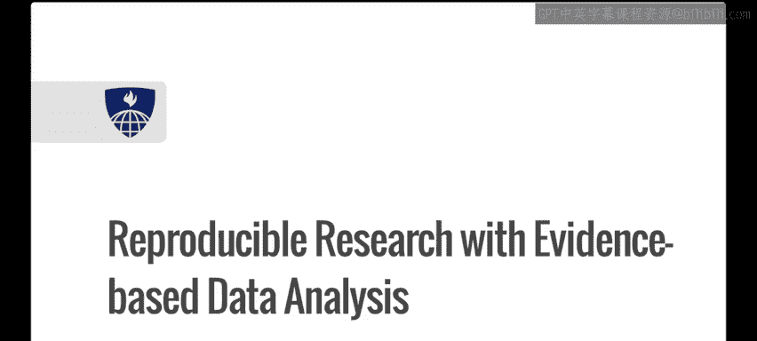

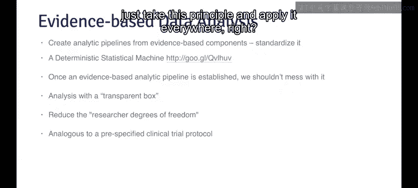

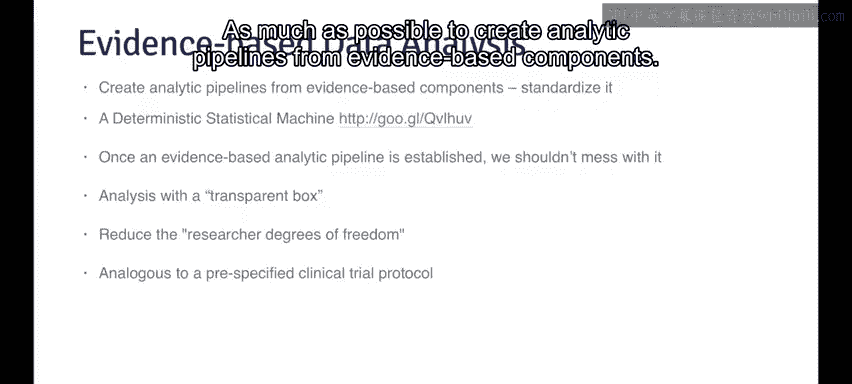

在本节课中，我们将学习“基于证据的数据分析”的核心思想，即如何构建标准化的、确定性的分析流程，并将其应用于科学研究中，以提高分析结果的可信度和可重复性。

---

我的核心观点是，我们应该将这一原则尽可能地应用到所有地方。

我们应尽可能使用基于证据的组件来创建分析流程，并将其标准化。

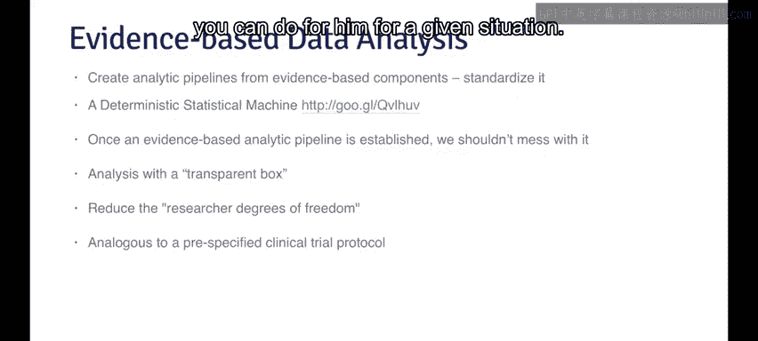

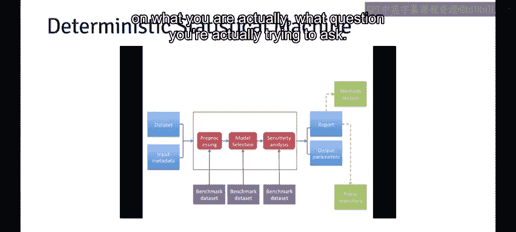

杰夫对此的另一个贡献是，他将此称为“确定性统计机器”。其核心思想是，你拥有一个算法或流程，在给定一组数据和最少的输入参数时，能够产生确定性的结果。

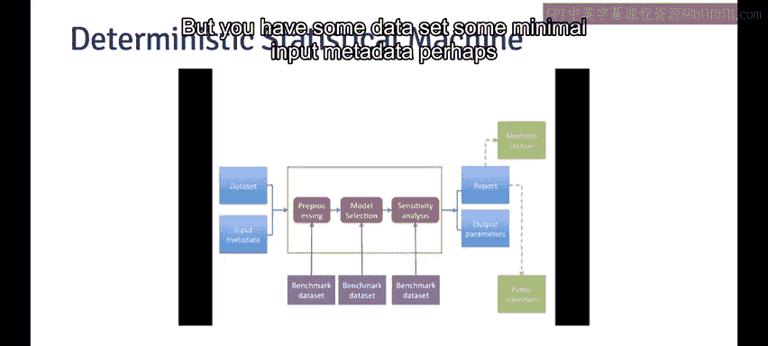

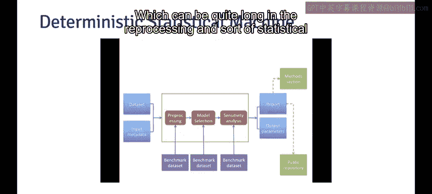

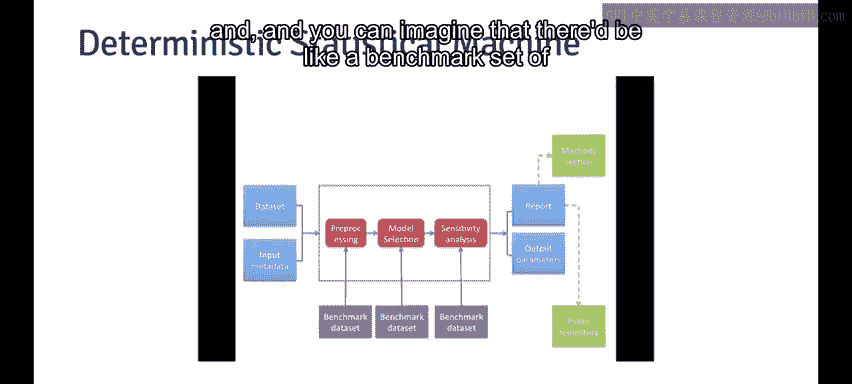

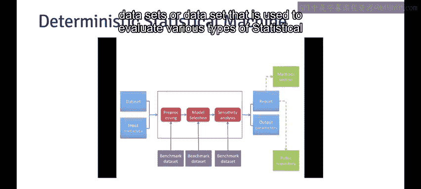

一旦这个基于证据的流程被建立，你就不要再去改动它。我称之为“透明盒子分析”。它是一个盒子，所以你不去动它，就像阿尔·戈尔的“锁箱”一样。但它是透明的，因为你可以清楚地知道里面发生了什么。所以它不是一个黑盒，你能看到过程，但关键是你不要去干预。

这样做的一个目标是减少所谓的“研究自由度”，即研究人员可以调整整个流程中的每一个调优参数，这种可能性呈指数级增长，从而可能从分析中得到任何他们想要的结果。

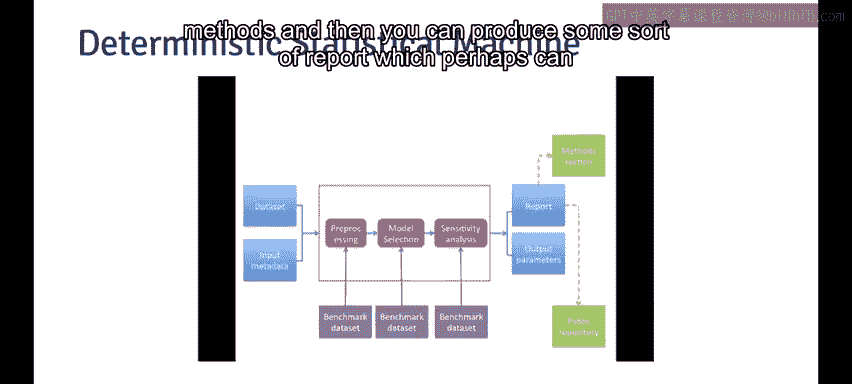

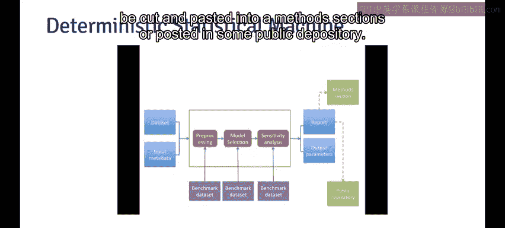

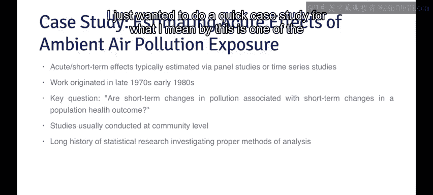

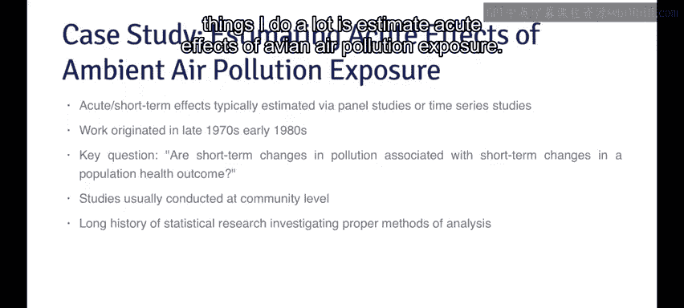

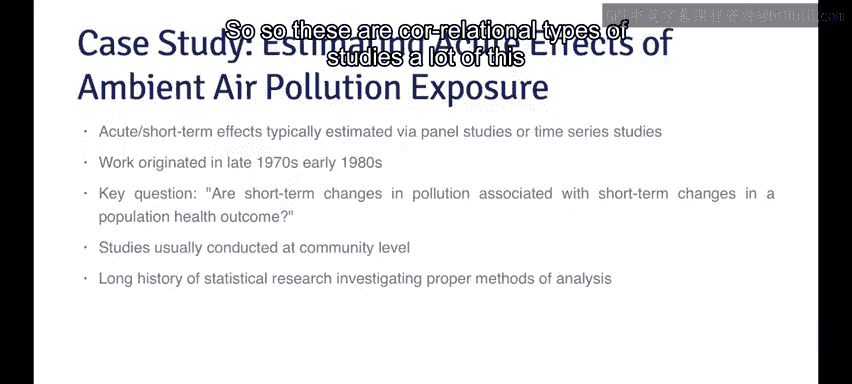

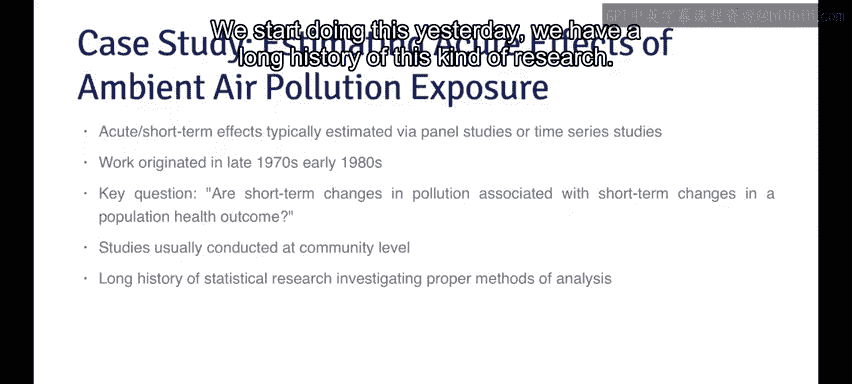

我认为这类似于一个理想的、预先设定的临床试验方案。当你进行临床试验时，你必须事先说明你将要做的一切，包括如何分析数据。如果有人已经为你写好了这个方案，那该多好？如果你使用一个标准化的流程，并且有人已经为你写好了，你就可以为特定情况预先精确指定你要做的事情。

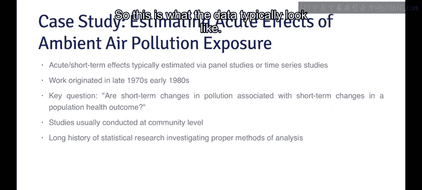

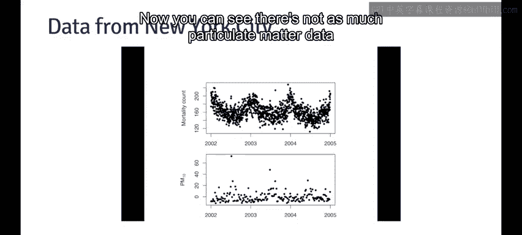

其基本结构只是一个示意图，当然具体取决于你实际要解决的问题。你有一些数据集，可能还有一些最少的元数据输入，然后数据会经过一系列模块，这些模块可能很长，涉及预处理和各种统计方法。你可以想象，会有一组基准数据集或数据，用于评估各种类型的统计方法。

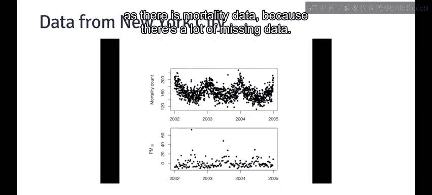

最终，你可以生成某种报告，或许可以复制粘贴到论文的方法部分，或者发布在某个公共存储库中。

我想通过一个快速案例研究来说明我的意思。我经常做的一件事是研究空气污染暴露的急性健康效应。这些是相关性研究，很多工作起源于七八十年代，所以我们有很长的研究历史。基本问题是：污染的短期变化是否与人群健康结果的短期变化相关？

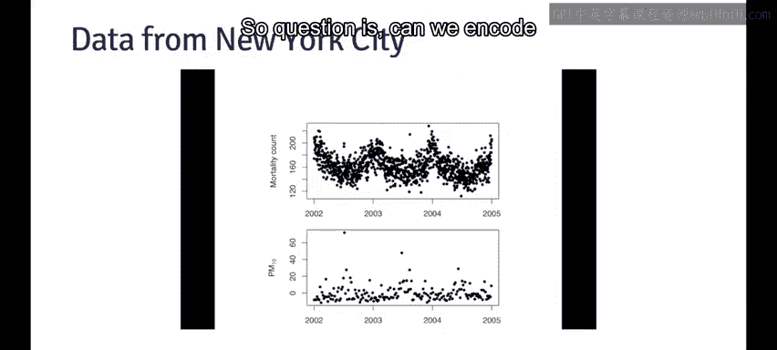

这类研究通常在社区层面进行，并且有很多统计研究投入其中，其中一部分是我自己完成的。这是数据通常的样子：你有死亡计数（例如纽约市），持续几年；然后底部是颗粒物水平。你可以看到颗粒物数据没有死亡率数据那么多，因为有很多缺失数据。基本上，你只是想问：顶部这个（死亡率）和底部这个（污染）相关吗？

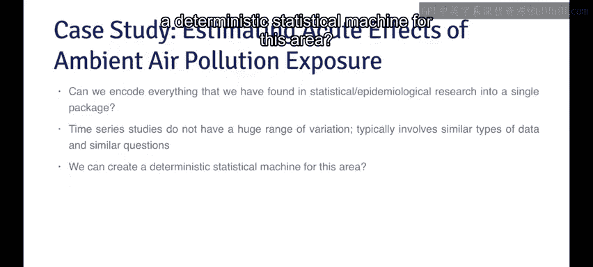

问题是，我们能否将我们在统计和流行病学研究中发现的所有东西编码到一个单一的软件包中？答案是肯定的。像这样的时间序列研究没有巨大的变化范围，通常涉及相似类型的数据（可能是住院、死亡率等），往往非常相似。那么我们能否在这个领域创建一个确定性的统计机器呢？

基本的流程非常简单，分析本身并不复杂。你需要检查数据中是否有异常值或高杠杆点。污染数据通常是偏态的，所以你需要检查这一点。对于过度离散，你需要检查。你想填补缺失数据吗？答案绝对是“不”。已有大量研究表明，这样做效果不好。这里的大问题实际上是模型选择。

在这些时间序列研究中，我们必须担心未测量的混杂因素。我们没有测量很多随时间变化的东西，这就像你的批次效应。因此，你必须使用各种方法来估计如何调整这些未测量的混杂因素，通常使用半参数回归方法。所以，估计自由度对任何你可能估计的关联都有最深远的影响，这至关重要。实际上，有关于如何做这件事的研究，有几篇论文（其中一篇是我的），有各种估计这个自由度数量的方法。我们可以选择一两种比其他方法更好的方法并实现它。模型的其他方面往往不那么重要，比如你是否调整温度，以及如何调整，通常影响不大。你通常还对多重滞后分析和敏感性分析感兴趣。你可以在这里选择一个模型，但你想看看如果你稍微前后移动模型，你的关联是否会急剧变化。这些是这类分析中你通常想看到的东西，当我每月审阅一篇时间序列研究的论文时，我总是会问这些问题。

关于为什么在这种背景下填补数据如此糟糕的15秒回答是：因为数据是系统性缺失的。污染数据很难收集，通常每六天才测量一次，所以每六天就有五天数据缺失。你可以尝试填补它，但你只是用大量的噪音换取了一点点的节省，并且可能引入偏差。

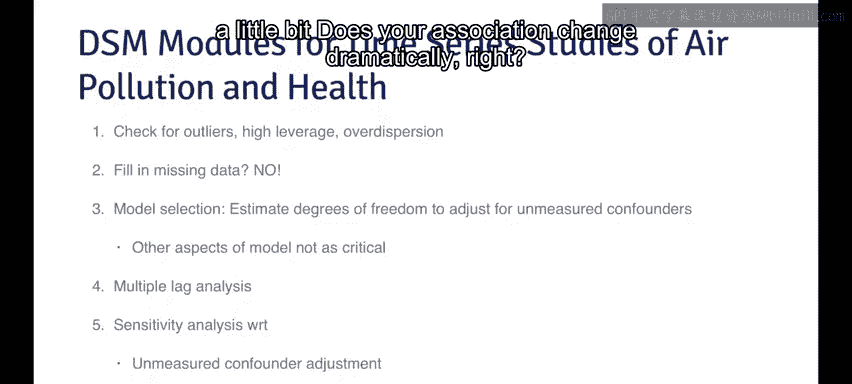

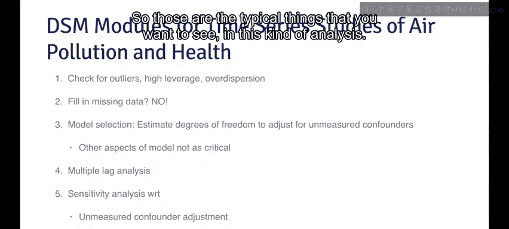

我认为，显然数据分析有很多领域，不同问题需要不同的专业知识，我不可能处理所有事情。但核心思想是，你可以创建一个由这些“机器”组成的精选库，提供标准化的、最先进的分析流程。显然，不同领域有不同的会议。污染的时间序列分析是一个非常成熟的领域，目前没有很多统计研究在进行，很多问题已经解决。因此，我们可以建立一个这类数据分析的档案库。

一个类似的例子是Cochrane协作网，它是一个基于证据的医学档案库。你可以去Cochrane协作网搜索诸如“阿司匹林治疗头痛”之类的东西。例如，你可以搜索“能否使用维生素C治疗哮喘”，这里有一个总结说：我们审查了证据，他们基本上做了荟萃分析，审查了来自9个维生素C临床试验的证据。总的来说，这些试验规模很小，既不能推荐使用也不能推荐避免使用维生素C治疗哮喘。所以，我们不用担心维生素C，它不会帮助我们，但也不会伤害我们。这构成了许多基于证据的干预和治疗的基础。类似的事情也可以为数据分析而做。

我们可以拥有由该领域知识渊博的专家策划的、编码了数据分析流程的软件包。这些不必是完美的解决方案，但想法是它们应该是相当好的解决方案，能够覆盖大部分基础。

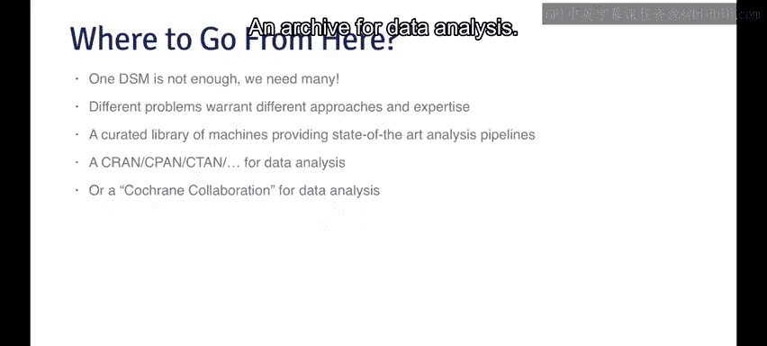

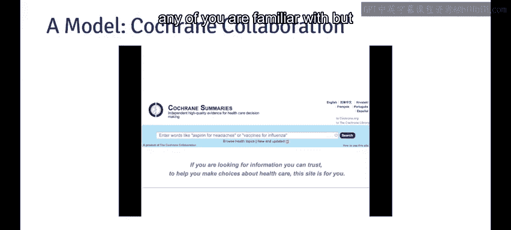

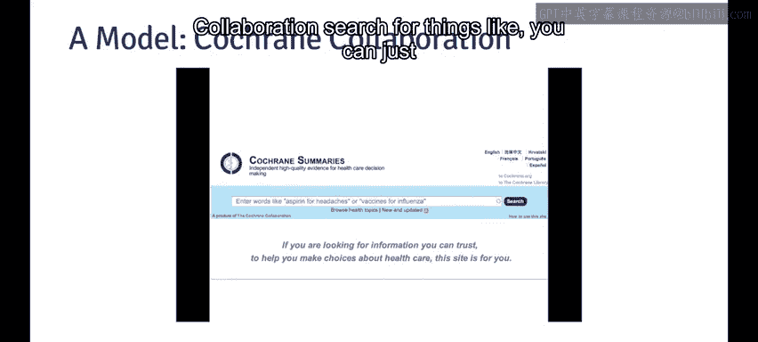

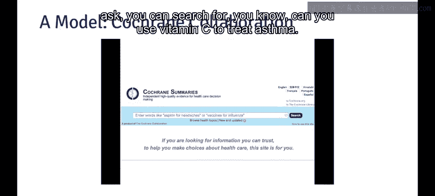

---

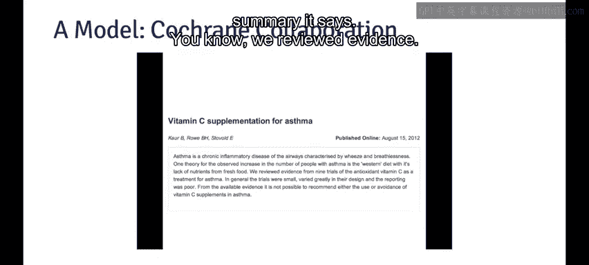

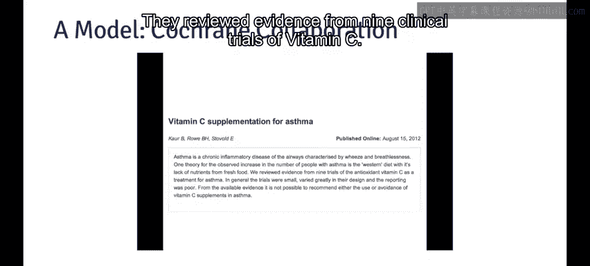

这就是我想说的全部内容。我做了一个基础介绍，虽然我没有真正谈论可重复研究，但我确实认为它很重要。然而，我认为它并没有从根本上解决你是否能信任一个分析这个最重要的问题。因此，我称之为“基于证据的数据分析”。我知道有些人不喜欢这个短语，但其核心思想是为特定的科学领域和问题制定有组织的、标准化的最佳实践。我并不是说它们不存在，真正的问题在于组织和整合。

我认为这可以为审稿人提供一个强大的工具，而不会像要求他们重现分析那样极大地增加他们的负担。我认为我们应该投入更多精力来解决科学研究的上游方面问题。

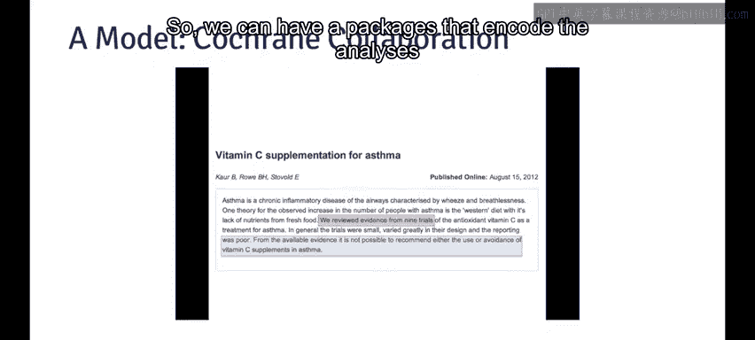

---

**本节课总结**

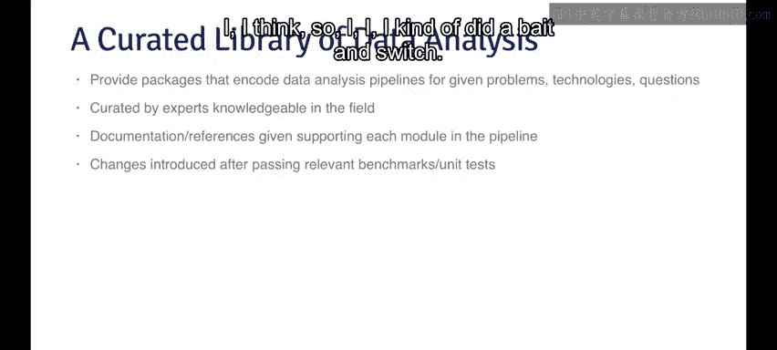

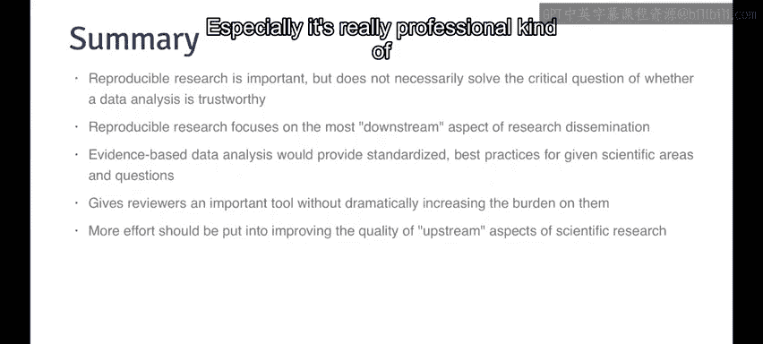

本节课中，我们一起学习了“基于证据的数据分析”理念。我们探讨了如何构建“确定性统计机器”或“透明盒子”分析流程，以减少研究自由度并提高结果的可信度。通过一个空气污染时间序列研究的案例，我们看到了将成熟的研究方法标准化为可重复流程的可能性。最后，我们讨论了建立类似“Cochrane协作网”的数据分析最佳实践档案库的愿景，以促进科学研究的严谨性和可靠性。