# 课程5：《可重复研究》｜案例研究：高通量生物学 🧬

## 概述

在本节课中，我们将通过一个发生在杜克大学研究人员身上的真实案例，探讨高通量生物学研究中可重复性的重要性。这个案例涉及使用基因组特征来预测癌症患者对化疗药物的反应。我们将看到，由于分析过程中的一系列错误和文档记录的缺失，导致了一项看似前景广阔的研究最终引发了严重的临床问题。通过剖析这个案例，我们可以学习到确保研究可重复性的关键教训。

---

## 研究背景与重要性

上一节我们介绍了可重复研究的基本概念。本节中，我们来看看为什么在高通量生物学领域，这一点尤为关键。

随着我们能够进行越来越精密的检测并生成成千上万的测量数据，分析工作占据了研究过程中越来越大的比重。因此，不仅我们自己，其他人也应该能够精确地复现我们的工作。这意味着，如果他人从相同的数据出发，应该能得到相同的结果。

在高通量生物学中，这一点之所以特别重要，还有一个不同的原因：我们对于高通量生物学中“什么是有意义的”直觉往往非常不可靠。临床医生可能对单个基因的行为有深刻直觉，但面对一个包含100个基因的特征列表时，他们同样可能从随机列表中“发现”模式。因此，我们不能依赖直觉来验证结果的合理性，而必须依赖清晰、可复现的分析流程。

遗憾的是，当我们查阅文献并试图理解一篇典型论文中做了什么时，文档记录往往非常糟糕。如果一项发现很重要但文档记录很差，我们有时不得不进行“法医生物信息学”，即从结果和原始数据出发，反向推导研究者到底做了什么，而不论其方法部分如何描述。

---

## 案例引入：基因组特征预测化疗敏感性

以下我们将深入分析一个具体的临床案例，该案例旨在使用基因组特征预测化疗敏感性。

这项研究基于2006年底发表在《自然·医学》上的一篇论文。研究者声称，他们从细胞系出发，找到了一种方法，可以得出对多种药物的基因组敏感性特征。

他们的工作流程如下：
1.  使用美国国家癌症研究所的标准细胞系面板NCI-60。
2.  针对目标药物，找出最敏感和最耐药的细胞系。
3.  对这些细胞系进行芯片分析，对比两组，找出差异最大的基因。
4.  使用“元基因”（即主成分分析）方法，用这些基因构建敏感性特征模型。
5.  将该模型应用于临床样本数据进行预测。

他们用多个公共数据集和七种常用药物进行了测试，并报告了出色的结果。论文发表后，很快就有多个研究小组希望复现并应用该方法。

---

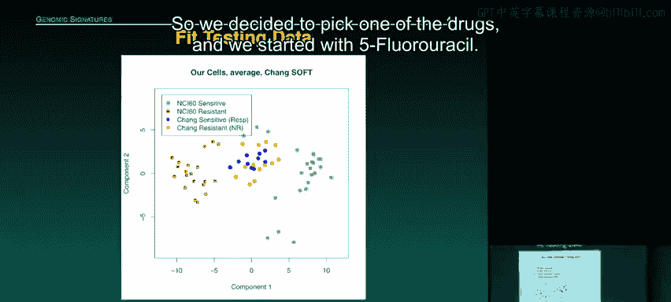

## 初步复现尝试与发现问题

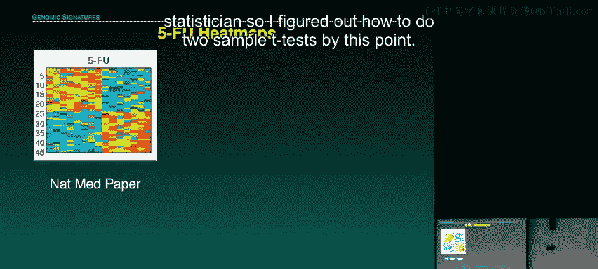

当我们尝试复现这项研究时，首先选择了药物“多西他赛”作为起点。

我们使用NCI-60细胞系的U95A芯片数据，选取了最敏感和最耐药的细胞系。在训练数据中，我们看到了预期的分离效果：耐药细胞系在主成分分析图中集中在左侧，敏感细胞系集中在右侧。

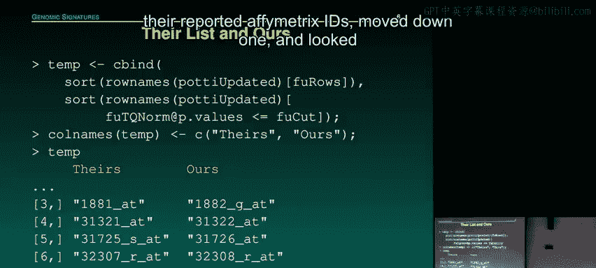

然而，当我们把该模型应用到真实的患者数据上时，并未看到预期的分离效果。这促使我们怀疑自己是否做错了什么，从而开始仔细追溯原始论文中的分析步骤。

论文的补充材料中提供了每种药物所用到的所有探针组ID列表。我们决定从药物“5-氟尿嘧啶”开始检查。

以下是构建热图时的发现：
*   论文中展示的热图显示，他们选出的45个基因在两组细胞系中呈现出完美的、相反的表达模式。
*   我们使用同样的t检验方法，选出了我们自己的45个最佳基因。
*   当我们用论文中提供的探针ID列表生成热图时，结果却不符合预期。

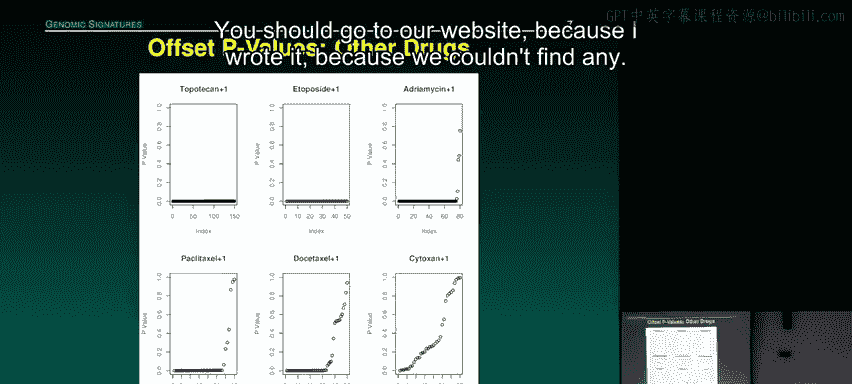

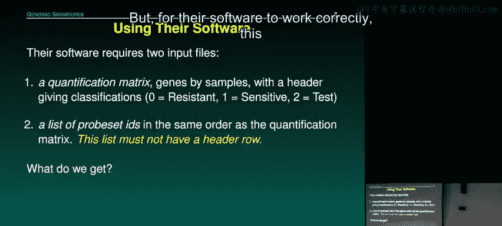

于是，我们将他们的列表与我们的列表并排比较，发现了一个明显的规律：**他们的每个探针ID都比正确的ID大1**。这是一个典型的“索引偏移一位”错误。

---

## 错误溯源与扩展调查

这个索引错误是如何产生的？通过检查他们使用的软件，我们发现了原因。

他们的软件需要两个输入文件：
1.  **定量矩阵**：行为基因，列为样本。首行是标题行，用0、1或2来标识该样本是敏感训练样本、耐药训练样本还是待预测的测试样本。
2.  **基因ID列表**：其顺序必须与定量矩阵中的基因顺序完全一致，但**这个文件不能有标题行**。

如果用户从一个有标题行的Excel文件中复制基因列表，就会不小心把标题也粘贴进去，导致所有基因ID向下偏移一位。我们用“多西他赛”的数据测试了这个假设，完美地复现了论文中的热图。

我们对论文中涉及的七种药物都进行了检查：
*   拓扑替康、依托泊苷、5-氟尿嘧啶、紫杉醇、多西他赛：大部分存在“偏移一位”错误。
*   阿霉素：大部分存在“偏移一位”错误，但还有少数基因无法解释。
*   环磷酰胺：完全无法理解他们用了哪些基因。

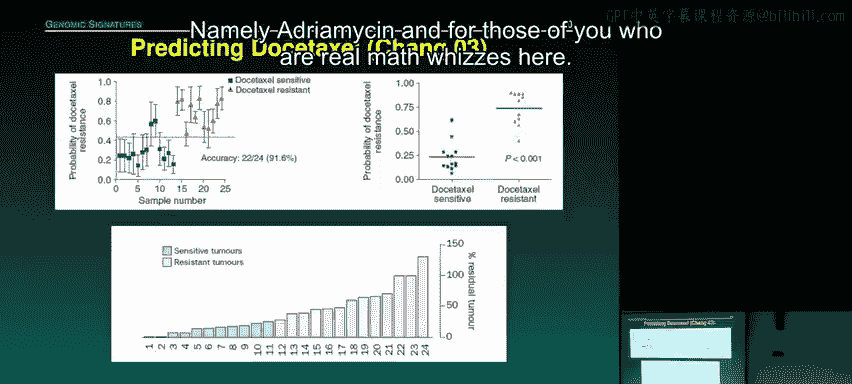

至此，我们发现了第一个严重问题：论文中用于解释生物学机制的基因，实际上可能根本不在他们分析所用的基因列表中。

---

## 预测准确性的严重问题

除了基因列表错误，我们在检查他们的预测结果时发现了更致命的问题。

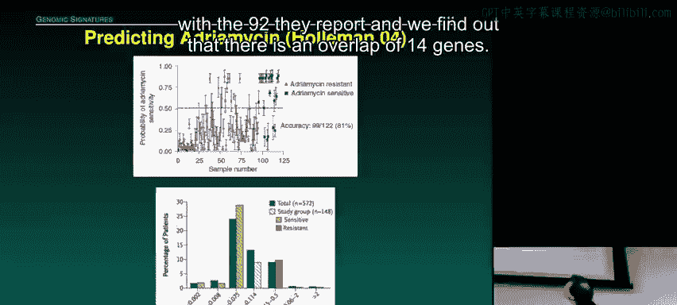

以药物“多西他赛”为例，论文中的图表显示有13个敏感样本和11个耐药样本。然而，提供该测试数据集的原始论文明确指出，他们有11个敏感样本和13个耐药样本。样本标签的数量对不上。

更严重的问题出现在药物“阿霉素”上。在他们的结果图中，显示为耐药的样本（红色三角）远多于敏感样本（蓝色方块）。然而，该数据集来源于一篇关于儿童白血病的论文，而儿童白血病的治愈率高达80%。如果大多数患者都对一种药物耐药，临床上根本不会使用它。原始数据提交者也认为大多数患者是敏感的。

我们怀疑，他们在准备数据时，将标签“0”和“1”的含义弄反了（即敏感和耐药互换），而自己并未察觉。**这在临床上是灾难性的**，因为这意味着他们会根据这个特征，只对那些实际上不会受益的患者使用阿霉素。

---

## 特征构建中的“数据窥探”嫌疑

一个随之而来的问题是：如果他们的数据标签如此混乱，当初是如何得到“良好”的预测结果的？

这引出了我们之前忽略的另一个问题：对于那些无法用“偏移一位”错误解释的基因，它们从何而来？以“多西他赛”为例，有19个这样的基因。

我们发现，其中14个基因恰好连续地出现在提供测试数据的原始论文所报告的“能区分敏感和耐药的92个基因”列表中。**从92个基因中随机抽取14个，它们恰好连续出现的概率极低**。这强烈暗示，他们在构建特征时，可能有意或无意地参考了测试集的信息，这是一种严重的“数据窥探”错误，会极大地夸大预测效果。

剩下的5个无法解释的基因，恰恰是论文中专门点名、用于解释特征生物学意义的基因。因此，对于多西他赛的特征，**区分训练集的基因、区分测试集的基因和解释机制的基因，三者毫无重叠**。这令人非常不安。

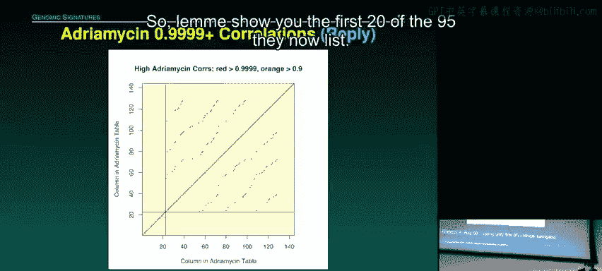

---

## 质疑、回应与后续调查

我们将这些发现写成信件投给《自然·医学》。我们坚持可重复研究的原则，因此在信件附带的补充材料中提供了全部代码和数据，任何人都可以运行并验证我们的结果。

作者的回应并非承认错误，而是声称我们的分析“存在严重缺陷”，并坚持他们的标签是正确的，因为他们已将方法再次应用于其他数据并取得成功。

我们检查了他们新公布的数据。以阿霉素为例，他们公布了一个包含144个样本的定量矩阵。当我们检查样本间的相关性时，发现了一个奇怪的现象：在122个测试样本中，有些样本被重复使用了3到4次，并且**同一个样本被标记为耐药和敏感的次数不一致**。这进一步证明他们的标签系统是混乱的。

尽管我们多次指出问题，但杜克大学的研究团队仍在继续发表论文，并基于这些有缺陷的特征**启动了临床试验**，用以为患者分配治疗方案。这促使我们撰写了一篇详尽的论文，于2010年9月提交，并很快被《应用统计年鉴》接受发表。

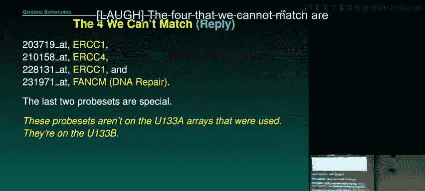

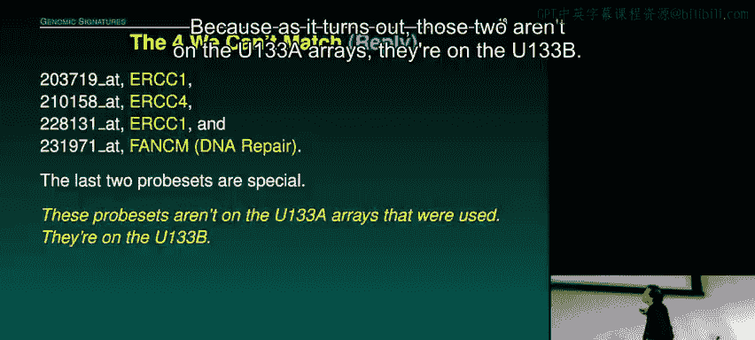

论文发表后，经媒体曝光，杜克大学启动了内部调查并暂停了试验。然而，调查在2011年1月结束，杜克大学宣布“加强了他们对这种个性化癌症治疗方法的信心”，并重启了试验。他们拒绝公开调查报告。

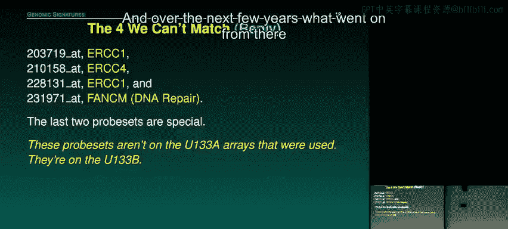

---

## 持续的错误与最终结果

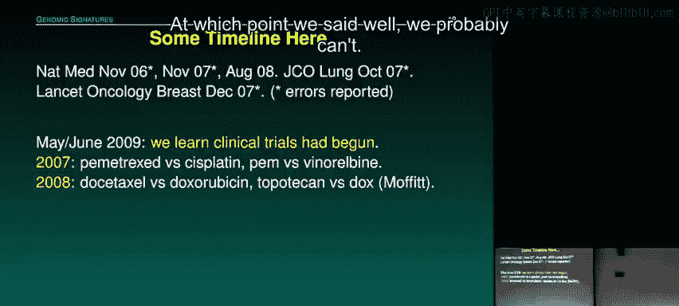

我们并未放弃。我们发现，在调查期间，他们又公布了一组用于验证“顺铂”和“培美曲塞”预测效果的新数据（共59个样本）。这两个药物正在临床试验中使用。

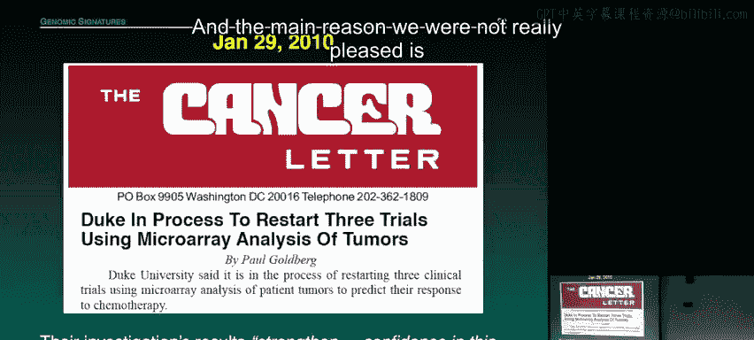

我们尝试将这59个样本与原始数据库进行匹配，结果令人震惊：
*   43个样本的标签完全错误。
*   剩余16个样本的基因标签混乱到无法识别其对应哪个原始样本。
*   **这意味着，这个用于验证两个已进行两年临床试验的药物的数据集，每一个样本都是错误的。**

我们通过《信息自由法案》从美国国家癌症研究所获得了杜克大学的内部调查报告。报告显示，审查委员会自己也无法仅从已发表的数据中复现该研究，他们依赖了未公开的额外信息。此外，报告完全没有提及我们刚刚发现的关于顺铂和培美曲塞数据的严重问题。

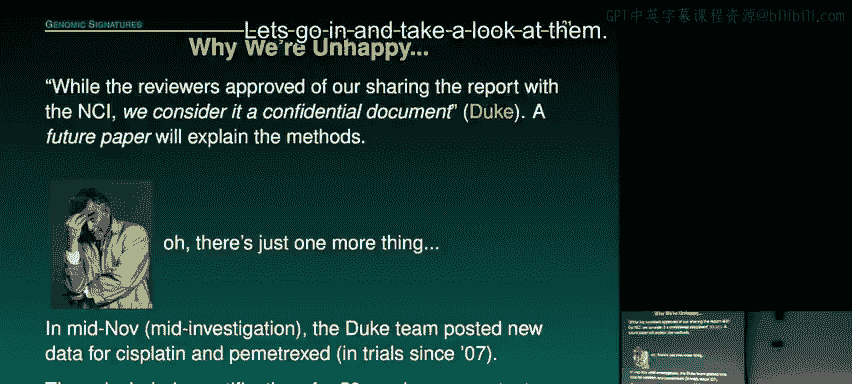

最终，在多方压力下，特别是在33位生物统计学家联名致信抗议后，杜克大学于2011年7月最终暂停了相关临床试验。多项外部调查随之启动。

---

## 经验教训与建议

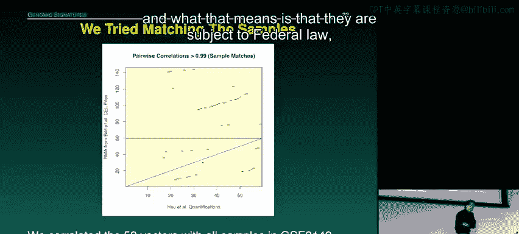

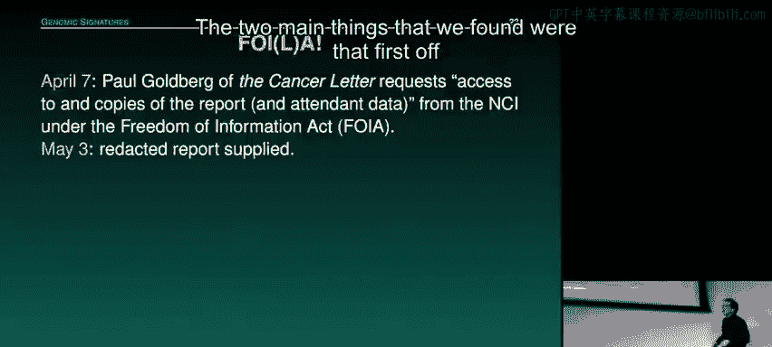

回顾整个案例，我们可以总结出以下核心教训：

**常见错误往往很简单**
*   索引偏移（如Excel复制粘贴错误）。
*   样本或基因标签混淆。
*   实验设计完全混淆。

**简单错误为何能通过审查？**
*   因为在高通量生物学中，我们的直觉并不可靠，无法一眼看出错误。
*   如果文档记录（代码、数据标注）不完整、不清晰，这些错误就很难被发现，从而溜进出版物甚至临床实践。

**对论文发表的最低要求**
1.  **提供数据**：在如GEO等公共数据库存放数据。
2.  **清晰标注**：提供定量表格时，请标注列名，说明每个样本的身份。
3.  **提供代码**：提供分析所用的完整代码。

**对临床试验的绝对要求**
上述对论文的要求，在开启涉及患者治疗的临床试验之前，必须是绝对的前提条件。

---

## 实践可重复研究：我们的做法

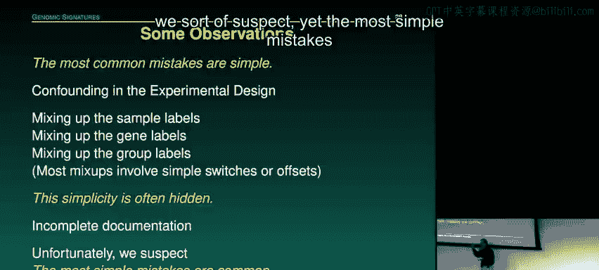

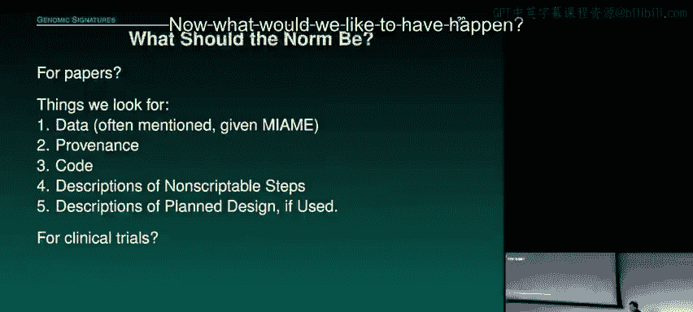

作为对这类事件的回应，自2007年起，我们团队强制推行了以下措施：
*   **使用Sweave**：所有分析报告必须使用Sweave（结合R和LaTeX）编写。这样，报告本身包含了生成所有结果和图表的数据与代码，他人可直接运行复现。
*   **双重审核流程**：分析报告由分析师撰写，提交给资深研究员审核；研究员在审阅内容的同时，必须重新运行代码以确保结果一致。只有经过这两步，报告才能发送给合作的生物学家。

这种方法极大地提高了我们工作的可重复性和透明度。

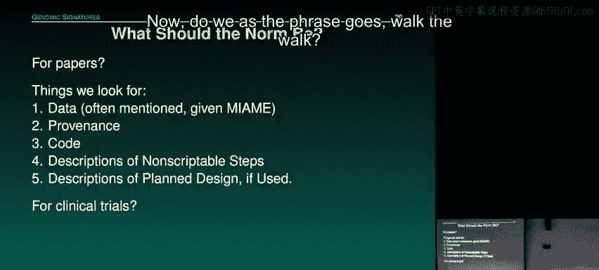

---

## 总结

本节课中，我们一起学习了“可重复研究”在高通量生物学中的极端重要性。通过杜克大学的案例，我们看到了从简单的索引错误、标签混淆，到严重的数据窥探和临床误用这一连串问题。核心问题在于**分析过程缺乏透明度、文档记录不完整以及代码未共享**，导致错误无法被及时发现和纠正。

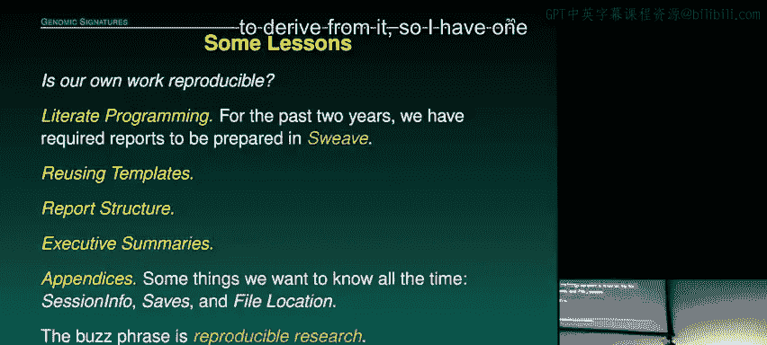

这个案例的教训是深刻的：无论是为了科学的严谨性，还是为了患者的安全，我们都必须将研究的可重复性置于核心地位。提供完整的数据、清晰的元数据以及可执行的代码，不应再是可选项，而应是所有科学研究，尤其是那些可能影响临床决策的研究的必备标准。