# 课程5：《可重复研究》｜P7：数据分析结构（第1部分）📊

在本节课中，我们将学习数据分析的基本流程与结构。虽然并非所有分析都完全相同，但了解其核心组成部分及其如何衔接，能为理解数据分析提供一个有用的模板。

## 概述：数据分析的基本步骤

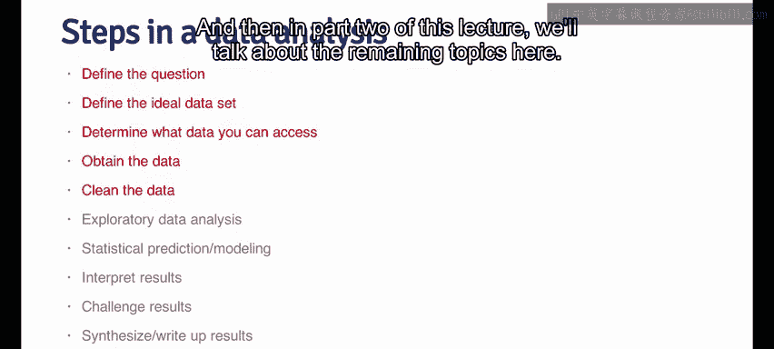

如果列出数据分析的步骤，可能会得到类似以下列表的内容。大多数分析都包含这些步骤的一个子集。在本讲（第一部分）中，我们将讨论：**定义问题、确定理想数据集、确定可获取的数据、获取数据以及清理数据**。在第二部分，我们将讨论剩余的主题。

以下是数据分析的典型步骤列表：
*   定义问题
*   确定理想数据集
*   确定可获取的数据
*   获取数据
*   清理数据
*   探索性数据分析
*   统计预测/建模
*   解释结果
*   挑战结果
*    综合撰写报告
*    创建可重复的代码

---

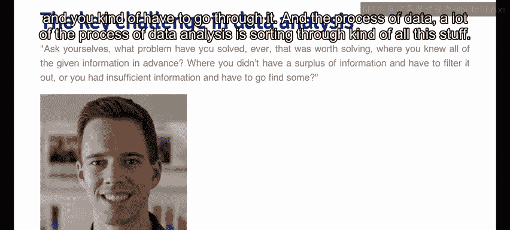

## 数据分析的核心挑战

数据分析的一个关键挑战，被数学教育家丹·迈耶在其TED演讲中很好地概括了。他问道：你曾解决过哪个值得解决的问题，是事先知道所有给定信息的？要么是信息过剩需要筛选，要么是信息不足需要寻找。这正是数据分析的关键：通常你并非掌握所有事实，就是信息过多需要梳理。数据分析的很大一部分过程，就是整理所有这些信息。

---

## 第一步：定义问题 🎯

数据分析首先要从**定义问题**开始。并非所有分析都始于一个非常具体或连贯的问题，但你在提出合理问题上投入的努力越多，后续筛选大量信息所需的工作就越少。原因是，定义问题是你所能使用的最强大的降维工具。例如，如果你只关心身高或体重等特定变量，就可以排除许多与此无关的其他变量。因此，尽可能具体地缩小问题范围，将有助于减少处理潜在庞大数据集时需要应对的“噪音”。

有时你只是想查看数据、探索其中的内容，那就需要检查大型数据中的各种信息。但如果你能将兴趣范围缩小到特定类型的问题，这对简化问题将极为有用。因此，建议在深入研究数据细节之前，先思考你想回答什么类型的问题。

一般来说，**科学背景**决定了你感兴趣的问题类型，这引导你找到**数据**，进而应用**应用统计学**来分析数据。如果你更有雄心，可能会思考一些**理论统计学**，以将你应用的方法推广到不同类型的数据。当然，能做到这一点的人相对较少，因此并非对每个人的要求。

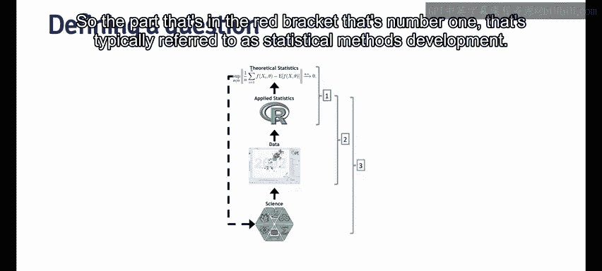

图中红色括号内的部分（第1点）通常被称为**统计方法开发**。而紫色括号内的部分（第2点），即在没有科学背景的情况下将统计学直接应用于原始数据，我称之为“危险区”。这个想法源自德鲁·康威绘制的数据科学维恩图。其核心是，如果你只是随机地将统计方法应用于数据集以寻找有趣的答案，你几乎肯定会发现一些有趣的东西，但它可能不可重复，也可能没有真正意义。因此，一个真正恰当的数据分析应具有科学背景，最好至少有一个我们试图研究的总体问题，这将缩小问题的维度，然后我们将适当的统计方法应用于适当的数据。

---

## 从问题到数据：一个例子

让我们从一个非常基本的问题例子开始。一个普遍性问题可能是：**我能自动检测电子邮件是垃圾邮件还是非垃圾邮件吗？** 当然，如果你使用电子邮件，这是一个重要问题，你想知道哪些是应该阅读的重要邮件，哪些只是垃圾邮件。

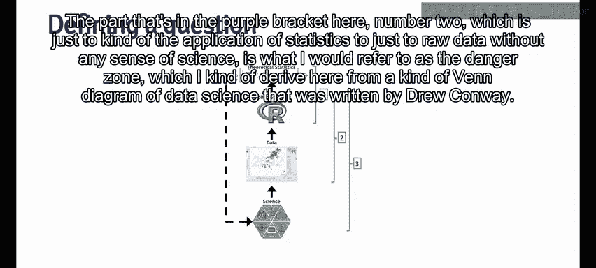

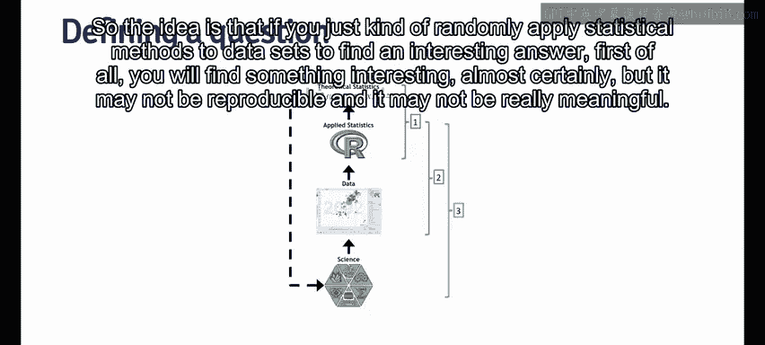

如果你想将其转化为数据分析问题，有多种方式可以回答。例如，你可以雇人手动检查邮件并判断是否为垃圾邮件，但这可能不可持续，效率也不高。因此，要将其转化为数据分析问题，你需要让问题更具体，并使用数据分析工具特有的术语来转化它。

一个更具体的版本可能是：**我能使用电子邮件本身的定量特征将其分类为垃圾邮件（spam）或正常邮件（ham）吗？** 现在，我们可以开始查看邮件，并思考：为了对邮件进行分类，我需要开发哪些定量特征？

---

## 第二步：确定理想数据集 📦

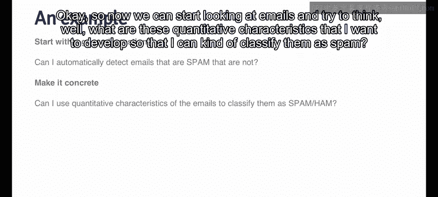

一旦有了问题，我们想知道：如何区分邮件以识别垃圾邮件？这样，你或许就能过滤掉所有垃圾邮件，只阅读真正的邮件。

首先要思考的是：**针对这个问题，理想的数据集是什么？** 如果我拥有世界上所有的资源，我会去寻找什么？根据目标和所提问题的类型，你可以收集不同类型的数据集。

以下是不同类型问题对应的理想数据集：
*   **描述性问题**：可能需要整个**总体**的数据（例如，进行一次普查）。
*   **探索性问题**：可能只需要一个包含许多测量变量的**随机样本**。
*   **推断性问题**：必须非常小心**抽样机制**和所抽样的**总体定义**，因为你是从样本中得出结论来推断更大的总体。
*   **预测性问题**：需要来自你感兴趣总体的**训练集**和**测试数据集**，以便构建模型和分类器。
*   **因果性问题**：需要**实验数据**，例如来自随机试验或随机研究的数据。
*   **机制性问题**：需要关于你所描述系统的所有不同组成部分的数据。

对于我们的垃圾邮件问题，一个理想的数据集或许是：如果你使用Gmail，你知道所有邮件都存储在谷歌的数据中心。那么，我们何不获取谷歌数据中心的所有数据呢？因为那将是邮件的整个总体，我们可以基于所有这些数据构建分类器，而无需担心抽样问题。这将是一种理想的数据。

---

## 第三步：确定可获取的数据 🔍

当然，在现实世界中，你必须思考：**你实际上能获取哪些数据？** 也许谷歌内部有人能访问所有通过Gmail的邮件，但即使在这种极端情况下也可能很困难，而且大多数人无法获取这些数据。因此，有时你不得不退而求其次，选择不那么理想的数据。

你可能需要在网络上寻找免费数据，或从提供商处购买数据。在这些情况下，务必**尊重数据的使用条款**。任何你同意的关于数据的协议或合同都必须遵守。如果数据根本不存在，你可能需要自己以某种方式生成数据。

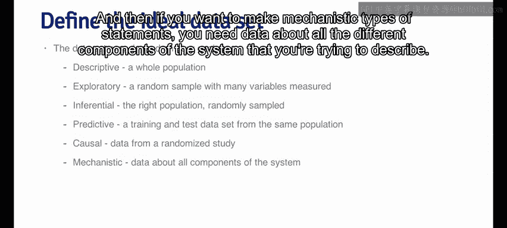

获取谷歌的所有数据很可能不可行，因为他们的数据中心安全级别非常高。因此，我们必须寻找其他方案。

---

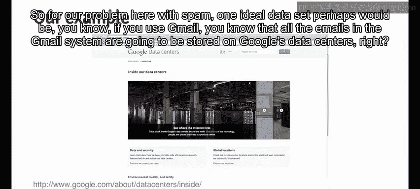

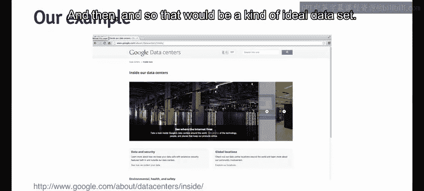

## 第四步：获取数据 ⬇️

一个可能的解决方案来自**UCI机器学习库**中的垃圾邮件数据集。这个数据集由惠普公司的人员创建，他们收集了几千封垃圾邮件和正常邮件，并进行了适当分类。你可以使用这个数据库来探索如何将电子邮件分类为垃圾邮件或正常邮件的问题。

获取数据时，首要目标是尝试获取**原始数据**（例如从UCI机器学习库获取）。必须小心**注明来源**。无论从哪里获取数据，都应始终注明来源并记录其出处。

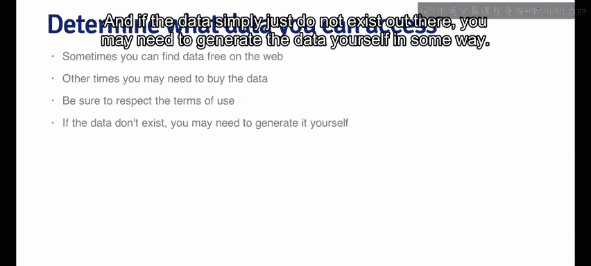

如果你需要向不熟悉的研究者索要数据，一封非常礼貌的电子邮件通常大有帮助，他们可能愿意与你分享数据。如果从互联网来源获取数据，至少应记录**URL**（获取数据的网站地址）以及**访问的日期和时间**，以便将来他人有据可查。网站可能会关闭，URL可能会改变或无法访问，但至少在你获取数据时，你记录了获取方式。

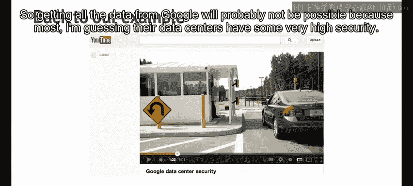

在本例中，既然我们无法访问谷歌数据中心，我们将讨论的数据集就是这个垃圾邮件数据集，你可以从R语言的`kernlab`包中获取。安装该包后，即可直接加载数据。

---

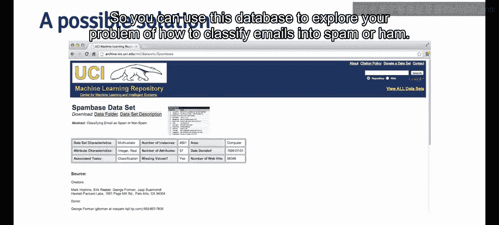

## 第五步：清理数据 🧹

对于任何数据集，你通常需要做的第一件事就是进行一些**清理**。原始数据通常需要经过某种处理，才能变成可以建模或输入建模程序的形式。

如果数据已经过预处理，重要的是**了解它是如何被预处理的**。尝试获取有关预处理内容及方式的文档。你需要了解数据的来源，例如，它是否来自调查？抽样是如何进行的？是方便抽样吗？数据来自观察性研究还是实验？数据的来源非常重要。

你可能需要以特定方式**重新格式化数据**，以便其适用于特定类型的分析。如果数据量极大，你可能希望**对数据进行二次抽样**，使其更易于管理。

**记录所有清理步骤至关重要**。你应该将这些步骤写在脚本或最方便的地方，因为无论是你自己还是他人，如果想要复现你的发现，都需要重复这些步骤。如果你不记录所有这些预处理步骤，那么将无人能够再次完成。

一旦清理完数据并对其有了基本了解，重要的是**判断数据是否足以解决你的问题**。因为在某些情况下，数据可能不够好：数据量可能不足，变量或特征可能不够，数据的抽样方式可能不适合你的问题。在清理数据的过程中，你可能会意识到各种问题。

如果你确定数据不足以解决你的问题，那么就应该停止，尝试重新获取数据、更换数据或改变问题。重要的是，不要仅仅因为你手头只有这些数据就强行继续分析，这可能导致不恰当的推断或结论。

---

## 示例：清理后的数据集

以下是我们将在本例中使用的已清理数据集（它已在`kernlab`包中为我们清理好）。这里只展示了前五个变量，数据中还有许多其他变量。你可以看到，共有4601个观测值和5个变量（此处显示）。我已将链接放在这里，你可以查看帮助页面，了解数据集的来源和处理方式。

---

## 总结

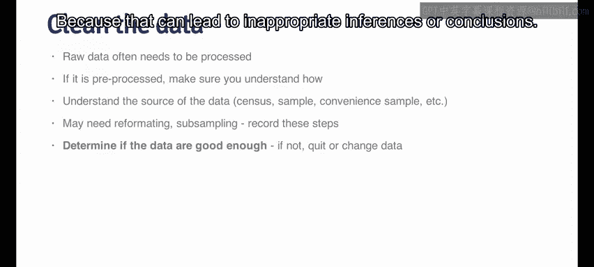

在本节课的第一部分，我们一起学习了数据分析流程的前半部分核心步骤。我们从**定义具体、可分析的科学问题**开始，这是最有效的降维工具。接着，我们探讨了如何根据问题类型（描述、探索、推断、预测、因果、机制）来**确定理想的数据集**。然后，我们面对现实，讨论了如何**评估和获取实际可用的数据**，并强调了记录来源和遵守条款的重要性。最后，我们深入了**数据清理**环节，包括理解预处理、格式化数据、子抽样，并特别强调了**详细记录所有清理步骤**对于确保分析可重复性的关键作用。

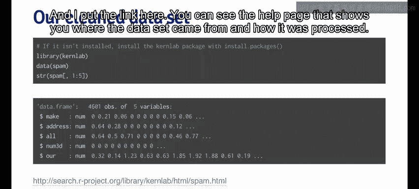

记住，清晰的问题定义和严谨的数据获取与清理，是构建可靠、可重复数据分析的坚实基础。在下一部分，我们将继续探讨数据分析的后续步骤。