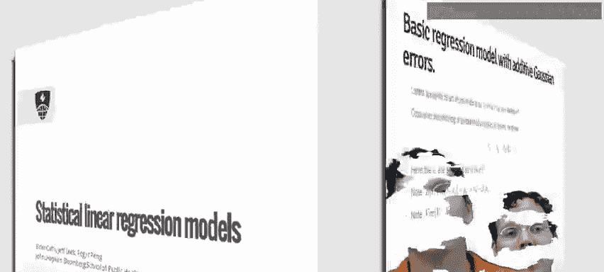
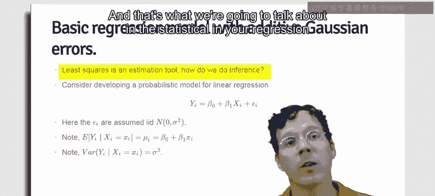
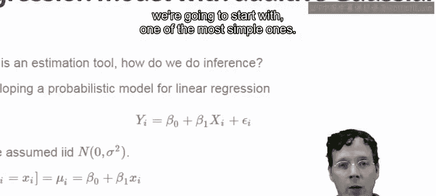
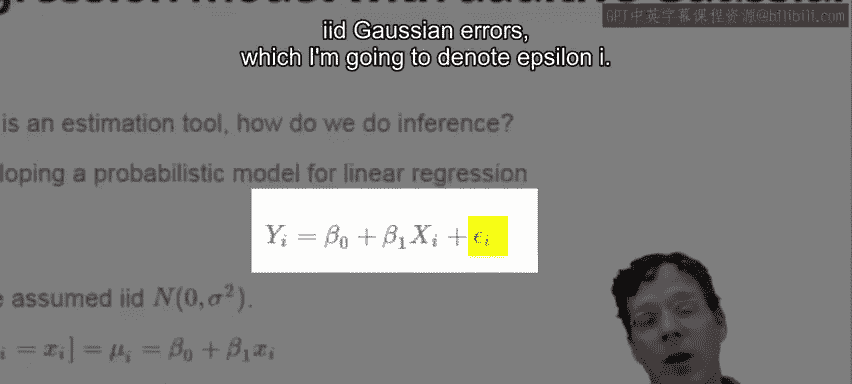
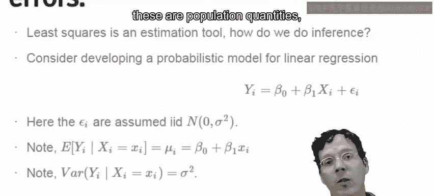

# 📊 课程7：《回归模型》｜P10：统计线性回归模型

在本节课中，我们将学习如何为线性回归建立统计模型，并理解如何从数据中推断总体参数。我们将从最简单的概率模型开始，逐步探讨其核心假设、参数估计及统计推断的基本原理。

---

## 从数学过程到统计推断

上一节我们介绍了使用最小二乘法寻找最佳回归线的数学过程。然而，我们希望进行统计推断，即基于样本数据对总体进行概括。这正是本节“统计线性回归模型”要讨论的内容。

## 线性回归的概率模型

我们从一个简单的线性回归概率模型开始。该模型将响应变量表述为解释变量的线性函数，并加入随机误差项。

### 模型公式

模型的基本形式如下：

**Yi = β₀ + β₁Xi + εi**

其中：
*   **Yi** 是第 i 个观测的响应变量。
*   **Xi** 是第 i 个观测的已知解释变量。
*   **β₀** 和 **β₁** 是我们希望估计的未知总体参数（截距和斜率）。
*   **εi** 是随机误差项，我们假设它服从独立同分布的正态分布，即 **εi ~ N(0, σ²)**。

### 关于误差项的说明

独立误差项可以理解为许多未被纳入模型但共同影响响应变量的因素的累积效应，其总体行为可以近似为独立同分布的高斯（正态）误差。我们暂时搁置其复杂的解释问题，先关注如何进行回归的统计推断。

### 模型的期望与方差

在给定解释变量 Xi 的条件下，响应变量 Yi 的期望值和方差具有明确的统计含义：

*   **条件期望**：**E[Yi | Xi] = β₀ + β₁Xi**。这恰好是回归线在该点的值。
*   **条件方差**：**Var(Yi | Xi) = σ²**。这表示数据点围绕回归线的波动程度。

需要强调的是，这里的方差 σ² 是**条件方差**，即给定 X 后 Y 的方差。由于通过 X 解释了一部分 Y 的变异，这个值通常小于响应变量 Y 自身的总体方差。此外，期望值和方差目前都是我们想要了解的总体参数，后续我们将通过样本数据来估计它们。

---

## 本节总结

本节课我们一起学习了统计线性回归模型的基础。我们建立了包含随机误差项的概率模型 **Yi = β₀ + β₁Xi + εi**，并明确了模型的核心假设：误差项 εi 独立且服从正态分布 **N(0, σ²)**。在此基础上，我们探讨了响应变量的条件期望与条件方差的含义，为后续的参数估计和统计推断奠定了理论基础。