# 课程7：《回归模型》｜P12：使用线性回归进行预测 📈

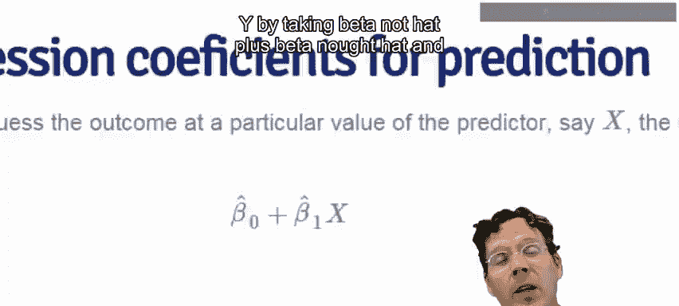

在本节课中，我们将学习如何使用线性回归模型进行预测。我们将通过一个具体的例子，解释回归系数，并演示如何计算和解释预测值。

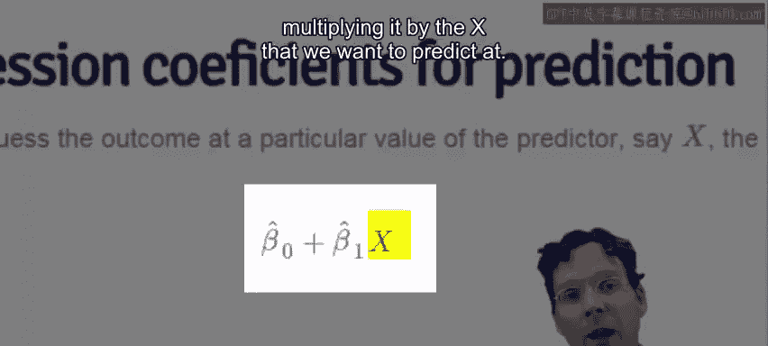

---

## 预测Y值

我们可以通过公式 **Ŷ = β̂₀ + β̂₁X** 来预测Y值，其中X是我们想要预测的自变量值。

如果我们代入观测到的X值，就会得到拟合值。这些拟合值是我们试图使其尽可能接近观测数据的值。

但这并不意味着我们只能在拟合值处进行预测。我们可以将任何我们想要的X值代入方程进行预测。

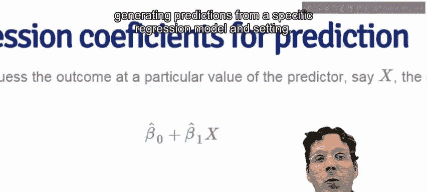

然而，如果我们代入的X值位于用于构建模型的数据范围内，预测结果将更为合理。

后续课程中，我们还将讨论如何使用预测区间来处理这种不确定性。目前，我们先讨论如何获得预测值。在接下来的几张幻灯片中，我们将通过一个具体例子来解读截距、解读斜率，并从特定的回归模型设置中生成预测。

---

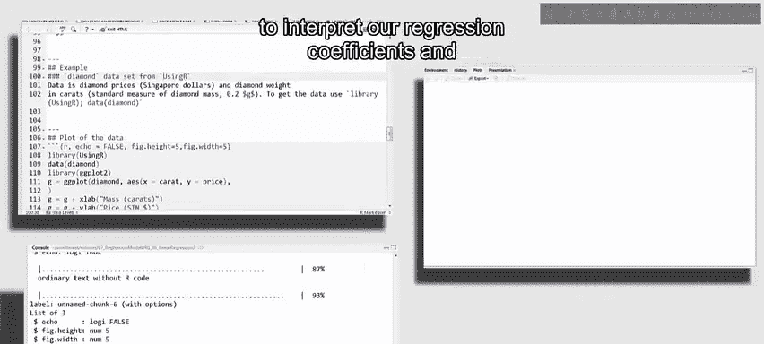

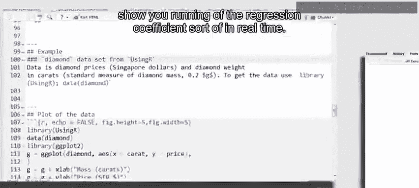

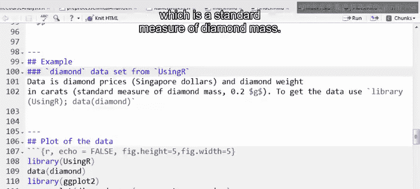

## 代码示例：解读回归系数

现在，让我们通过一些代码来解读回归系数，并实时展示回归系数的运行过程。数据集来自`UsingR`包中的钻石数据集，数据包括钻石价格（新加坡元）和钻石重量（克拉）。

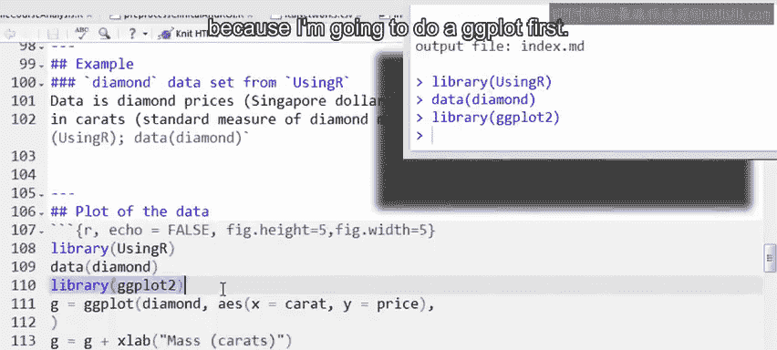

要获取数据，首先需要使用`library(UsingR)`加载`UsingR`包，然后加载`diamond`数据集。

我们还将使用`ggplot2`进行绘图。

以下是创建绘图的命令。我们将绘图赋值给变量`g`。数据集是`diamond`，横轴变量是`carat`（克拉），纵轴变量是`price`（价格）。我们为坐标轴添加标签：X轴标签为“质量（克拉）”，Y轴标签为“价格（新加坡元）”。

运行这些代码后，我们添加数据点（黑色背景，浅色半透明）和回归线。使用`geom_smooth(method = lm)`可以轻松添加回归线，该方法默认使用Y作为结果变量，X作为预测变量。我们将回归线颜色设为黑色。

运行代码后调用绘图，即可看到图形。X轴是质量，Y轴是价格，图中显示的直线就是拟合线，即最小化各点到直线垂直距离平方和的直线。

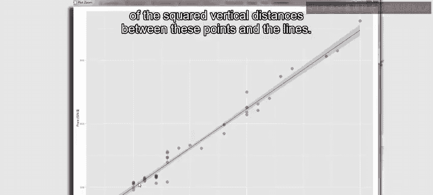

---

## 获取拟合线

`lm`函数是R中用于线性模型的程序，回归是它的一个特例。

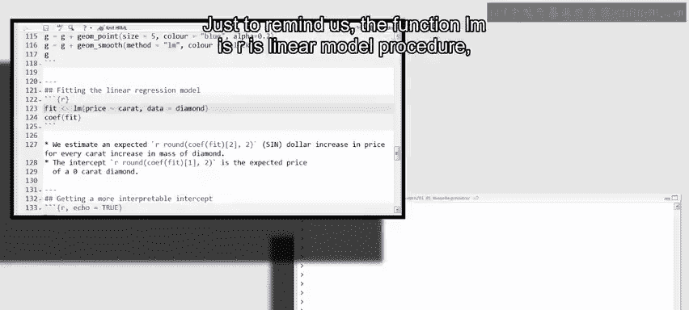

在公式中，波浪号`~`左侧是结果变量`price`，右侧是预测变量`carat`。默认情况下，`lm`包含截距项。如果不需要截距，必须在模型中明确指定。

逗号后面指定我们使用的数据集为`diamond`数据框。我们将模型结果赋值给变量`fit`。

运行后查看输出：

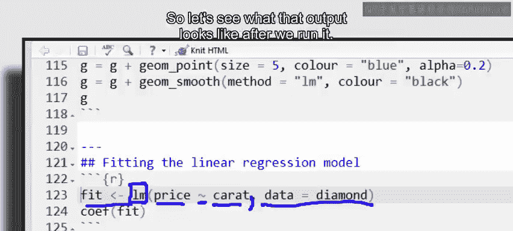

运行模型后，输入`fit`会打印出系数β̂₀和β̂₁。若想获得更详细的输出，可以使用`summary(fit)`。在课程后期，你将能解读此摘要中的所有数字。

目前，我们只关注系数。使用`coef(fit)`可以获取系数向量，其中包含截距（标记为`(Intercept)`）和`carat`变量的回归斜率。

观察斜率3721，并尝试解读它。

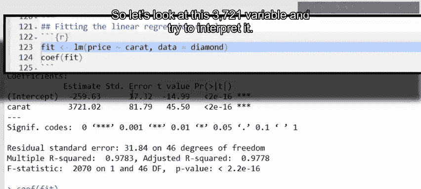

这意味着，钻石质量每增加1克拉，其预期价格将增加3,721新加坡元。

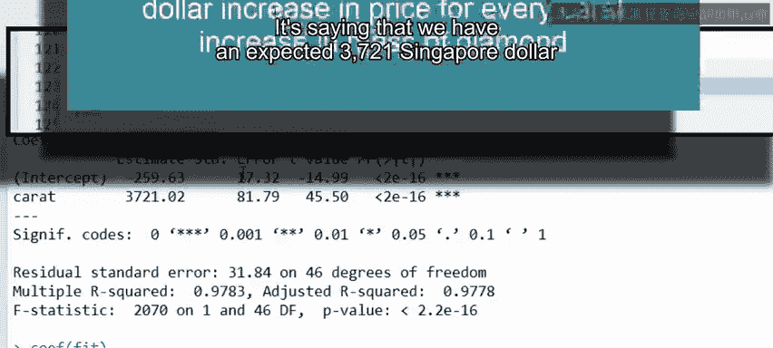

截距-259是0克拉钻石的预期价格。这个值本身意义不大，因为我们不关心0克拉的钻石。

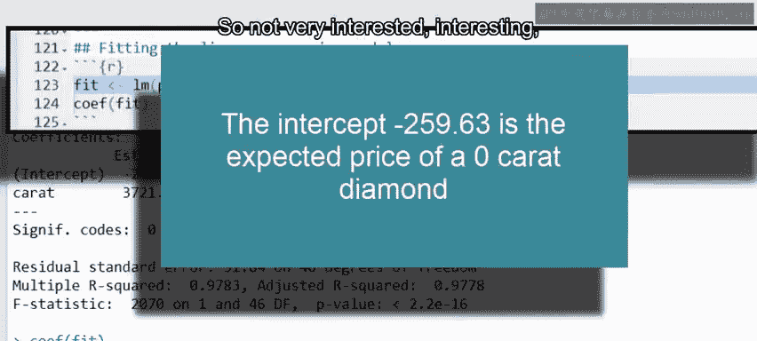

---

## 中心化X变量

现在，我们对X变量进行中心化处理，使截距处于更易解释的尺度上。

首先，将新模型赋值给`fit2`，以免覆盖原始的`fit`。在`lm`公式中，结果变量保持不变，预测变量变为`carat - mean(carat)`。在`lm`的公式语句中进行算术运算时，必须用`I()`函数括起来。数据集仍然是`diamond`。

运行代码后查看新系数：

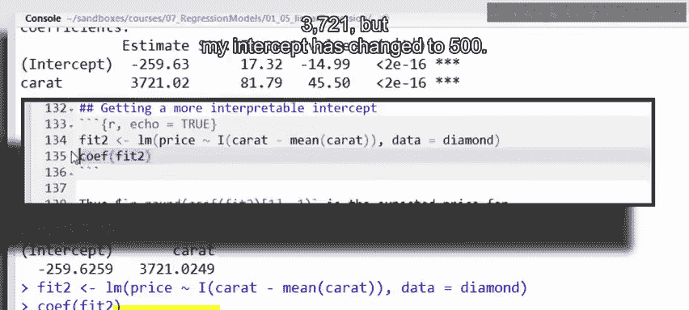

斜率保持不变，仍是3721，但截距变为500。这意味着，500新加坡元是该数据集中平均大小钻石（约0.2克拉）的预期价格。

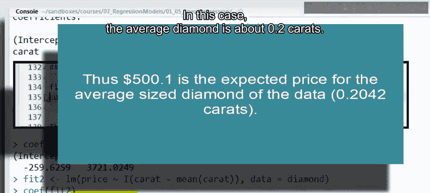

---

## 改变单位

1克拉的增加量实际上很大。如果我们将单位改为0.1克拉呢？

我们可以简单地将系数除以10。因此，我们预计钻石质量每增加0.1克拉，价格将增加372新加坡元。

让我们在R中演示这一点。现在将新模型赋值给`fit3`。在公式中，我们放入`carat * 10`，因此这个新变量的单位是0.1克拉。数据集仍是`diamond`。

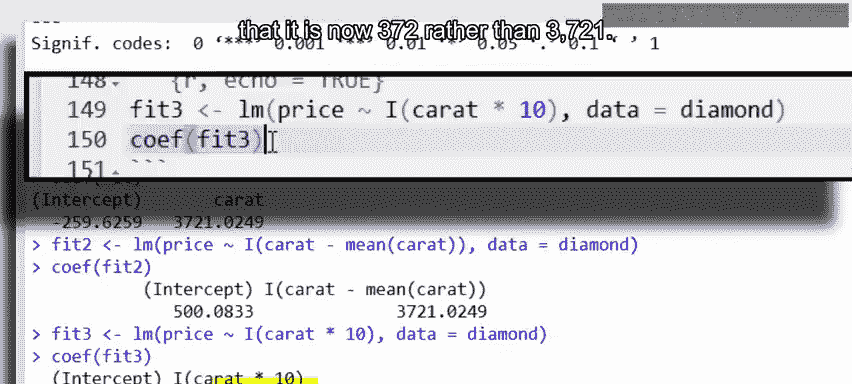

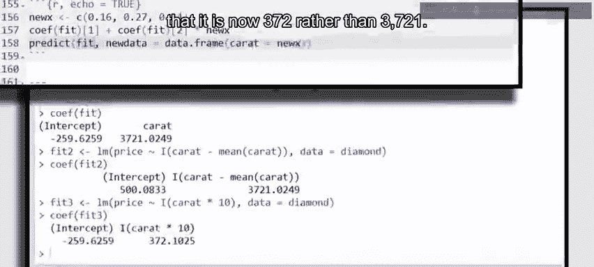

运行后获取系数：

现在斜率是372，而不是3,721。

---

## 进行预测

假设有人带来了三颗新钻石，重量分别为0.16克拉、0.27克拉和0.34克拉。他们想知道这些钻石的估计价格。

你可以手动计算，即取截距加上斜率乘以这些新值。计算出的预测价格分别为336、745和1006新加坡元。根据散点图，这个拟合的线性回归模型似乎相当不错。

通常，你不想进行这么多编码，尤其是当有很多回归变量时，你需要一个更通用的方法。R中有一个通用函数叫`predict`，它可以处理多种模型拟合的输出（线性模型是其中之一）。

我们使用`predict`函数，并传入新的数据框（包含`carat`变量的新值）进行预测。这会给出与手动计算相同的答案。这种方法在我们有多个回归变量和更复杂设置时具有良好的扩展性。

如果你省略`newdata`参数，直接使用`predict(fit)`，它会预测在观测到的X值处的Y值，即给出Ŷ值。如果你想在新的X值处预测，必须提供`newdata`参数。

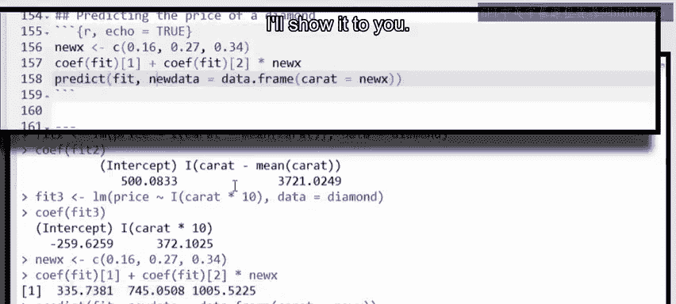
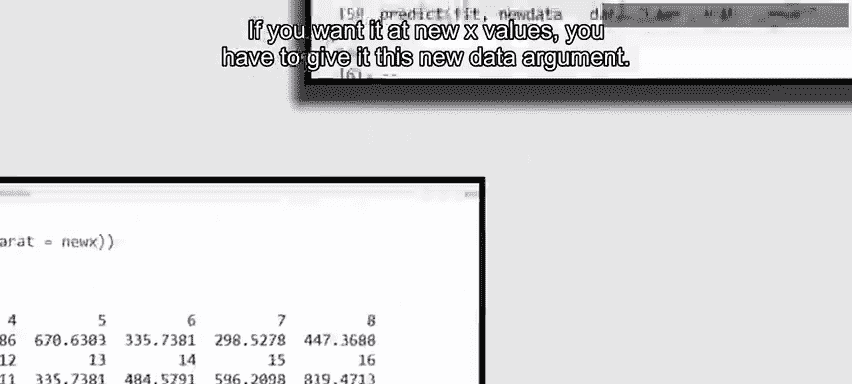

---

## 预测过程图示

我想简要说明预测是如何完成的。图中蓝色点是观测数据点。红色点是我们使用`predict`命令得到的拟合值，即所有观测X值在拟合线上对应的点。如果我们从观测数据点向拟合线画垂直线，垂足就是这些红点。

当我们预测一个新的X值时，我们是在横轴上找到这个点（例如0.16、0.27、0.34），向上画一条线到拟合回归线，然后水平移动到价格轴，得到预测的美元金额。

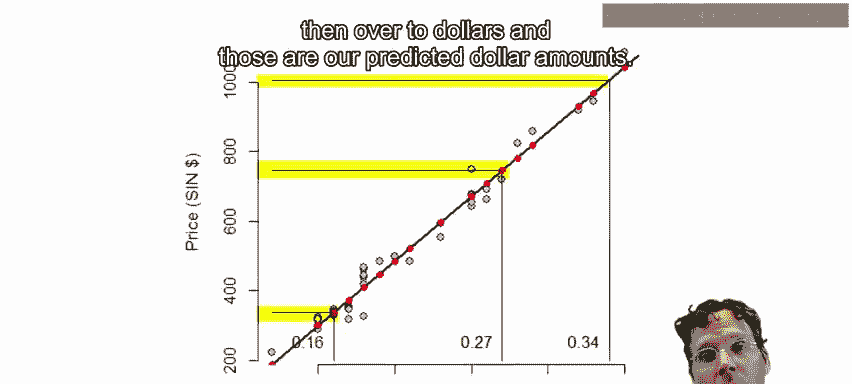

---

## 总结

在本节课中，我们一起学习了如何使用线性回归模型进行预测。我们通过钻石数据的例子，详细解读了回归系数（截距和斜率）的含义，并演示了如何对X变量进行中心化和单位转换以改善解释性。最后，我们介绍了使用`predict`函数进行预测的通用方法，并图示了预测的几何过程。