# 约翰霍普金斯大学数据科学课程7：《回归模型》｜P13：残差 📊

在本节课中，我们将要学习回归分析中的一个核心概念：**残差**。我们将了解残差的定义、性质及其在诊断模型拟合优度中的重要作用。

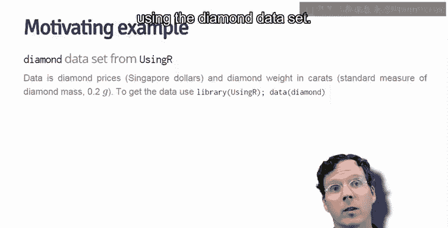

---

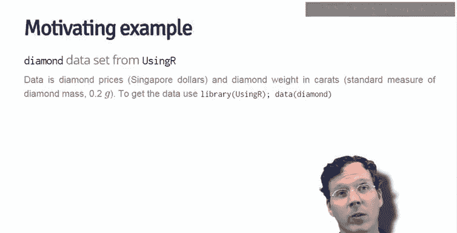

## 课程概述

本节课以钻石数据集为例，探讨如何利用钻石重量解释其价格的变化。我们将重点关注在考虑了预测变量（重量）的线性影响后，模型中剩余的、未被解释的变异，这部分变异就称为残差。

上一节我们介绍了回归线的基本概念，本节中我们来看看如何量化数据点与回归线之间的差异。

---

## 残差的定义

让我们回顾一下正在考虑的线性回归模型。在我们的例子中，结果变量是价格，解释变量是重量。

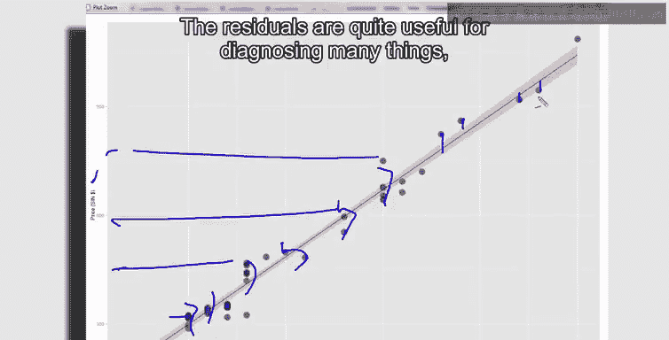

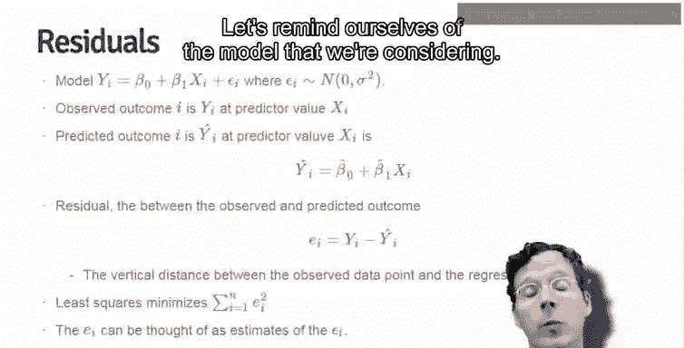

模型公式如下：
`Y_i = β_0 + β_1 * X_i + ε_i`

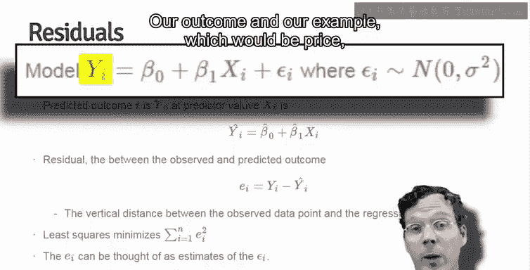

其中：
*   `Y_i` 是第 `i` 个观测的结果（钻石价格）。
*   `X_i` 是第 `i` 个观测的预测变量值（钻石重量）。
*   `ε_i` 是误差项，我们通常假设它服从均值为0、方差为 `σ²` 的正态分布。

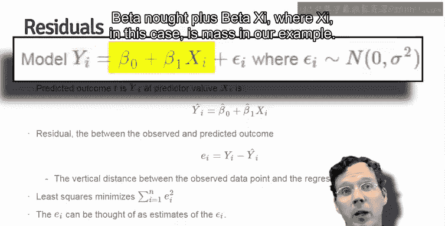

对应于 `X_i` 的回归线上的点，我们称之为拟合值 `Ŷ_i`：
`Ŷ_i = β̂_0 + β̂_1 * X_i`

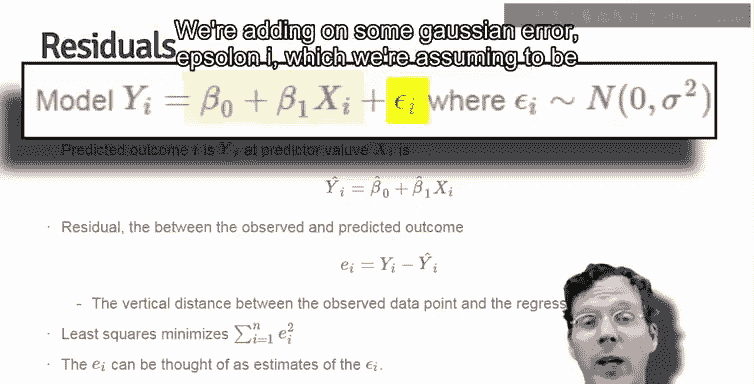

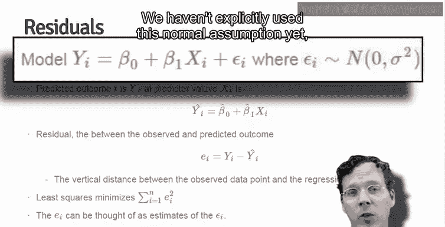

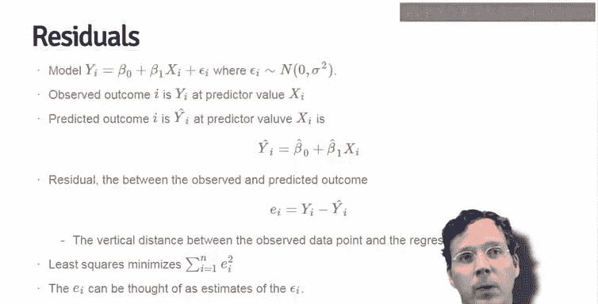

**残差** `e_i` 定义为观测值 `Y_i` 与模型拟合值 `Ŷ_i` 之间的垂直距离：
`e_i = Y_i - Ŷ_i`

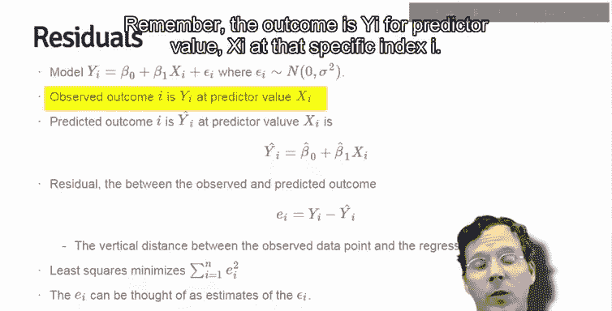

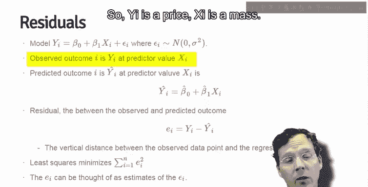

最小二乘法的目标正是最小化所有残差的平方和：`∑ e_i²`。

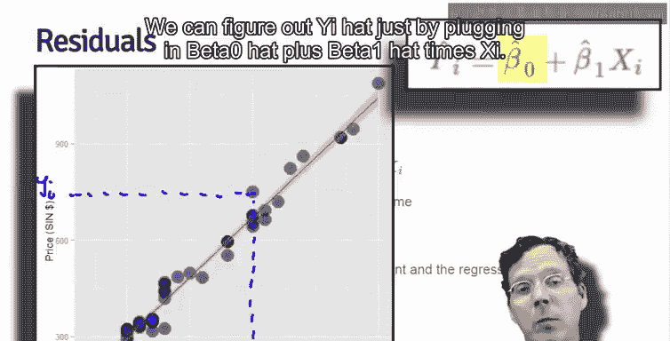

---

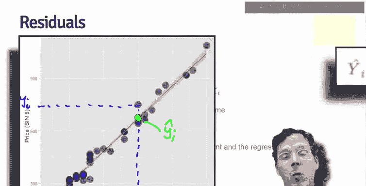

## 残差的性质与用途

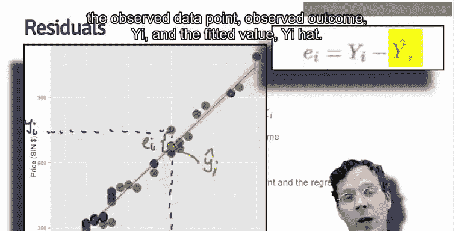

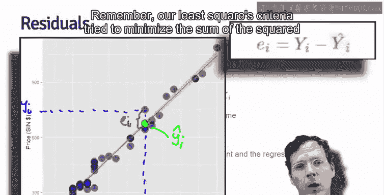

理解残差的性质有助于我们更好地解释和使用它们。

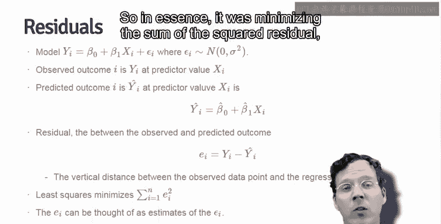

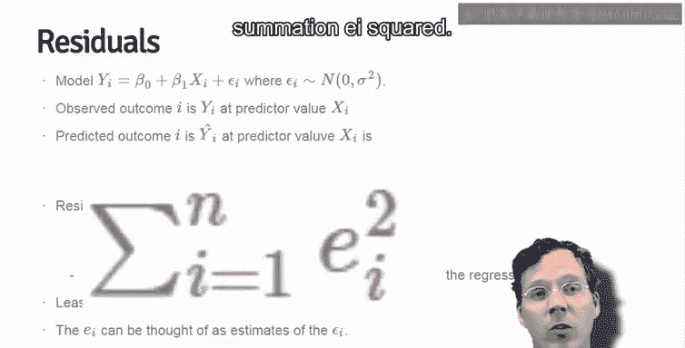

以下是残差的一些关键性质：
*   **均值为零**：如果模型中包含了截距项，那么残差的样本和（以及样本均值）为零。
*   **与预测变量正交**：在包含截距项的线性模型中，残差与模型中任何一个预测变量的乘积和也为零。
*   **误差项的估计**：残差可以被视为模型中随机误差项 `ε_i` 的一种估计。但需注意，随意增加无关的预测变量会人为地减小残差，因此需谨慎解释。

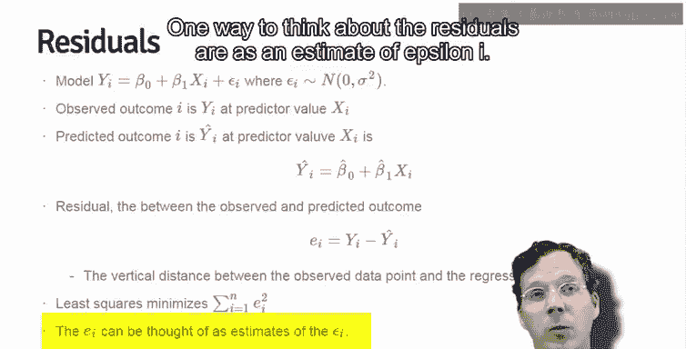

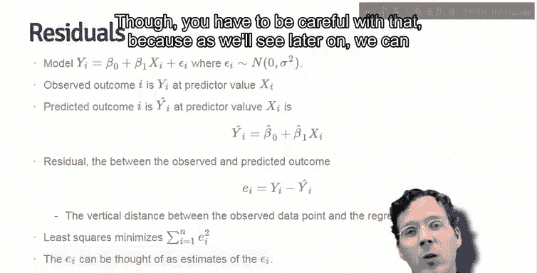

残差主要有两大用途：
1.  **诊断模型拟合**：残差图是诊断模型假设是否成立、识别模型拟合不佳区域（如非线性、异方差性、异常值）的强大工具。
2.  **创建调整后的变量**：残差可以看作是移除了预测变量 `X` 的**线性影响**后的结果变量 `Y`。例如，如果我们想分析已根据重量调整后的钻石价格（即所有钻石价格处于同一重量尺度上），就可以使用以价格为结果、重量为预测变量的回归模型所得到的残差进行后续分析。

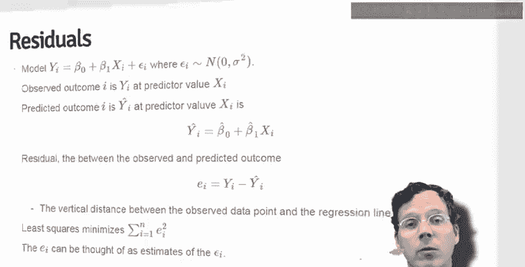

---

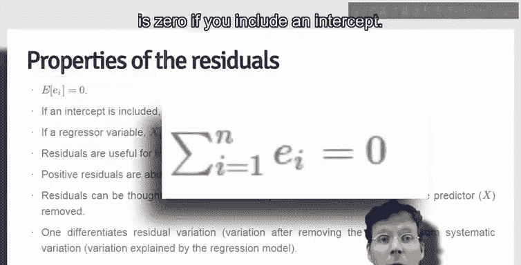

## 残差变异与系统变异

区分以下两种变异非常重要：
*   **系统变异**：由回归模型解释的变异，即预测变量 `X` 所能说明的结果 `Y` 的变化部分。
*   **残差变异**：在通过线性方式考虑了预测变量 `X` 的影响后，结果 `Y` 中剩余的、未被解释的变异。它体现了数据点围绕回归线的分散程度。

正如在钻石数据集的散点图中所示，如果不考虑重量，价格本身变异很大。当我们用重量进行线性解释后，价格围绕回归线的变异（即残差变异）就小得多。

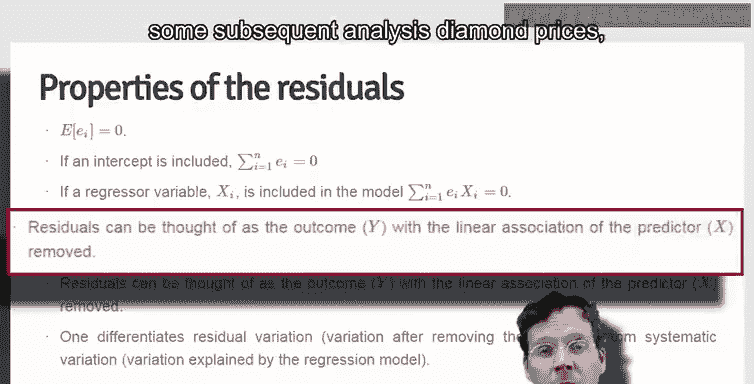

---

## 总结

本节课中我们一起学习了回归分析的核心概念——**残差**。

我们明确了残差是观测值与模型预测值之间的差值（`e_i = Y_i - Ŷ_i`），理解了其均值为零、与预测变量正交等重要性质。更重要的是，我们认识到残差是诊断模型拟合优度的关键工具，并能用于创建移除了特定变量线性影响的新变量。

下一节，我们将利用这些知识，深入探讨如何通过绘制和分析残差图来评估和改进我们的回归模型。