# 约翰霍普金斯大学数据科学课程7：《回归模型》｜P16：回归中的推断 📊

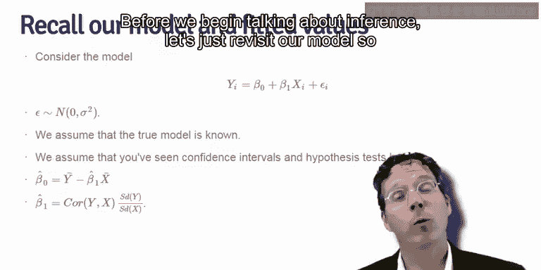

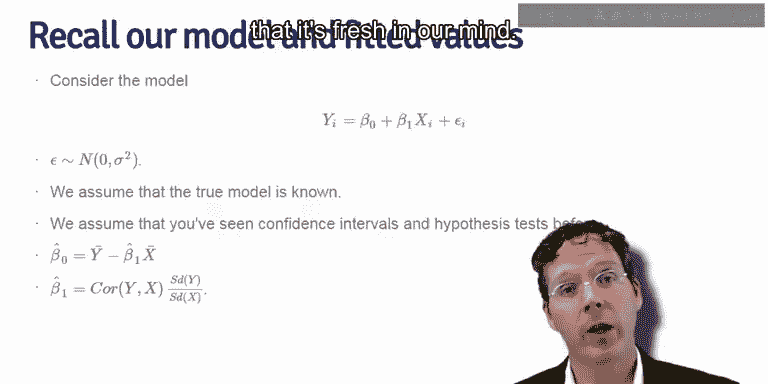

在本节课中，我们将要学习如何在回归模型的背景下进行统计推断。我们将回顾假设检验和置信区间的基本概念，并将其应用于回归模型的参数估计中。

上一节我们介绍了回归模型的基本形式及其参数估计方法。本节中我们来看看如何对这些参数进行统计推断。

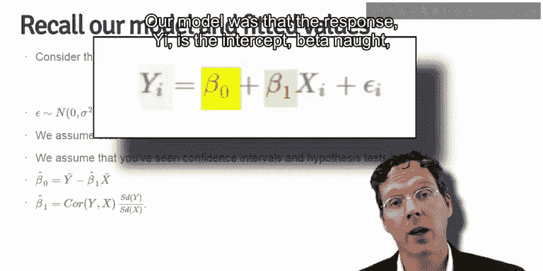

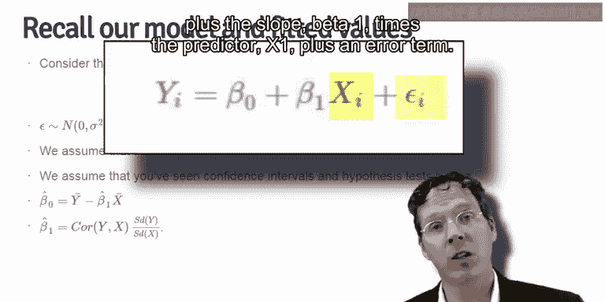

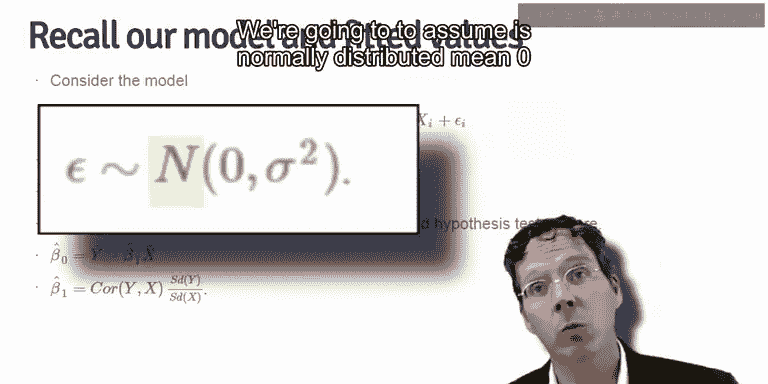

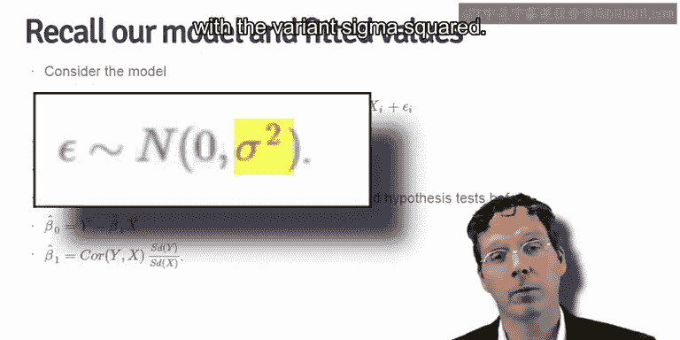

## 模型回顾 📝

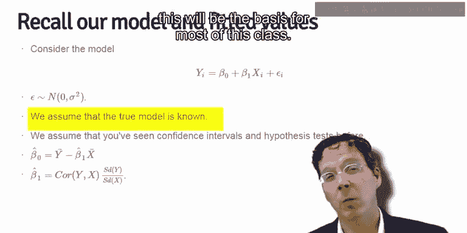

我们的模型假设响应变量 `Y_i` 由以下公式描述：
`Y_i = β_0 + β_1 * X_i + ε_i`
其中，误差项 `ε_i` 服从均值为0、方差为 `σ^2` 的正态分布。

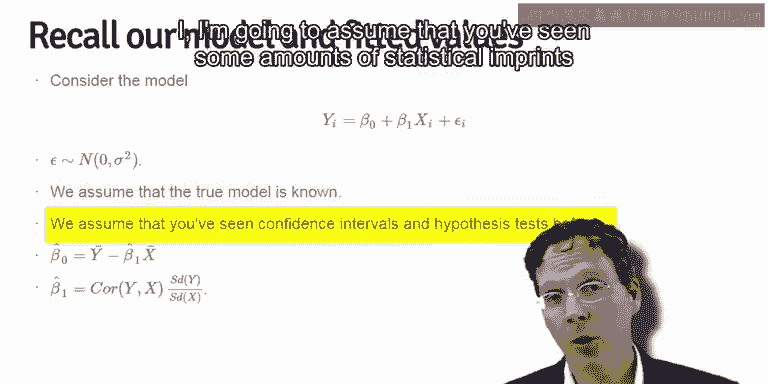

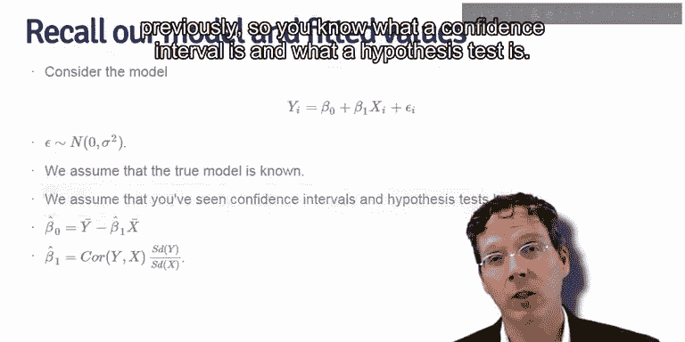

我们暂时假设真实的模型是已知的，这将作为本课程大部分内容的基础。

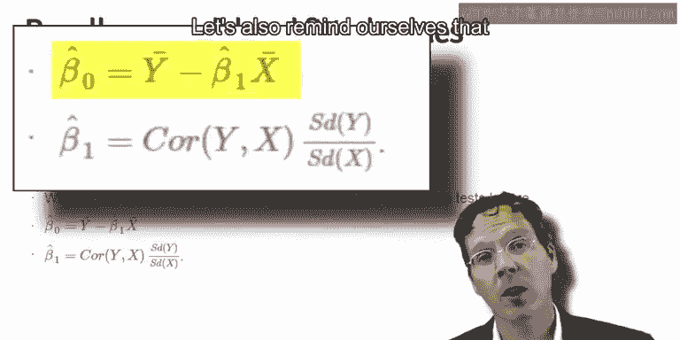

## 统计推断基础 🔍

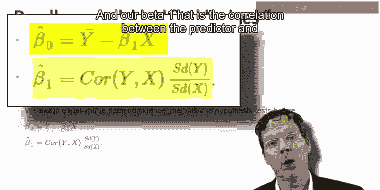

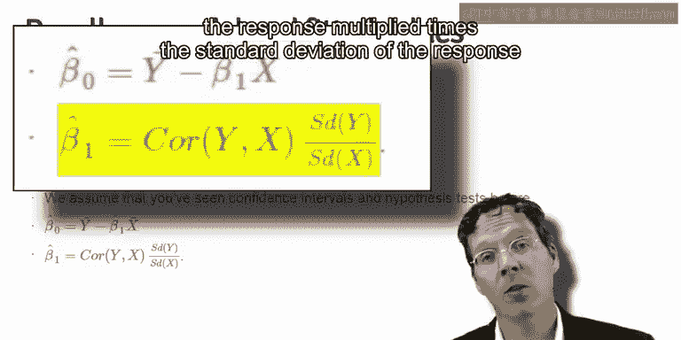

我假设你已经学习过一些统计推断知识，因此了解什么是置信区间和假设检验。

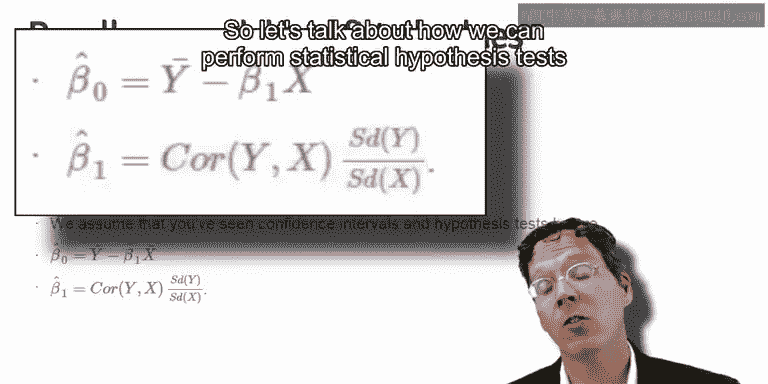

让我们回顾一下统计推断中的几个核心概念。

以下是统计量的一般形式及其性质：
*   统计量 `(θ_hat - θ) / SE(θ_hat)` 通常具有以下性质。
*   该统计量通常服从正态分布。
*   在有限样本中，如果用估计方差代替真实方差，该统计量通常服从 `t` 分布。
*   我们将看到，在我们所做的假设下，这在回归背景下也成立。

这个统计量可用于对参数 `θ` 进行假设检验，检验其是否等于某个原假设值，或者小于、大于、不等于该值。

我们也可以用以下形式创建置信区间：
`估计值 ± 相关分位数 * 标准误`
其中，`Q` 是相关分位数。例如，如果 `α` 为 5%，我们想要 95% 的置信区间，我们就取 97.5% 的分位数。这个分位数可能来自正态分布或 `t` 分布。

在回归案例中，在误差项独立同分布且正态的假设下，推断将遵循与你在统计推断课程中看到的非常相似的路线。

## 回归斜率的方差 📉

回归斜率的方差公式信息量很大。

回归斜率 `β_1_hat` 的方差公式为：
`Var(β_1_hat) = σ^2 / ∑(X_i - X_bar)^2`

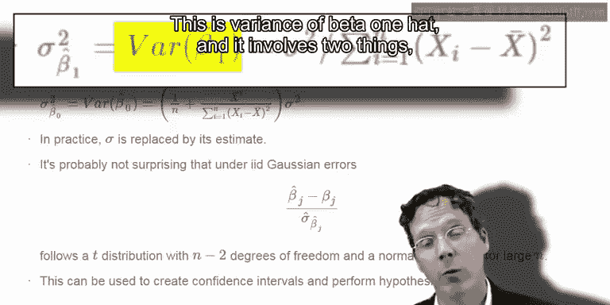

这个方差涉及两个因素：
*   数据点围绕真实回归线的变异程度，即 `σ^2`。
*   预测变量 `X` 的变异程度，即 `∑(X_i - X_bar)^2`。

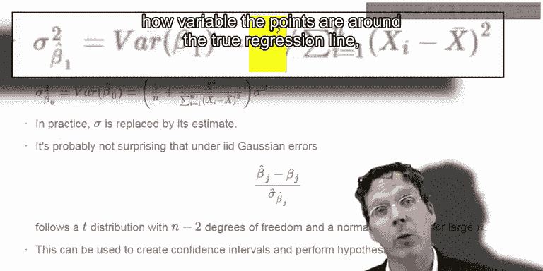

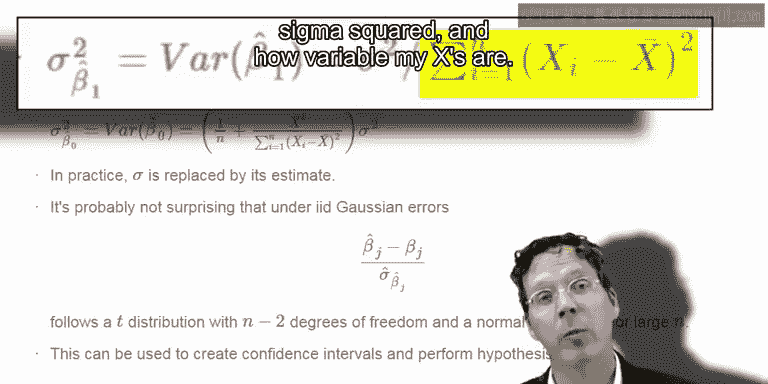

我认为分子部分，即数据点围绕回归线的变异程度，比较容易理解为什么它越小，我们对回归斜率的估计就越好。

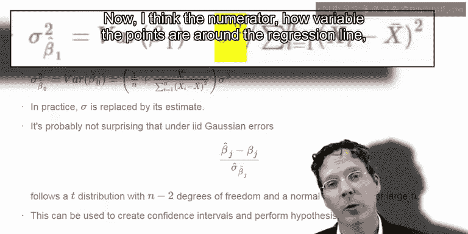

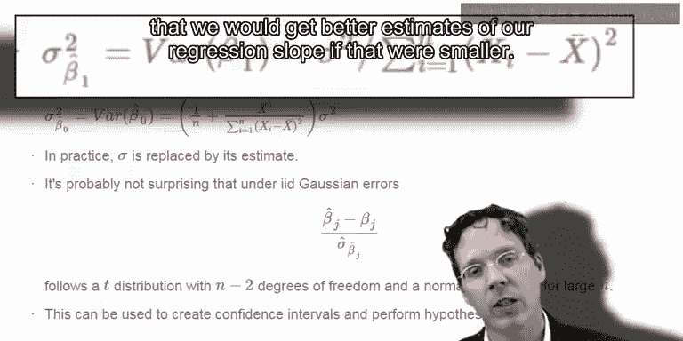

然而，为什么我们希望预测变量 `X` 有更大的变异，以获得更低的回归斜率方差，这可能不那么直观。让我们画图说明。

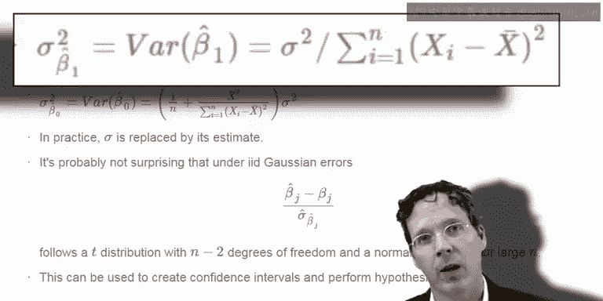

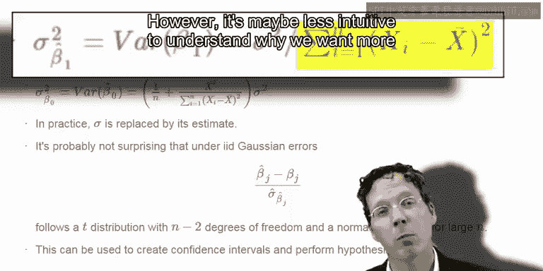

如果我们的预测变量 `X` 都紧密地聚集在一起，那么显然我们无法很好地估计一条直线，直线可以很容易地围绕那团点云弯曲，得到等效的拟合。

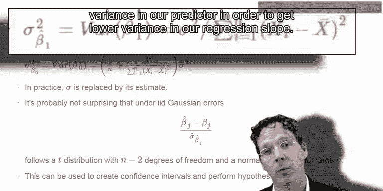

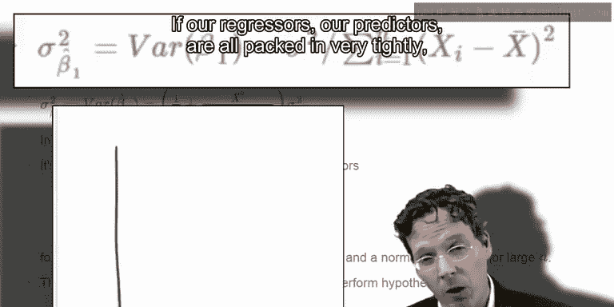

另一方面，如果我们把 `X` 值分散开，我们就能得到一条拟合得更好的回归线，斜率的方差也会更低。

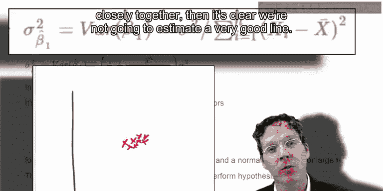

事实证明，你能得到的最小方差是将一半的观测值推到一端，另一半推到另一端。但这样做，你很大程度上是在假设这两端之间存在一条直线，因为你没有收集任何数据来评估中间部分的情况。

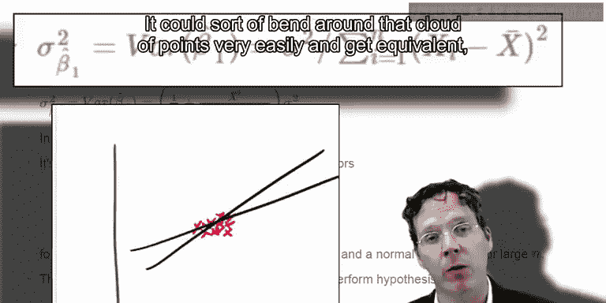

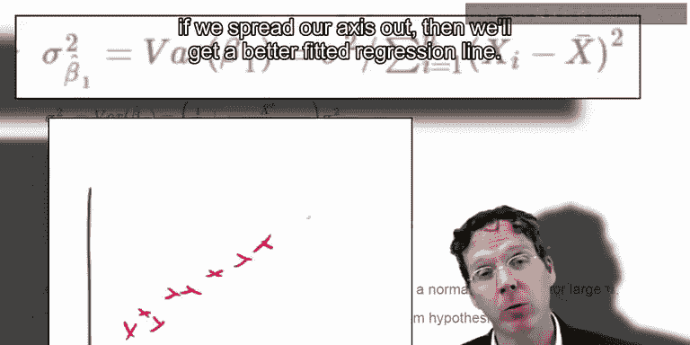

## 截距的方差与 `t` 分布 📐

这里我也给出了截距的方差公式。它可能信息量稍小，因为截距通常不如斜率那么受关注。

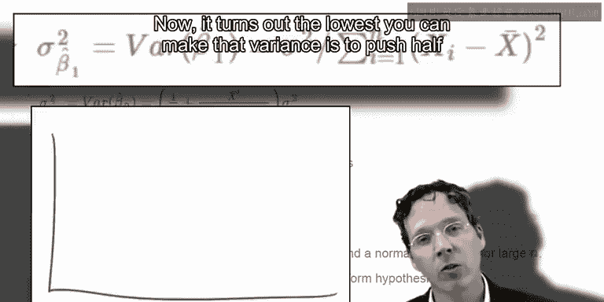

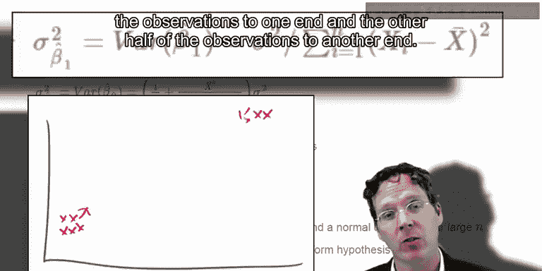

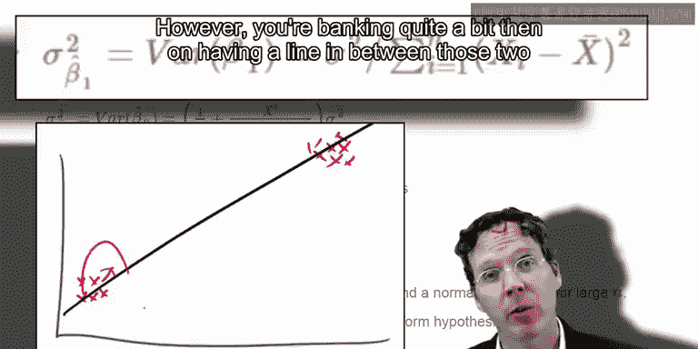

截距 `β_0_hat` 的方差公式为：
`Var(β_0_hat) = (1/n + X_bar^2 / ∑(X_i - X_bar)^2) * σ^2`

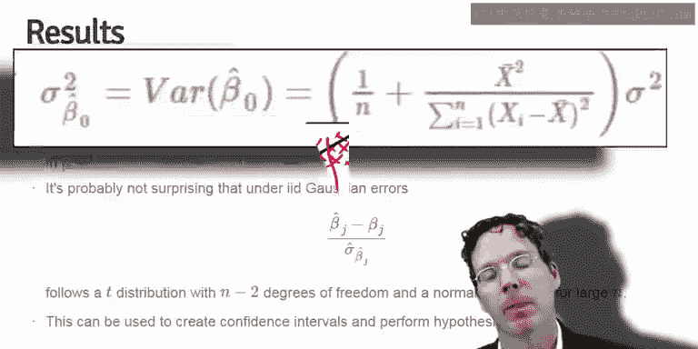

尽管如此，我们可以计算并写下这个公式。

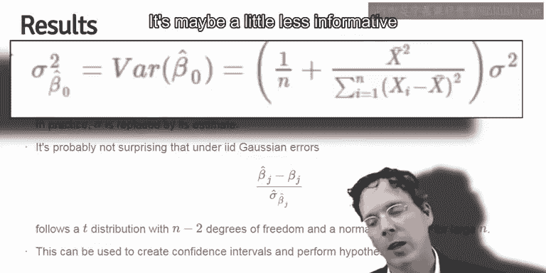

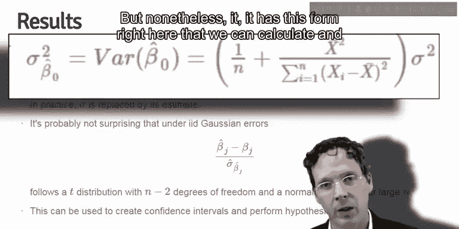

在这两种情况下，我们都用其逻辑估计量 `σ_hat^2` 代替 `σ^2`，即 `1/(n-2) * ∑ e_i^2`，我们在上一讲中介绍过。

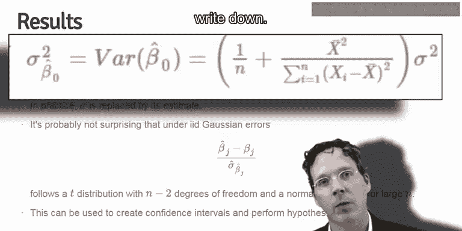

我们的斜率或截距估计值减去真实值，再除以其标准误，服从自由度为 `n-2` 的 `t` 分布，这或许并不令人惊讶。

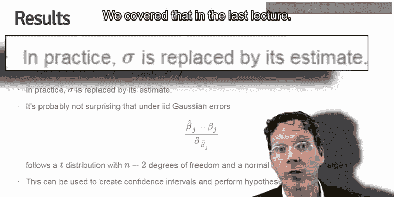

因此，这可以用来创建置信区间和进行假设检验。我们将在接下来的几张幻灯片中看一些例子。

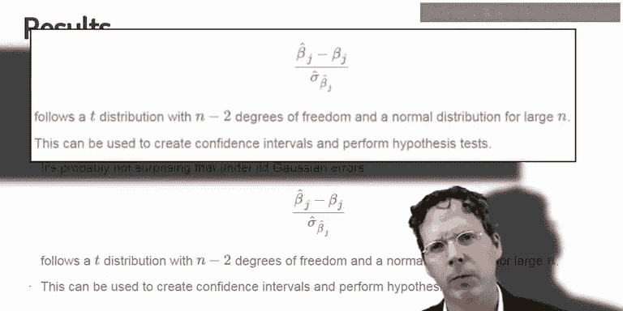

但首先，我要向你展示所有这些结果都完全成立，并且是 R 语言报告的内容。

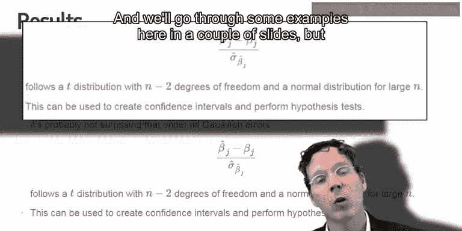

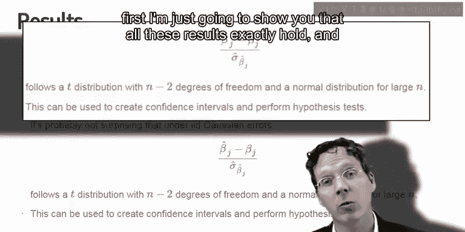

本节课中我们一起学习了如何在回归分析中进行统计推断。我们回顾了用于参数假设检验和构建置信区间的 `t` 统计量，并探讨了回归系数方差的构成，特别是预测变量的变异性如何影响估计的精度。