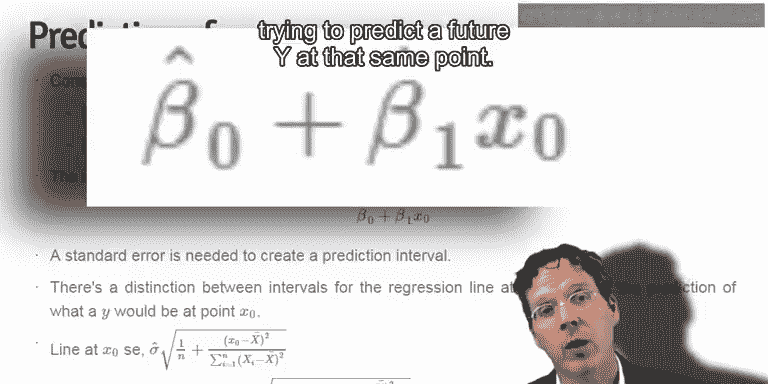
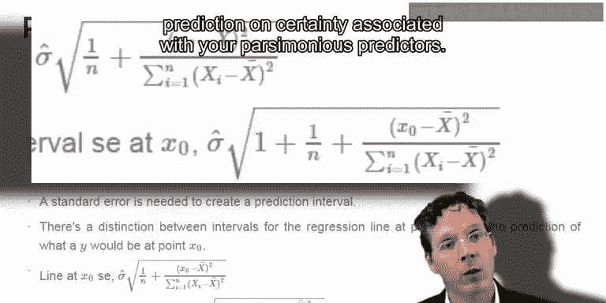
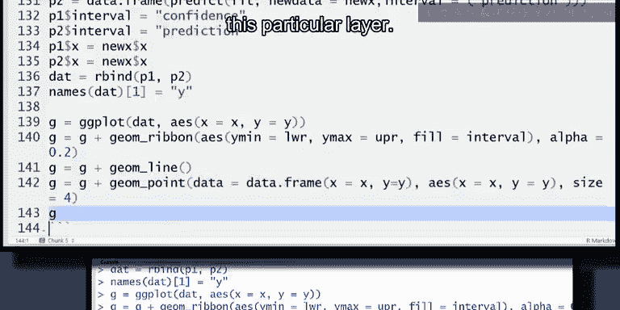
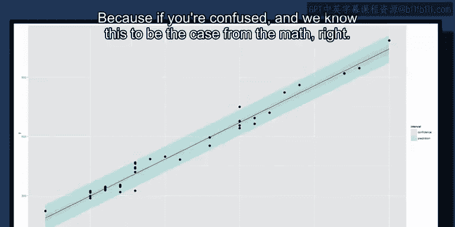
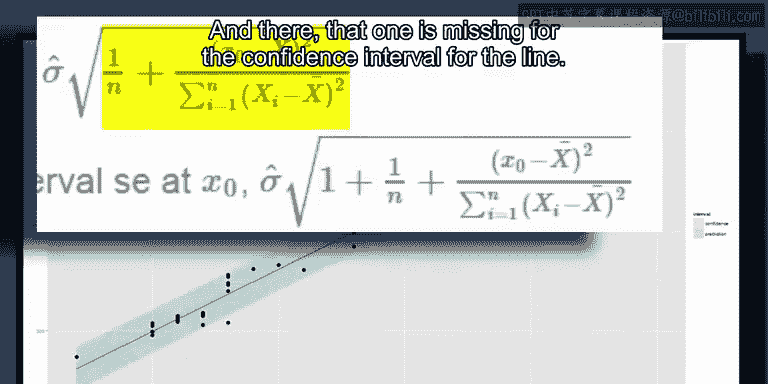
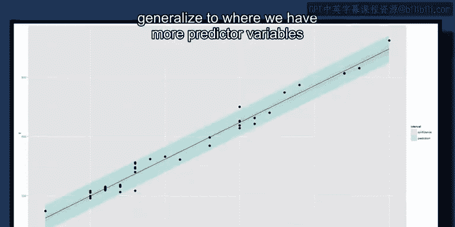

# 课程7：《回归模型》｜P18：预测 📊


在本节课中，我们将要学习如何使用回归模型进行预测。预测是数据科学的核心概念之一，而回归模型是实现预测的基础且强大的工具。我们将探讨如何利用回归模型进行点预测，以及如何评估预测的不确定性，例如通过计算预测区间和置信区间。

---

## 预测的核心概念

上一节我们介绍了回归模型的基础。本节中，我们来看看如何利用这些模型进行预测。

回归和广义线性模型是执行预测的核心技术。它们通常能产生非常好的预测结果，模型简洁且易于解释。此外，一个额外的好处是，你可以在不进行任何数据重采样的前提下，获得关于预测的推断。这里的“推断”指的是，我们可以得到预测值，并围绕这些预测值计算置信区间，以评估预测的不确定性。

在回归模型中实现这一点非常容易，在广义线性模型中相对容易，但在一些更高级的机器学习算法中则可能相当困难。

---

## 如何进行预测

我们可能想要预测响应变量，例如特定克拉数钻石的价格，或者特定父母身高下孩子的身高。在这两种情况下，最直接的估计是取我们想要预测的预测变量值 \( x_0 \)，乘以相关的估计斜率 \( \hat{\beta}_1 \)，然后加上截距 \( \hat{\beta}_0 \)。



公式如下：
\[
\hat{y}_0 = \hat{\beta}_0 + \hat{\beta}_1 x_0
\]

然而，如果我们想成为优秀的统计学家，就需要评估该预测中的不确定性。因此，拥有一个预测区间会很有帮助。

这里有一个细微的区别：预测回归线在特定点的值，与预测该点未来的 \( y \) 值，是两个不同的概念。这反映在预测方差的公式中。

---

## 预测方差公式

预测方差首先与数据点围绕回归线的变异性 \( \hat{\sigma} \) 有关。预测误差的公式如下：

对于预测回归线在 \( x_0 \) 处的值（置信区间）：
\[
\text{Var}(\hat{y}_0) = \hat{\sigma}^2 \left[ \frac{1}{n} + \frac{(x_0 - \bar{x})^2}{\sum_{i=1}^{n} (x_i - \bar{x})^2} \right]
\]

对于预测 \( x_0 \) 处一个新的 \( y \) 值（预测区间）：
\[
\text{Var}(\hat{y}_{\text{new}}) = \hat{\sigma}^2 \left[ 1 + \frac{1}{n} + \frac{(x_0 - \bar{x})^2}{\sum_{i=1}^{n} (x_i - \bar{x})^2} \right]
\]



请注意，预测新 \( y \) 值的公式中多了一个“1”。这使得预测新值的区间比预测回归线值的区间更宽。

---

## 理解公式中的关键项

以下是公式中各项的含义：

*   **\( \hat{\sigma}^2 \)**: 残差方差，衡量数据点围绕回归线的离散程度。
*   **\( 1/n \)**: 样本量 \( n \) 越大，估计越精确，此项贡献的方差越小。
*   **\( (x_0 - \bar{x})^2 / \sum (x_i - \bar{x})^2 \)**: 此项衡量预测点 \( x_0 \) 距离 \( x \) 均值 \( \bar{x} \) 的远近，以及 \( x \) 变量自身的变异性。
    *   当 \( x_0 = \bar{x} \) 时，此项为0，预测方差最小。
    *   \( x \) 的变异性越大（分母越大），此项贡献的方差越小。

---

## 在R中实现预测与绘图

让我们通过钻石数据集的例子，在R中生成预测区间和置信区间。

以下是关键的R代码步骤：

```r
# 拟合线性模型
fit <- lm(price ~ mass, data = diamond)

# 创建一个密集的x值网格用于预测
newx <- data.frame(mass = seq(min(diamond$mass), max(diamond$mass), length = 100))



# 预测回归线值及其置信区间
pred_conf <- predict(fit, newdata = newx, interval = "confidence")

# 预测新y值及其预测区间
pred_pred <- predict(fit, newdata = newx, interval = "prediction")

# 将结果合并到数据框中以便绘图
plot_data <- data.frame(newx, conf_lwr = pred_conf[, "lwr"], conf_upr = pred_conf[, "upr"],
                        pred_lwr = pred_pred[, "lwr"], pred_upr = pred_pred[, "upr"])

# 使用ggplot2绘图
library(ggplot2)
ggplot(plot_data, aes(x = mass)) +
  geom_ribbon(aes(ymin = pred_lwr, ymax = pred_upr, fill = "预测区间"), alpha = 0.3) +
  geom_ribbon(aes(ymin = conf_lwr, ymax = conf_upr, fill = "置信区间"), alpha = 0.5) +
  geom_line(aes(y = pred_conf[, "fit"]), color = "red", size = 1) + # 拟合线
  geom_point(data = diamond, aes(x = mass, y = price), alpha = 0.6) + # 原始数据点
  scale_fill_manual(values = c("预测区间" = "blue", "置信区间" = "salmon")) +
  labs(x = "质量（克拉）", y = "价格", fill = "区间类型") +
  theme_minimal()
```





运行上述代码将生成一张图。图中：
*   **蓝色区域** 代表预测区间（用于预测新观测值）。
*   **浅橙色区域** 代表置信区间（用于预测回归线本身）。
*   **红色线** 是拟合的回归线。
*   **灰色点** 是原始观测数据。

可以观察到，预测区间总是比置信区间宽。此外，两个区间在 \( x \) 的均值 \( \bar{x} \) 附近最窄，随着向数据范围的边缘移动而变宽。

---

## 两种区间的直观理解

为什么会有这样的区别呢？我们可以这样思考：

*   **置信区间（预测回归线）**：如果我们能在所有 \( x \) 值处收集无限多的数据，我们就能极其精确地知道回归线在哪里。因此，随着数据量 \( n \) 的增加，这个区间会不断变窄，最终收敛到回归线本身。这体现了统计估计的精度随样本量增加而提高。
*   **预测区间（预测新观测值）**：即使我们知道了真实的回归线（即真实的 \( \beta_0 \) 和 \( \beta_1 \)），由于模型中存在固有的随机误差 \( \epsilon \)，新的 \( y \) 值仍然会有波动。这种不确定性不会因为收集更多数据而消失。公式中的“+1”就代表了这种不可消除的残差变异。

此外，区间在数据云中心更窄，在两端更宽，这告诉我们：在预测变量取值接近其均值的地方进行预测，我们的信心更足。如果我们试图预测远离观测数据范围的值（外推），区间会变得非常宽，这提醒我们外推预测具有很高的不确定性。

---

## 总结

本节课中我们一起学习了回归预测的核心内容。

我们了解到，使用回归模型进行预测不仅包括计算点估计 \( \hat{y}_0 \)，更重要的是评估预测的不确定性。我们区分了两种区间：
1.  **置信区间**：用于估计回归线在特定 \( x \) 值处的取值范围，其宽度随样本量增加而减小。
2.  **预测区间**：用于预测在特定 \( x \) 值处一个新观测值 \( y \) 的取值范围，它包含了模型固有的残差变异，因此总是更宽。

我们还学习了预测方差的公式，理解了其组成部分的含义，并通过R代码实践了如何计算和可视化这些区间。记住，在数据范围中心进行预测最可靠，而外推预测需格外谨慎。



掌握了这些，你就为使用回归模型进行可靠的预测和推断打下了坚实基础。接下来，我们将进入更复杂的主题，探讨包含多个预测变量的回归模型。