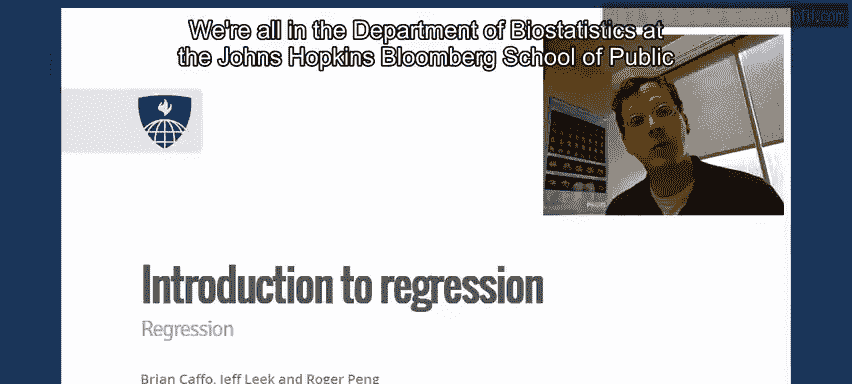
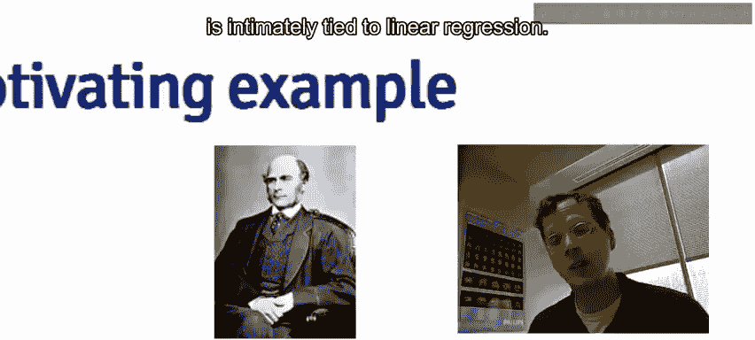
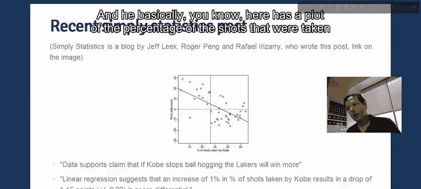
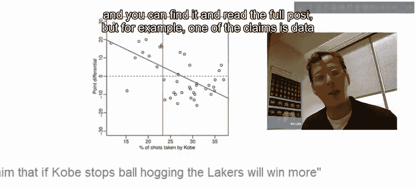
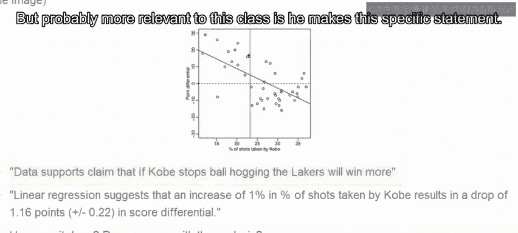
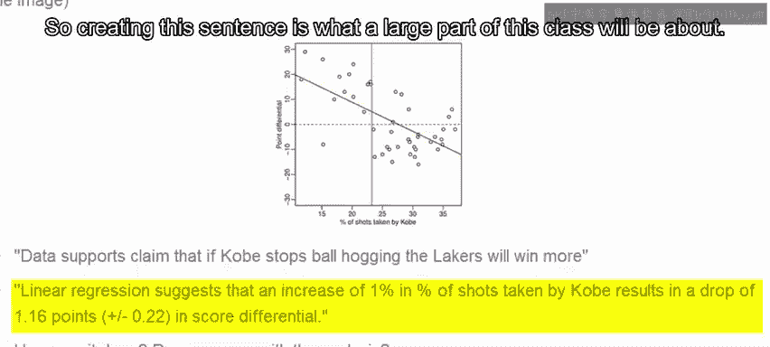
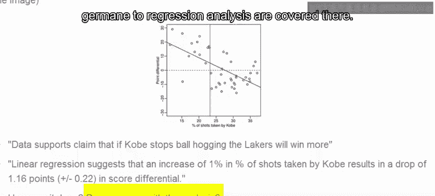

# 课程7：《回归模型》｜P1：回归简介 📈

在本节课中，我们将要学习回归分析的基本概念。回归是数据科学中最基础、最核心的工具之一，它用于探索变量之间的关系，并基于这种关系进行预测。我们将从回归的历史起源讲起，通过经典与现代的实例，理解回归分析能回答哪些问题，以及它在数据科学工作流程中的重要性。

## 回归的历史起源 🧬

上一节我们提到了回归的重要性，本节中我们来看看它的历史起源。回归的概念由弗朗西斯·高尔顿爵士提出，他同时发明了“回归”和“相关”这两个紧密相连的术语。

高尔顿的众多研究之一，是利用父母的身高来预测子女的身高。这个数据集因其历史意义，在本课程中将被多次探讨。我的同事兼课程讲师杰夫·利里指出，这个例子至今仍具有惊人的现实意义。

《美国人类遗传学杂志》上的一篇文章，将利用现代高通量生物信息学技术获得的遗传数据，与高尔顿在维多利亚时代收集的测量数据进行了比较。结果发现，现代方法并未显著优于高尔顿的古老方法。这既是对现代遗传学分析的一种有趣审视，也提醒我们弗朗西斯·高尔顿工作的超前性与重要性。

## 一个现代数据科学实例 🏀

了解了回归的历史背景后，本节中我们来看一个更贴近现代数据科学家日常工作的例子。这个例子来自“简明统计”博客，由本课程讲师杰夫·利里、罗杰·彭以及哈佛大学生物统计系的拉斐尔·伊里萨里共同撰写。

拉斐尔在一篇博文中分析了篮球运动员科比·布莱恩特的“独霸球权”行为。他绘制了科比出手投篮次数占比与球队单场净胜分差的关系图。

他对数据拟合了一条线性回归线，并在博文中提出了一些主张。例如，数据支持“如果科比减少独霸球权，湖人队会赢得更多比赛”这一说法。

更与本课程相关的是，他给出了一个具体的统计陈述：**线性回归表明，科比出手占比每增加1%，会导致（湖人队）净胜分下降约1.6分**。

并且，他给出了这个估计的标准误。**如何生成并合理解读这样的陈述，如何遵循良好的统计实践（例如报告标准误），将是本课程的一大重点**。

我们不仅要学习如何进行分析，也要思考分析本身是否合理。例如，这个分析是否完整？拉法是否考虑了所有相关因素？阅读那篇博文及其评论，会涉及许多与回归分析相关的主题。

## 回归分析能回答的问题 ❓

看过了现代应用，让我们回到高尔顿的经典例子，系统性地探讨回归分析能帮助我们回答哪些类型的问题。

以下是回归分析可以解决的核心问题：

*   **预测**：利用父母身高预测子女身高。
*   **建立简约关系**：寻找父母与子女身高之间简洁、易于描述的均值关系。回归擅长在保证解释力的前提下提供简约的模型，而许多机器学习方法虽然预测可能更精确，但模型往往复杂，不易解释和生成新知识。
*   **量化未解释的变异**：讨论回归模型无法解释的变异，即所谓的**残差变异**。
*   **比较影响因素**：量化如基因信息等因子，在父母身高之外对解释子女身高的额外贡献。这与之前提到的遗传学论文研究的问题相关。
*   **进行统计推断**：将基于样本数据的结论，推广到更大总体所需的条件和假设。这是一个深刻的主题，称为统计推断。本课程将把推断工具应用到回归分析中。
*   **理解“回归”本质**：回答高尔顿提出的一个有趣问题——“**均值回归**”或“回归平庸”。即：为什么非常高父母的孩子通常也高，但会比父母矮一点？为什么非常矮父母的孩子通常也矮，但会比父母高一点？这就是著名的“均值回归”思想。

## 总结 📝

本节课中我们一起学习了回归分析的简介。我们回顾了回归由弗朗西斯·高尔顿创立的历史，并通过一个现代篮球数据分析的实例，看到了回归在数据科学中的实际应用。最后，我们系统地列出了回归分析能够回答的各类核心问题，包括预测、建立简约模型、分析残差、比较变量贡献、进行统计推断以及理解“均值回归”现象。这些概念构成了我们深入学习回归模型的基础。