# 课程7：《回归模型》｜P24：多元回归示例（第二部分）🎯

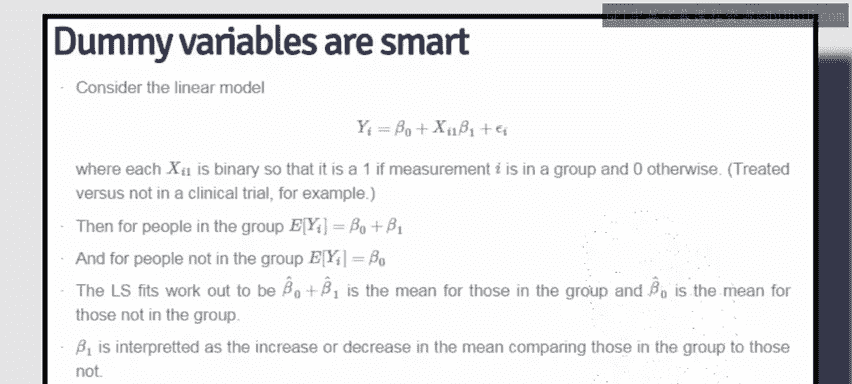

在本节课中，我们将学习线性回归模型如何处理因子变量。我们将通过一个具体的例子，演示如何将分类变量（如处理组/对照组、政治派别）作为回归预测因子，并解释其系数的含义。理解这一点对于正确解读模型结果至关重要。

## 线性回归模型的灵活性

你可能会惊讶地发现线性回归模型非常灵活。例如，你可以将因子变量作为回归预测因子，并实现诸如方差分析（ANOVA）这样的方法。如果你之前听说过方差分析，它实际上是线性模型的一个特例。

让我们通过一个例子来具体说明。假设我们有一个协变量 `x`，其取值为0或1。我们来看看当把这个变量放入线性回归模型时会发生什么。

**模型公式**：
`y = β₀ + x * β₁ + ε`

在这个模型中，`y` 是结果变量，`β₀` 是截距，`β₁` 是 `x` 的系数，`ε` 是误差项。这里，`x` 只取0或1。例如，`x=0` 可能代表对照组，`x=1` 代表处理组。

*   对于处理组（`x=1`），其均值为 `β₀ + β₁`。
*   对于对照组（`x=0`），其均值为 `β₀`。

拟合这个模型后，正如你所料：
*   处理组的估计均值就是处理组样本的均值，即 `β̂₀ + β̂₁`。
*   对照组的估计均值就是对照组样本的均值，即 `β̂₀`。

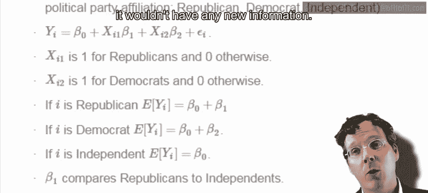

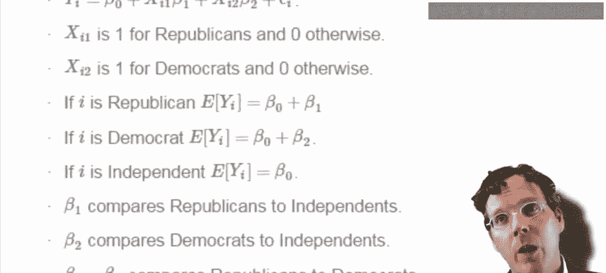

因此，`β₁` 被解释为 `x=1` 的组（即处理组）相对于 `x=0` 的组（即对照组）的均值响应增加量（如果为负则是减少量）。这是一种将二水平因子变量作为线性回归变量的巧妙方法。它不仅通过拟合值告诉你两组的均值，还自动提供了比较两组的推断（例如T检验）。顺便提一下，`β₁` 的T检验与假设方差齐性的两独立样本T检验完全相同。

## 扩展到多水平因子

我们可以将此方法扩展到两个以上的水平。例如，假设你有一个三水平的变量，比如你想比较某个结果与美国政治派别（民主党、共和党、独立人士）的关系。

你可以通过创建以下变量来实现：
*   变量 `x₁`：如果是共和党则为1，否则为0。
*   变量 `x₂`：如果是民主党则为1，否则为0。

我们暂时省略代表独立人士的变量 `x₃`（设为1代表独立人士，否则为0），因为它将是冗余的。

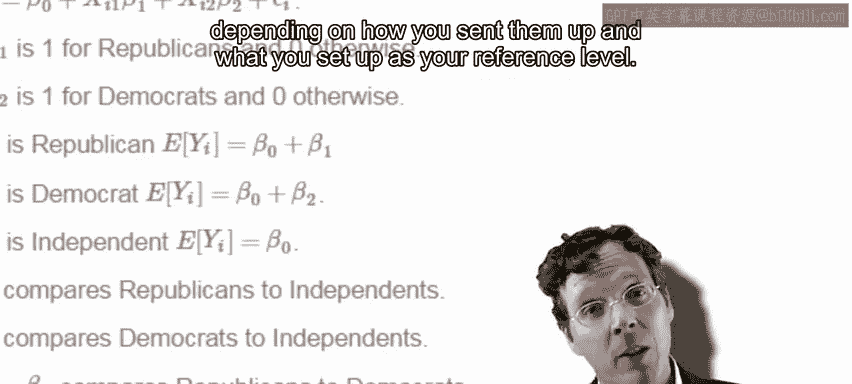


**模型公式**：
`y = β₀ + x₁ * β₁ + x₂ * β₂ + ε`

*   如果一个人是共和党（`x₁=1， x₂=0`），其均值为 `β₀ + β₁`。
*   如果一个人是民主党（`x₁=0， x₂=1`），其均值为 `β₀ + β₂`。
*   如果一个人是独立人士（`x₁=0， x₂=0`），其均值仅为 `β₀`。


这就是我们不能包含第三项的原因。在我们这样设置变量的情况下，如果你不是共和党也不是民主党，那么你一定是独立人士。因此，加入第三个变量将是冗余的，不会提供任何新信息。我们有三个均值（共和党、民主党、独立人士）和三个参数（`β₀， β₁， β₂`）。如果添加一个额外参数，模型就会出问题。

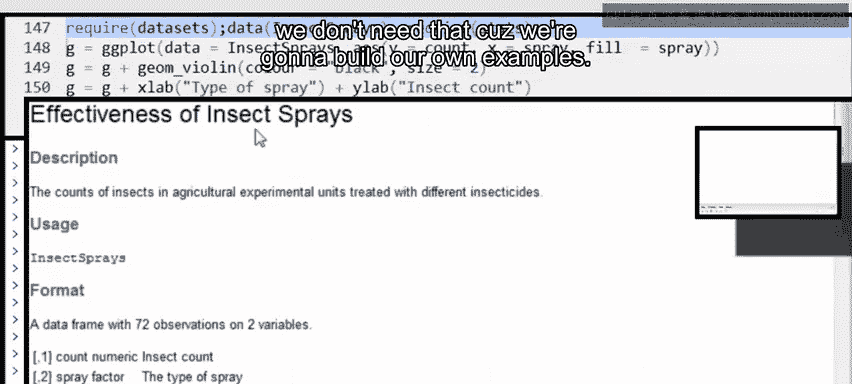

## 系数解释与参照水平

如果我们观察这里的均值：
*   `β₁` = 共和党均值 - 独立人士均值。所以 `β₁` 比较了共和党与独立人士。
*   `β₂` = 民主党均值 - 独立人士均值。所以 `β₂` 比较了民主党与独立人士。
*   `β₁ - β₂` 则比较了民主党与共和党。

通过省略代表独立人士的回归变量，截距 `β₀` 就变成了独立人士的均值。所有其他系数都被解释为相对于独立人士的变化。`β₁`（共和党协变量前的系数）被解释为共和党与独立人士之间的差异，`β₂`（民主党协变量前的系数）被解释为民主党与独立人士之间的差异。

这都是省略独立人士这一回归项的结果。如果我们包含了独立人士的回归项而省略了共和党的，那么截距将代表共和党的均值，民主党前的系数将是民主党 vs 共和党，独立人士前的系数将是独立人士 vs 共和党。

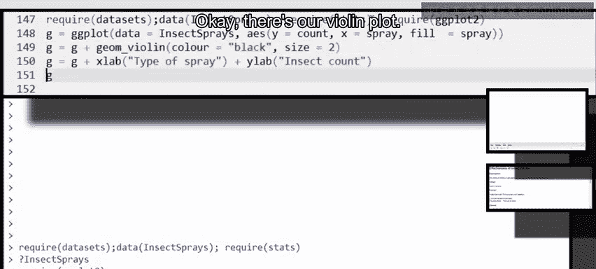

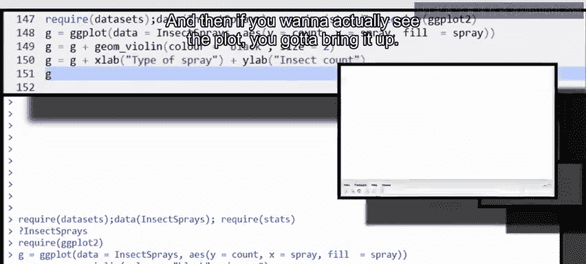

R语言在默认情况下会自动为你处理这一点。如果你将一个变量作为因子纳入模型，它会自动选择其中一个水平作为参照水平。关键在于，在处理因子变量和线性模型时，你设定哪个水平作为参照水平会产生重大影响。这些系数的解释会因设置方式的不同而有很大差异。

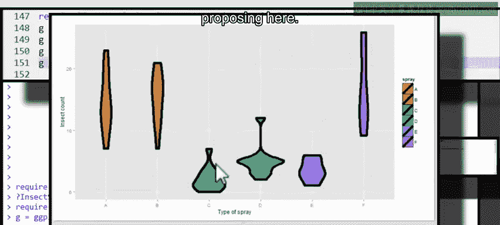

## R语言实例演示

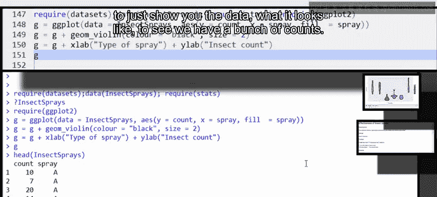

现在，让我们通过一个R语言示例来观察如何处理因子变量，并看看R是如何对待它的。

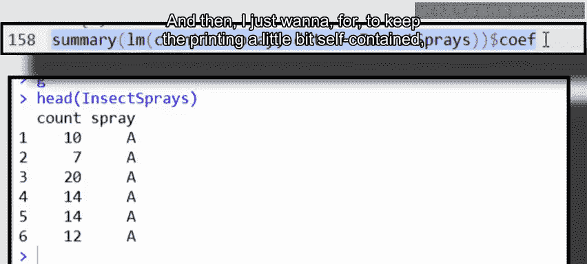

首先，我们使用 `InsectSprays` 数据集，其中结果变量 `count` 是昆虫数量，预测因子 `spray` 是杀虫剂类型（因子变量，水平为A到F）。

我们先绘制数据以直观了解：

```r
library(ggplot2)
ggplot(InsectSprays， aes(x = spray， y = count， fill = spray)) +
  geom_violin() +
  labs(title = "不同杀虫剂的昆虫数量分布"， x = "杀虫剂类型"， y = "昆虫数量")
```

从图中可以大致看出不同喷雾剂处理后的昆虫数量差异。

接下来，我们拟合一个线性模型，将 `count` 作为结果，`spray` 作为预测因子。

```r
# 拟合模型
fit <- lm(count ~ spray， data = InsectSprays)
# 查看系数表
summary(fit)$coefficients
```

输出结果中，你会看到截距（Intercept），以及 `sprayB`， `sprayC`， `sprayD`， `sprayE`， `sprayF` 的系数，但 `sprayA`  conspicuously 缺失了。这意味着所有系数都是相对于 `sprayA` 进行比较的。

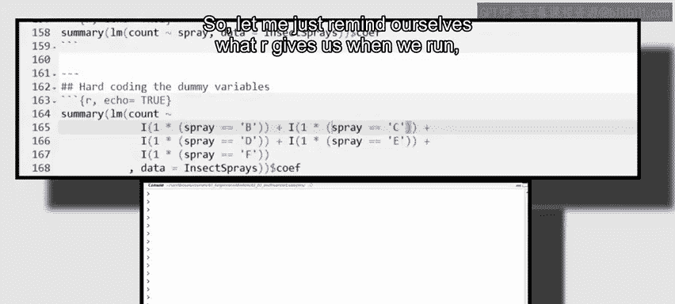

*   **截距（14.5）** 被解释为 `sprayA` 组的均值。
*   **`sprayB` 的系数（0.833）** 被解释为 `sprayB` 组均值与 `sprayA` 组均值的差异。
*   **`sprayC` 的系数（-12.4）** 被解释为 `sprayC` 组均值与 `sprayA` 组均值的差异。

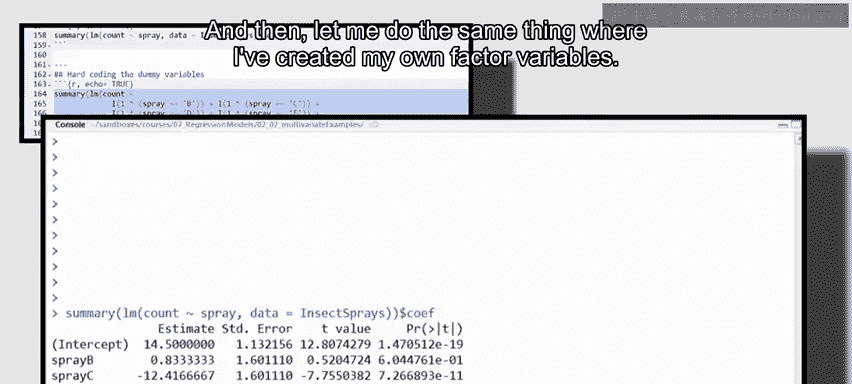

如果你想得到 `sprayB` 的均值，就是截距加上 `sprayB` 的系数：14.5 + 0.833 = 15.333。

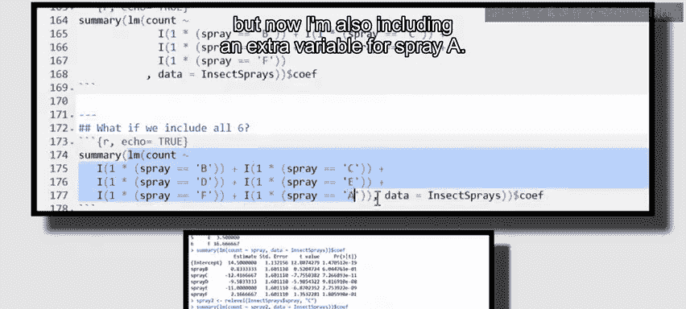

R在幕后自动创建了虚拟变量。我们可以手动创建这些变量来验证：

```r
# 手动创建虚拟变量，以A为参照水平
fit_manual <- lm(count ~ I(spray == 'B') + I(spray == 'C') +
                   I(spray == 'D') + I(spray == 'E') + I(spray == 'F')，
                 data = InsectSprays)
summary(fit_manual)$coefficients
```

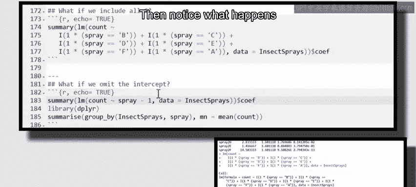

你会发现结果与让R自动处理因子变量时完全相同。

## 包含所有水平与省略截距

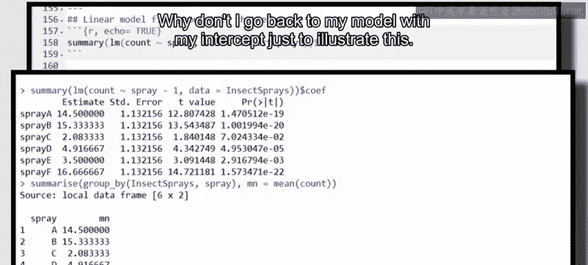

如果你在模型中包含了代表所有水平的变量（包括参照水平），会发生什么？

```r
# 错误示例：包含所有水平（包括A）和截距
fit_redundant <- lm(count ~ I(spray == 'A') + I(spray == 'B') +
                      I(spray == 'C') + I(spray == 'D') +
                      I(spray == 'E') + I(spray == 'F')，
                    data = InsectSprays)
summary(fit_redundant)$coefficients
```

你会看到 `sprayA` 对应的系数显示为 `NA`。这是因为模型试图用7个参数（1个截距 + 6个水平）去拟合6个均值，造成了冗余，R会自动丢弃其中一个。

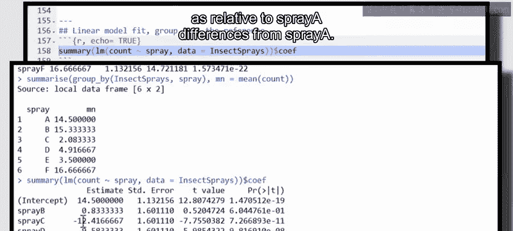

如果你希望每个系数直接代表各组的均值（而不是与参照组的差值），你可以通过**省略截距**来实现：

```r
# 无截距模型，系数代表各组的均值
fit_no_intercept <- lm(count ~ spray - 1， data = InsectSprays)
summary(fit_no_intercept)$coefficients
```

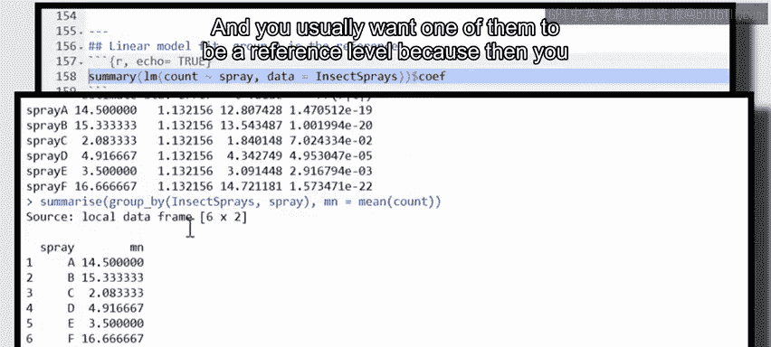

现在，输出中包含了 `sprayA` 到 `sprayF` 所有水平的系数，它们分别等于各自组的样本均值。这个模型与包含截距的模型在数学上是等价的，信息量相同，唯一的区别在于系数的解释。

*   **有截距模型**：截距是参照组（A）的均值，其他系数是各组与参照组的差异。P值检验的是这些差异是否显著不为零（即该组是否与A组不同）。
*   **无截距模型**：每个系数是各组的均值。P值检验的是该组均值是否显著不为零。这通常不是我们关心的主要问题，我们更关心组间比较。

## 更改参照水平

默认情况下，R选择因子中字母顺序最低的水平作为参照水平（这里是A）。你可以使用 `relevel` 函数轻松更改参照水平。

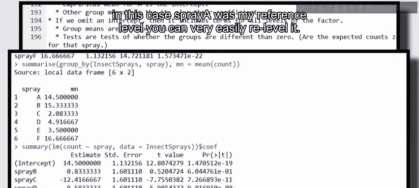

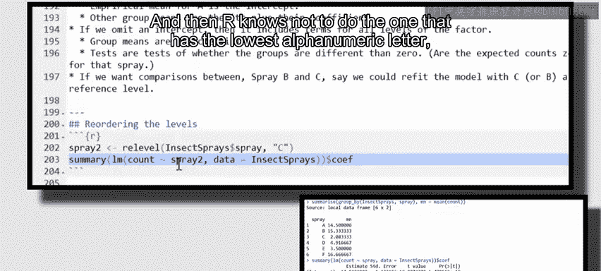

```r
# 将参照水平改为C
InsectSprays$spray2 <- relevel(InsectSprays$spray， ref = "C")
fit_new_ref <- lm(count ~ spray2， data = InsectSprays)
summary(fit_new_ref)$coefficients
```

现在，输出中截距代表 `sprayC` 的均值，`sprayA` 的系数代表A组与C组的差异，`sprayB` 的系数代表B组与C组的差异，依此类推。`sprayC` 本身不再出现在系数表中，因为它现在是参照水平。

## 重要总结与注意事项

让我们总结一下关于线性模型中因子变量的关键点：

1.  **默认行为**：在R中，当你在 `lm()` 中包含一个因子变量时，R会自动包含一个截距，并将因子的第一个水平（按字母或因子顺序）设为参照水平。
2.  **系数解释**：
    *   截距被解释为参照水平的均值。
    *   其他因子水平的系数被解释为该水平与参照水平均值的差异。
    *   该水平的实际均值 = 截距 + 该水平的系数。
3.  **假设检验**：
    *   截距的检验是检验参照水平的均值是否为零。
    *   其他系数的检验是检验该组与参照组的均值差异是否显著。
4.  **无截距模型**：如果省略截距，每个系数代表对应组的均值，但此时的假设检验（检验均值是否为零）通常不具实际意义。
5.  **更改参照水平**：使用 `relevel()` 函数可以方便地更改参照水平，从而改变所有系数的比较基准。

**关于本示例分析的注意事项**：
本例中使用线性回归（假设正态分布）对计数数据建模可能并不理想，因为计数数据有下限（0），且方差可能不恒定（异方差性）。更合适的模型可能是泊松回归或负二项回归等广义线性模型（GLM），这将在课程后续部分涉及。目前，我们的均值估计可能是正确的，但基于正态假设的推断（如P值、置信区间）可能不准确。处理异方差性等问题需要更高级的统计方法。

## 本节课总结

在本节课中，我们一起深入探讨了在线性回归模型中如何处理和解释因子变量。我们学习了：
*   如何将二水平及多水平分类变量纳入回归模型。
*   R语言如何通过创建虚拟变量并设置参照水平来自动处理因子变量。
*   模型中有截距和无截距时，系数含义的根本区别。
*   如何正确解释相对于参照水平的系数及其假设检验。
*   使用 `relevel()` 函数更改参照水平以进行不同的组间比较。

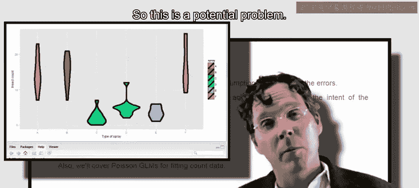

理解这些概念对于避免错误解读回归结果至关重要，尤其是在涉及分类预测因子的研究中。