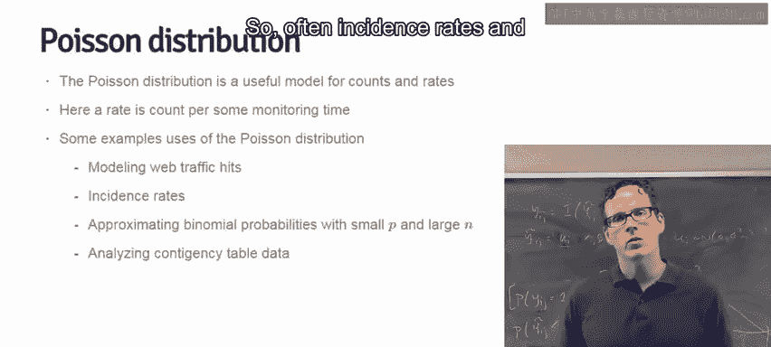
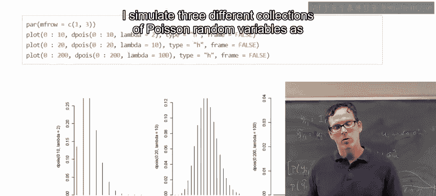
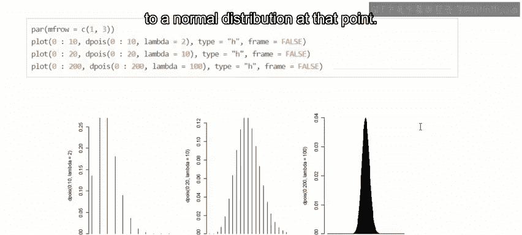
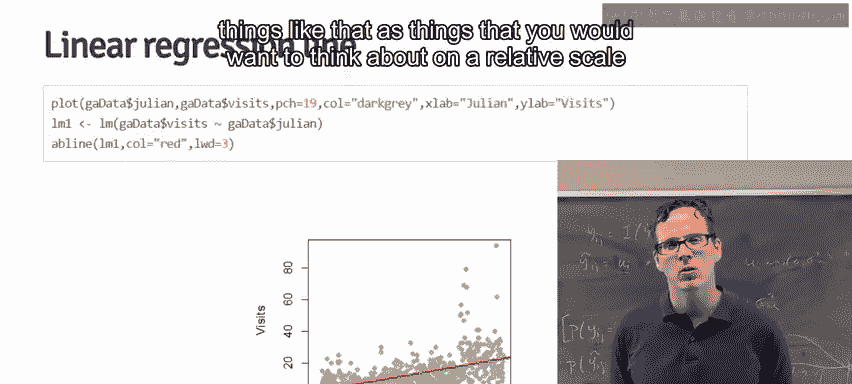
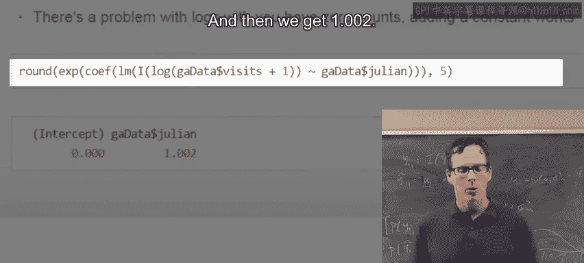
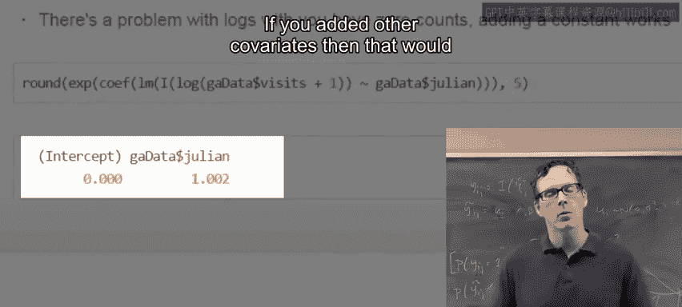

# 📊 约翰霍普金斯大学数据科学课程7：《回归模型》｜P38：泊松回归第1部分

在本节课中，我们将要学习泊松回归模型。泊松回归是广义线性模型（GLM）的一种，专门用于处理计数数据和比率数据。我们将从理解泊松分布的基本性质开始，探讨为何它适用于计数建模，并学习如何将线性回归的思路应用到计数数据上。

## 泊松分布简介

上一节我们介绍了广义线性模型的基本框架，本节中我们来看看专门用于计数的泊松模型。计数数据在应用中非常常见，例如呼叫中心的来电数量、流感病例数等。这些计数在理论上是无界的，或者说其理论上界（如世界总人口）相对于我们观察到的计数值来说非常大。

此外，数据也可能以比率或比例的形式出现，例如测试通过率，或单位时间内的事件发生率（如核泵故障率）。在公共卫生领域，一个常见的比率是发病率，即每单位人-时间风险中新发病例的数量。所有这些计数和比率数据都可以用泊松广义线性模型来处理。

泊松分布是建模计数和比率的有效工具。比率是单位监测时间内的计数，例如发病率和网络流量等常使用泊松分布建模。

泊松分布的一个常见用途是近似二项分布概率，当成功概率非常小且试验次数n非常大时。另一个我喜欢的应用是列联表数据建模，例如统计不同发色和不同眼色的人数交叉表。泊松模型为这类数据提供了非常优雅的建模框架。

以下是泊松分布的概率质量函数。单位时间的计数率为 λ，总时间为 t。如果 X 服从均值为 tλ 的泊松分布，那么其期望值 E[X] = tλ。因此，我们对比率的自然估计是计数除以总时间，即 X/t。一个有用的性质是，这个比率估计的期望值 E[X/t] 恰好等于我们想要估计的比率 λ。

泊松分布的方差等于其均值，即 Var(X) = tλ。这是模型的一个假设，我们可以进行检验，并在其不成立时寻求解决方案。

另一个有趣的性质是，当泊松分布的均值变大时，它会趋近于正态分布。这可以通过模拟来展示：随着泊松分布均值的增大，其分布形状越来越接近正态分布。

我们可以通过数学推导或模拟来验证泊松分布的均值与方差相等这一性质。

## 一个实例：网站流量分析

让我们来看一个杰夫·利克的网站流量实例。网站地址是 `www.biostat.jhsph.edu/~jleek`。在这个例子中，泊松分布的均值被解释为每天的网站点击量，即我们的时间单位 t = 1 天。如果我们想将估计的比率解释为每小时点击量，则需要设 t = 1/24。

以下是数据预览。我们将日期从标准字符格式转换为儒略日（自1970年1月1日以来的天数），这样它就是一个简单的计数，便于分析。

数据集中包含日期、访问次数、来自“简单统计”博客的访问次数以及儒略日。

下图绘制了数据集，X轴是儒略日，Y轴是访问次数。

在上一讲中，我们讨论了用线性回归直接建模计数数据（或二值数据）的缺陷。对于计数数据，直接使用线性模型存在一些问题。然而，正如我们之前看到的，当计数的均值非常大时，这种担忧会减少，因为泊松分布会趋近于正态分布。如果计数值非常大，使用线性模型的反对意见就会少很多。

让我们建立符号：以访问次数 `NH` 作为结果变量，儒略日 `JD` 作为预测变量，构建一个线性回归模型。我们可以绘制拟合线，但可以看到存在一些曲线关系，或许应该加入二次项。这是我们的第一种方法，虽然可能不是最佳选择，且线性模型的解释性不佳。在接下来的部分，我们将探讨如何调整线性模型以获得更好的解释性。对于网站点击量这类数据，我们通常希望从相对尺度来思考，而线性模型是在线性加性尺度上处理的。

## 对数变换模型

我们首先可以尝试对结果变量取自然对数。模型如下：

`log(NH) = β0 + β1 * JD + ε`

让我们讨论一下对数变换的作用。一个随机变量对数的期望值的指数，我称之为总体几何均值。其原因是，样本的几何均值是数据乘积的 n 次方根。对这个几何均值取对数，就得到了对数数据的算术均值。因此，几何均值就是对数据取对数后的算术均值的指数。

当我们在线性回归中对结果变量取自然对数时，指数化的回归系数就可以用几何均值来解释。例如：
*   `exp(β0)` 是第0天（起点日）的估计几何均值点击量。需要重申的是，这里的截距意义不大，因为1970年1月1日并非我们关心的日期。为了使截距可解释，我们应该从所有日期中减去数据集中的最早日期，这样截距就代表了数据集第一天的几何均值点击量。
*   `exp(β1)` 是估计的每天几何均值点击量的相对增加（或减少）量。

这里存在一个问题：如果计数为零，则无法取对数。常见的处理方法是加一个常数，通常是加1，即对 `log(结果 + 1)` 进行建模。

如果我们对 `log(NH + 1)` 与儒略日进行线性回归，会得到截距（如前所述，此处意义不大）和斜率。在指数尺度上，斜率约为1.002。这意味着我们的模型估计每天网站流量增加约0.2%。这是一个很好的解释。如果加入其他协变量，这个0.2%就是在保持其他协变量不变的情况下，每天的估计增加量。

本节课中我们一起学习了泊松回归的基础知识。我们了解了泊松分布适用于计数和比率数据，探讨了直接使用线性回归和对数变换线性回归处理计数数据的思路及其解释。在下一部分，我们将正式引入泊松回归模型，它为我们处理计数数据提供了更自然、更强大的框架。