# 课程7：《回归模型》｜P5：符号与背景 📚

在本节课中，我们将学习回归分析所需的基本符号和背景知识。这些概念是理解后续回归模型的基础。

---

## 概述

本节将回顾统计学中的核心符号和定义，包括均值、方差、标准化以及协方差与相关系数。这些内容是回归分析的基石。

---

## 基本符号

在回归分析中，我们经常使用下标来表示有序的数据集合。

例如，我们可以用 **x₁, x₂, ..., xₙ** 来表示 n 个数据点。假设数据为 `[1, 2, 5]`，那么：
*   x₁ = 1
*   x₂ = 2
*   x₃ = 5
*   n = 3

字母本身没有特殊含义，我们同样可以用 **y₁, y₂, ..., yₙ** 来表示另一组数据。

一个重要的约定是：
*   我们通常用**希腊字母**（如 μ）来表示未知的**总体参数**。
*   我们用**普通字母**（如 x̄）来表示可以观测或计算的**样本统计量**。

---

## 样本均值

上一节我们介绍了数据索引的符号，本节中我们来看看如何计算样本均值。

样本均值是数据集中所有观测值的平均值，计算公式为：

**x̄ = (1/n) * Σᵢ₌₁ⁿ xᵢ**

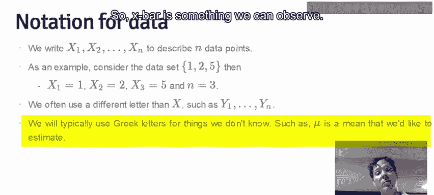

其中，Σ 符号表示求和。例如，对于数据 `[1, 2, 5]`，其均值为 (1+2+5)/3 ≈ 2.67。

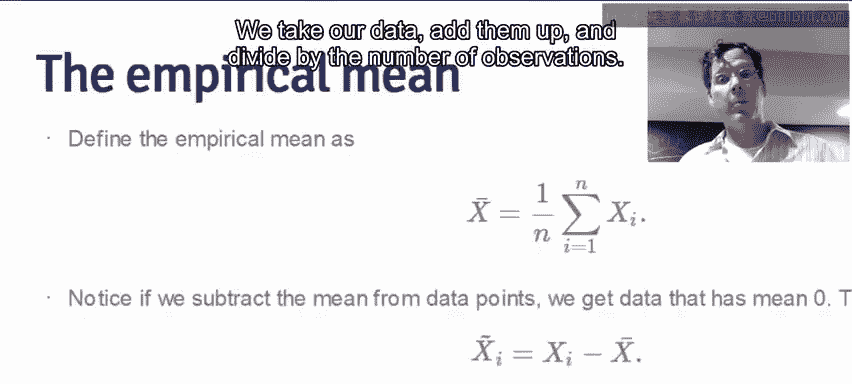

一个重要的性质是，如果我们从每个数据点中减去均值，得到的新数据集（称为**中心化**数据）其均值将为零。

令 **x̃ᵢ = xᵢ - x̄**，则新数据集 `{x̃₁, x̃₂, ..., x̃ₙ}` 的均值为 0。

此外，样本均值是“最小二乘”意义上的中心点，即它是使 **Σᵢ₌₁ⁿ (xᵢ - μ)²** 最小的 μ 值。

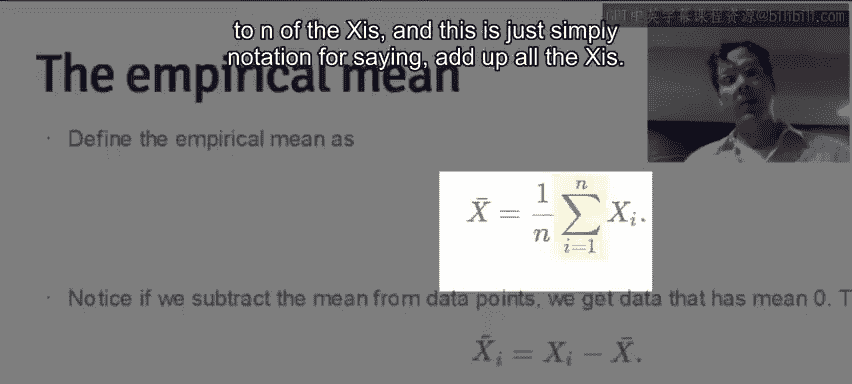

---

## 方差与标准差

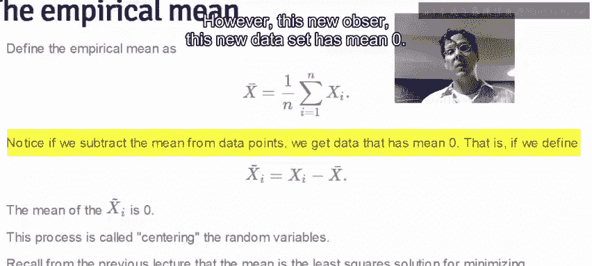

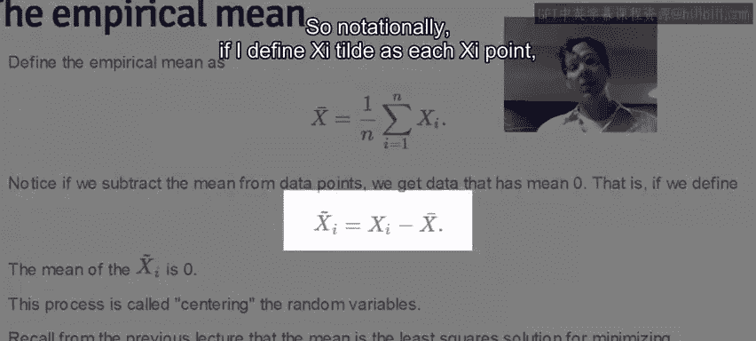

在了解了数据的中心位置（均值）后，我们需要衡量数据的离散程度，这就是方差和标准差。

样本方差 **s²** 衡量了数据点围绕均值的平均平方偏差，计算公式为：

**s² = [1/(n-1)] * Σᵢ₌₁ⁿ (xᵢ - x̄)²**

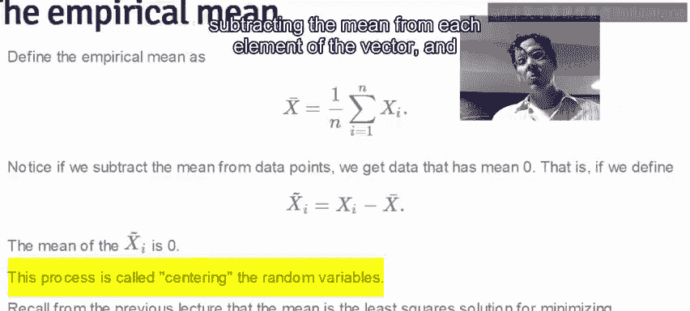

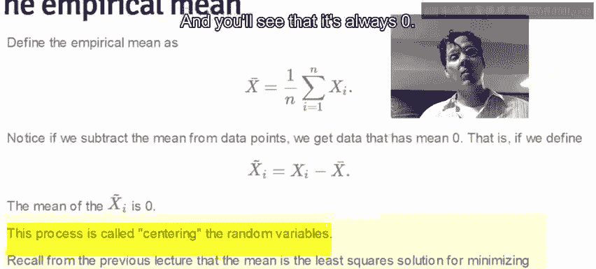

样本标准差 **s** 是方差的平方根：

**s = √s²**

使用标准差的好处在于，它的单位与原始数据 x 的单位一致，而方差的单位是原始单位的平方。

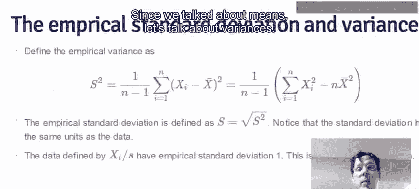

类似于中心化，我们可以对数据进行**缩放**。如果将每个观测值除以标准差 s，得到的新数据集其标准差将为 1。

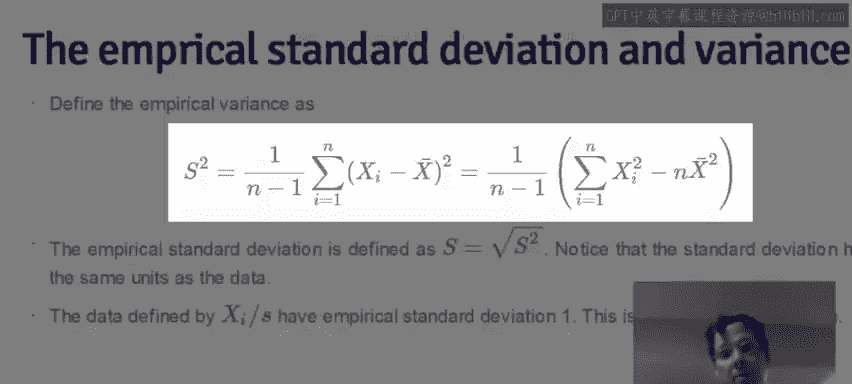

---

## 数据标准化

结合中心化和缩放，我们可以对数据进行**标准化**（或称为归一化）。

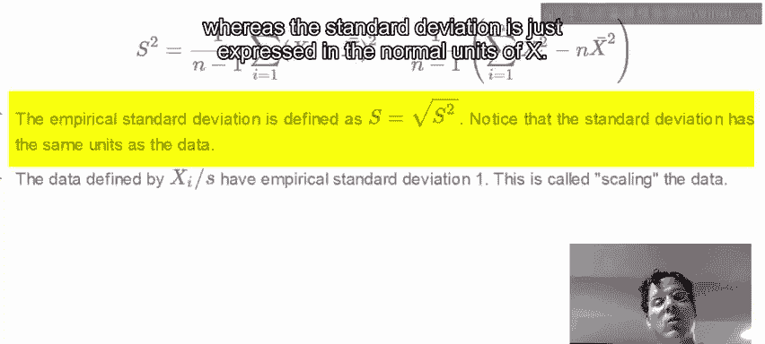

以下是标准化的步骤：
1.  **中心化**：将每个数据点减去均值（xᵢ - x̄），得到均值为0的数据。
2.  **缩放**：将中心化后的每个数据点除以标准差 s。

令 **zᵢ = (xᵢ - x̄) / s**，则新数据集 `{z₁, z₂, ..., zₙ}` 具有以下性质：
*   经验均值为 0。
*   经验标准差为 1。

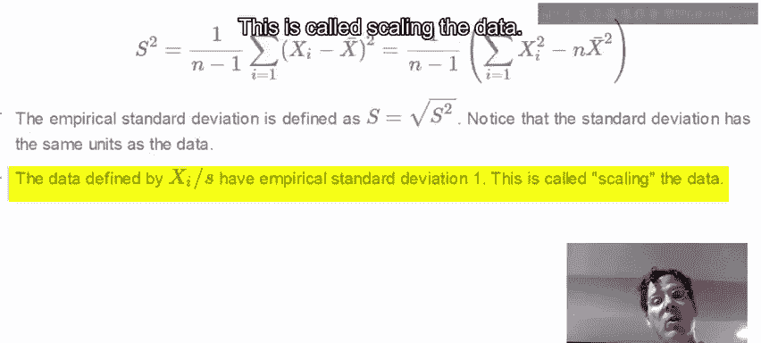

标准化数据以零为中心，其数值表示该点距离均值有多少个标准差。例如，一个标准化后的值为 2，意味着该原始数据点比均值高出 2 个标准差。标准化使得不同尺度的数据集之间具有可比性。

---

## 协方差与相关系数

现在，我们进入回归分析最核心的概念之一：衡量两个变量之间关系的指标。

想象我们有两组一一对应的数据，例如每个人的体重指数 (x) 和血压值 (y)。我们可以有意义地绘制散点图来观察它们的关系。

样本协方差 **Cov(x, y)** 衡量了 x 和 y 共同变化的趋势，计算公式为：

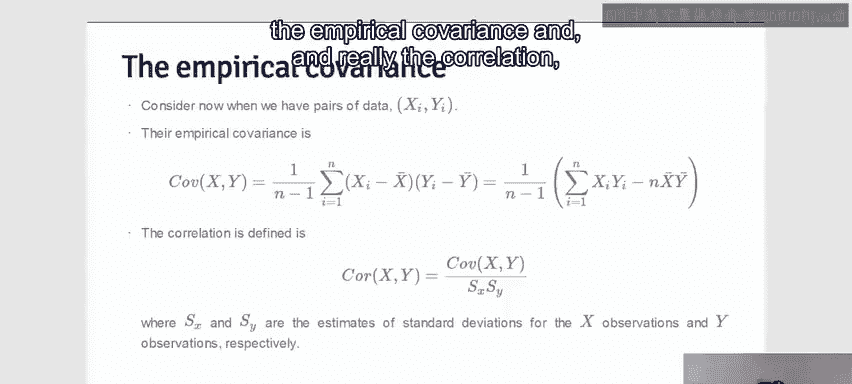

**Cov(x, y) = [1/(n-1)] * Σᵢ₌₁ⁿ (xᵢ - x̄)(yᵢ - ȳ)**

然而，协方差的单位是 x 的单位乘以 y 的单位，不便于直接比较。因此我们引入**相关系数 r**，它是标准化后的协方差，是一个无单位的量：

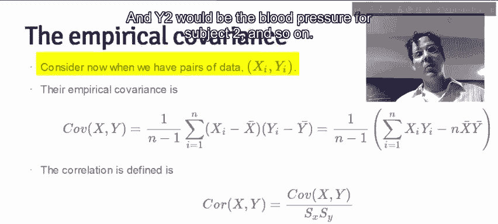

**r = Cov(x, y) / (sₓ * sᵧ)**

其中 sₓ 和 sᵧ 分别是 x 和 y 的标准差。

---

## 相关系数的性质

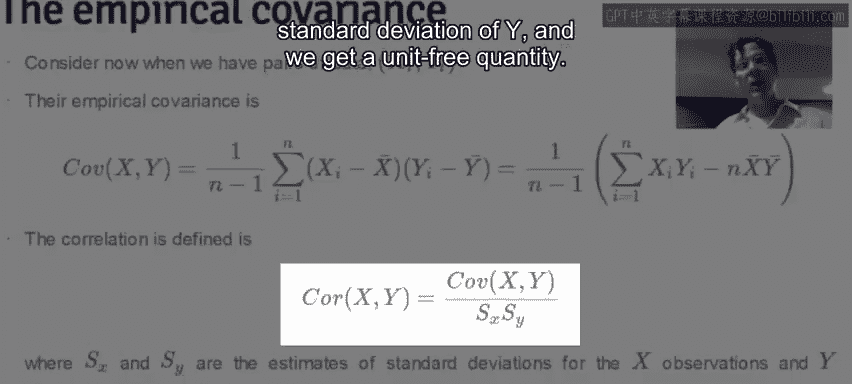

关于相关系数，有以下重要事实：

*   **取值范围**：相关系数 r 的值介于 **-1** 和 **1** 之间。
*   **极端情况**：
    *   当 r = **1** 时，所有数据点完全落在一条**正斜率**的直线上，表示完全正线性相关。
    *   当 r = **-1** 时，所有数据点完全落在一条**负斜率**的直线上，表示完全负线性相关。
*   **含义**：相关系数衡量了 **x 和 y 之间线性关系的强度和方向**。
    *   r 的绝对值越接近 1，线性关系越强。
    *   r 接近 0，表示没有线性关系（但可能存在其他类型的关系）。
*   **核心地位**：相关系数是线性回归分析中的核心度量。

---

## 总结

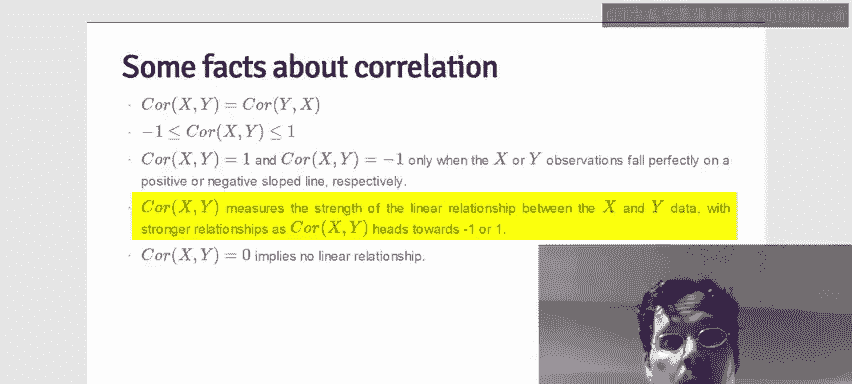

本节课中我们一起回顾了回归分析所需的基本符号和统计背景。我们学习了如何表示数据集合，计算样本均值和方差，以及通过中心化、缩放和标准化来调整数据。最后，我们深入探讨了衡量两个变量线性关系的核心工具——协方差和相关系数，并了解了相关系数的关键性质。掌握这些概念是理解后续线性回归模型原理和应用的基础。

---