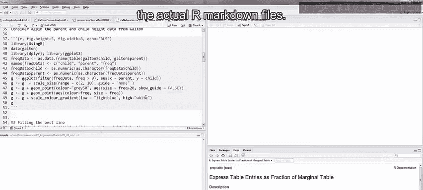
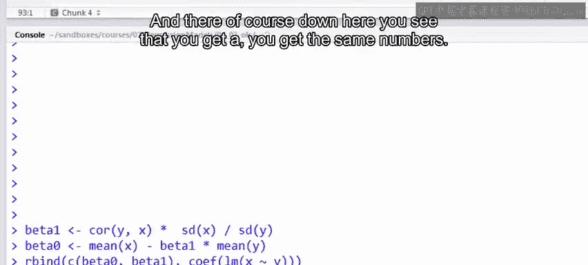
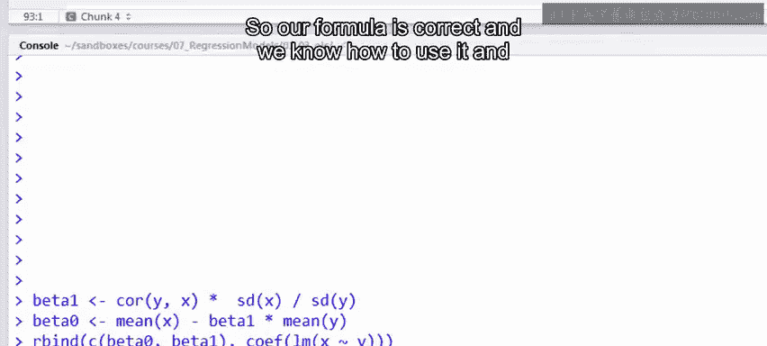
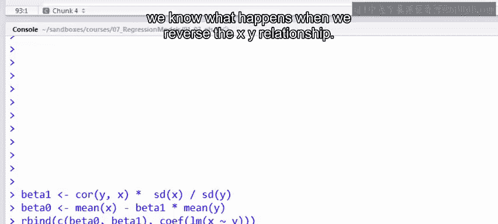
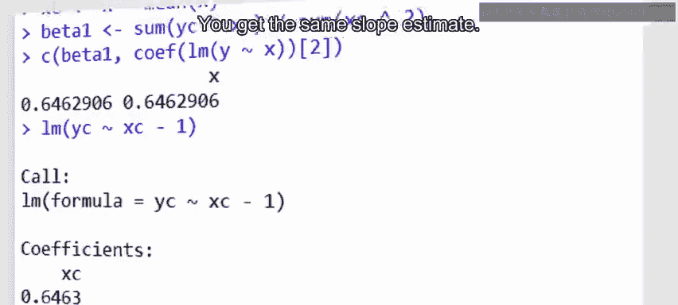
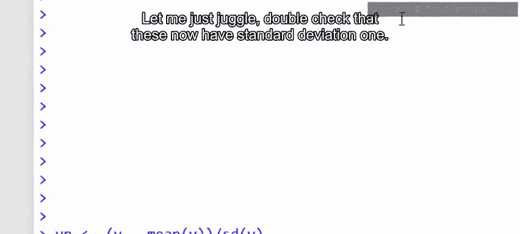
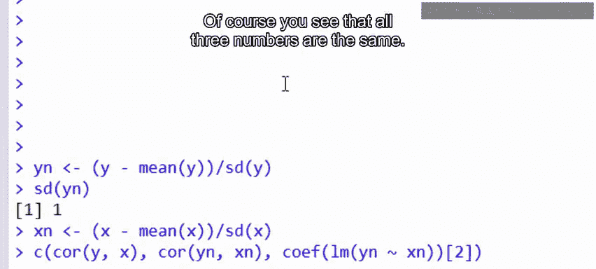
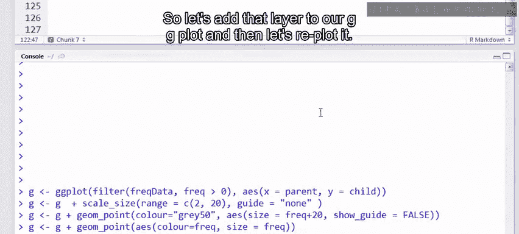

# 课程7：《回归模型》｜P7：线性最小二乘法编码示例 📊



在本节课中，我们将通过一个具体的R语言编码示例，深入理解线性最小二乘法的计算过程。我们将使用高尔顿父母与子女身高数据集，手动计算回归系数，并与R内置的`lm`函数结果进行对比验证。

## 数据准备与可视化

首先，我们需要加载并查看将要分析的数据。这里使用的是高尔顿的父母身高与子女身高数据集。

以下是初始步骤，包括加载数据和绘制散点图。

```r
# 绘制父母身高与子女身高的散点图
library(ggplot2)
# 假设数据已加载到名为 Galton 的数据框中
g <- ggplot(Galton, aes(x = parent, y = child)) + geom_point()
print(g)
```


上图展示了父母身高（x轴）与子女身高（y轴）之间的关系。

## 手动计算回归系数

上一节我们介绍了回归模型的基本概念，本节中我们来看看如何手动计算最小二乘估计的斜率和截距。我们将根据公式进行计算，并与R的`lm`函数结果进行比较。

定义变量以简化后续计算：
```r
y <- Galton$child  # 结果变量：子女身高
x <- Galton$parent # 预测变量：父母身高
```

根据公式，斜率 β₁ 和截距 β₀ 的计算方法如下：

*   **斜率 β₁** 的公式为：`β₁ = cor(y, x) * (sd(y) / sd(x))`
*   **截距 β₀** 的公式为：`β₀ = mean(y) - β₁ * mean(x)`

以下是具体的计算代码：
```r
# 手动计算斜率和截距
beta1 <- cor(y, x) * sd(y) / sd(x)
beta0 <- mean(y) - beta1 * mean(x)
c(beta0, beta1)
```

## 使用 `lm` 函数验证结果

为了验证我们手动计算的正确性，现在使用R内置的线性模型函数 `lm` 进行拟合。



以下是使用 `lm` 函数进行线性回归的代码：
```r
# 使用lm函数拟合线性模型
fit <- lm(y ~ x)
coef(fit)
```
运行后，你会发现 `coef(fit)` 输出的截距和斜率与我们手动计算的 `c(beta0, beta1)` 结果完全一致（例如23.94和0.6463），这证实了我们的公式和计算是正确的。



## 反转X与Y的关系



一个有趣的现象是，如果我们交换自变量和因变量的角色，公式依然成立，但形式会发生变化。

现在，我们将子女身高作为预测变量（X），父母身高作为结果变量（Y）来建立模型。

以下是反转关系后的系数计算：
```r
# 当x为子女身高，y为父母身高时
beta1_rev <- cor(y, x) * sd(x) / sd(y) # 注意公式中sd的位置交换了
beta0_rev <- mean(x) - beta1_rev * mean(y)
c(beta0_rev, beta1_rev)

# 使用lm函数验证
fit_rev <- lm(x ~ y)
coef(fit_rev)
```
对比 `c(beta0_rev, beta1_rev)` 和 `coef(fit_rev)`，两者结果依然相同，这证明了公式的普适性。


## 中心化数据与过原点回归

在讲座中提到的另一个要点是，如果先将Y和X中心化（减去各自的均值），那么过原点回归（即强制截距为0的回归）得到的斜率，与包含截距的普通线性回归斜率是相同的。

以下是验证这一点的计算步骤：

首先，对数据进行中心化处理：
```r
yc <- y - mean(y) # 中心化的Y
xc <- x - mean(x) # 中心化的X
```



然后，计算过原点回归的斜率。其公式为：`β₁_origin = sum(yc * xc) / sum(xc^2)`
```r
beta1_origin <- sum(yc * xc) / sum(xc^2)
beta1_origin
```

最后，与包含截距的线性回归模型的斜率进行比较：
```r
# 普通线性回归的斜率（第二个系数）
coef(lm(y ~ x))[2]
# 使用中心化数据并强制截距为0的回归
coef(lm(yc ~ xc - 1))
```
你会发现，`beta1_origin`、`coef(lm(y ~ x))[2]` 和 `coef(lm(yc ~ xc - 1))` 这三个值是完全相同的。代码中的 `-1` 即表示在 `lm` 公式中移除截距项。




## 标准化与相关系数

接下来，我们验证另一个重要结论：如果将Y和X标准化（均值为0，标准差为1），那么回归斜率就等于二者的相关系数。

以下是标准化的过程及验证：
```r
# 标准化Y和X
yn <- (y - mean(y)) / sd(y)
xn <- (x - mean(x)) / sd(x)

# 验证标准差是否为1
sd(yn)
sd(xn)

# 比较相关系数与回归斜率
c(cor(y, x), cor(yn, xn), coef(lm(yn ~ xn))[2])
```
执行后，你会看到输出的三个数值完全相同。这证实了对于标准化后的数据，皮尔逊相关系数 `cor(yn, xn)` 就等于回归模型的斜率估计值。




## 在图形中添加回归线

最后，我们将学习如何在使用 `ggplot2` 绘制的散点图上添加回归线，这能更直观地展示变量间的关系。

以下是创建带回归线的增强散点图的代码。我们使用气泡图，其中点的大小和颜色代表该（父母身高，子女身高）组合出现的频数。
```r
# 创建基础散点图（气泡图表示频数）
g <- ggplot(Galton, aes(x = parent, y = child, size = ..count.., color = ..count..)) +
  geom_point(stat = "sum")

# 添加线性回归平滑层
g + geom_smooth(method = "lm", formula = y ~ x)
```
`geom_smooth(method = "lm")` 层会自动拟合数据并绘制回归线。默认情况下，它还会添加回归线的置信区间带（图中灰色阴影区域），这很好地展示了估计的不确定性，我们将在后续课程中讨论其生成原理。




## 总结

本节课中我们一起学习了线性最小二乘法的实际编码应用。我们使用R语言手动计算了回归系数，并通过多种方式验证了其正确性，包括与 `lm` 函数对比、验证中心化与标准化后的性质。最后，我们还掌握了如何在 `ggplot2` 图形中直观地添加回归线。通过这些练习，你应当对最小二乘估计的计算和验证有了更扎实的理解。