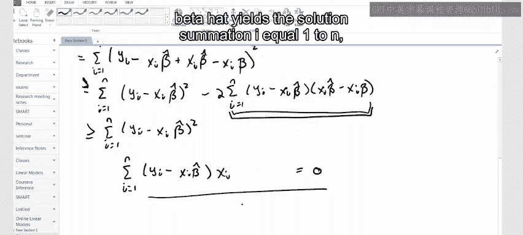
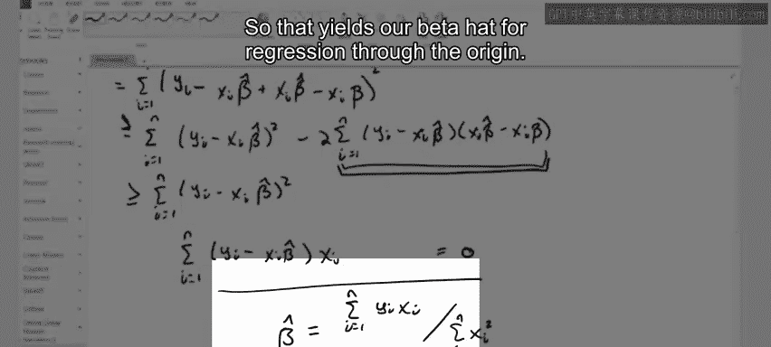

# 课程7：《回归模型》｜P8：线性回归斜率公式推导 🧮

在本节课中，我们将要学习线性回归斜率估计公式的数学推导。我们将证明，斜率估计值 `β1_hat` 等于 `y` 和 `x` 的相关系数乘以 `y` 的标准差再除以 `x` 的标准差。这个推导过程会涉及一些数学运算，但我们会尽量用简单直白的方式讲解，让初学者也能跟上思路。

---

## 从过原点回归开始

在进入完整的线性回归推导之前，我们先来看一个更简单的情况：**过原点回归**。这意味着我们拟合一条形式为 `y = xβ` 的直线，且这条直线强制通过原点（0,0）。

假设我们有 `n` 个数据点：`(x1, y1), (x2, y2), ..., (xn, yn)`。我们的目标是找到一个 `β` 值，使得以下**最小二乘准则**最小化：

`∑ (yi - xi * β)^2`，其中求和 `∑` 从 `i=1` 到 `n`。

我们设使这个表达式最小的解为 `β_hat`。为了找到它，我们对准则进行一些代数变换。

首先，我们在表达式中巧妙地加上一个 `0`：

`∑ [ (yi - xi * β_hat) + (xi * β_hat - xi * β) ]^2`

展开这个平方项，我们得到三项的和：

1.  `∑ (yi - xi * β_hat)^2`
2.  `-2 * ∑ [ (yi - xi * β_hat) * (xi * β_hat - xi * β) ]`
3.  `+ ∑ (xi * β_hat - xi * β)^2`

现在，关键的一步是观察第二项。如果我们选择的 `β_hat` 能使这一项等于 `0`，那么对于任何其他的 `β` 值，其对应的最小二乘准则值都会大于或等于 `β_hat` 对应的值。这就证明了 `β_hat` 是最小值点。

因此，我们令第二项为 `0` 并求解 `β_hat`：

`∑ [ (yi - xi * β_hat) * xi * (β_hat - β) ] = 0`

由于 `(β_hat - β)` 是一个不依赖于 `i` 的常数，我们可以将其从求和号中提出并消去。于是，方程简化为：

`∑ (yi - xi * β_hat) * xi = 0`

解这个方程，我们得到过原点回归的斜率估计公式：

`β_hat = (∑ yi * xi) / (∑ xi^2)`

---

### 一个特例：均值回归

为了验证这个公式，让我们考虑一个特例：假设所有的 `xi` 都等于 `1`。

此时，我们的模型 `y = xβ` 变成了 `y = 1 * β`，也就是 `y = β`。这被称为**均值回归**，因为我们试图用一个常数 `β` 来拟合所有的 `y` 值。

将 `xi = 1` 代入我们的公式：

`β_hat = (∑ yi * 1) / (∑ 1^2) = (∑ yi) / n = y_bar`

这个结果与我们之前学到的知识一致：在均值回归中，使平方和最小的估计值就是 `y` 的样本均值 `y_bar`。

---

## 推广到一般线性回归

上一节我们介绍了过原点回归，本节中我们来看看完整的一般线性回归模型。模型形式为：

`y = β0 + β1 * x`

我们的目标是最小化最小二乘准则：

`∑ (yi - β0 - β1 * xi)^2`

我们的推导将利用过原点回归的结论，使过程变得简单。

首先，假设 `β1` 是已知的固定值。那么，我们可以将准则重写为：

`∑ [ (yi - β1 * xi) - β0 ]^2`

令 `y*_i = yi - β1 * xi`，则上式变为 `∑ (y*_i - β0)^2`。这正是一个均值回归问题！我们知道，使这个表达式最小的 `β0` 就是 `y*` 的均值：

`β0_hat = (∑ y*_i) / n = (∑ (yi - β1 * xi)) / n = y_bar - β1 * x_bar`

这个关系式非常重要，它意味着**无论 `β1` 是多少，最优的 `β0` 都必须满足这个等式**。这也表明，拟合的回归线必然穿过数据的中心点 `(x_bar, y_bar)`。

现在，我们将这个 `β0` 的表达式代回原始的最小二乘准则中：

`∑ [ yi - (y_bar - β1 * x_bar) - β1 * xi ]^2`

经过整理，我们可以将其重写为：

`∑ [ (yi - y_bar) - β1 * (xi - x_bar) ]^2`

现在，我们定义**中心化**的变量：
*   `y_tilde_i = yi - y_bar`
*   `x_tilde_i = xi - x_bar`

于是，我们的最小化问题变成了：

`∑ (y_tilde_i - β1 * x_tilde_i)^2`

看！这正好是一个**以中心化数据进行的过原点回归**问题。`y_tilde` 是结果变量，`x_tilde` 是预测变量。

根据我们之前推导的过原点回归公式，最优的 `β1_hat` 为：

`β1_hat = (∑ y_tilde_i * x_tilde_i) / (∑ x_tilde_i^2)`

将中心化变量的定义代入：

`β1_hat = [ ∑ (yi - y_bar)(xi - x_bar) ] / [ ∑ (xi - x_bar)^2 ]`

---

### 得到最终公式

现在，我们对分子和分母同时除以 `(n-1)`：

*   分子除以 `(n-1)` 是 `y` 和 `x` 的**样本协方差** `Cov(y, x)`。
*   分母除以 `(n-1)` 是 `x` 的**样本方差** `Var(x)`。

因此：

`β1_hat = Cov(y, x) / Var(x)`

我们知道，相关系数 `Cor(y, x)` 的定义是 `Cov(y, x) / (Sd(y) * Sd(x))`，其中 `Sd` 表示标准差。同时，方差 `Var(x) = Sd(x)^2`。

所以，我们可以将公式进一步改写：

`β1_hat = [Cor(y, x) * Sd(y) * Sd(x)] / [Sd(x)^2] = Cor(y, x) * [Sd(y) / Sd(x)]`

至此，我们完成了证明。一般线性回归的斜率估计公式为：

`β1_hat = Cor(y, x) * (Sd(y) / Sd(x))`

而截距的估计公式由之前的关系式给出：

`β0_hat = y_bar - β1_hat * x_bar`

---

## 总结

本节课中我们一起学习了线性回归核心公式的完整推导。

1.  我们从**过原点回归**这个简化模型入手，推导出其斜率估计公式 `β_hat = (∑ yi * xi) / (∑ xi^2)`。
2.  然后，我们将一般线性回归问题，通过中心化数据，巧妙地转化为一个过原点回归问题。
3.  最终，我们证明了线性回归的斜率估计值 `β1_hat` 确实等于 `y` 和 `x` 的相关系数乘以 `y` 的标准差与 `x` 的标准差之比，即 **`β1_hat = Cor(y, x) * (Sd(y) / Sd(x))`**。
4.  截距 `β0_hat` 则由中心点的关系确定：**`β0_hat = y_bar - β1_hat * x_bar`**。

这个推导揭示了相关系数、标准差与回归斜率之间的深刻联系，是理解线性回归模型本质的重要一步。