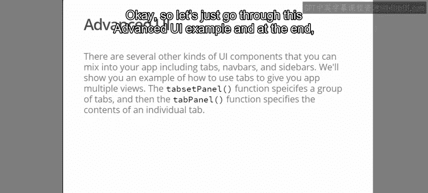
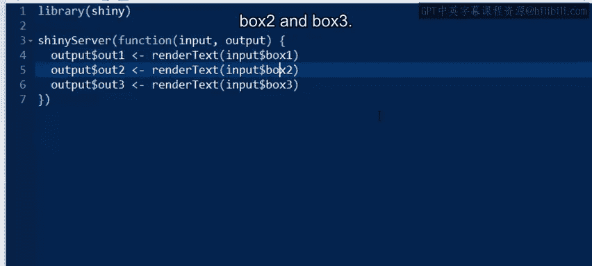
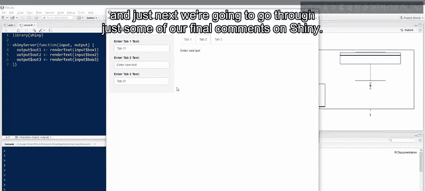

# 课程9：《开发数据产品》｜P10：Shiny进阶UI设计 🎨

在本节课中，我们将学习如何调整Shiny应用程序的用户界面（UI）。上一节我们介绍了Shiny的基本UI结构，本节中我们来看看如何通过标签页（tabs）等方式来定制UI，使应用更加灵活和用户友好。

## 概述



我们将通过一个具体的例子，展示如何在Shiny中创建带有标签页的UI。这个例子将包含一个侧边栏（用于输入）和一个主面板（包含多个标签页）。通过这个例子，你将理解Shiny UI的嵌套结构，并能够根据自己的需求进行定制。

## 进阶UI示例：标签页布局

以下是创建一个带有标签页的Shiny UI的步骤。我们将使用 `sidebarLayout` 作为基础布局，侧边栏放置输入控件，主面板则包含一组标签页。

### UI代码结构

首先，我们定义UI部分。代码结构如下：

```r
ui <- fluidPage(
  sidebarLayout(
    sidebarPanel(
      textInput("box1", "Enter tab 1 text:", "tab1"),
      textInput("box2", "Enter tab 2 text:", "tab2"),
      textInput("box3", "Enter tab 3 text:", "tab3")
    ),
    mainPanel(
      tabsetPanel(
        type = "tabs",
        tabPanel("Tab1", br(), textOutput("out1")),
        tabPanel("Tab2", br(), textOutput("out2")),
        tabPanel("Tab3", br(), textOutput("out3"))
      )
    )
  )
)
```

**代码解释**：
*   `sidebarPanel`: 包含三个文本输入框，其标签和初始值分别为“tab1”、“tab2”、“tab3”。
*   `mainPanel`: 内部嵌套了 `tabsetPanel` 函数，用于创建标签页组。
*   `tabPanel`: 定义了三个独立的标签页，每个标签页包含一个换行符 `br()` 和一个文本输出区域 `textOutput`。这些输出区域（如 `"out1"`）将与服务器函数中定义的输出对应。

### 服务器逻辑

服务器部分非常简单，它的作用是将用户在对应输入框中输入的文字，实时显示在对应的标签页输出区域中。

```r
server <- function(input, output) {
  output$out1 <- renderText({
    input$box1
  })
  output$out2 <- renderText({
    input$box2
  })
  output$out3 <- renderText({
    input$box3
  })
}
```

**代码解释**：
*   每个 `renderText` 函数监听一个输入（如 `input$box1`），并将其值赋给对应的输出（如 `output$out1`）。
*   这样，当用户在“box1”中输入文字时，“Tab1”标签页中的内容就会同步更新。

### 运行效果

运行此应用程序后，界面左侧会出现三个文本输入框，右侧则显示三个标签页（Tab1， Tab2， Tab3）。用户在任意输入框（例如为Tab2设计的输入框）中输入文字，然后切换到对应的标签页，即可看到输入的文字显示在该标签页中。



这个例子展示了如何通过简单的结构调整来丰富Shiny应用的UI。通过组合不同的布局函数（如 `tabsetPanel`, `navbarPage` 等），你可以创建出各种复杂的界面。

## 开发注意事项与最终讨论

在调整UI时，确保R代码语法正确至关重要。RStudio会在遗漏逗号或括号时给出错误提示。保持代码缩进清晰、结构分明，能极大减少此类错误。

以下是进行Shiny UI编程时的一些核心要点：
*   **语法检查**：密切注意函数括号的闭合和参数间的逗号。
*   **代码环境**：在RStudio等集成开发环境中编写代码，利用其语法高亮和错误提示功能。
*   **模式识别**：掌握 `sidebarLayout`、`tabsetPanel` 等基本组件的使用模式后，你可以自由组合它们，或探索其他布局（如不带侧边栏的纯标签页布局）。
*   **无限定制**：除了内置函数，Shiny还允许使用自定义HTML来无限定制UI，这为高级用户提供了极大的灵活性。

## 总结

本节课中我们一起学习了Shiny的进阶UI设计。我们通过构建一个带标签页的应用程序，深入了解了如何利用 `tabsetPanel` 和 `tabPanel` 函数来组织内容。你掌握了UI与服务器之间通过输入/输出ID进行连接的基本模式。记住，清晰的代码结构和仔细的语法检查是高效开发的关键。你的课后任务是尝试开发一个属于自己的标签页用户界面。



---
**课程要点回顾**：
1.  使用 `tabsetPanel` 和 `tabPanel` 创建标签页界面。
2.  UI组件通过嵌套结构进行组合。
3.  服务器函数中的 `renderText` 将输入值绑定到输出显示。
4.  注意代码语法（括号、逗号）和结构以规避错误。