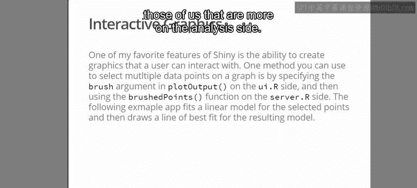
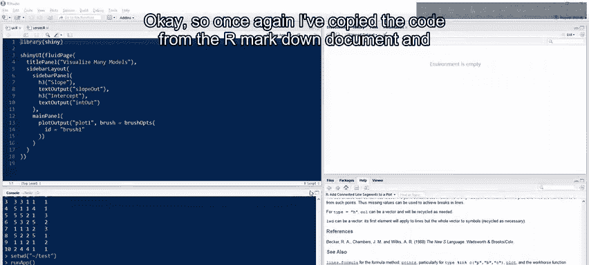
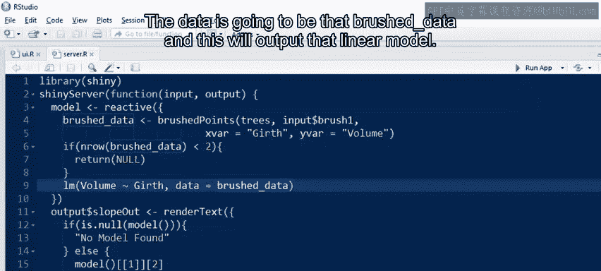
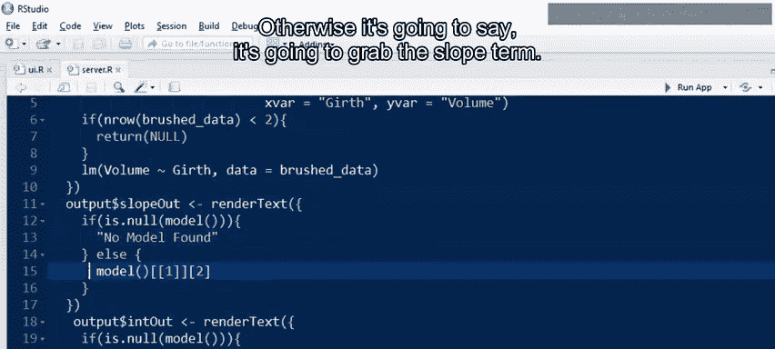
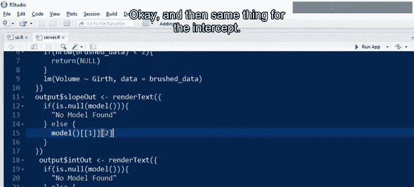
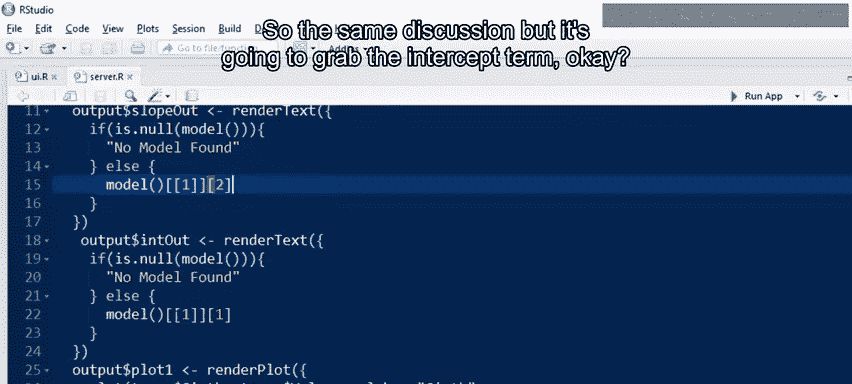
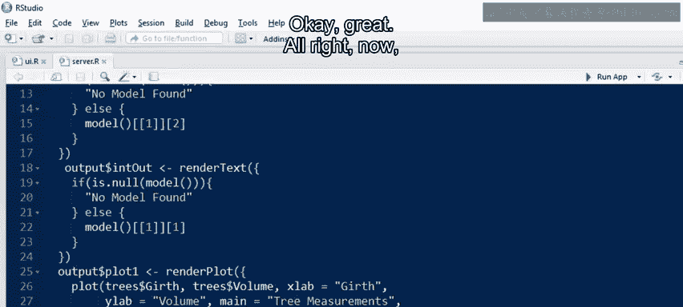
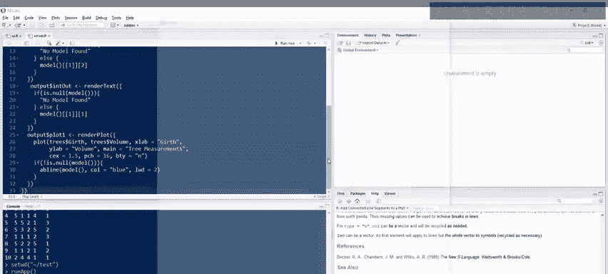
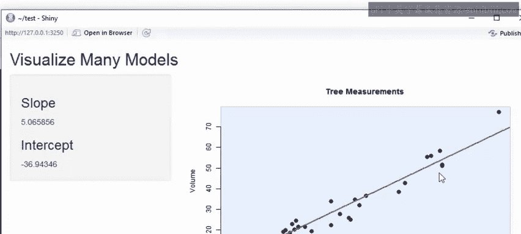

# 课程9：《开发数据产品》｜P12：交互式绘图与Shiny应用 🎨

在本节课中，我们将学习如何在Shiny应用中使用`brush`参数（UI端）和`brushPoints`参数（服务器端）来创建一个交互式图形。具体来说，我们将实现一个功能：在散点图中用鼠标框选数据点，Shiny应用会为这些被选中的点拟合一条线性回归线，并实时显示该直线的斜率和截距。这是一个展示Shiny交互式图形核心功能的经典示例。

---



## 应用结构与UI设计



首先，我们来看用户界面（UI）部分的代码结构。UI定义了应用的布局和用户看到的元素。

以下是UI侧边栏面板的关键组件：

*   `textOutput("slopeOut")`：用于显示回归线斜率的文本区域。
*   `textOutput("intOut")`：用于显示回归线截距的文本区域。
*   `plotOutput("plot1", brush = brushOpts(id = "brush1"))`：这是核心的绘图输出区域。`brush = brushOpts(id = "brush1")`参数启用了框选功能，并为其指定了ID `"brush1"`，以便在服务器端引用。

## 服务器端逻辑与反应式编程

接下来，我们深入服务器函数，了解应用背后的逻辑。服务器端负责处理数据、进行计算并更新UI。

服务器函数接收`input`和`output`两个列表。我们首先创建一个反应式表达式`model`，它依赖于用户通过`brush1`框选的数据。



```
model <- reactive({
    brushData <- brushedPoints(trees, input$brush1, xvar = "Girth", yvar = "Volume")
    if (is.null(brushData) || nrow(brushData) < 2)
        return(NULL)
    lm(Volume ~ Girth, data = brushData)
})
```

这段代码执行以下操作：
1.  `brushedPoints`函数从`trees`数据集中提取被`brush1`选中的点，并指定`Girth`为X变量，`Volume`为Y变量。
2.  如果选中的点少于两个，则返回`NULL`。
3.  否则，使用`lm`函数为选中的点拟合一个线性模型（`Volume ~ Girth`）。



然后，我们定义输出内容：





*   `output$slopeOut` 和 `output$intOut`：这两个输出分别使用`renderText`来渲染文本。它们检查`model()`的结果。如果模型为`NULL`，则显示“No model found”；否则，从模型系数中提取并显示斜率或截距。
*   `output$plot1`：这是主要的图形输出，使用`renderPlot`创建。

```
output$plot1 <- renderPlot({
    plot(trees$Girth, trees$Volume, xlab = "Girth", ylab = "Volume", main = "Tree Measurements")
    if (!is.null(model())) {
        abline(model(), col = "blue", lwd = 2)
    }
})
```



这段代码首先绘制完整的`trees`数据集散点图。然后，通过检查`model()`是否存在，来决定是否在图上添加一条蓝色的回归线。这条线仅基于当前被框选的数据点绘制。



## 运行与交互演示

现在，让我们运行这个应用并观察其交互效果。

启动应用后，初始状态因为没有框选任何数据点，所以斜率和截距显示为“No model found”。当你在散点图上用鼠标框选一组数据点时，应用会立即为这些点计算并绘制回归线，同时更新显示对应的斜率和截距值。你可以尝试框选不同的数据子集，观察回归线和参数如何动态变化。如果框选区域不包含任何点或仅包含一个点，参数显示会恢复为“No model found”。

## 总结与拓展

本节课我们一起学习了如何利用Shiny的`brush`功能构建一个交互式数据探索工具。我们掌握了在UI中启用图形框选，在服务器端使用`brushedPoints`获取选中数据，并利用反应式编程动态更新模型和图形输出的完整流程。



这个示例清晰地展示了Shiny在创建交互式图形方面的强大能力，这对于数据分析师来说是一个非常实用的工具。建议你尝试重现这个例子，并探索使用R中的其他数据集（例如`mtcars`）来创建你自己的交互式图形。至此，你已经掌握了Shiny的基础，足以开始将它融入你的数据分析工作流。Shiny还有许多高级功能，例如处理数据框的输入输出，甚至可以使用WebGL在Shiny网页中嵌入R的3D图形库（rgl），但这些内容相对进阶。目前你所学的知识已经足够让你起步，请务必尝试使用Shiny，并将其纳入你的标准工具箱。