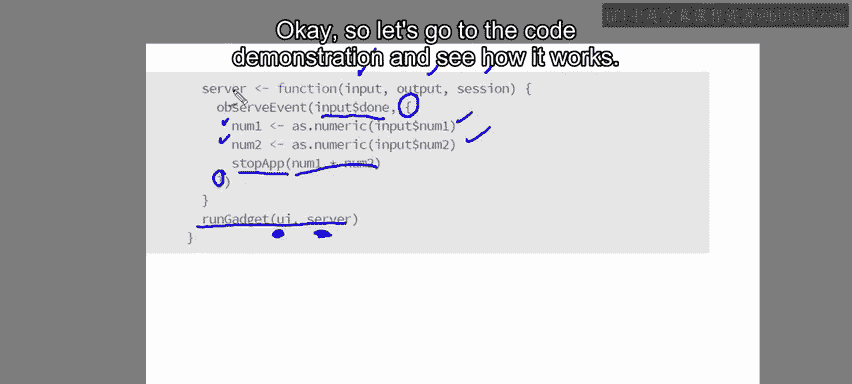
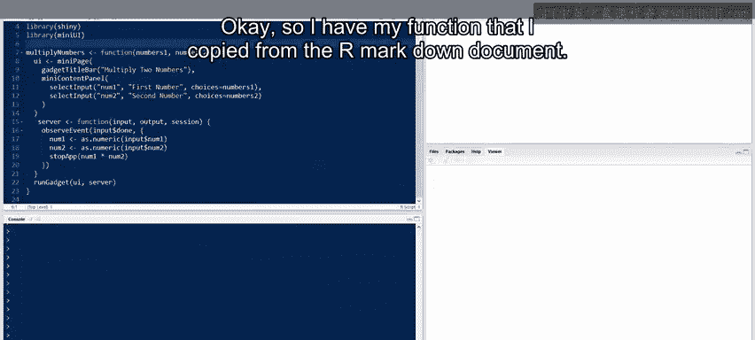
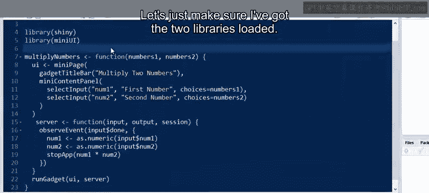
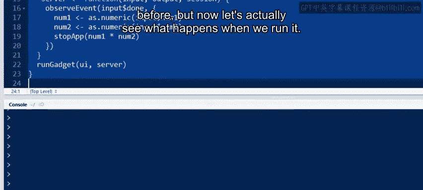
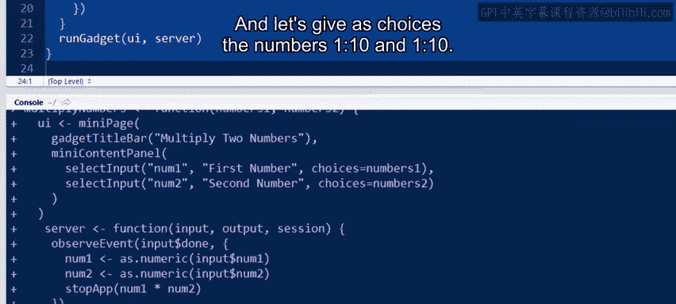
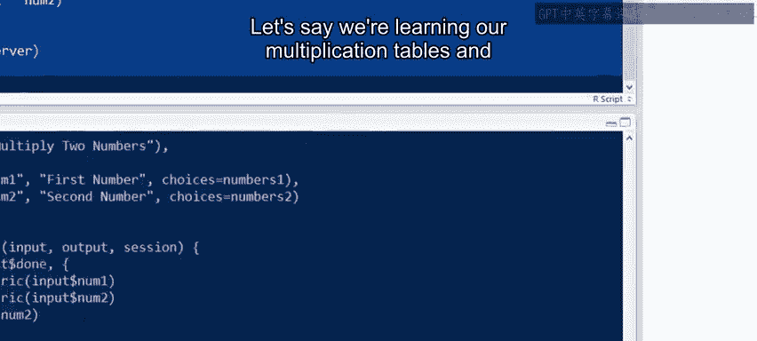
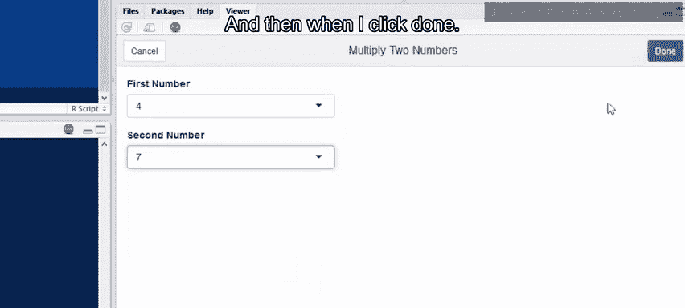
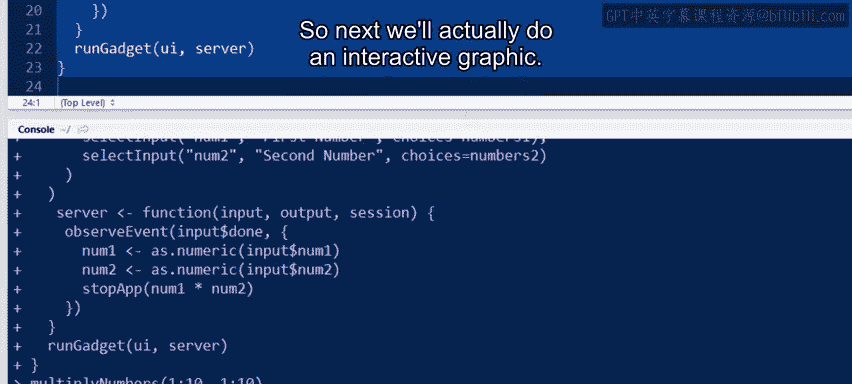

# 课程9：《开发数据产品》｜P14：Shiny小工具入门 🛠️

在本节课中，我们将学习如何构建一个基础的Shiny小工具（gadget）。我们将创建一个简单的交互式应用，允许用户选择两个数字，然后计算它们的乘积。通过这个例子，你将理解Shiny小工具的基本结构和工作原理。

---

上一节我们介绍了Shiny小工具的基本概念。本节中，我们来看看如何为小工具添加参数和交互功能。

我们的示例小工具包含两个主要部分：用户界面（UI）和服务器逻辑（server）。以下是构建步骤：

以下是构建该小工具所需的代码结构：

```r
library(shiny)
library(miniUI)

multiplyNumbers <- function(numbers1 = 1:10, numbers2 = 1:10) {
  ui <- miniPage(
    gadgetTitleBar("Multiply Two Numbers"),
    miniContentPanel(
      selectInput("num1", "First Number", choices = numbers1),
      selectInput("num2", "Second Number", choices = numbers2)
    )
  )
  
  server <- function(input, output, session) {
    observeEvent(input$done, {
      num1 <- as.numeric(input$num1)
      num2 <- as.numeric(input$num2)
      result <- num1 * num2
      stopApp(result)
    })
  }
  
  runGadget(ui, server)
}
```

代码分为两部分。第一部分定义用户界面，使用`miniPage`和`miniContentPanel`创建布局。`selectInput`函数生成两个下拉选择框，其选项来自函数参数`numbers1`和`numbers2`。

第二部分是服务器逻辑。`observeEvent`监听“Done”按钮。当按钮被点击时，代码获取输入值，计算乘积，并通过`stopApp`函数返回结果。

---

现在，让我们运行这个函数，看看它的实际效果。



首先，确保已加载必要的库。然后，调用`multiplyNumbers`函数。

```r
# 加载库
library(shiny)
library(miniUI)







# 运行小工具
multiplyNumbers(numbers1 = 1:10, numbers2 = 1:10)
```

执行后，会弹出一个窗口。用户可以从两个下拉框中分别选择数字（例如4和7）。点击“Done”按钮，小工具关闭，并在R控制台返回计算结果（例如28）。

这个例子展示了Shiny小工具的核心流程：接收用户输入、执行R计算、返回结果。它是构建更复杂交互工具的基础。

---









本节课中，我们一起学习了如何创建一个简单的Shiny小工具。我们了解了其UI和server的基本结构，并实现了一个让用户选择数字并计算乘积的功能。掌握这个基础后，你就可以进一步探索如何构建交互式图形等更复杂的数据产品了。