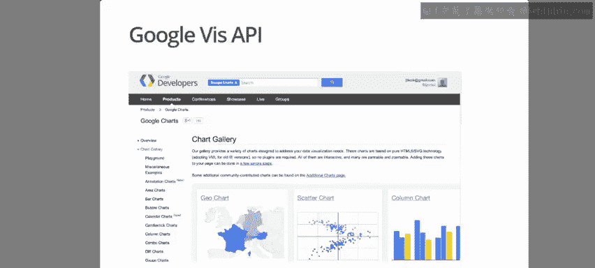
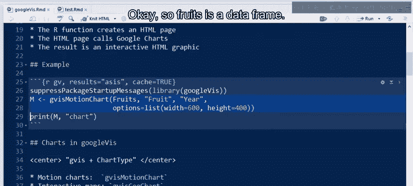
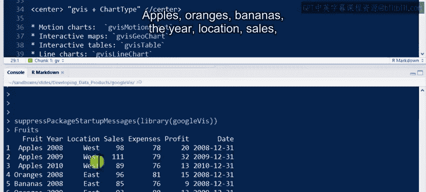
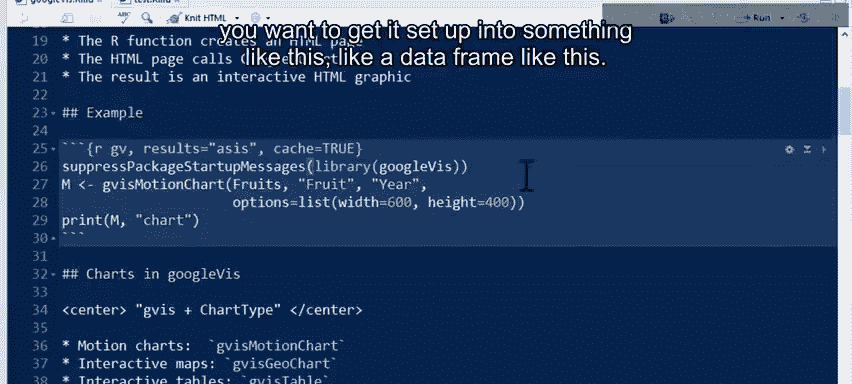
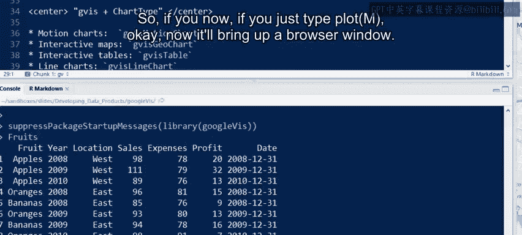
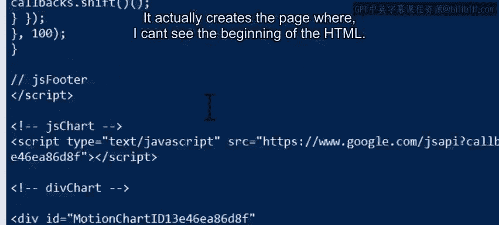

# 课程9：《开发数据产品》｜P16：使用googleVis包创建交互式图表 🚀

在本节课中，我们将学习如何使用R语言中的`googleVis`包。这个包能够连接R与谷歌的可视化API，帮助我们轻松创建出交互式图表。我们将通过几个核心示例，学习如何生成动态图表、地图等，并将结果嵌入网页。

`googleVis`是一个功能强大且文档完善的R包。它允许我们利用谷歌现有的交互式图表库，在R环境中创建复杂的可视化效果，而无需从头编写大量代码。

上一节我们介绍了课程概述，本节我们将具体学习如何创建第一个交互式图表：动态图。

## 创建动态图 📊

动态图可以展示数据随时间的变化，非常适合呈现趋势。以下是创建动态图的基本步骤。



首先，我们需要加载`googleVis`包并准备数据。

```r
# 加载googleVis包
library(googleVis)
```

接下来，我们使用包中自带的一个示例数据集`Fruits`。这个数据集包含了不同水果在不同年份的销售、支出和利润数据。

```r
# 查看数据结构
head(Fruits)
```

数据框`Fruits`包含以下列：水果种类、年份、地点、销售额、支出额、利润和日期。这种结构非常适合用于创建动态图。

现在，我们使用`gvisMotionChart`函数来创建动态图对象。



```r
# 创建动态图对象
M <- gvisMotionChart(Fruits, 
                     idvar = "Fruit", 
                     timevar = "Year")
```



代码解释：
*   `Fruits`： 我们使用的数据框。
*   `idvar = “Fruit”`： 指定标识不同系列的变量，这里是水果种类。
*   `timevar = “Year”`： 指定代表时间的变量。

创建好对象`M`后，我们可以用`plot`函数在浏览器中查看它。



```r
# 在浏览器中绘制图表
plot(M)
```

执行这行代码会打开一个浏览器窗口，展示出交互式动态图。你可以点击播放按钮观察数据随时间的变化，也可以选择只显示某一种水果，或切换X轴、Y轴对应的数据维度（例如利润、销售额）。

上一节我们创建并预览了动态图，本节我们来看看如何获取图表的HTML代码，以便将其嵌入到网页或报告中。

## 导出图表HTML代码 🌐



`googleVis`生成的图表本质上是包含了JavaScript代码的HTML页面。我们可以轻松提取这些代码。

要获取图表的完整HTML代码，可以使用`print`函数。

```r
# 打印图表的HTML代码到控制台
print(M)
```

这段代码会在R的控制台中输出生成图表所需的所有HTML和JavaScript代码。


如果希望将图表保存为一个独立的HTML文件，可以指定`file`参数。

```r
# 将图表保存为HTML文件
print(M, file = “motion_chart.html”)
```



执行后，会在当前工作目录下生成一个名为`motion_chart.html`的文件。用浏览器打开这个文件，就能看到交互式图表。

通常的工作流程是：先用`plot(M)`在浏览器中调试和查看图表效果，满意后，再用`print(M, file=“...”)`导出最终的HTML代码，嵌入到你的网站、博客或R Markdown文档中。关于如何嵌入到R Markdown，可以参考本讲义的原始Rmd文档。

我们已经学会了创建和导出动态图，接下来可以探索`googleVis`包提供的其他图表类型。

## 其他图表类型与练习 🗺️

`googleVis`包还支持创建多种其他类型的交互式图表。

以下是部分可创建的图表类型：
*   **地图**： 例如`gvisGeoChart`，可用于绘制地理数据。
*   **条形图/柱状图**： 例如`gvisColumnChart`。
*   **折线图**： 例如`gvisLineChart`。
*   **散点图**： 例如`gvisScatterChart`。
*   **仪表盘**： 例如`gvisGauge`。

你的课后练习是：成功安装`googleVis`包，并完整复现本节课的动态图示例。确保你能在浏览器中可视化图表，并尝试将图表保存为HTML文件。

---

本节课中，我们一起学习了如何使用R的`googleVis`包创建交互式图表。我们重点掌握了动态图的创建、预览与HTML代码导出方法。`googleVis`包极大地简化了在R中生成复杂交互可视化的过程，是开发数据产品时的有力工具。