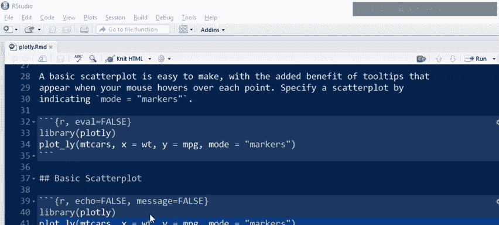
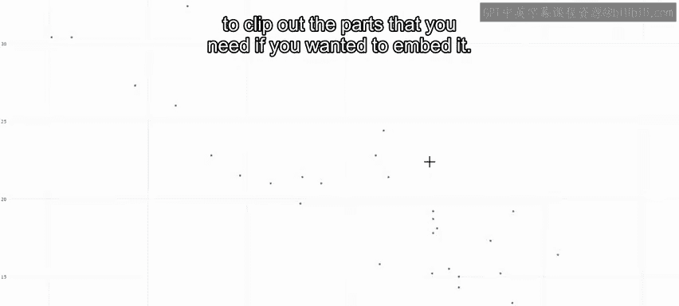

# 📊 约翰霍普金斯大学数据科学课程9：《开发数据产品》｜P19：使用Plotly创建交互式图表



在本节课中，我们将学习如何使用Plotly库在R语言中创建交互式图表。Plotly是一个强大的工具，能够将数据可视化并生成可交互的网页图形。

---

## 🚀 开始使用Plotly

首先，我们需要准备一个与Plotly课程相关的R Markdown文档。在使用Plotly之前，请确保已经安装了该库。

以下是加载Plotly库的代码：
```r
library(plotly)
```

加载完成后，我们可以使用Plotly来创建图表。Plotly的命令非常简单直接。

---

## 📈 创建散点图

我们将使用内置数据集`mtcars`来创建一个散点图。`mtcars`是一个数据框，其中包含汽车的重量和每加仑英里数等数据。

以下是创建散点图的代码：
```r
plot_ly(mtcars, x = ~wt, y = ~mpg, mode = "markers")
```
在这段代码中，`x = ~wt`指定了X轴为重量（weight），`y = ~mpg`指定了Y轴为每加仑英里数（miles per gallon），`mode = "markers"`表示创建散点图。

运行这段代码后，散点图将显示在RStudio的查看器面板中。这个图表是交互式的，当您将鼠标悬停在数据点上时，会显示对应的X和Y值。

---

## 🛠️ 图表的交互功能

Plotly生成的交互式图表顶部有一系列控制选项，包括：
*   将图表下载为PNG图片
*   重新调整图表比例
*   重置坐标轴
*   更改悬停显示的内容

此外，还有一个发布按钮，您可以通过点击它直接将图表发布到RPubs，从而生成一个网络图形。我们稍后会介绍其他发布方式。

---

## 💾 导出和保存图表

另一种简单的发布方式是点击“导出”按钮。以下是可用的选项：
*   将图表保存为图像
*   复制到剪贴板
*   保存为网页

例如，选择“保存为网页”，将文件命名为“test”。系统会生成一个名为“test.html”的文件，您可以在浏览器中打开它查看图表。如果您了解JavaScript，可以查看和修改网页代码；如果不了解，也可以直接提取所需的部分代码用于嵌入到其他网页中。

---

## ✅ 课程任务



您的第一个任务是使用不同的数据集创建一个简单的散点图。请尝试以下步骤：
1.  使用另一个数据集创建散点图。
2.  将图表保存为网页。
3.  将图表导出为PNG和PDF格式的图片。
4.  尝试将图表发布到RPubs。

完成这个任务后，我们将继续学习更多Plotly的示例和高级功能。

---

## 🎯 总结

本节课我们一起学习了如何使用Plotly库在R中创建交互式散点图。我们介绍了加载库、创建图表、利用交互功能以及导出和发布图表的基本步骤。掌握这些基础操作后，您就可以开始探索更复杂的数据可视化项目了。