# 📊 约翰霍普金斯大学数据科学课程9：《开发数据产品》｜P20：Plotly 散点图进阶教程

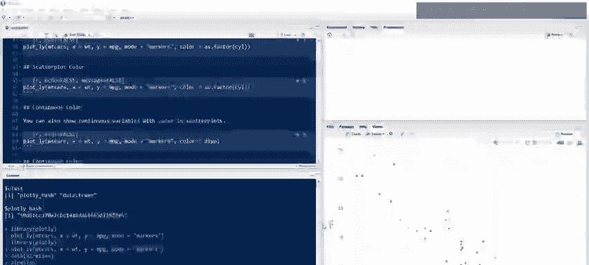

在本节课中，我们将学习如何使用Plotly创建和定制散点图。散点图是数据可视化中最常见的图表类型之一，Plotly提供了丰富的选项来增强其表现力。我们将涵盖如何通过颜色、大小和三维空间来展示更多数据维度，并最终生成可交互的网页图表。

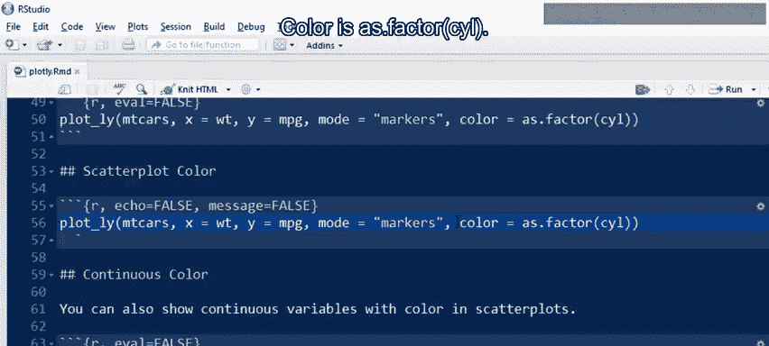

---

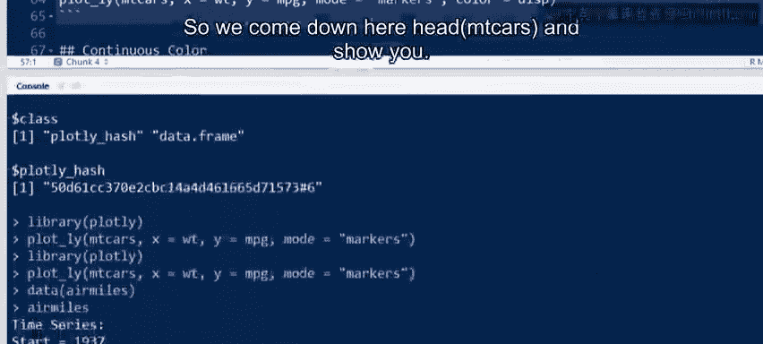

## 🎨 使用颜色区分数据点

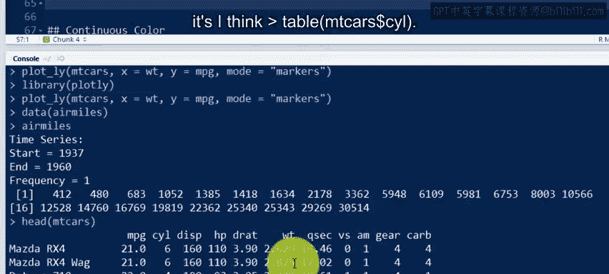

上一节我们介绍了基础散点图的创建。本节中，我们来看看如何通过改变数据点的颜色来展示额外的分类或连续变量。

在`mtcars`数据集中，`cyl`（气缸数）是一个分类变量，但默认是数值型。我们可以将其转换为因子变量，并用不同颜色表示。

以下是转换`cyl`为因子并着色的代码：

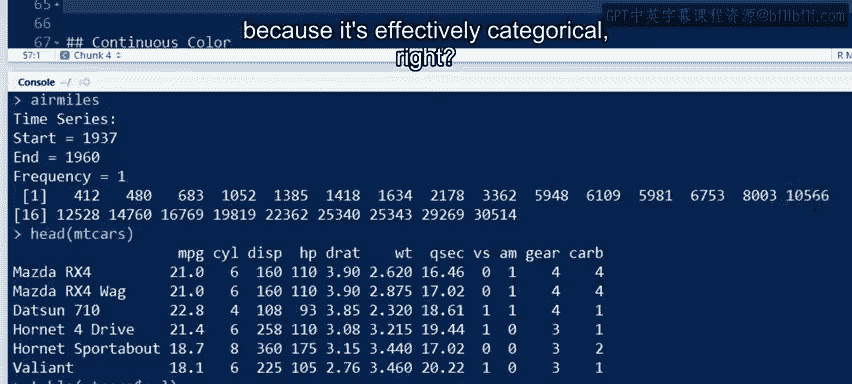

```r
plot_ly(data = mtcars, x = ~wt, y = ~mpg, color = ~as.factor(cyl), type = "scatter", mode = "markers")
```

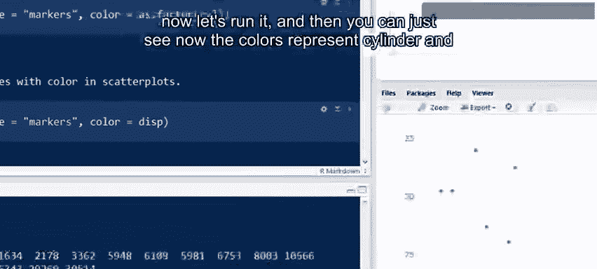

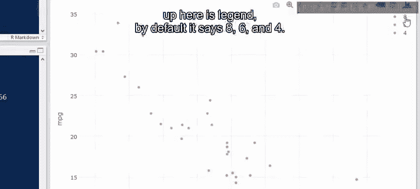

运行代码后，图表会使用不同颜色代表4缸、6缸和8缸的汽车，并自动生成图例。

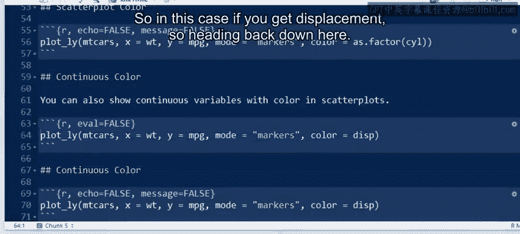

---

## 🌈 用连续变量着色

接下来，我们尝试用一个连续变量来定义颜色。`disp`（排量）是一个连续变量。

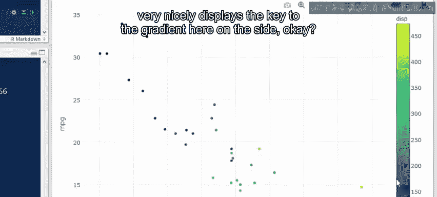

以下是使用连续变量`disp`着色的代码：

```r
plot_ly(data = mtcars, x = ~wt, y = ~mpg, color = ~disp, type = "scatter", mode = "markers")
```

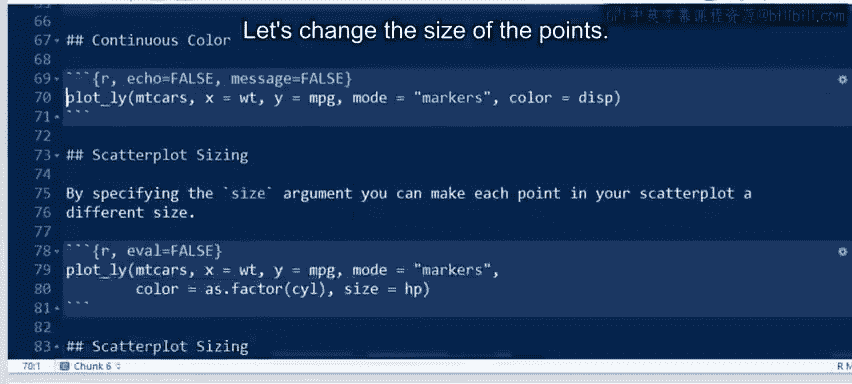

Plotly能够智能识别`disp`是连续变量，并自动应用连续的颜色渐变。图表右侧会显示对应的颜色梯度图例。

---

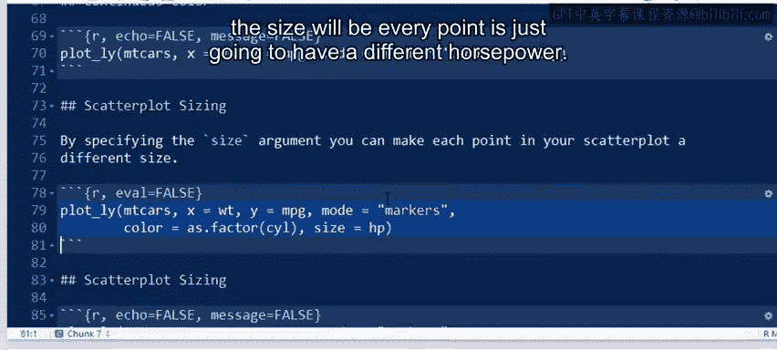

## 🔵 调整数据点大小

除了颜色，我们还可以通过调整数据点的大小来展示另一个维度。这有助于在二维散点图中呈现更多信息。

以下是使用`hp`（马力）这一连续变量来控制点的大小的代码：

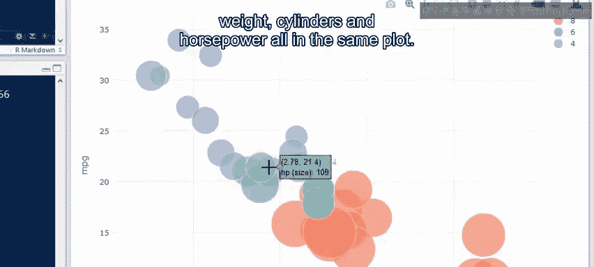

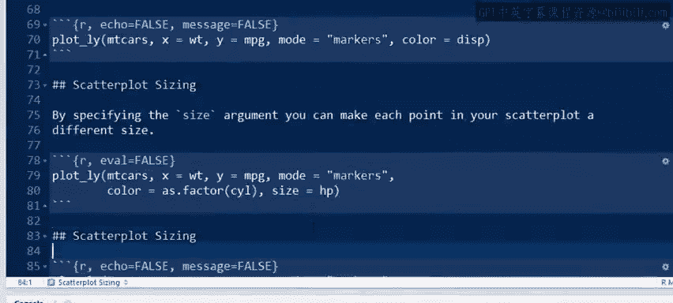

```r
plot_ly(data = mtcars, x = ~wt, y = ~mpg, color = ~as.factor(cyl), size = ~hp, type = "scatter", mode = "markers")
```

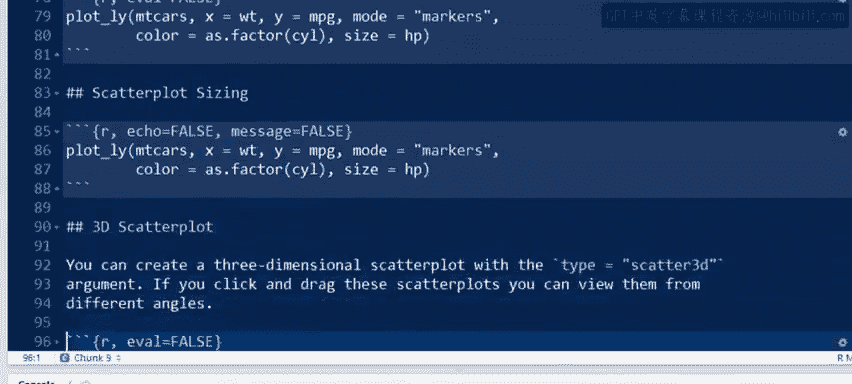

在这张图中，我们同时展示了四个维度：X轴的车重(`wt`)、Y轴的每加仑英里数(`mpg`)、用颜色表示的气缸数(`cyl`)以及用点大小表示的马力(`hp`)。

---

## 🧊 创建三维散点图

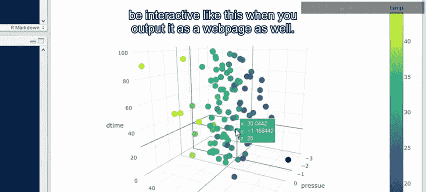

二维散点图的维度是有限的。为了展示更多变量，我们可以创建三维散点图。

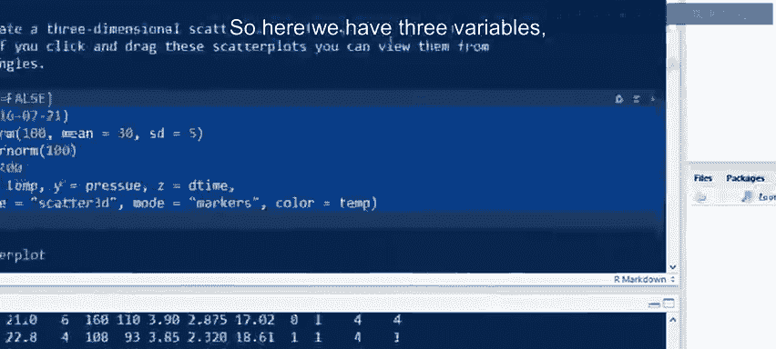

以下是创建一个虚构数据集并绘制三维散点图的步骤：

1.  首先，我们生成包含三个变量的数据：
    ```r
    temp <- rnorm(100, mean=30, sd=5)
    pressure <- rnorm(100, mean=100, sd=20)
    dtime <- 1:100
    ```
2.  然后，使用`plot_ly`并指定`type = "scatter3d"`来创建三维图表：
    ```r
    plot_ly(x = ~temp, y = ~pressure, z = ~dtime, type = "scatter3d", mode = "markers", color = ~temp)
    ```

这段代码会生成一个可交互的三维散点图。`x`、`y`、`z`参数分别对应三个坐标轴。我们再次使用`color`参数，为数据点根据`temp`变量添加了颜色渐变，图表侧面会显示对应的颜色图例。Plotly利用WebGL技术来实现网页中的交互式3D图形。

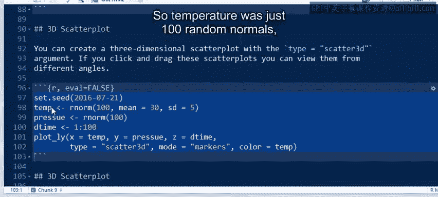

---

## 📝 课后练习

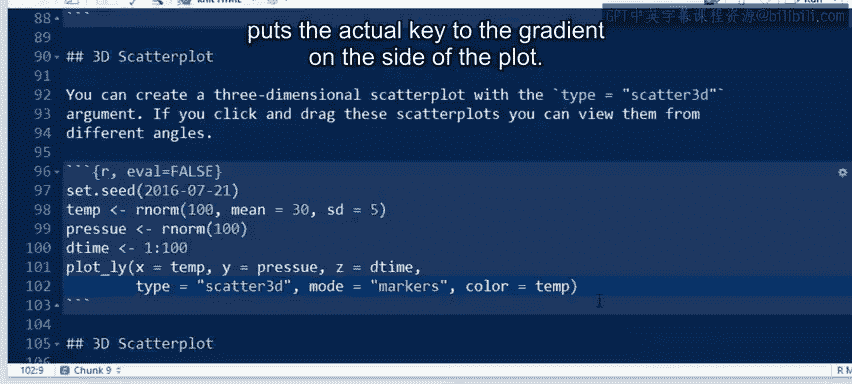

我们已经介绍了足够多的Plotly散点图功能，可以帮助你入门。

以下是本课的练习任务：

*   创建多种不同的二维散点图，尝试改变图表属性，例如使用颜色或不同大小的点来展示其他数据维度。
*   尝试创建一个三维散点图，并进行类似的定制。
*   将你的图表输出为HTML网页文件，以便在浏览器中查看其交互效果。
*   如果你愿意，可以尝试将图表发布到RPubs等平台，学习如何公开托管你的可视化作品。

尝试完成这些练习，下一节课我们将探索Plotly更多有趣的应用。

---

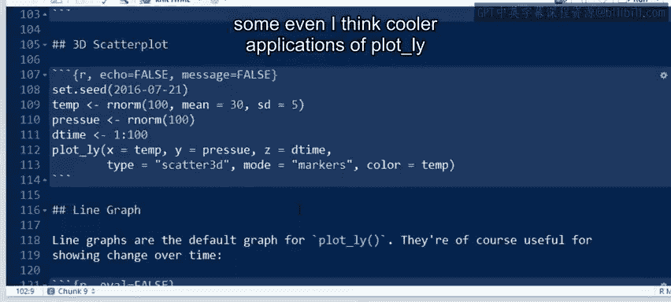

本节课中我们一起学习了如何用Plotly创建功能丰富的散点图。我们掌握了用颜色区分分类或连续变量、用大小表示数据强度以及构建交互式三维散点图的方法。这些技巧能帮助我们在有限的平面内有效展示多维数据，并生成可用于网页分享的动态图表。