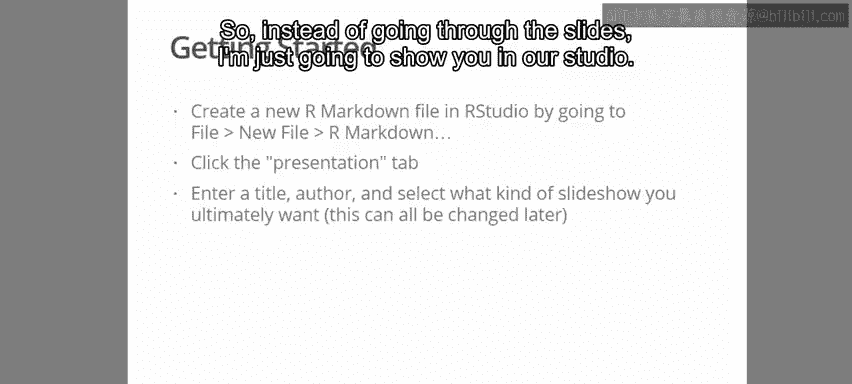
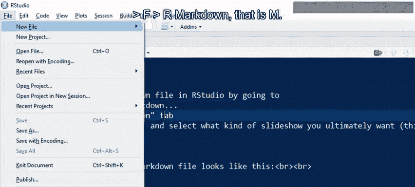
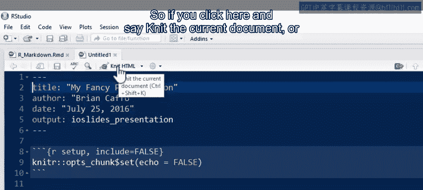
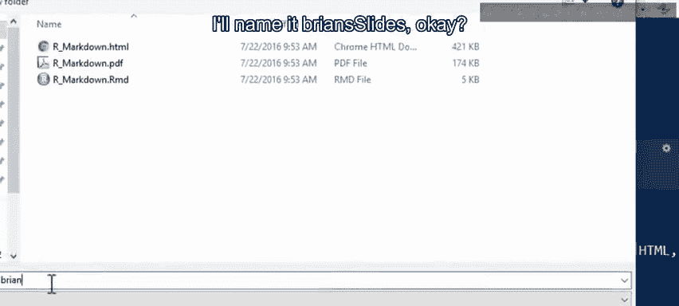
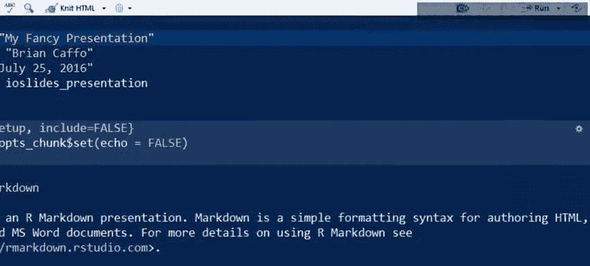
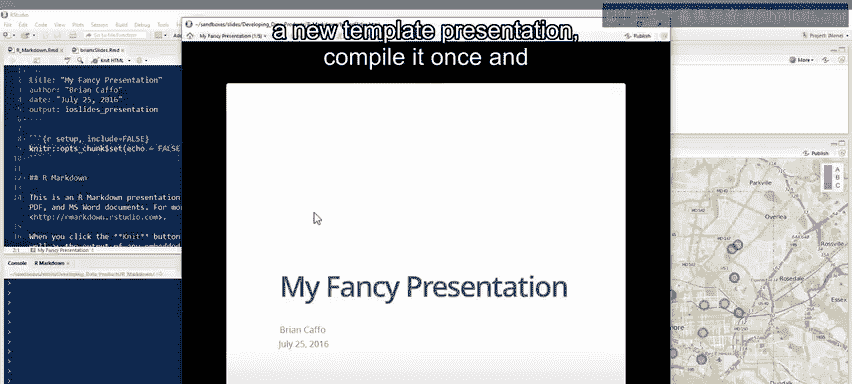

# 课程9：《开发数据产品》｜P27：R Markdown 基础演示 1️⃣

## 📋 概述

在本节课中，我们将学习如何使用R Markdown创建一个简单的演示文稿。我们将从创建一个新的R Markdown文件开始，选择演示文稿格式，并最终编译生成一个HTML幻灯片。整个过程将帮助你熟悉R Markdown创建演示文稿的基本工作流程。

## 🚀 创建新演示文稿

上一节我们介绍了R Markdown的基本概念，本节中我们来看看如何实际操作，创建一个新的演示文稿。

首先，在RStudio中创建一个新的R Markdown文件。以下是具体步骤：

1.  点击菜单栏的 **File**。
2.  选择 **New File**。
3.  点击 **R Markdown...**。

你也可以使用快捷键 `Alt + F`，然后按 `N`，再按 `R` 来快速创建。

## ⚙️ 配置演示文稿选项

创建新文件后，会弹出一个配置对话框。以下是需要填写的选项：

*   **Title**: 输入演示文稿的标题，例如 `my.Fancy.Presentation`。
*   **Author**: 输入作者姓名。
*   **Default Output Format**: 选择输出格式。这里提供了多种演示文稿样式。

对于输出格式，我们暂时选择默认的 **ioslides_presentation**。这是一种源自Google演示文稿的幻灯片格式。如果你想输出PDF，需要在系统上安装LaTeX环境（如Windows的MikTeX，macOS的MacTeX，Linux的TeX Live），这将在后续课程中介绍。

## 🧶 编译演示文稿

配置完成后，点击 **OK**。RStudio会生成一个包含默认模板的R Markdown文件，其临时名称可能是 `Untitled1`。

现在，我们可以首次编译这个文件，看看生成的演示文稿是什么样子。以下是编译方法：

1.  点击编辑器上方的 **Knit** 按钮。
2.  选择 **Knit to HTML**。

你也可以使用快捷键 `Ctrl + Shift + K`（Windows/Linux）或 `Cmd + Shift + K`（macOS）。

首次编译时，系统会提示你保存这个R Markdown源文件。我们可以将其命名为 `Brians.Slides.Rmd`。

保存后，R Markdown引擎会开始运行，处理文件中的代码和文本，并最终在预览窗口生成一个名为 `my fancy presentation` 的HTML幻灯片。

## 📝 第一个练习

至此，你已经完成了创建和编译一个基础演示文稿的所有步骤。你的第一个练习就是重复这个过程：

1.  创建一个新的演示文稿模板。
2.  使用默认设置编译一次。

完成这个练习后，我们就可以继续学习如何为演示文稿添加具体内容了。

## ✅ 总结

本节课中我们一起学习了R Markdown创建演示文稿的入门操作。我们掌握了从 **File -> New File -> R Markdown** 创建新文件，到配置标题、作者和输出格式，最后通过 **Knit** 按钮或快捷键编译生成HTML幻灯片的全过程。这为后续填充和定制演示文稿内容打下了基础。