# 课程9：《开发数据产品》｜P29：R Markdown基础格式 🖋️

在本节课中，我们将学习R Markdown文档中的基础文本格式化选项。我们将了解如何将普通文本转换为斜体、粗体，以及如何插入代码块，并掌握其对应的语法规则。

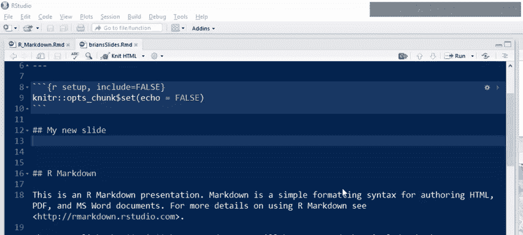

上一节我们介绍了R Markdown的基本环境，本节中我们来看看如何对文本进行简单的格式化。

## 文本格式化演示

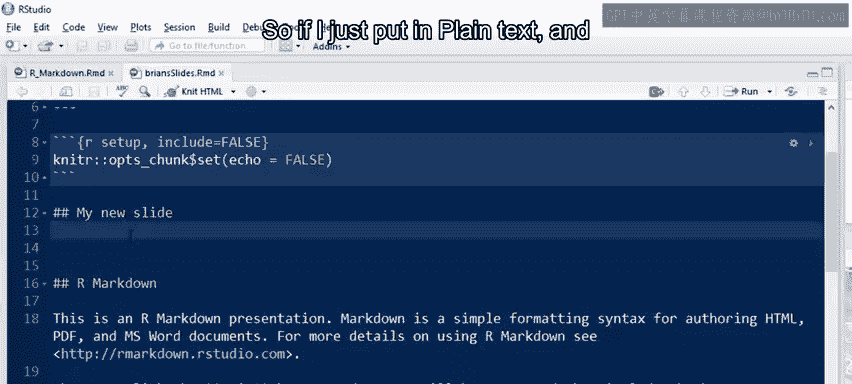

首先，我们输入一些纯文本。

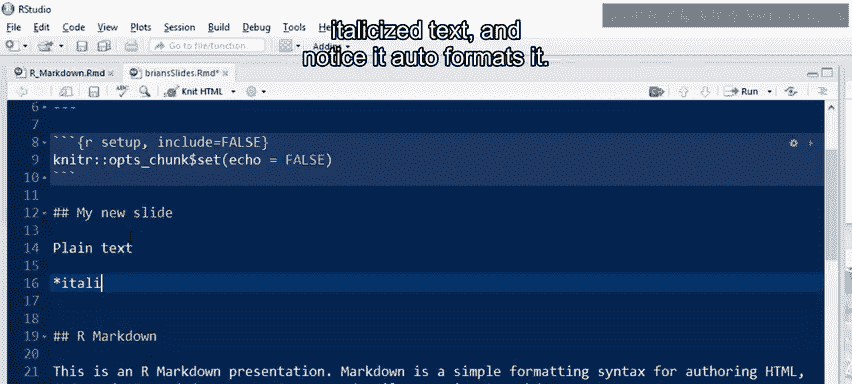

接下来，我们将其转换为斜体文本。

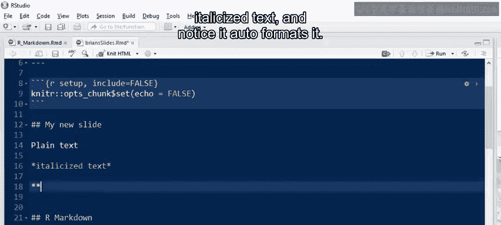

请注意，编辑器会自动对其进行格式化渲染。

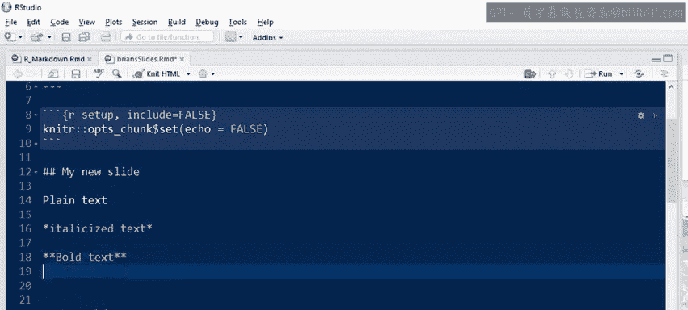

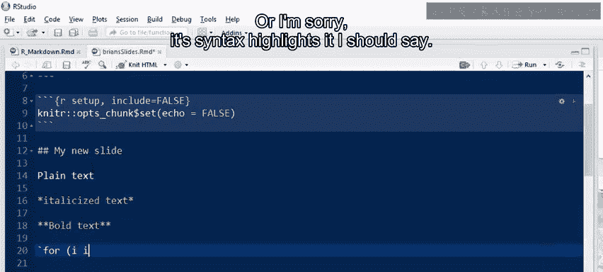

然后，我们将其转换为粗体文本。或者更准确地说，是语法高亮显示。

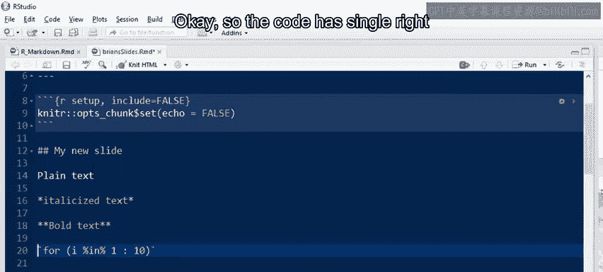

## 语法规则总结

以下是各种格式对应的Markdown语法：

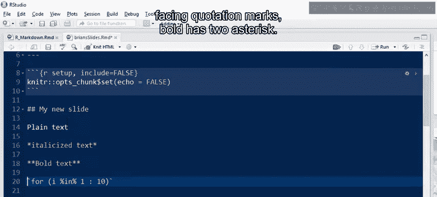

*   **代码**：使用单个反引号包裹文本。公式为：\`代码\`
*   **粗体**：使用两个星号包裹文本。公式为：\*\*粗体\*\*
*   **斜体**：使用一个星号包裹文本。公式为：\*斜体\*
*   **纯文本**：无需任何特殊符号。

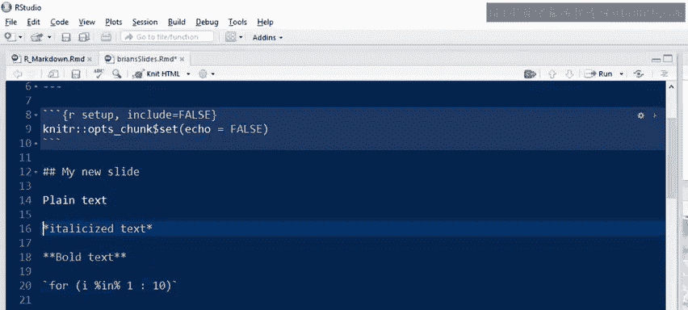

## 重要注意事项

星号必须紧挨着起始字符。如果像下面这样留有空格，有时会无法正确渲染。

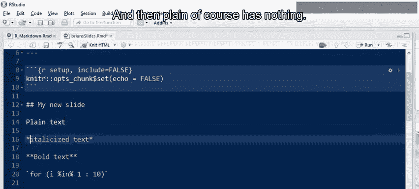

因此，请确保星号紧邻需要格式化的文本。

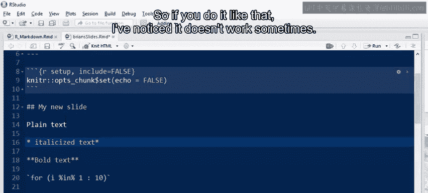

最后，让我们运行这个代码块来查看渲染效果。

本节课中我们一起学习了R Markdown中基础的文本格式化语法，包括创建斜体、粗体文本和行内代码，并了解了正确书写格式的关键要点。