# 约翰霍普金斯大学数据科学课程9：《开发数据产品》｜P30：R Markdown基础（第一部分）📝

在本节课中，我们将学习如何在R Markdown文档中嵌入和运行R代码，并探索控制代码输出显示的`knitr`选项。通过调整这些选项，你可以灵活地控制报告中代码和结果的呈现方式。

---

上一节我们介绍了R Markdown的基本结构，本节中我们来看看如何在文档中嵌入R代码块。

首先，我们创建一个R代码块。在R Markdown中，使用三个反引号（```）来开始一个代码块，并在花括号中指定语言为`r`。

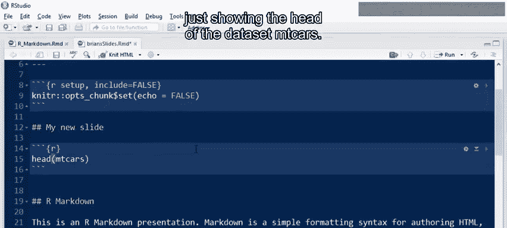

```r
head(cars)
```

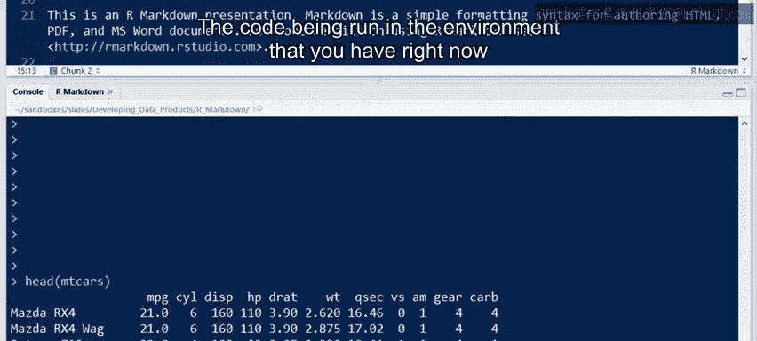

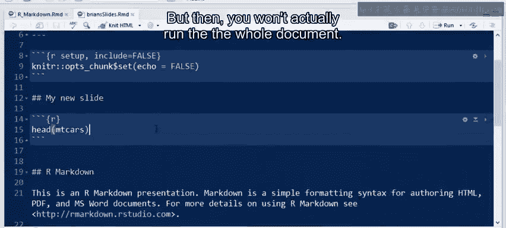

请注意，RStudio会进行语法高亮，以明确指示你正处于R代码环境中。你可以直接在RStudio中运行这个代码块，结果会显示在交互式控制台或文档输出中。

---

上一节我们演示了如何运行代码，本节中我们来看看如何编译整个文档。

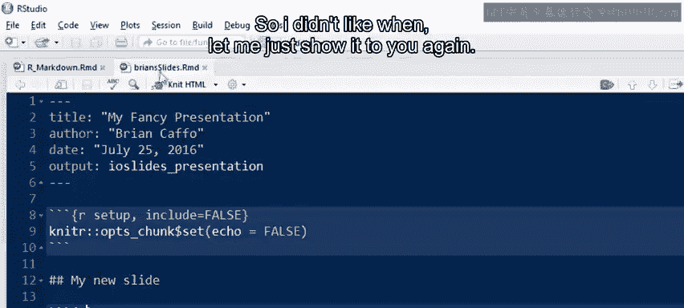

要编译整个R Markdown文档并生成最终报告，你可以使用快捷键 `Ctrl + Shift + K`（在Windows/Linux上）或 `Cmd + Shift + K`（在Mac上）。编译后，你将看到包含代码输出的新幻灯片或文档。

---

上一节我们生成了包含输出的文档，本节中我们来看看如何通过`knitr`选项自定义输出。

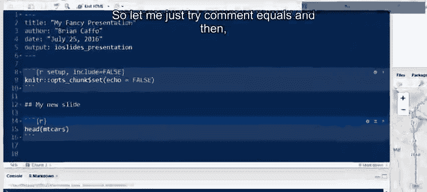

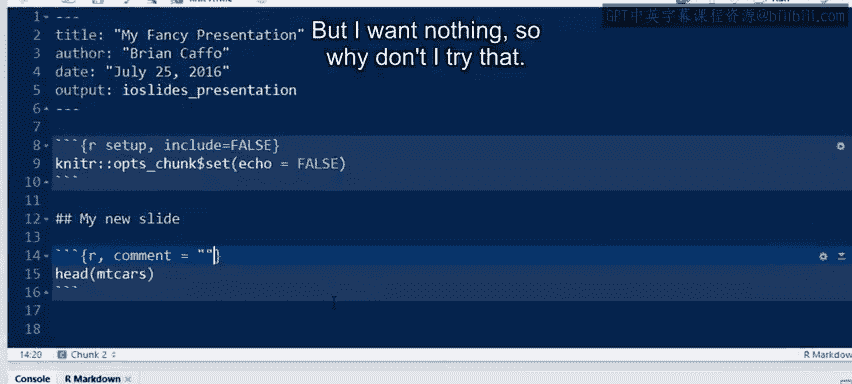

我删除了其他幻灯片，以便专注于这个简单的代码示例。在初始输出中，我不喜欢输出结果前面的注释符号（`##`）。

为了移除这些注释符号，你可以在代码块的开头设置`comment`选项。将其值设置为空字符串即可。

```r
# 设置 knitr 选项，移除输出前的注释符号
knitr::opts_chunk$set(comment = '')
```

设置后重新编译文档，输出结果将不再显示`##`符号，看起来更加整洁。

---

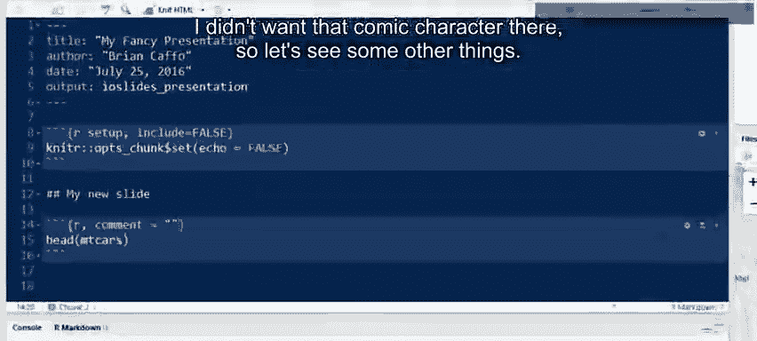

上一节我们移除了注释符号，本节中我们来看看其他有用的`knitr`选项。

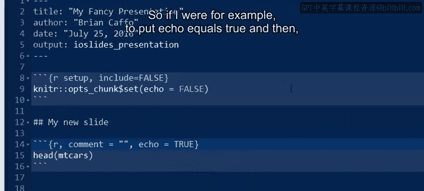

默认情况下，从某些模板创建的R Markdown文档可能设置了`echo = FALSE`选项。这意味着最终输出中**只显示代码运行的结果，而不显示代码本身**。

你可以在代码块的开头手动设置`echo = TRUE`来覆盖这个默认行为，从而让代码和输出都显示出来。

```r
# 设置 knitr 选项，同时显示代码和输出
knitr::opts_chunk$set(echo = TRUE)
```

实际上，`echo = TRUE`是`knitr`的默认选项。除非你在文档开头或特定代码块中覆盖它，否则代码会自动显示。

---

上一节我们控制了代码的显示，本节中我们来看看如何控制代码的执行。

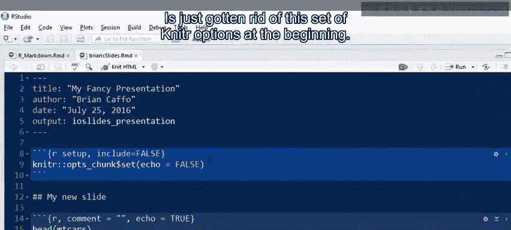

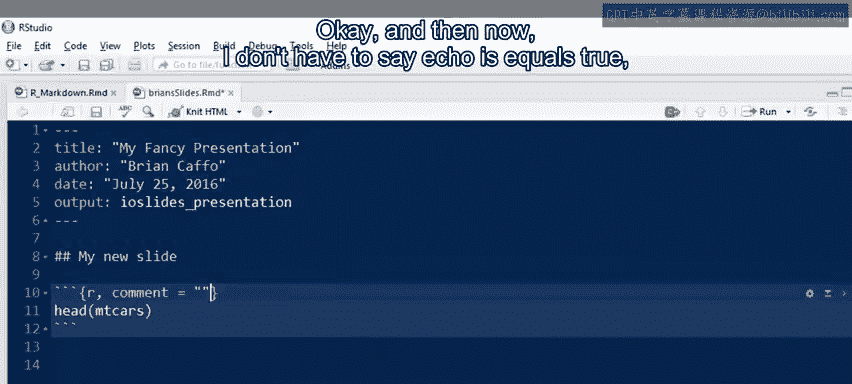

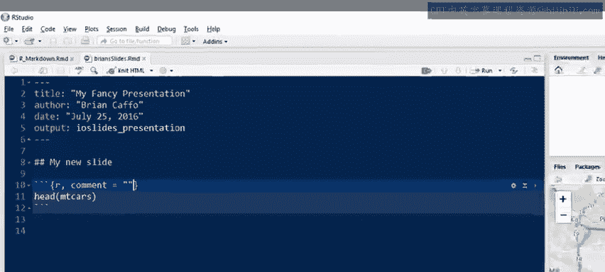

有时，你可能希望只展示代码而不实际运行它。这可以通过设置`eval = FALSE`选项来实现。

```r
# 设置 knitr 选项，只显示代码但不执行
knitr::opts_chunk$set(eval = FALSE)
```

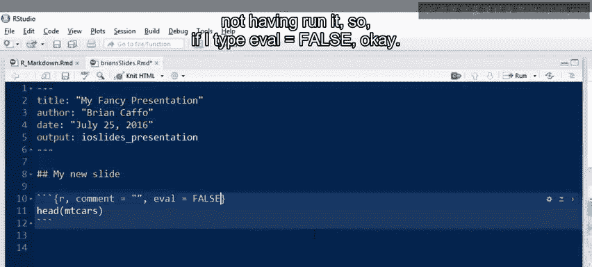

设置此选项后，代码块会被渲染出来，但不会被执行，因此不会有输出结果。

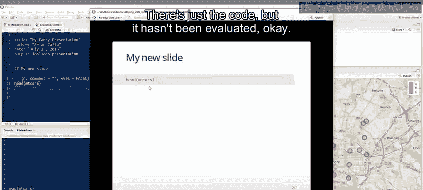

---

以下是本节介绍的核心`knitr`选项总结：
*   **`comment`**： 用于设置输出结果前的注释字符。公式为 `comment = ‘字符’`，例如 `comment = ”` 表示无注释符。
*   **`echo`**： 控制是否在输出中显示R代码。`echo = TRUE`（默认）表示显示，`echo = FALSE`表示隐藏。
*   **`eval`**： 控制是否执行代码块中的R代码。`eval = TRUE`（默认）表示执行，`eval = FALSE`表示仅显示代码而不执行。

你可以通过在代码块的花括号内使用逗号分隔来同时设置多个选项，例如 `{r, echo=TRUE, eval=FALSE}`。RStudio的自动补全功能可以帮助你查看所有可用的选项，其中许多选项用于控制图形输出，我们将在后续课程中介绍。

---

本节课中我们一起学习了在R Markdown中嵌入R代码的基础知识。我们掌握了如何创建代码块、编译文档，并重点探索了三个关键的`knitr`选项（`comment`， `echo`， `eval`）来定制代码和输出的显示方式。

建议你尝试创建一个包含以下内容的R Markdown文档进行练习：
1.  一个不执行的R代码块。
2.  一个执行并显示结果的R代码块。
3.  尝试设置不同的`comment`字符。
4.  随意调整其他`knitr`选项以熟悉其效果。

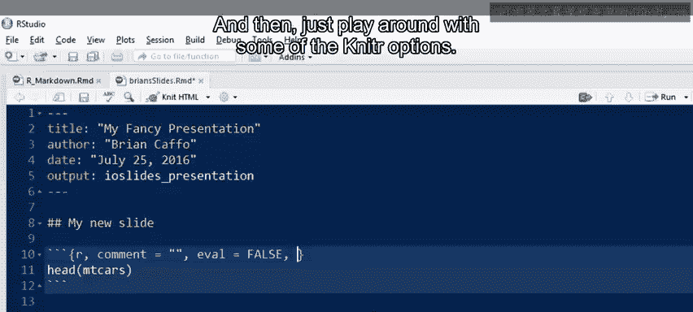

下一节，我们将继续学习如何在R Markdown中插入和自定义图形。