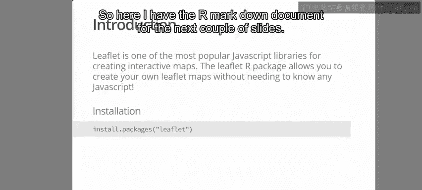
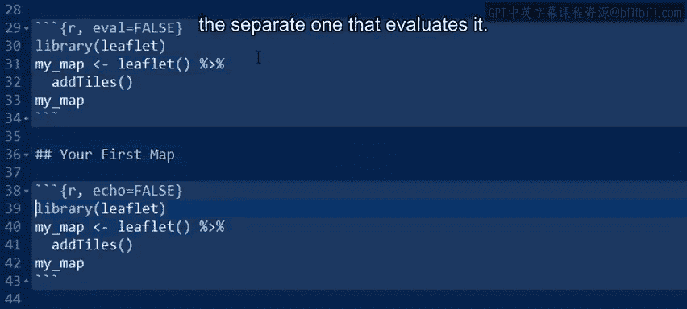
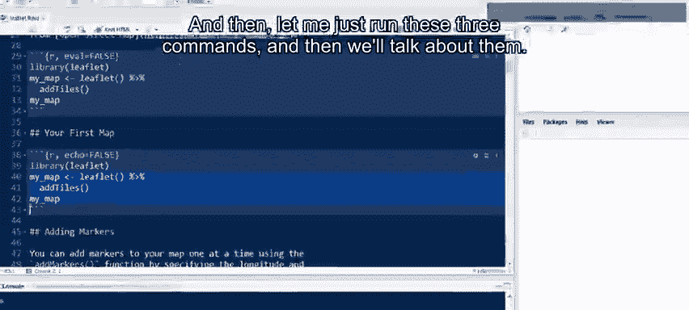
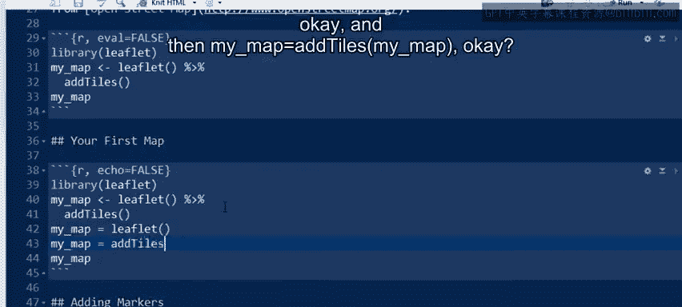
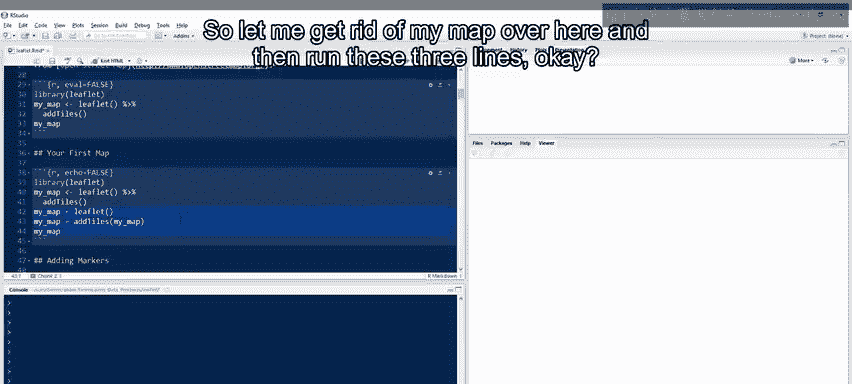
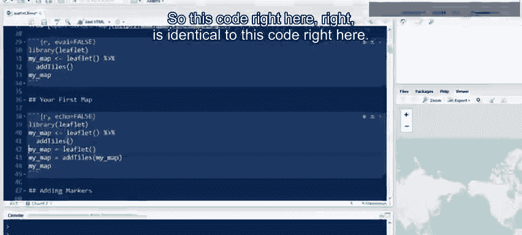
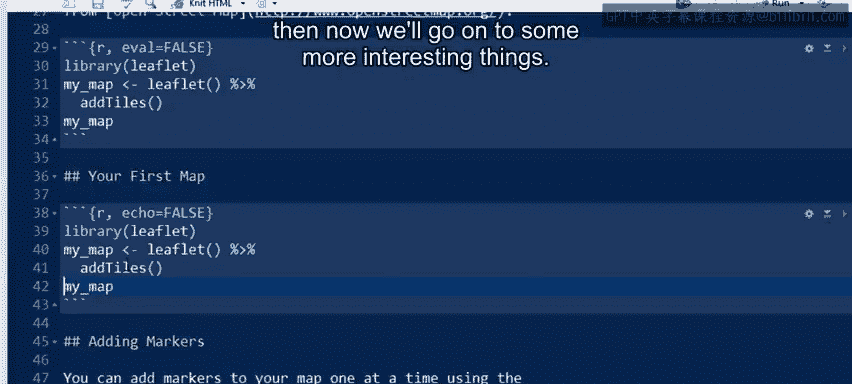

# 课程9：《开发数据产品》｜第32讲：使用Leaflet创建交互式地图 🗺️

在本节课中，我们将学习如何使用R语言中的`leaflet`包来创建交互式地图。这是开发数据产品的一个重要方面，因为它允许我们以动态和可视化的方式展示地理空间数据。

## 概述

`leaflet`是一个基于JavaScript的库，而R中的`leaflet`包则利用这个JavaScript库，使我们能够在R环境中直接创建交互式地图。在RStudio中使用尤其方便，因为地图可以直接显示在RStudio的查看器窗格中。

我们将通过几个简单的例子来入门，掌握创建基础地图所需的最少知识。掌握了这些基础后，你将能够快速扩展其功能。

需要说明的是，创建交互式地图还有其他方法，例如`googleVis`。`leaflet`因其在R社区中被广泛接受和使用而值得单独介绍。在关于`googleVis`的课程中，我们也会讨论如何直接调用Google Maps API来创建地图。`leaflet`和`googleVis`可能是目前最流行的两种方式。

## 第一步：安装与基础地图

首先，你需要确保已经安装了`leaflet`包。安装命令如下：

```r
install.packages("leaflet")
```



安装完成后，让我们通过一个代码示例来创建你的第一张`leaflet`地图。

以下是创建一张基础世界地图的代码：



```r
library(leaflet)



m <- leaflet() %>%
  addTiles()
m
```

运行这段代码后，你将在RStudio的查看器窗格中看到一张交互式世界地图。你可以使用鼠标进行缩放和平移操作。

## 理解代码：管道操作符

上一节我们运行了创建地图的代码，本节中我们来仔细看看这段代码的结构，特别是其中使用的管道操作符 `%>%`。



上面简洁的代码与下面这段更传统的代码完全等效：

```r
library(leaflet)





m <- leaflet()
m <- addTiles(m)
m
```

管道操作符 `%>%` 的作用是：将左侧命令的输出结果，作为右侧命令的第一个参数传递进去，并重新赋值给变量。这种写法使代码更清晰、更易读，尤其是在进行一系列链式操作时。

在这段代码中：
1.  `leaflet()` 函数初始化了一个地图对象。
2.  `addTiles()` 函数为这个地图对象添加了底图图层（默认是OpenStreetMap）。

现在，你已经成功创建并显示了一张基础地图。接下来，我们将学习如何在地图上添加更有用的元素，例如标记点。

## 总结

本节课中我们一起学习了：
1.  **安装与加载**：如何安装并加载R的`leaflet`包。
2.  **创建基础地图**：使用 `leaflet() %>% addTiles()` 来生成一张可交互的世界地图。
3.  **理解管道操作**：认识了 `%>%` 管道操作符，它能让代码的链式调用更加简洁流畅。



你已迈出了使用`leaflet`创建交互式地图的第一步。请确保你能成功运行示例代码并进行缩放操作。在接下来的课程中，我们将探索如何添加标记、多边形、弹出窗口等更丰富的内容来制作真正有用的数据产品。