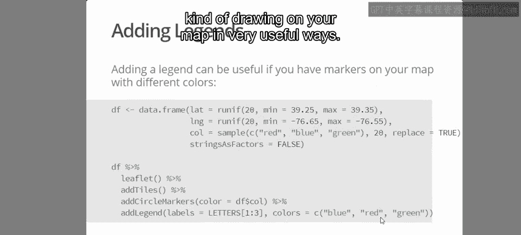
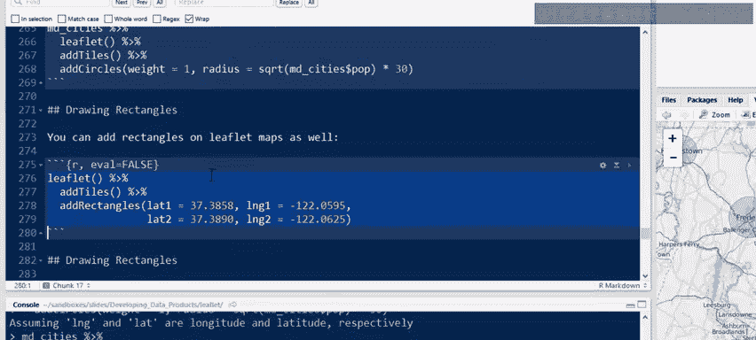

# 课程9：《开发数据产品》｜第37讲：在Leaflet地图上绘制图形与添加图例 🗺️

在本节课中，我们将学习如何在Leaflet地图上手动绘制图形，例如圆形和矩形，以及如何为地图添加图例。这些功能对于在地图上进行数据标注和可视化至关重要。

---



上一节我们介绍了Leaflet的基础地图功能。本节中，我们来看看如何在地图上绘制自定义图形。

首先，我们将展示如何绘制圆形。以下是一个实际应用场景的示例：我们有一个包含多个城市信息的数据集，包括城市名称、人口以及经纬度坐标。我们希望根据城市的人口规模，在地图上用不同大小的圆形来直观表示。

以下是实现此功能的核心代码：

```r
leaflet(cities) %>%
  addTiles() %>%
  addCircles(weight = 1, radius = ~sqrt(pop) * 30)
```

在这段代码中：
*   `addCircles` 函数用于添加圆形。
*   `weight` 参数控制圆形轮廓线的粗细。
*   `radius` 参数定义了圆形的半径。我们通过公式 `~sqrt(pop) * 30` 将半径与人口数据的平方根相关联，这样人口越多的城市，其代表的圆形就越大。

为了理解 `weight` 参数的作用，可以尝试将其值调大（例如设为10或100），观察圆形轮廓线的变化。通过极端值的测试，可以更清晰地理解每个参数的功能。

---

接下来，我们学习如何绘制矩形。绘制矩形比圆形更简单，因为只需要提供两个对角的坐标点即可。

以下是绘制一个矩形的示例代码：



```r
leaflet() %>%
  addTiles() %>%
  addRectangles(lng1 = -76.61, lat1 = 39.28,
                lng2 = -76.59, lat2 = 39.29)
```

运行这段代码，地图上就会出现一个覆盖指定经纬度范围的矩形区域。

---

最后，也是非常重要的一步，是为地图添加图例。当我们使用不同颜色的图形（如圆点）来表示不同类别的数据时，图例能帮助用户理解每种颜色的含义。

假设我们有一个包含20个随机点及其对应颜色（红、蓝、绿）的数据框。我们首先根据颜色绘制这些点：

```r
leaflet(df) %>%
  addTiles() %>%
  addCircleMarkers(color = ~clr)
```

然后，我们使用 `addLegend` 函数来添加图例：

```r
addLegend(labels = LETTERS[1:3], colors = c("blue", "red", "green"))
```

在这段代码中：
*   `labels` 参数是图例的文字标签。示例中使用了 `LETTERS[1:3]` 生成 A、B、C，在实际应用中，应替换为有实际意义的标签，例如“民主党”、“共和党”、“其他”。
*   `colors` 参数指定了图例中每种标签对应的颜色，需要与绘制图形时使用的颜色一致。

添加图例后，地图的角落会显示一个说明框，清晰地标明每种颜色代表的数据类别。

---

本节课中我们一起学习了在Leaflet地图上进行高级标注的方法。我们掌握了如何根据数据（如人口）绘制比例大小的圆形，如何绘制矩形区域，以及如何添加图例来解释可视化元素的含义。Leaflet是R语言中非常强大且易用的交互式绘图工具，结合Shiny可以创建出令人惊叹的数据应用，值得投入时间深入学习。