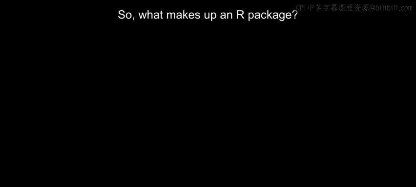
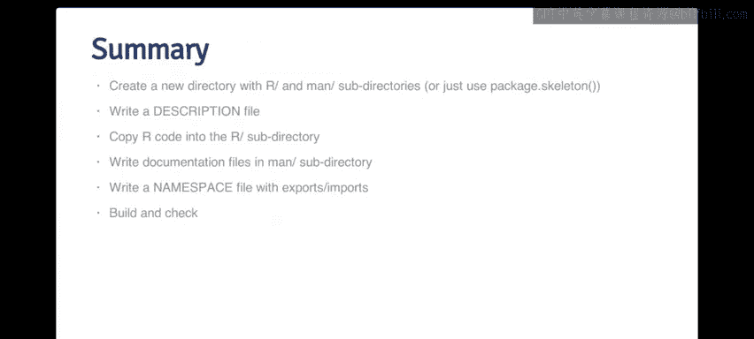

# 📦 课程9：《开发数据产品》｜R包开发（第二部分）



在本节课中，我们将深入探讨R包的核心组成部分。我们将学习如何构建一个结构完整的R包，包括描述文件、命名空间文件、代码和文档的编写，以及最终的构建与检查流程。

---

## 🗂️ R包的构成要素

一个R包由一些必需元素和若干可选元素构成。创建R包的第一步是在文件系统中创建一个目录。通常，目录的名称应与包的名称保持一致。例如，如果你的包名为`mypackage`，那么目录也应命名为`mypackage`。这是R包开发中普遍遵循的约定。

以下是构成R包的主要部分：
*   **描述文件**：包含包的元数据信息。
*   **R代码**：存放在`R`子目录下的函数和代码。
*   **文档**：通常存放在`man`子目录下，用于说明代码功能。
*   **命名空间文件**：可选但强烈推荐，用于定义包的公开接口和依赖关系。

如果你想了解所有完整要求，可以参考R官方网站上的《Writing R Extensions》文档。

---

## 📄 描述文件详解

在创建目录后，你需要添加一个描述文件。这个文件包含了关于包的基本信息。

以下是描述文件中必须包含的字段：
*   **包名**：包的名称。
*   **标题**：比名称更详细一些的简短描述。
*   **描述**：更长的描述，可以是一两句话。
*   **版本号**：通常采用“主版本号.次版本号-修订号”的格式。
*   **作者**：编写原始代码的人。
*   **维护者**：非常重要，这是负责维护包的人员及其邮箱地址。
*   **许可证**：描述源代码的发布条款，常见的有GPL、BSD、MIT等开源许可证。

除了必需字段，描述文件还可以包含一些常用但可选的字段：
*   **依赖项**：列出你的包所依赖的其他R包。
*   **建议项**：列出用户可能需要但不是运行代码所必需的R包。
*   **发布日期**：包的发布日期。
*   **主页**：包的网址，例如GitHub仓库的链接。

你可以添加其他字段供自己使用，但R通常会忽略它们。

### 描述文件示例

以下是`gpclib`包的描述文件示例：
```
Package: gpclib
Title: General Polygon Clipping Library for R
Description: General polygon clipping routines for R based on the C library by Alan Murta.
Version: 1.5-5
Author: Roger Bivand
Maintainer: Roger Bivand <Roger.Bivand@nhh.no>
License: file LICENSE
Depends: R (>= 2.14), methods
Imports: graphics
Date: 2013-04-01
URL: http://www.cs.man.ac.uk/~toby/alan/software/, https://github.com/...
```

---

## 📁 R代码与命名空间

上一节我们介绍了描述文件，本节中我们来看看如何组织代码并定义包的接口。

### R代码子目录

通常，下一步是将你的R代码复制到`R`子目录中。这个目录下可以有任意数量的文件，你不必将所有代码放在一个文件里，也不必一个函数一个文件。你可以按逻辑组织代码，例如将所有读取数据的函数放在一个文件，将所有拟合模型的函数放在另一个文件。所有你想通过包公开的代码都应放在这里，不要将R代码放在包的其他部分。

### 命名空间文件

命名空间文件非常有用，它本质上定义了你的函数接口，并列出包的所有依赖项。

它主要处理两类内容：
1.  **导出**：指明包中哪些函数是公开的，可供用户直接调用。未列出的函数是内部函数，用户通常无法直接调用，这有助于向用户隐藏实现细节，保持接口整洁。
2.  **导入**：从其他包导入函数。这允许你的包使用其他包的功能，而无需将这些包加载到用户的搜索路径中。导入函数会加载包的命名空间，但不会将其附加到搜索列表。

命名空间文件的关键指令包括：
*   `export()`：用于导出函数。
*   `import()`：用于导入整个包。
*   `importFrom()`：用于从特定包导入特定函数。
*   如果使用S4类和方法，`exportClasses`和`exportMethods`指令也很重要。

需要注意的是，这些指令看起来像R函数，但并不完全是。

#### 命名空间文件示例

以下是`mvtsplot`包的简单命名空间文件示例，它只导出了一个函数：
```r
export(mvtsplot)
importFrom(graphics, axis)
import(splines)
```

`gpclib`包的命名空间文件则稍复杂一些：
```r
export(read.polyfile, write.polyfile)
importFrom(graphics, plot)
exportClasses(gpc.poly, gpc.poly.nohole)
exportMethods(show, get.bbox, ...)
```

---

## 📖 编写文档

在准备好描述文件、R代码和命名空间文件后，接下来需要处理文档。文档非常重要，它能帮助用户理解如何使用你的函数。

文档文件通常以`.Rd`为扩展名，存放在包的`man`子目录下，使用特定的标记语言编写。**每一个导出的函数都必须有一个对应的文档文件**。这同时也提醒我们，应限制导出的函数数量，因为每个导出函数都需要编写文档。对于未导出的内部函数，则不需要编写用户文档。

除了函数，你还可以为数据集、基本概念或整个包编写概述文档。

### 文档文件结构

以下是一个简单的帮助文件示例（来自`line`函数）：
```
\name{line}
\alias{line}
\alias{residuals.2kline}
\title{Robust Line Fitting}
\description{
  A slightly longer description of the robust line fitting function.
}
\usage{
  line(x, y)
}
\arguments{
  \item{x, y}{Arguments can be any way of specifying x-y pairs.}
}
\details{
  Additional details and notes about the function.
}
\value{
  Returns an object of class \code{2kline}.
}
\references{
  Reference to a book or paper for further reading.
}
```

文档通常包含以下部分：
*   **名称与别名**：函数名和其他能调用此帮助页面的别名。
*   **标题与描述**：简要和详细的功能说明。
*   **用法**：展示函数如何调用及其参数。
*   **参数**：详细描述每个参数。
*   **细节**：关于函数各方面的更深入说明。
*   **返回值**：描述函数返回的对象。绘图函数可能没有有用的返回值，其主要作用是产生图形副作用。
*   **参考文献**：如果实现了某种统计方法，可以列出相关的论文或书籍供用户深入阅读。

---

## 🔨 构建与检查包

当你拥有了R代码、帮助文件、描述文件和命名空间文件后，就可以开始构建包了。

R附带了一个命令行工具`R CMD build`，它可以创建包归档文件（通常以`.tar.gz`为扩展名）。构建完成后，你可以使用`R CMD check`命令对包运行一系列测试，以确保包结构内部一致。例如，它会检查是否缺少文档、导出和导入声明是否恰当等。

你可以在终端中使用命令行运行这些工具，也可以在R内部使用`system()`函数来运行。

`R CMD check`会运行一整套测试，主要包括：
*   检查文档是否存在，每个导出函数是否都有文档。
*   检查代码是否能被加载。
*   检查编码风格和常见编码问题。
*   如果你的文档中包含示例，它会运行这些示例以确保它们能正确执行。
*   检查文档中的参数列表是否与代码中的函数参数匹配。

**特别重要的是**，如果你想将包提交到CRAN，它必须通过`R CMD check`的所有测试，不能有任何警告或错误。

---

## 🚀 快速入门与总结

如果你想快速开始，一个方便的函数是`package.skeleton()`。这个函数会创建一个包骨架目录结构。如果你将一个函数名作为参数传递给它，它会创建目录、`R`和`man`子目录，生成一个待填写的描述文件草稿、一个命名空间文件，并将你工作空间中所有可见函数的文档存根写入`man`目录。之后，你只需要编辑这些文件以满足你的需求即可。

### 创建R包的基本清单

以下是创建R包的基本步骤清单：
1.  创建一个新目录（或使用`package.skeleton`）。
2.  创建`R`和`man`子目录。
3.  编写描述文件。
4.  将R代码放入`R`子目录。
5.  将文档文件写入`man`子目录。
6.  创建命名空间文件，定义导出和导入项。
7.  构建包（`R CMD build`）并检查包（`R CMD check`），确保通过所有测试。

---

### 课程总结



在本节课中，我们一起学习了R包开发的核心流程。R包是系统化地与他人分享R代码的标准方式。这种标准化非常重要，它确保了包至少包含最低限度的文档，并具有一定的健壮性。我们通常从CRAN、Bioconductor、GitHub等代码仓库获取R包。通过遵循描述文件、代码组织、命名空间定义、文档编写以及构建检查这一完整模板，你可以创建出结构清晰、易于分享的R包。