# 课程9：《开发数据产品》｜P3：创建你的第一个Shiny应用 🚀

在本节课中，我们将学习如何创建你的第一个Shiny应用。我们将从设置开发环境开始，逐步构建一个包含用户界面和服务器逻辑的基础应用，并了解如何运行和查看它。

---

## 创建第一个应用

你需要一个相对较新版本的RStudio。开始创建应用最简单的方式是：点击 **File** -> **New File** -> **Shiny Web App**。

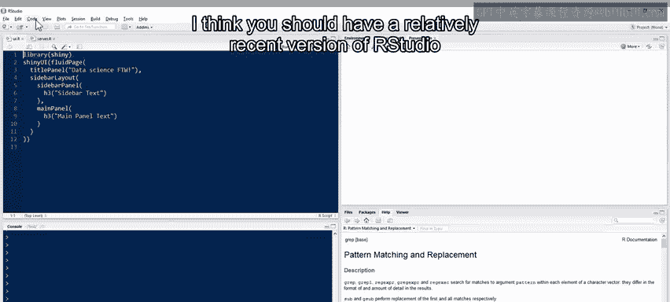

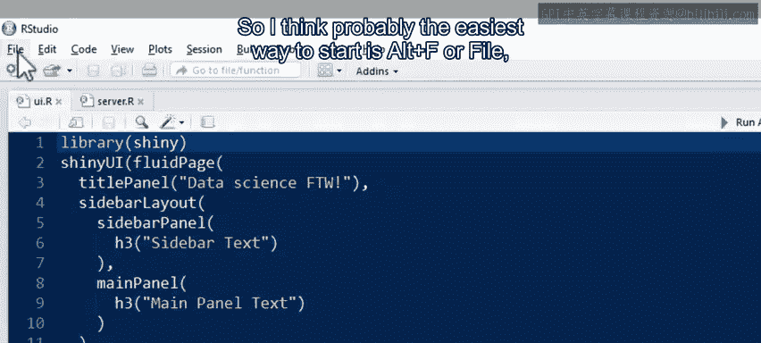

点击后会弹出一个对话框，你可以为应用命名，例如 `my_app`。接着，你可以选择将文件组织在单个文件中，或者分为两个文件：`ui.R` 和 `server.R`。我们讨论过并将继续讨论后一种方式。

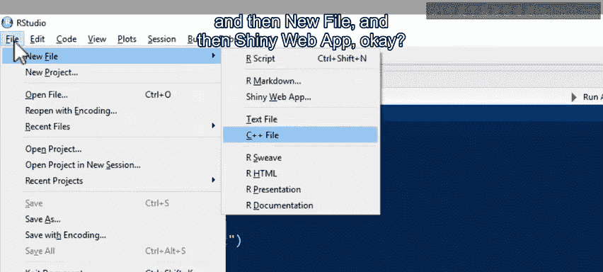

我推荐使用两个文件的方式，因为我个人倾向于使用多个小文件，而不是一个包含大量函数的大文件。但请注意，Shiny真正需要的是`ui.R`和`server.R`文件中**特定命名的函数**，而不是文件本身。稍后你将看到这些函数。

我不会在这里创建新应用，因为我已经提前准备好了。当你创建时，它会生成一个目录以及两个文件：`ui.R` 和 `server.R`。我使用了Shiny预填充的`ui.R`和`server.R`文件，并粘贴了课程讲义中的版本。

---

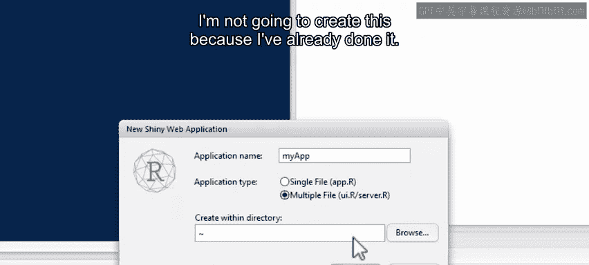

## 理解 `ui.R` 文件

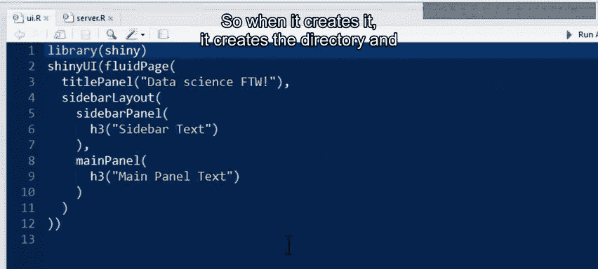

在 `ui.R` 文件中，关键是需要调用 `shinyUI` 函数。你需要加载 `shiny` 库，并且这个 `shinyUI` 函数将控制用户界面。

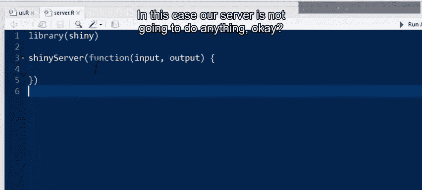

```r
library(shiny)
shinyUI(fluidPage(
  # 界面组件将在这里定义
))
```

---

## 理解 `server.R` 文件

在 `server.R` 文件中，你需要一个名为 `server` 的函数。在这个初始例子中，我们的服务器函数暂时不执行任何操作。

```r
server <- function(input, output) {
  # 服务器逻辑将在这里定义
}
```

---

## 深入分析 `shinyUI` 函数

让我们更详细地看看 `shinyUI` 函数。我们使用 `fluidPage` 来定义要创建的用户界面页面类型。这是一个默认设置，建议你在深入学习之前先使用它。

`titlePanel` 用于设置标题，你会看到它显示在界面上。例如，这里我们设置为 “Data Science FTW”。这只是设置一个GUI元素（标题）。

默认情况下，`fluidPage` 包含一个主面板和一个侧边栏面板。这里我们使用 `sidebarLayout` 来指定布局。

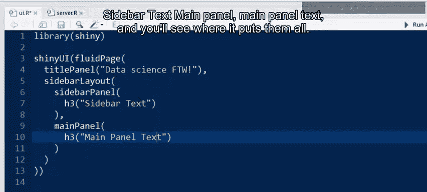

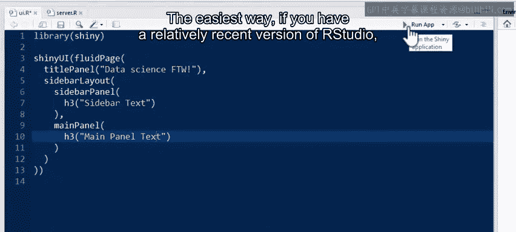

*   `sidebarPanel` 定义了侧边栏中将出现的内容。`h3` 是HTML的三级标题，意味着比 `h2` 小，比 `h1` 更小。这里它显示 “Sidebar Text”。
*   `mainPanel` 定义了右侧的主面板内容。同样使用 `h3` 标题，显示 “Main Panel Text”。

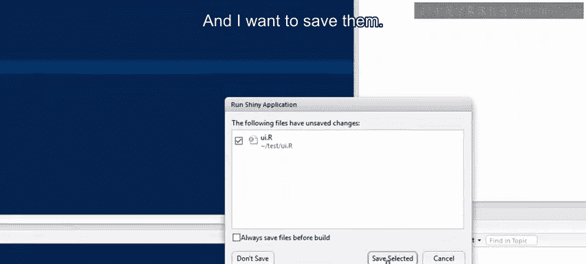

因此，`sidebarLayout` 表示在流体页面中，我们将采用侧边栏布局：左侧用于导航等，右侧是显示主要内容的主面板。

请记住这三个短语：标题面板的 “Data Science FTW”，侧边栏的 “Sidebar Text”，主面板的 “Main Panel Text”。你将看到它们被放置在何处。

---

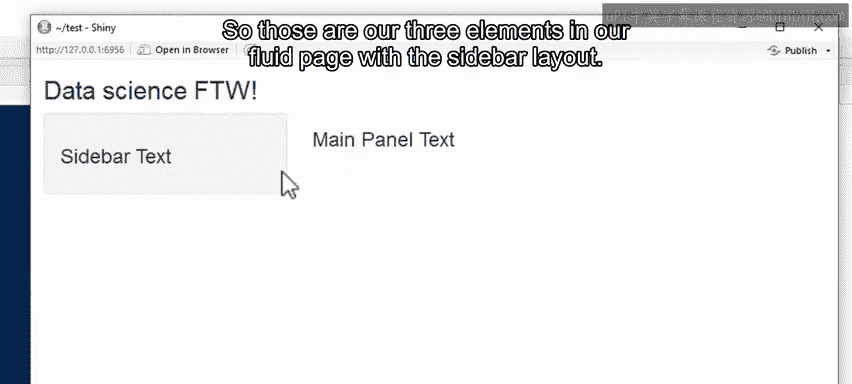

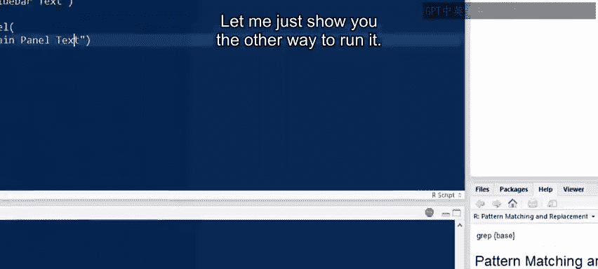

## 运行Shiny应用

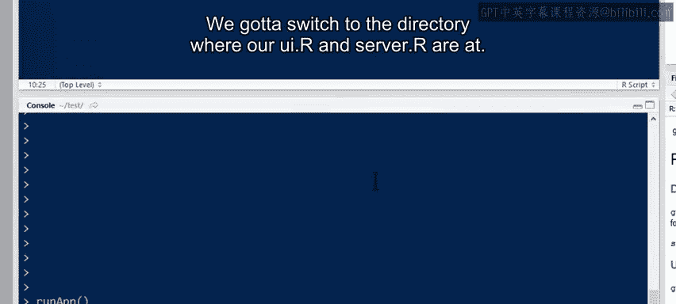

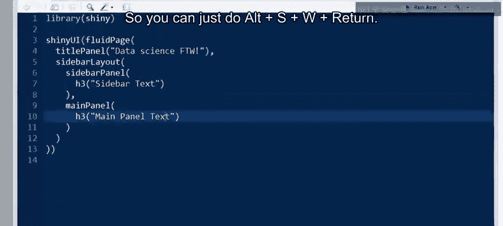

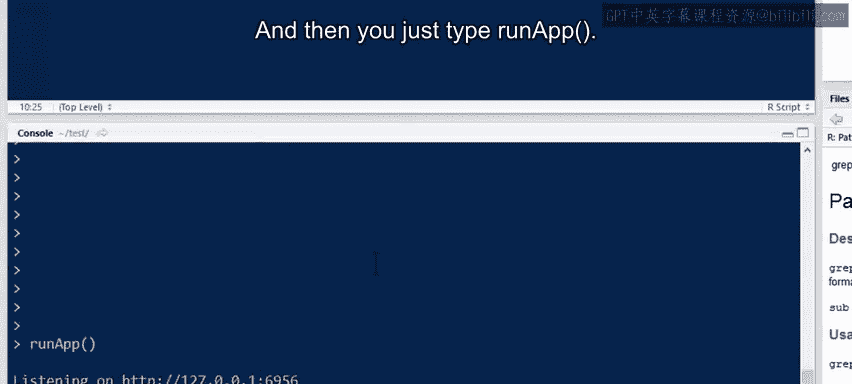

有两种方式可以运行应用。

最简单的方法是，如果你有相对较新版本的RStudio，可以直接点击 **Run App** 按钮。在运行前，请确保保存了文件。

运行后，你将看到应用元素：“Data Science FTW” 显示在标题位置，“Sidebar Text” 在侧边栏，“Main Panel Text” 在主面板。这就是我们在采用侧边栏布局的流体页面中的三个元素。

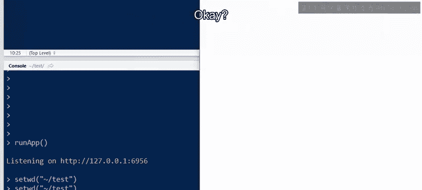

另一种运行方式是，首先切换到包含 `ui.R` 和 `server.R` 文件的目录。你可以使用快捷键 **Alt + S + W + Enter**，或者点击 **Session** -> **Set Working Directory** -> **To Source File Location**。然后，在控制台输入 `runApp()` 并执行。

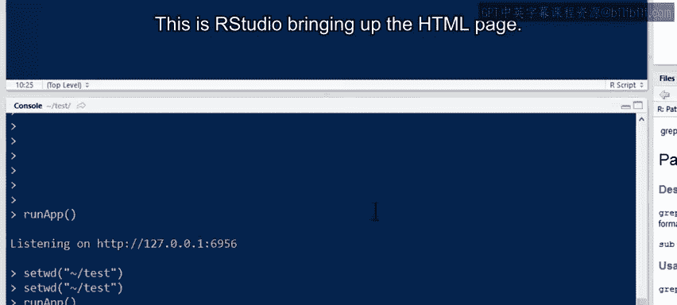

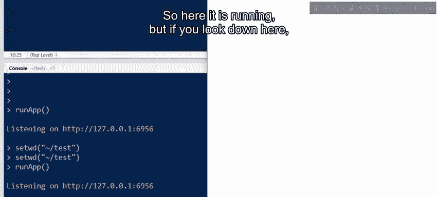

你也可以在 `runApp()` 函数中直接指定应用的路径，这样你甚至不需要切换到该目录。注意，它是在RStudio内部运行的。RStudio启动了一个本地网页来显示HTML页面。

查看运行界面下方，它会显示 “Listening on...” 并给出一个URL。本质上，Shiny在你的电脑上创建了一个小型网络服务器，而RStudio的内置浏览器正在访问这个服务器。当你本地运行和调试时，它就会为你创建这个本地运行的网络服务器。

最终，我们的目标是将应用部署到公共网络服务器上，以便任何人都能访问，而不仅仅是你本地电脑上的用户。不过，向其他R用户交付Shiny应用最简单、最低限度的方式，就是直接提供给他们运行所需的 `ui.R`、`server.R` 文件以及其他函数，他们就可以像你一样运行它。但这并非长远之计，我们最终希望它运行在一个网页上。

---

## 总结

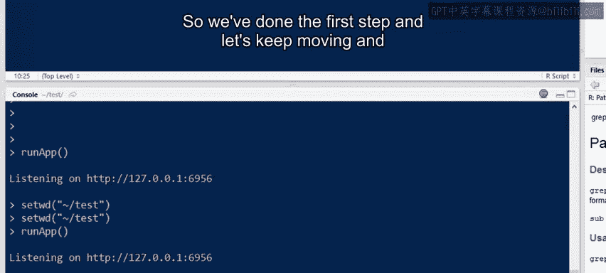

本节课中，我们一起学习了创建第一个Shiny应用的基础步骤。我们了解了如何设置 `ui.R` 和 `server.R` 文件，认识了 `shinyUI` 函数的基本结构，包括 `fluidPage`、`titlePanel` 和 `sidebarLayout` 等核心组件，并掌握了在RStudio中运行应用的两种方法。我们已经完成了第一步，接下来可以继续填充内容，让我们的应用变得更加实用。