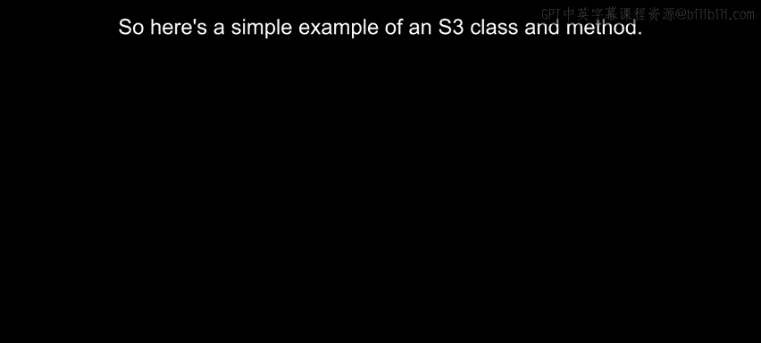
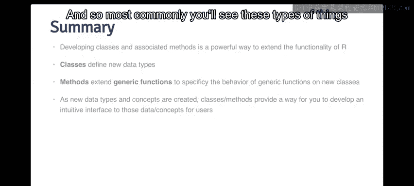

# 课程9：《开发数据产品》｜P42：R类与方法（第二部分）🔧



在本节课中，我们将继续深入学习R语言中的S3和S4类与方法系统。我们将通过具体示例，理解如何创建新类、定义方法，以及如何利用这些机制来扩展R的功能，以处理新的数据类型。

---

## S3类与方法示例

上一节我们介绍了S3类与方法的基本概念，本节中我们来看看具体的代码示例。

以下是一个简单的S3类与方法示例。

```r
# 生成随机正态数据并计算均值
x <- rnorm(100)
mean(x)
```

执行上述代码，均值结果约为-0.0307。虽然计算简单，但背后发生了很多事情。首先，向量`x`的类是`numeric`。当我们调用泛型函数`mean`时，它会搜索是否存在针对`numeric`对象的特定方法。本例中并不存在，因此它会调用`mean`的默认方法，即计算所有元素之和并除以向量长度。

我们可以使用`getS3method`函数查看`mean`的默认方法。

```r
getS3method("mean", "default")
```

查看函数代码，可以看到它包含`trim`、`na.rm`等参数，并检查各种情况（例如是否进行修整均值计算）。最终，为了提高效率，它在最底层调用了内部的C代码来计算均值。

这是一个简单的例子。下面是一个稍复杂的例子。

```r
# 在数据框中生成数据，并对各列应用mean函数
df <- data.frame(a = rnorm(100), b = rnorm(100))
sapply(df, mean)
```

关于数据框，需要知道的一个重要点是：每一列可能属于不同的类。例如，第一列可能是`numeric`，第二列可能是`integer`。当我们对列应用`sapply`并调用`mean`函数时，`mean`会检查每列的类，并寻找合适的方法。对于第一列（`numeric`），它寻找`numeric`方法，未找到则调用默认方法。对于第二列（`integer`），过程相同。因此，如果有一个大型数据框且每列类都不同，`mean`函数会为每列检查是否存在合适的类方法。

在某些情况下，可以直接调用方法。一些S3方法对用户是可见的。例如，可以直接调用`mean.default`函数，而不通过泛型函数。但一般来说，规则是：**永远不要直接调用方法**。应该始终调用泛型函数，让合适的**方法被自动分派**。这样能产生更清晰、更健壮的代码。如果方法名称发生微小变化，你也不必担心底层细节。在S4系统中，这通常不是问题，因为你大多根本无法直接调用方法。

最后再看一个S3类方法的例子：`plot`函数。

```r
# 为数值向量调用plot
x <- rnorm(100)
plot(x)
```

调用`plot`时，它会寻找`numeric`的`plot`方法。由于不存在，它调用了`plot`的默认方法，生成了一个散点图，这符合预期。

然而，下面是一个略有变化的例子。

```r
# 将数据转换为时间序列对象后调用plot
x <- rnorm(100)
x_ts <- as.ts(x)
plot(x_ts)
```

请注意，我调用`plot`的方式与上一张幻灯片完全相同，但现在生成的图却完全不同。它不再是一堆圆点的散点图，而是创建了一个时间序列图，其中线条是连接的。此外，你会注意到x轴上的标签是“Time”，这与`plot`默认函数的x轴标签不同。这里可以看到，存在一个针对`ts`对象（时间序列对象）的特殊绘图方法，正是这个方法被调用了，而不是默认方法。

如果你想为新的类编写新的方法（例如，当你创建一个新类来表示一种新的数据类型时），你通常需要为打印或显示编写方法，可能为`summary`编写方法，也常常需要为`plot`编写方法，因为对于新类型的数据可能没有现成的绘图方法。

因此，扩展R的类与方法系统有几种基本方式：
*   你可以创建一个新类，然后为现有的泛型函数（如`print`或`plot`）编写方法。
*   或者，你可以为你的新类编写新的泛型函数和新的方法。

---

## S4类与方法的创建

在接下来的部分，我们将讨论S4类。一个基本问题是：为什么要创建新类？只用向量、列表、数值、整数、逻辑值等基本数据类型不行吗？

虽然仅靠基本数据类型也能工作，但通常更简单、更紧凑的方式是在更高层次上思考更复杂的数据类型。例如：
*   你可能希望表示新的数据类型，如基因表达数据、时空数据、层次结构数据。
*   你可能希望表示稀疏矩阵。这些都是R中不存在的数据类型，因此你必须创建新类来表示它们。
*   这些通常是尚未被想到的新概念。例如，有线性模型类，但你可以想到点过程模型、混合效应模型等不同类型的类，这些在R中可能尚未实现。
*   此外，你可能希望向用户隐藏某些实现细节。你或许可以使用列表和向量来表示一种新类型的数据，但这样可能会向用户暴露许多你宁愿他们不知道的繁琐细节。

需要强调的是，当我说创建新的数据类型时，并不一定意味着这种数据类型前所未见。我的意思仅仅是它对R来说是未知的，R没有对这些数据类型进行特殊处理。

创建新类使用`setClass`函数。至少，你可以只指定新类的名称。但通常，在指定新类时，会有与此类关联的数据元素，这些称为**槽**。然后，你可以使用`setMethod`函数为此类定义方法。粗略地说，你可以将类视为类似于列表。每个类都有一系列槽，这些槽有点像列表的元素，但每个槽更具体，因为它必须是某个特定类的对象。你不能将任意数据放入类的任何槽中，必须将特定类型的数据放入类的每个槽中。

以下是一个创建多边形类的简单示例。R中没有多边形数据对象，你可以想到多种表示多边形数据的方式。可以将多边形视为一组顶点，以及连接这些顶点的线。这里我创建一个`polygon`类，在表示中创建两个槽：一个叫`x`，包含所有顶点的x坐标；另一个叫`y`，包含所有顶点的y坐标。可以看到，我指定`x`和`y`槽必须是数值。因此，如果我创建一个多边形对象，`x`和`y`槽必须包含数值数据，不能包含字符或整数等。

```r
# 定义多边形类
setClass("polygon",
         representation(x = "numeric",
                        y = "numeric"))
```

创建了`polygon`类之后，接下来可能要做的事情就是为此类创建一个方法，例如绘图方法。当你调用`setMethod`函数时，必须指定一个泛型函数（如`plot`），还必须指定一个称为**签名**的东西。签名基本上是方法将操作的类集合。在本例中，我要为`plot`泛型函数创建一个方法，签名将是我刚刚创建的`polygon`类。

以下是我的`plot`泛型方法。我调用`setMethod`函数，第一个参数是泛型函数的名称，第二个参数是签名（本例中是`"polygon"`）。在这个函数中，它接受`x`和`y`参数（`...`用于其他参数）。`x`参数就是多边形对象，`y`参数是缺失的。在函数内部，我实际上再次调用了`plot`。这里我创建了一个针对多边形对象的方法，然后在方法内部又调用了`plot`，但这次调用的是`plot`的默认方法，因为我只是绘制一些数值向量。这个函数的作用是绘制顶点，设置绘图窗口，然后将顶点首尾相连，最后使用`lines`函数连接这些点，从而绘制出我的小多边形。这就是多边形对象的绘图方法。

请注意，由于`plot`已经作为泛型函数存在，我不需要创建新的泛型函数。另外，注意当我想访问S4类对象中的槽时，我使用`@`符号，这有点像列表，但我用`@`代替了`$`符号。

```r
# 为polygon类定义plot方法
setMethod("plot", "polygon",
          function(x, y, ...){
            plot(x@x, x@y, type = "n", ...)
            xp <- c(x@x, x@x[1])
            yp <- c(x@y, x@y[1])
            lines(xp, yp)
          })
```

调用`setMethod`函数后，如果我调用`showMethods("plot")`，可以看到`polygon`方法已被添加到列表中。除了`polygon`方法，还有`any`方法（即默认方法）。

现在，我使用`new`函数从`polygon`类创建一个简单的多边形对象。我创建X顶点和Y顶点，然后对其调用`plot`。可以看到，它没有调用默认的`plot`方法，而是调用了我刚刚创建的方法，并通过连接点绘制了这个小三角形。

```r
# 创建多边形对象并绘图
p <- new("polygon", x = c(1, 2, 3, 1), y = c(1, 2, 1, 1))
plot(p)
```

---

## 总结

本节课中我们一起学习了如何通过S3和S4系统在R中创建新类和方法。

*   **类**定义了新的数据类型，允许R表示新的数据类型。
*   **方法**扩展了泛型函数，指定了泛型函数在你开发的新类上的行为。
*   随着你开发这些新的数据类型和概念，并使R熟悉它们，类和方法为你提供了一种方式，为用户开发更简单的接口来与新型数据交互。
*   这是一种非常方便的方式，允许用户与新型数据交互，而无需陷入大量的实现细节。
*   向用户提供新类和方法的最流行方式之一是通过R包。最常见的情况是，你会在R包中看到这些内容。



通过掌握类和方法的创建，你可以极大地扩展R的功能，使其能够处理各种专业和自定义的数据类型与分析任务。