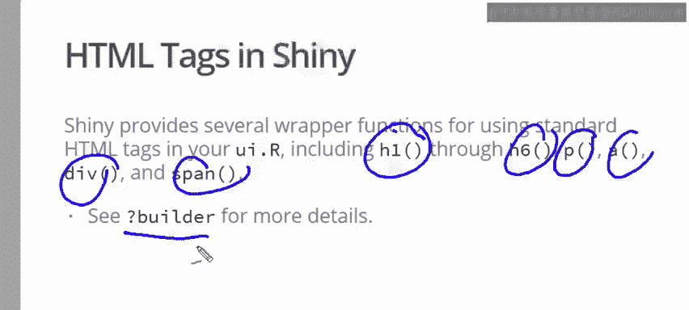
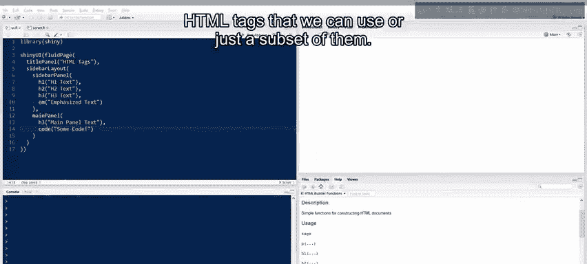
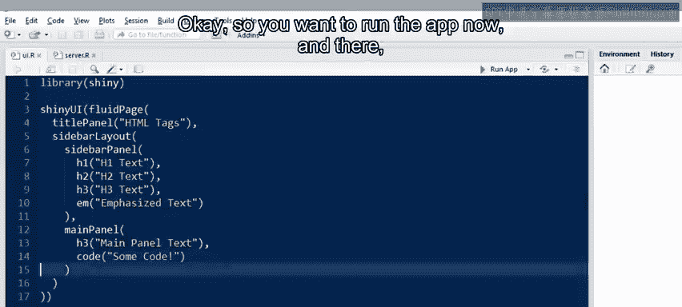
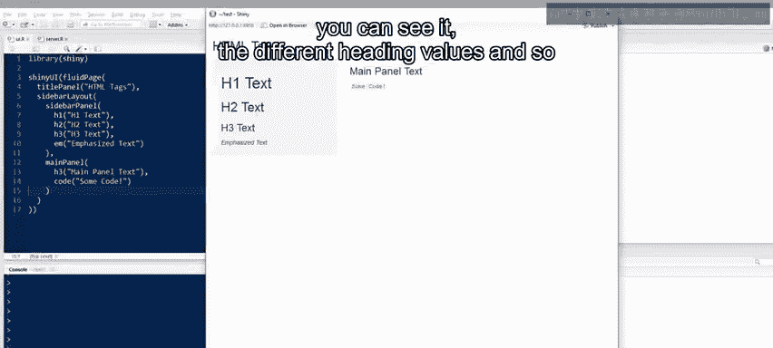
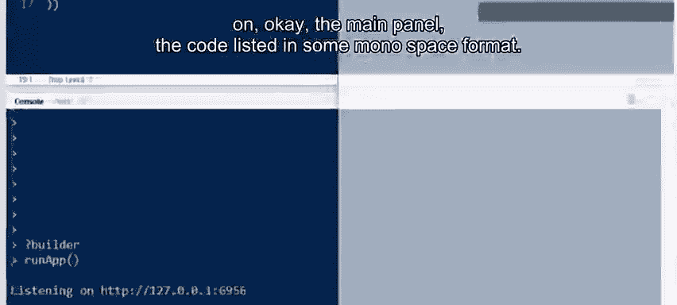
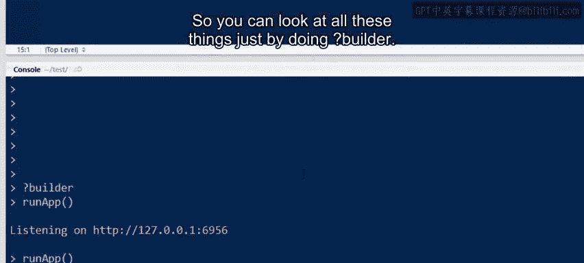
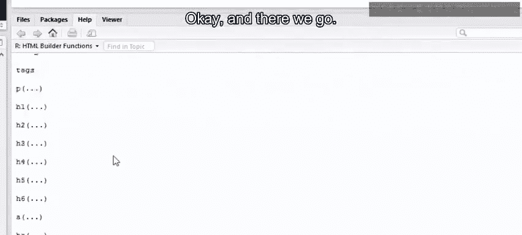
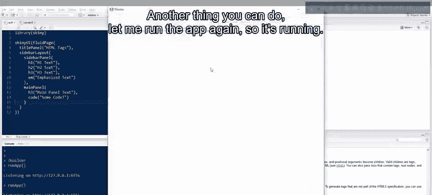
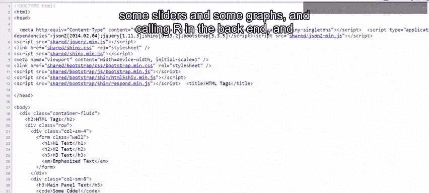

# 课程9：《开发数据产品》｜P4：Shiny基础 - HTML元素使用教程 📝

在本节课中，我们将学习如何在Shiny应用中使用内置的HTML元素函数来构建用户界面。我们将了解如何通过R代码生成标准的HTML标签，并查看这些代码最终如何被渲染成网页。

---

## 使用内置HTML标签函数 🏗️

上一节我们介绍了Shiny应用的基本结构。本节中我们来看看如何使用Shiny内置的函数来创建HTML元素。



在默认的工作流程中，我们使用R函数来插入HTML元素。Shiny提供了几乎所有标准HTML标签对应的函数，例如标题标签（H1到H6）、段落标签、超链接、`div`和`span`等。

以下是可用的部分HTML标签函数列表：
*   `h1()` 到 `h6()`：用于创建各级标题。
*   `p()`：用于创建段落。
*   `a()`：用于创建超链接。
*   `div()` 和 `span()`：用于创建容器和行内元素。



你可以通过在R控制台输入 `?builder` 来查看完整的函数列表。

---



## 代码示例与演示 🖥️

接下来，我们通过一个具体的代码示例来展示不同HTML标签的用法。我们将主要关注格式化相关的标签。







在 `ui.R` 文件中，我们可以在侧边栏布局中放置一些标题和其他元素。

```r
# ui.R 文件中的示例代码
library(shiny)

shinyUI(fluidPage(
  sidebarLayout(
    sidebarPanel(
      h1("一级标题"),
      h2("二级标题"),
      h3("三级标题"),
      em("这里是强调文本"), # 用于强调文本
      br(), # 换行
      code("这里是代码文本") # 用于显示代码，呈等宽字体
    ),
    mainPanel(
      p("这里是主面板的段落文本。")
    )
  )
))
```

运行这个应用后，你可以在网页上看到不同级别的标题。`em()` 函数生成的文本会被强调显示，而 `code()` 函数生成的文本会以等宽字体显示，这非常适合展示代码片段。





---

## 查看生成的HTML源码 🔍

理解Shiny如何将R代码转换为网页是很有帮助的。运行应用后，你可以在浏览器中查看页面源代码。

在浏览器中右键点击页面并选择“查看页面源代码”，你会看到Shiny生成的完整HTML文档。文档的`<head>`部分包含了Shiny运行所需的JavaScript库和样式表（如Twitter Bootstrap），它们负责按钮样式和交互功能。

我们主要关注`<body>`部分，这里可以看到R函数如何被转换成标准的HTML标签。例如，`h1("一级标题")` 会生成 `<h1>一级标题</h1>`。

这个过程非常有用，尤其是当你开始为按钮等元素命名时，可以清楚地看到它们如何映射到HTML的`id`或`class`属性。即使你对HTML不熟悉，通过观察Shiny生成的代码，也能逐渐学会如何编写HTML。

---

## 总结与下一步 🚀

本节课中我们一起学习了在Shiny应用中使用内置函数创建HTML元素的基本方法。我们看到了如何生成标题、段落、强调文本和代码块，并了解了这些R代码在后台是如何被转换成标准HTML的。



建议你尝试使用这些标签，设计一个没有交互性的简单静态页面来熟悉它们。接下来，我们将开始学习如何为Shiny应用添加真正的交互性，例如按钮、滑块和图形，并调用R在后端进行数据处理与可视化。