# 课程9：《开发数据产品》｜P8：Shiny应用中的反应式表达式 🚀

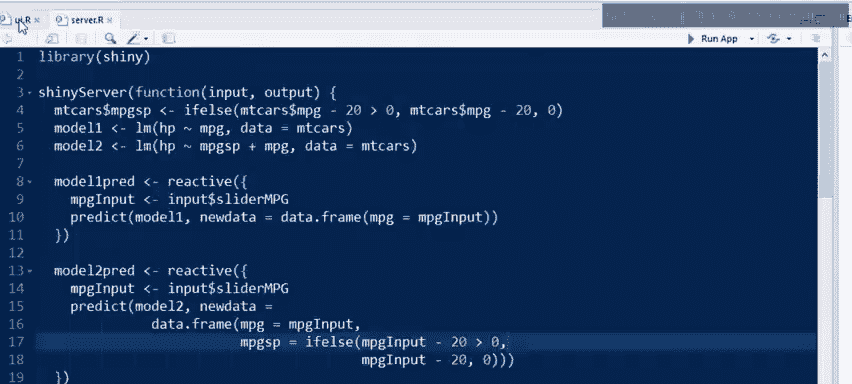

在本节课中，我们将学习如何在Shiny应用中创建和使用**反应式表达式**。反应式表达式是Shiny框架的核心概念之一，它允许我们根据用户输入动态更新应用的内容。我们将通过一个具体的例子，详细讲解如何构建一个包含用户界面和服务器逻辑的完整Shiny应用。

---

## 用户界面构建

上一节我们介绍了Shiny应用的基本结构，本节中我们来看看如何构建一个具体的用户界面。

用户界面负责定义应用的布局和输入输出元素。我们使用`shinyUI`和`fluidPage`函数来创建页面布局。

以下是用户界面的主要组成部分：

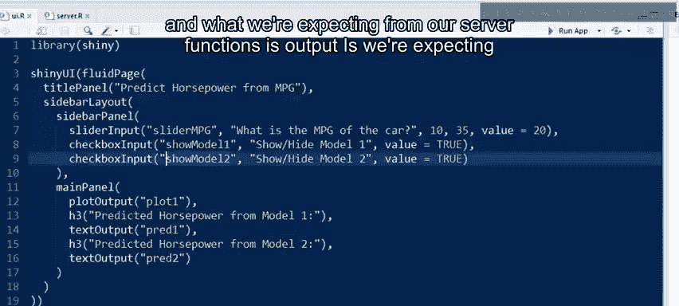

*   **标题面板**：使用`titlePanel`函数设置应用的标题。
*   **侧边栏布局**：使用`sidebarLayout`函数创建包含侧边栏和主面板的布局。
*   **侧边栏面板**：使用`sidebarPanel`函数，内部放置输入控件。
    *   `sliderInput`：创建一个滑块，用于输入汽车的每加仑英里数（MPG），其ID为`sliderMPG`，默认值为20，范围从10到35。
    *   `checkboxInput`：创建两个复选框，ID分别为`showModel1`和`showModel2`，用于控制是否显示对应模型的预测线。
*   **主面板**：使用`mainPanel`函数，内部放置输出元素。
    *   `plotOutput("plot1")`：用于显示名为`plot1`的图形输出。
    *   `textOutput("pre1")` 和 `textOutput("pre2")`：用于显示名为`pre1`和`pre2`的文本输出，即两个模型的预测值。

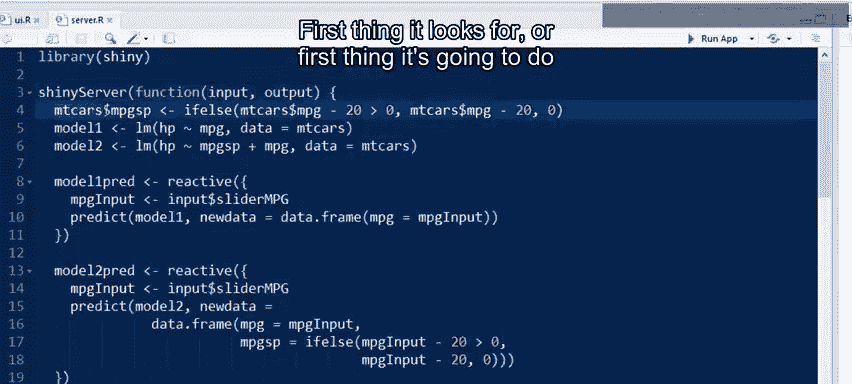

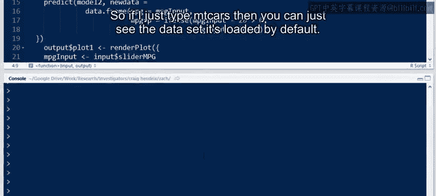

用户界面的作用是将用户的输入（如滑块值和复选框状态）传递给服务器函数，并接收服务器返回的输出（如图形和文本）进行展示。

---

## 服务器逻辑与反应式表达式

现在，让我们深入服务器函数，看看如何处理用户输入并生成动态输出。

服务器函数是应用的核心，它包含所有的计算逻辑。我们首先加载内置的`mtcars`数据集，并基于它构建两个预测模型。

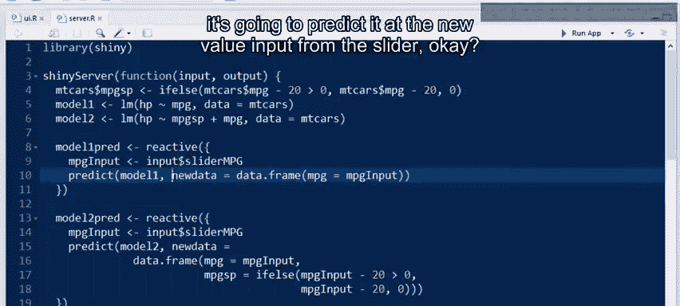

**模型1**是一个简单的线性模型，公式为：
`model1 <- lm(hp ~ mpg, data = mtcars)`

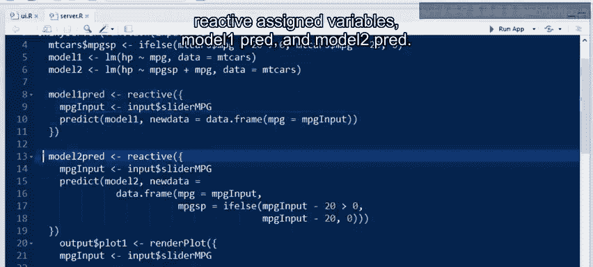

**模型2**是一个包含断点的分段线性模型（在`mpg=20`处），公式为：
`model2 <- lm(hp ~ mpg + I((mpg - 20) * (mpg > 20)), data = mtcars)`
其中，`I((mpg - 20) * (mpg > 20))`创建了一个在20之后斜率发生变化的项。

接下来是关键部分——创建**反应式表达式**。反应式表达式封装了依赖于输入值的计算，只有当相关输入改变时才会重新执行。

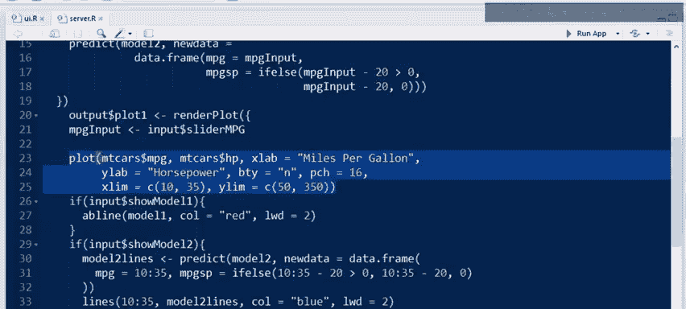

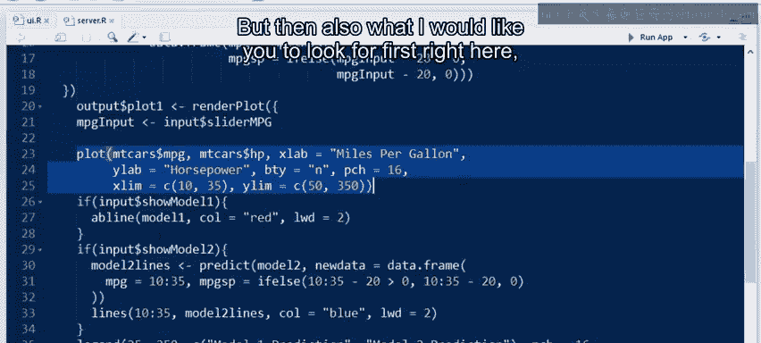

以下是服务器逻辑中的关键步骤：

*   **反应式表达式**：我们使用`reactive({...})`创建了两个表达式：`model1pred`和`model2pred`。它们根据用户从滑块输入的`mpg`值，分别使用`model1`和`model2`进行预测。例如：
    ```r
    model1pred <- reactive({
        mpgInput <- input$sliderMPG
        predict(model1, newdata = data.frame(mpg = mpgInput))
    })
    ```
*   **生成输出**：
    *   `output$plot1`：使用`renderPlot`创建图形。它绘制原始数据点，并根据复选框状态决定是否添加两个模型的拟合线。最重要的是，它使用反应式表达式`model1pred()`和`model2pred()`的值，在图上添加代表当前预测的点。**注意**：调用反应式表达式时，必须像函数一样加上括号`()`。
    *   `output$pre1` 和 `output$pre2`：使用`renderText`创建文本输出，直接显示两个反应式表达式的预测值。

---

## 应用运行与交互演示

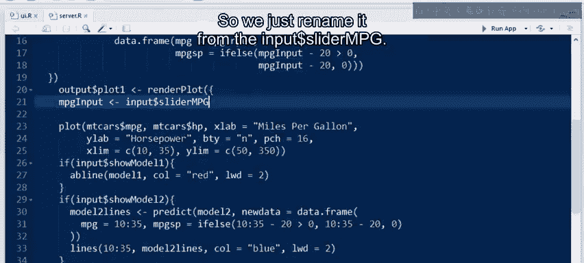

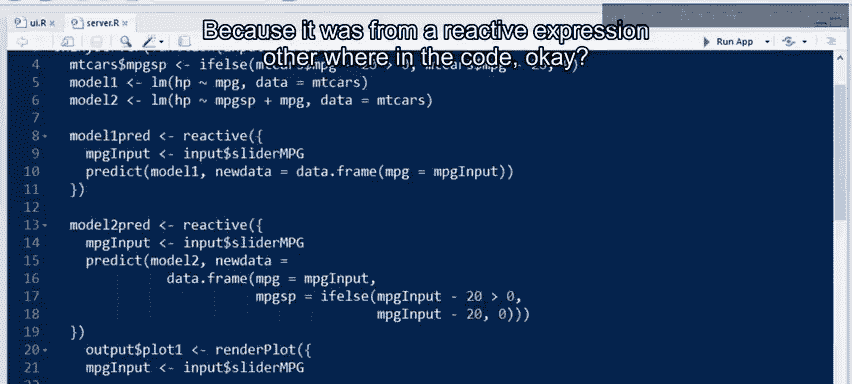

让我们运行这个应用，看看所有部分是如何协同工作的。

当应用启动后，你可以拖动滑块来改变MPG值。图形上的两个预测点（分别对应两个模型）会实时移动。下方的预测文本也会同步更新。你可以通过勾选或取消勾选复选框，来显示或隐藏对应的模型拟合线。

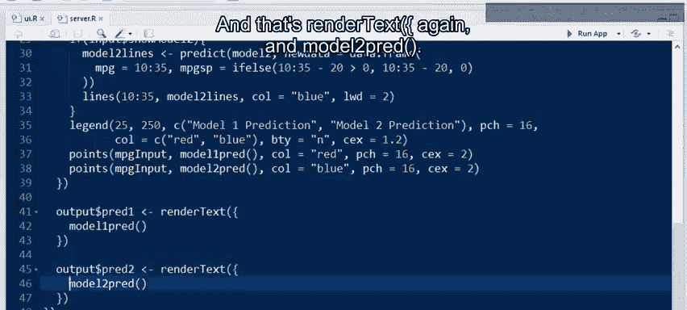

这个例子展示了反应式编程的强大之处：服务器逻辑自动响应前端输入的变化，并高效地更新所有相关的输出，无需重新加载整个页面或编写复杂的回调函数。

---

## 总结与展望

本节课中我们一起学习了Shiny应用中**反应式表达式**的创建和使用。我们构建了一个完整的应用，它包含用户界面（接收滑块和复选框输入）、服务器逻辑（拟合模型、创建反应式表达式、生成图形和文本输出），并实现了输入与输出之间的动态联动。

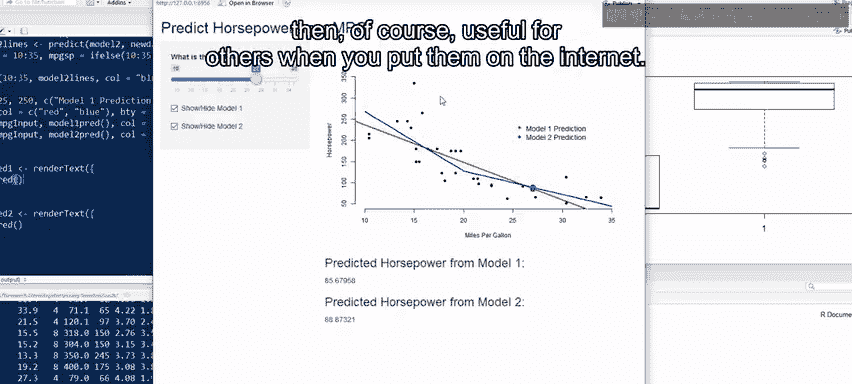

通过这个例子，你应该已经能够利用Shiny创建功能相当复杂的交互式Web应用。掌握反应式表达式是有效使用Shiny的关键。在接下来的课程中，我们将学习如何添加更高级的交互控制，例如根据按钮点击执行条件操作。打好这些基础后，你将能够开发出对自己和他人都有用的Shiny应用，并可以将它们部署到互联网上共享。